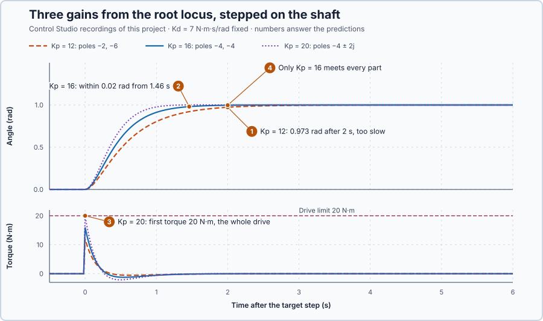

# 51. Root locus

In this lesson, you will see where the shaft's poles go as the proportional gain grows, choose a gain from that picture in Control Studio, and test it against two alternatives on the shaft.

## The problem

Lesson 50 found the characteristic equation of the shaft under PD for one choice of gains, $K_p = 16$ N·m/rad and $K_d = 7$ N·m·s/rad: $(s + 4)^2 = 0$. After a knock, the shaft turned at 0.0953 rad and returned without passing its target, 0.0010 rad away after 2 s. That describes one gain. To choose $K_p$, we need to know how the poles, and so the response, change when $K_p$ changes.

We will follow the poles as $K_p$ grows, choose a gain from that picture in Control Studio, and test it on target steps.

## What we need

We need to:

1. see how the poles move as $K_p$ changes while the shaft and the braking stay fixed;
2. read from that picture which gains respond fast enough without overshoot; and
3. check the chosen gain against the limits the model leaves out.

## The new idea

**A root locus** is a plot of where the closed-loop poles go as one gain increases. From it you choose the gain that gives the speed and the overshoot you want.

**In words.** Lesson 50's characteristic equation gives the poles for one choice of gains. Change one gain, and every pole moves. A root locus follows that movement: it solves the characteristic equation for every value of the gain, from 0 upwards, and draws the path each pole takes. Reading it takes three things:

1. **Each point is a pole at one gain**, not a position of the shaft.
2. **Left and right is speed.** The horizontal coordinate is the pole's real part: the further left, the faster its motion dies away. The slowest pole, the one furthest right, decides how long a response lasts.
3. **Up and down is swinging.** The vertical coordinate is the imaginary part. A pole on the horizontal axis gives a smooth motion; a pair above and below it gives a swing, faster the further from the axis.

It is like turning the gain up slowly during commissioning and watching how the response changes, except that the plot shows every gain at once, calculated, without moving the machine.

For the shaft, the braking stays fixed at $K_d = 7$ N·m·s/rad while $K_p$ varies, and the locus shows which $K_p$ gives a fast response without overshoot.

**The formula.** With $J = 1$ kg·m² and $B = 1$ N·m·s/rad, the shaft and its braking obey $\ddot\theta + 8\,\dot\theta = K_p\,(r - \theta)$. The characteristic equation and its roots are

$$
s^2 + 8\,s + K_p = 0, \qquad s = \frac{-8 \pm \sqrt{64 - 4K_p}}{2} .
$$

Let:

- $K_p$ be the proportional gain, in N·m/rad, the one gain that varies;
- $p_1$ and $p_2$ be the two poles, in 1 per second, $p_1$ the slower when both are real;
- $\sigma \pm j\omega$ be the poles when they are complex, $\sigma$ in 1 per second and $\omega$ in rad/s; and
- $e(t)$ be how far the shaft is still short of its target after a step of 1 rad from rest, in rad.

What the poles say about a 1 rad step depends on where they are:

| Poles | Remaining error $e(t)$ | What it means |
| --- | --- | --- |
| Real, $p_1 \neq p_2$ | $\dfrac{p_2\,e^{p_1 t} - p_1\,e^{p_2 t}}{p_2 - p_1}$ | no overshoot; the slow pole's term lasts longest |
| Equal, $-4$ twice | $(1 + 4t)\,e^{-4t}$, Lesson 50's repeated root | no overshoot |
| Complex, $\sigma \pm j\omega$ | swings | overshoot $e^{\sigma\pi/\omega}$ of the step, Lesson 49 |

The first torque at a step from rest is $K_p$ times the step, because the error is the whole step and the shaft is not yet moving.

**Example: following the poles.** Only $K_p$ varies. Follow the roots as it grows from 0:

1. $K_p = 0$: the roots are 0 and $-8$. The paths start there, at the poles of the shaft and its braking alone.
2. $0 < K_p < 16$: two real poles move toward each other. $K_p = 15$ gives $\sqrt{64 - 60} = 2$ under the root, so $p_1 = -3$ and $p_2 = -5$. After 2 s, the remaining error is $(-5\,e^{-6} + 3\,e^{-10})/(-2) = 2.5\,e^{-6} - 1.5\,e^{-10} = 0.0061$ rad: the slow pole's term is all that is left. Trying times shows that the error falls below 0.02 rad at 1.60 s.
3. $K_p = 16$: the two poles meet at $-4$, the repeated root of the last lesson.
4. $K_p > 16$: they leave the real axis as $-4 \pm j\sqrt{K_p - 16}$. $K_p = 32$ gives $-4 \pm 4j$, and an overshoot of $e^{-4\pi/4} = e^{-\pi} = 0.043$, 4.3 % of the step.

**Reading the picture.** Below 16, one pole is slower than $-4$, so the response lasts longer. At 16 both sit at $-4$: the fastest decay without swinging. Above 16 the real part stays at $-4$, so more gain decays no faster; it only adds a swing of $\sqrt{K_p - 16}$ rad/s, and with it overshoot.

**The limitation.** The locus contains only what its linear model contains. At a 1 rad step the first torque is $K_p \times 1$ rad: $K_p = 32$ would ask for 32 N·m, more than the drive's 20 N·m. The torque would saturate, and the start would no longer follow the locus. The requirement and the candidate gains below are teaching choices.

## Prediction

The requirement for a step from 0 to 1 rad: within ±0.02 rad of the target from 2 s after the step, at most 0.05 rad overshoot, and the torque below the drive's 20 N·m limit. Before running, answer these questions:

1. Will $K_p = 12$ be within ±0.02 rad of the target 2 s after the step?
2. From when will $K_p = 16$ stay within ±0.02 rad?
3. What overshoot and first torque does $K_p = 20$ give?
4. Which gain meets every part of the requirement?

| $K_p$ | Poles | Expected |
| ---: | --- | --- |
| 12 | −2, −6 | slow: 0.027 rad short after 2 s |
| 16 | −4, −4 | within 0.02 rad from 1.46 s, no overshoot |
| 20 | −4 ± 2j | overshoot 0.2 %, first torque 20 N·m |

## Implementation

Open [`src/Main.st`](src/Main.st). The function `BrakedPositionTorque` applies $u = K_p\,(r - \theta) - 7\,\omega$ from the measured angle and velocity, within ±20 N·m, every 20 ms. The program runs two identical shafts: `Kp` drives the candidate and `AlternativeKp` the alternative, preset to 16 and 12. The project experiment steps both targets to 1 rad. The program calculates no roots: Control Studio calculates the root locus from the model $1/(s\,(s + 8))$ declared in `control-loop.json`.

**ST practice.** Calculate `BrakedPositionTorque` by hand at the moment of the step, with the shaft at rest: $K_p \times 1$ rad, so 12, 16 and 20 N·m. Then calculate it with the shaft at 0.5 rad moving at 1 rad/s and $K_p = 16$: $16 \times 0.5 - 7 = 1$ N·m. The braking term takes torque away while the shaft moves toward its target. The tests in [`src/tests.st`](src/tests.st), run from the **Testing** view, check the same law.

## Experiment in Control Studio

1. Open this lesson's project and start **Simulator**. Both shafts rest at 0 rad. In the **truST** side bar, select **Control Studio**.
2. On **Tune**, choose **Root locus** in **Tuning method** and select **Calculate root locus**. The plot shows **Pole paths, Kp 0–20 N·m/rad**, with $K_d = 7$ fixed.
3. Enter 12, 20 and 16 in **Kp (N·m/rad)**, selecting **Calculate root locus** after each, and read the selected poles under **Calculation details**.
4. On **Identify**, choose **Project experiment** from **Method**. **Signals** already shows `P1.Setpoint · Setpoint (rad)`, `P1.Angle · Process value (rad)` and `P1.AppliedTorque · Applied output (N·m)`; add `P1.AlternativeAngle · state (rad)` and `P1.AlternativeTorque · state (N·m)`.
5. Answer the predictions. Select **Review project test**, check the declared **8.1 s** duration, and select **Confirm and start**. After 2 s both targets step to 1 rad.
6. After the run, hover both angles 1 s and 2 s after the step, and both torques at the step. At completion, Control Studio shows **Project test completed. Outputs restored.**
7. Stop the simulator, set `AlternativeKp := 20.0` in `src/Main.st`, start **Simulator** again and repeat steps 4–6.

Select **Abort test** to stop early.

## Evidence and decision

The numbered marks answer the predictions with the same numbers. Control Studio's root locus listed the poles −6 and −2 at $K_p = 12$, −4 twice at 16, and $-4 \pm 2j$ at 20. From the recorded steps:

| $K_p$ | Angle after 2 s | Within ±0.02 rad from | Largest angle | First torque |
| ---: | ---: | ---: | ---: | ---: |
| 12 | 0.9731 rad | 2.16 s | 1.0000 rad | 12 N·m |
| 16 | 0.9969 rad | 1.46 s | 1.0000 rad | 16 N·m |
| 20 | 1.0005 rad | 1.04 s | 1.0013 rad | 20 N·m |

1. At $K_p = 12$ the slow pole $-2$ kept the shaft 0.027 rad short after 2 s: it fails.
2. At $K_p = 16$ the shaft stayed within 0.02 rad from 1.46 s, without overshoot.
3. At $K_p = 20$ it settled fastest and overshot by only 0.0013 rad, but its first torque used the drive's whole 20 N·m: any larger move would hit the limit.
4. Only $K_p = 16$ met every part of the requirement, and we keep it.

Each difference is where the locus put it. The benefit of the picture is that it shows all gains at once; its cost is what it leaves out, here the torque limit, which only the test revealed. These are simulation results.

## Conclusion

A root locus shows how the closed-loop poles move as one gain changes. For the shaft with $K_d = 7$, the poles meet at $K_p = 16$ and then move only vertically: more gain adds swinging, not speed.

The locus chose the candidates; the test decided, including the torque limit the locus does not contain. $K_p = 16$ is kept.

## Check yourself

1. **What are the poles for $K_p = 7$, and which one decides how long a step takes?**
   $s = (-8 \pm \sqrt{36})/2$, so −1 and −7 per second. The slow pole −1 decides: $e^{-t}$ still leaves 14 % after 2 s.
2. **Why does raising $K_p$ above 16 not make the shaft settle faster?**
   Above 16 the poles' real part stays at −4, which sets the decay; the extra gain only raises the imaginary part,
   which adds swinging.
3. **What first torque would $K_p = 25$ ask for at a 1 rad step, and what happens?**
   25 N·m, more than the drive's 20 N·m, so the torque saturates and the linear locus no longer describes the start.

## Reason for the next lesson

The locus showed the poles for the gains we plotted, 0 to 20 N·m/rad. It does not state the exact range of gains that keeps the loop stable, or what happens at the boundary of that range.

[Routh–Hurwitz stability](../44-routh-hurwitz/README.md) finds that range from the coefficients of the characteristic equation alone.
