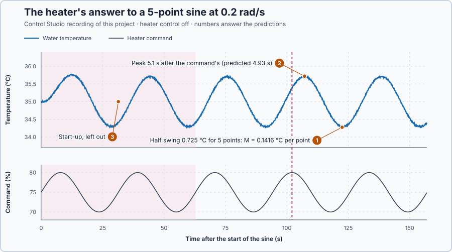

# 54. Frequency response

In this lesson, you will calculate how much the heater shrinks and delays a sine command at each speed, measure it in Control Studio, and read both on a Bode plot.

## The problem

Lesson 53 drove the heater with a 5-point sine at three speeds. The water swung 0.91 °C at 0.1 rad/s, 0.72 °C at 0.2 rad/s and only 0.46 °C at 0.4 rad/s, and its peaks came about 5.6, 4.8 and 3.9 s after the command's. The traces say "smaller and later", but not by how much, in numbers we can predict from the heater's model.

We will derive the size and the lag of the heater's answer at each speed from its transfer function, measure both at 0.2 rad/s in Control Studio, and compare.

## What we need

We need to:

1. put a number on how much smaller and how much later the answer is at each speed;
2. predict both numbers from the heater's model; and
3. measure them on settled cycles to check the prediction.

## The new idea

**The frequency response** tells, for each speed of a sine wave, how much smaller the output wave is, the **amplitude ratio**, and how far it lags behind, the **phase**.

**In words.** Lesson 53 found that once the start-up has died away, the heater answers a sine with a sine of the same speed. For a linear process this is always so, and then only two things can differ between the input wave and the output wave:

1. **The size.** The amplitude ratio is the output's swing divided by the input's swing. Below 1 means the wave comes out smaller.
2. **The timing.** The phase is how far the output's peaks come after the input's, measured as a part of the cycle: a whole cycle is 360°, so a lag of a quarter cycle is −90°.

Each speed has its own pair of numbers. Together, over all speeds, they are the frequency response: a fingerprint of the process that says how it treats slow and fast changes. It is the same kind of curve as on the datasheet of an analog input filter or a drive's speed filter: for each frequency, how much gets through and how late.

For the heater, the amplitude ratio is the temperature swing per percentage point of command swing, and the phase is how far each temperature peak comes after the command's peak. Its two parts act differently: the stored heat makes the wave smaller and later, while the 1 s delivery delay only makes it later.

**The formula.** A sine can be written with Euler's identity as part of $e^{j\omega t}$. The derivative of $e^{j\omega t}$ is $j\omega\,e^{j\omega t}$, so for a sine every derivative becomes a multiplication by $j\omega$, and a delay of $t_d$ seconds a multiplication by $e^{-j\omega t_d}$. That is the transfer function with $s = j\omega$: the output wave is the input wave multiplied by the complex number $G(j\omega)$.

> **Math you need: the magnitude and angle of a complex number.** A complex number $a + jb$ can be drawn as an arrow from 0 to the point $(a, b)$. Its length is the **magnitude** $\sqrt{a^2 + b^2}$, and its direction is the **angle** $\arctan(b/a)$ when $a > 0$. When complex numbers are multiplied, their magnitudes multiply and their angles add; when they are divided, magnitudes divide and angles subtract. Example: $1 + j$ has magnitude $\sqrt{2} = 1.414$ and angle 45°.

Multiplying by a complex number scales a wave by its magnitude and shifts it by its angle. So, for an input $d\,\sin(\omega t)$, the settled output is $M d\,\sin(\omega t + \phi)$, with

$$
M = |G(j\omega)|, \qquad \phi = \angle G(j\omega) .
$$

Let:

- $\omega$ be the angular frequency, in rad/s;
- $M$ be the amplitude ratio, in output units per input unit, here °C per percentage point;
- $\phi$ be the phase, in radians or degrees, negative for a lag; and
- $-\phi/\omega$ be the lag in seconds, with $\phi$ in radians.

For the heater, $5\dot x + x = 0.2\,v(t - 1)$ gives

$$
G(j\omega) = \frac{0.2\,e^{-j\omega}}{1 + 5j\omega} .
$$

The magnitude of $e^{-j\omega}$ is 1 and its angle is $-\omega$ radians, so

$$
M = \frac{0.2}{\sqrt{1 + 25\,\omega^2}}, \qquad \phi = -\omega - \arctan(5\omega) .
$$

A **Bode plot** shows $M$ and $\phi$ against frequency on a logarithmic frequency axis, often with $M$ in decibels, $20\log_{10} M$: the heater's steady gain 0.2 is −13.98 dB, and each factor of 10 is 20 dB.

**Example: the heater at 0.8 rad/s.** Follow the two parts, then combine them:

1. **The stored heat.** $1 + 5j\omega = 1 + 4j$, with magnitude $\sqrt{1 + 16} = 4.123$ and angle $\arctan 4 = 75.96°$. Dividing by it shrinks the wave 4.123 times and delays it by 75.96°.
2. **The delay.** $e^{-0.8j}$ has magnitude 1 and angle $-0.8$ rad, −45.84°: no change in size, 45.84° more lag.
3. **Combined.** $M = 0.2/4.123 = 0.0485$ °C per point and $\phi = -75.96° - 45.84° = -121.80°$, or −2.126 rad. A 5-point command swings the water by $5 \times 0.0485 = 0.243$ °C, and each temperature peak comes $2.126/0.8 = 2.66$ s after the command's.
4. **On the Bode plot,** $20\log_{10} 0.0485 = -26.28$ dB, 12.3 dB below the steady gain.

Follow what each part does as the speed rises:

1. The stored heat shrinks the answer and adds a lag that never exceeds 90°: $\arctan(5\omega)$ approaches 90° but never reaches it.
2. The delay keeps the size but adds $\omega$ radians of lag, which keep growing with the speed.
3. Well above $1/5$ rad/s, $M \approx 0.2/(5\omega)$: at 0.8 rad/s, $0.2/4 = 0.050$, close to the exact 0.0485. Ten times the speed gives a tenth of the swing.
4. Very slowly, $M$ approaches 0.2, the steady gain: Lesson 53's largest possible swing.

**Measuring it.** Control Studio compares the recorded temperature with the recorded command at the chosen speed, over settled cycles only, split into segments. It reports the **coherence**, between 0 and 1: 1 means that in every segment the temperature moved with the command by the same amplitude ratio and lag. Noise or another input lowers it, and a low coherence makes the measurement untrustworthy.

**The limitation.** A frequency response describes a linear process near its operating point, and each measured speed needs settled cycles: at 0.2 rad/s, five periods take $5 \times 31.4 = 157$ s. The 0.8 rad/s example above is calculated, not measured.

## Prediction

Before running, answer these questions:

1. How large will the temperature's half swing be at 0.2 rad/s, and what amplitude ratio does that measure?
2. How far will each temperature peak lag the command's peak?
3. Why must the measurement leave out the first cycles?
4. What are $M$ and $\phi$ at 0.1 and 0.4 rad/s?

| $\omega$ | $M$ | $\phi$ | Swing for 5 points |
| ---: | ---: | ---: | ---: |
| 0.1 rad/s | 0.1789 °C/point | −32.29° | 0.894 °C |
| 0.2 rad/s | 0.1414 °C/point | −56.46° | 0.707 °C |
| 0.4 rad/s | 0.0894 °C/point | −86.35° | 0.447 °C |

## Implementation

Open [`src/Main.st`](src/Main.st). The program drives the heater, with its 1 s delay and ±0.02 °C noise, with a 5-point sine at 0.2 rad/s for five periods, then 75 %. `HeaterAmplitudeRatio` and `HeaterPhaseRad` calculate $M$ and $\phi$. For Control Studio's Bode plot, [`heater-model.json`](heater-model.json) states the same model: $0.2/(5s + 1)$ with a 1 s delay.

**ST practice.** Calculate `HeaterAmplitudeRatio` and `HeaterPhaseRad` by hand at 0.4 rad/s: $0.2/\sqrt{1 + 4} = 0.0894$ and $-0.4 - \arctan 2 = -1.507$ rad, −86.35°. The tests in [`src/tests.st`](src/tests.st), run from the **Testing** view, check $M$ and $\phi$ at three speeds, the 4.93 s lag and the −16.99 dB.

## Experiment in Control Studio

1. Open this lesson's project and start **Simulator**. The heater rests at 35 °C. In the **truST** side bar, select **Control Studio**.
2. On **Identify**, choose **Project experiment** from **Method**. **Signals** already shows `P1.TemperatureC · Process value (°C)` and `P1.HeaterCommandPct · Applied output (%)`.
3. Answer the predictions. Select **Review project test**, check the declared **159.2 s** duration and select **Confirm and start**. After 2 s the sine starts.
4. On **Tune**, choose **Measured frequency response** in **Tuning method**. Enter 0.2 in **Frequencies (rad/s, comma separated)**, 3 **Segments**, 0.8 **Minimum coherence**, and **Discard startup samples** 648: the 2 s rest and two periods, 20 + 628 samples of 0.1 s. Select **Calculate measured frequency response** and expand **Calculation details**.
5. On **Identify**, choose **Supplied plant model** in **Method**, select **Open model…** and open `heater-model.json`. On **Tune**, choose **Frequency response**, enter 0.0125 and 3.2 rad/s and 17 **Frequency points**, select **Calculate frequency response** and expand **Calculation details**.

Select **Abort test** to stop the recording early. To repeat, stop and restart **Simulator**.

## Evidence and decision

The numbered marks answer predictions 1–3. Control Studio at 0.2 rad/s, on cycles 3–5 of the recording:

| | Model | Measured |
| --- | ---: | ---: |
| $M$ | 0.1414 °C/point | 0.1416 °C/point |
| $\phi$ | −56.46° | −57.07° |
| Coherence | | 1 |

1. The temperature swung 0.725 °C each way in cycles 3–5; Control Studio measured $M = 0.1416$ °C per point, 0.2 % above the model. The noise adds to the extremes, so the half swing is a little larger than $5M$.
2. The fourth cycle's temperature peak came 5.1 s after the command's peak, against 4.93 s; the measured phase was 0.6° later than the model's.
3. The first cycles carry the start-up, which dies away as $e^{-t/5}$; leaving out 648 samples keeps only settled cycles.
4. Control Studio's frequency response gave 0.1789 at −32.29° for 0.1 rad/s and 0.0894 at −86.35° for 0.4 rad/s, as calculated; Lesson 53's half swings, 0.912 and 0.458 °C, match $5M$ = 0.894 and 0.447 °C plus the noise.

The extra 0.6° comes from holding each command for its 0.1 s update: half an update, 0.05 s, is 0.01 rad, or 0.57°, at 0.2 rad/s. On the Bode table the magnitude stays near 0.2 below 0.05 rad/s and falls about tenfold per tenfold speed above 0.2 rad/s, while the phase keeps falling, to −269.8° at 3.2 rad/s, because the delay adds lag at every speed. These are simulation results.

## Conclusion

For a sine command, a linear process answers with a sine of the same speed, scaled by $M = |G(j\omega)|$ and shifted by $\phi = \angle G(j\omega)$. A stored quantity shrinks and delays the answer more as the speed rises; a delay adds lag without changing the size.

For the heater, the model predicted the measured amplitude ratio within 0.2 % and the phase within 0.6°, and the 0.6° is the update hold.

## Check yourself

1. **What are $M$ and the 5-point swing at 1 rad/s?**
   $M = 0.2/\sqrt{26} = 0.0392$ °C per point, so a swing of 0.196 °C.
2. **Why does the delay change the phase but not the amplitude ratio?**
   $e^{-j\omega}$ has magnitude 1 at every speed; it only turns the angle by $\omega$ radians.
3. **What does a coherence of 1 tell you about the measurement?**
   In every segment the temperature followed the command with the same ratio and lag, so no other input or noise
   spoiled the measurement at that speed.

## Reason for the next lesson

This describes the heater with its control off, driven by a known command. With feedback connected, a heat loss and a noisy sensor reading enter the loop at different points, and the plant's frequency response alone does not show how the loop treats each of them.

[Sensitivity functions](../48-sensitivity-functions/README.md) derives those paths for the same heater under PI control.
