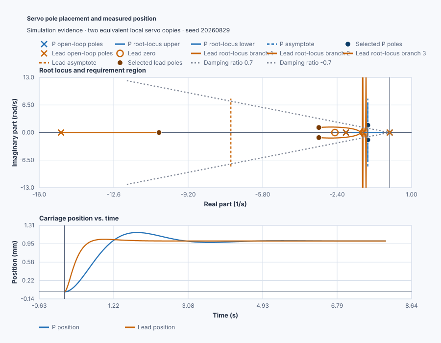

# Reshape a positioning-servo root locus

Course position: Lesson 46 of 84. Previous lesson:
[crane Routh-Hurwitz stability](../45-crane-routh-stability/README.md).
Next lesson: [flexible-drive Bode analysis](../47-flexible-drive-bode/README.md).

**Lesson objective:** Prove why proportional gain alone fails and design and
validate one lead compensator from explicit pole requirements.

**Evidence class:** Simulation evidence, not physical-plant evidence.

## The problem

The equipment is a belt-driven industrial positioning carriage. The
carriage-position setpoint and measured position use millimetres. Requested and
applied motor-current commands use percent of the drive rating and may act in
either direction.

Two independent simulated copies share the same motor and carriage model,
zero initial position, one-millimetre move, 10-millisecond control interval,
current limits, and seed. One uses proportional control; the other uses the
lead compensator designed here.

Lesson 45 used Routh-Hurwitz to establish a stable gain interval. It did not
show how individual poles move, which poles dominate the response, or whether
a stable gain is fast and well damped enough.

This servo permits no more than 5-percent overshoot, requires 2-percent settling
within 2.0 seconds, requires zero final position error, and permits no current
saturation. We need to see why proportional gain cannot satisfy those
requirements together before changing controller structure.

## What we need

We need more freedom than proportional gain alone provides to place the carriage's dominant response while keeping other modes acceptable. Desired pole location, added dynamics, and executable response must agree.

## The new idea

An open-loop pole is a natural mode before feedback. An open-loop zero is a
frequency where the transfer-function numerator becomes zero. A root-locus
branch is the path followed by one closed-loop pole while one positive scalar
gain changes.

Branches start at open-loop poles and finish at open-loop zeros or at infinity.
A real-axis segment is part of the locus on the real number line. A breakaway
point is where branches leave that line.

An asymptote is a branch going to infinity: when open-loop poles outnumber
zeros, one asymptote exists per excess pole. Their centroid, where they
cross the real axis, is the pole sum minus the zero sum, divided by the
count; their angles are evenly spaced, starting at 180 degrees divided by
the count.

The angle condition decides whether a point lies on the locus: the angles
from every open-loop pole to that point, minus the angles from every
open-loop zero to it, must sum to plus-or-minus 180 degrees or an odd
multiple. The magnitude condition then gives the positive gain that places a
closed-loop pole exactly there.

Natural frequency describes the undamped speed of a pole pair. Damping ratio
describes its decay relative to that frequency. A constant-damping line marks
all complex poles with one damping ratio. Dominant poles are the slow poles
that shape most of the visible response; a non-dominant pole decays sufficiently
faster to have less influence.

A lead compensator adds a zero and a farther-left pole. It adds positive phase
and reshapes the locus toward faster, better-damped poles. A lag compensator
primarily improves low-frequency accuracy and is not the design used here.

## Prediction

Start with the local carriage equation

$\ddot{x}(t)+2\dot{x}(t)=u(t)$

Here $x$ is carriage position in millimetres, $\dot{x}$ is speed, and $u$ is
the motor-current command after the model's unit scaling. The acceleration term
represents inertia. The $2\dot{x}$ term represents viscous friction: it opposes
motion in proportion to speed. With zero initial conditions, the Laplace
transform gives

$s^2X(s)+2sX(s)=U(s)$

so position divided by current is

$G(s) = \frac{1}{s(s+2)}$

The factors in the denominator give open-loop poles at 0 and -2. The pole at
zero is the integration from speed to position; the pole at -2 is the damped
speed mode. There is no numerator factor, so there is no finite open-loop
zero. The coefficient 2 is a configured teaching value for viscous friction;
on a physical carriage an engineer would estimate it from a guarded
coast-down test and validate it on an unused move.

For proportional feedback, $1+KG(s)=0$. Multiplying by $s(s+2)$ gives

$s^{2}+2s+K=0.$

This equation is useful because its roots are the closed-loop poles. On the
real axis the gain required at a candidate pole $s$ is

$K=-s(s+2).$

The gain is positive only between -2 and 0, so that interval is the real-axis
locus. A breakaway occurs where changing $s$ no longer changes $K$ to first
order: differentiating gives $dK/ds=-2s-2$, so setting it to zero gives
$s=-1$; the locus breaks away at -1. Two branches go to infinity with no
finite zeros, so by the asymptote rule their count is two, their centroid is
the mean of the two poles, $(0-2)/2=-1$, and their angles start at 180
degrees divided by 2: 90 degrees and -90 degrees, leaving -1 vertically.

The quadratic formula gives $s=-1\pm\sqrt{1-K}$. For $K > 1$ this becomes
$s=-1\pm j\sqrt{K-1}$. Increasing gain raises the imaginary part, which means
faster oscillation, but the decay rate remains fixed at real part -1: since
settling time depends only on that real part, proportional gain alone cannot
improve on roughly 4 seconds of decay time at any $K$. At $K=4$, the poles
are $-1\pm j1.732$. Their natural frequency is their distance from the
origin, $\omega_n=\sqrt{1^2+1.732^2}=2$ rad/s, and their damping ratio is
$\zeta=1/2=0.5$.

Percent overshoot ($M_p$) is the peak response above the final commanded
value, as a percentage of the commanded change. The 2-percent settling time
($T_{2\%}$, chosen not to collide with the sample interval $T_s$) is the
earliest time the response stays within plus or minus 2 percent of that
final value. The standard second-order estimates are

$M_p=100e^{-\pi\zeta/\sqrt{1-\zeta^2}}=16.3\%$

and

$T_{2\%}\approx4/(\zeta\omega_n)=4\text{ s}.$

At $K = 4$ this predicts 16.3-percent overshoot and a 4-second settling
time: both miss the servo requirements.

### Derive the lead design

The required region needs a more negative real part than -1: 5-percent
overshoot needs damping ratio at least 0.69, and 2-second settling needs
$\zeta\omega_n$ of at least 2 rad/s. The standard lead recipe places a zero
close to the slow region for positive phase there, and a pole several times
farther left so it stays non-dominant: a lead zero at -2.5, a farther-left
pole at -15, and gain 50:

$C(s)=50\frac{s+2.5}{s+15}$

The compensated loop is $C(s)G(s)$. Closed-loop poles satisfy
$1+C(s)G(s)=0$. Multiplying by all three denominator factors gives

$s(s+2)(s+15)+50(s+2.5)=0.$

Expanding the first product gives $s^3+17s^2+30s$; expanding the controller
term gives $50s+125$. Adding like powers produces

$s^{3}+17s^{2}+80s+125=0$

Numerically factoring this polynomial gives poles
$-3.235\pm j1.186$ and $-10.530$. The real pole is more than three times faster
than the complex pair, so the pair is dominant. Its natural frequency is
$\sqrt{3.235^2+1.186^2}=3.446$ rad/s and its damping ratio is
$3.235/3.446=0.939$.

The angle and magnitude conditions confirm this choice. At
$s_0=-3.235+j1.186$, the poles at 0, -2, -15 contribute angles near 159.9,
136.2, 5.8 degrees; the zero at -2.5 contributes near 121.8 degrees. Poles
minus zero, $159.9+136.2+5.8-121.8\approx180$ degrees, satisfies the angle
condition. The same four distances, $|s_0|\approx3.446$,
$|s_0+2|\approx1.712$, $|s_0+15|\approx11.825$, $|s_0+2.5|\approx1.395$, give
the gain:

$K=\frac{|s_0|\,|s_0+2|\,|s_0+15|}{|s_0+2.5|}=\frac{3.446\times1.712\times11.825}{1.395}\approx50$

That damping ratio does not by itself determine overshoot because the complete
closed-loop transfer function still contains the controller zero:

$T(s)=\frac{50(s+2.5)}{s^3+17s^2+80s+125}.$

Evaluating this complete response predicts about 3.2 percent overshoot and
1.36-second settling. Its DC gain is $T(0)=125/125=1$, so a constant
one-millimetre command has zero steady-state error. At the instant of the step,
the filter state is still zero and the error is 1 mm, so the implemented law
requests $50\times1=50$ percent current. Those are concrete predictions to
check in the run, not values to copy from the retained results.

## Implementation

The actual Structured Text exposes both laws. The proportional path is gain
times position error. The lead path realizes the declared pole-zero state:

```st
ProportionalRequested := ProportionalGain
    * (ProportionalSetpoint - ProportionalPosition);

LeadError := LeadSetpoint - LeadPosition;
LeadRequested := LeadGain
    * (LeadError + (LeadZero - LeadPole) * LeadFilterState);
LeadFilterState := LeadFilterState
    + CycleTime * (-LeadPole * LeadFilterState + LeadError);
```

Requested current is retained before the identical -100-to-100-percent clamp;
applied current is the command reaching each simulated plant. The program does
not contain pole locations, overshoot, settling time, or an accepted winner.

## Experiment in Control Studio

The project owns the one-millimetre move, both control laws, the eight-second
observation window, and restoration to zero. Control Studio is allowed to
write only the Boolean authority `P1.ExperimentEnabled`; it must not inject a
second setpoint step. The extra 0.1 seconds in the Test timeout lets the
project finish its declared eight-second window before Control Studio judges
the terminal state. The deterministic Simulation seed is 20260829.

### Control Studio actions

1. **Monitor** — Start the **Simulator**, then open **truST sidebar → Control Studio → Monitor → Response**.
   - **Baseline check:** Wait until the header shows **Simulation**, **Running**, and current data. Confirm Proportional carriage setpoint (SP, mm) and Lead carriage setpoint (SP, mm); Proportional carriage position (PV, mm) and Lead carriage position (PV, mm); Proportional applied motor current (MV, %) and Lead applied motor current (MV, %), including units, limits, mode, and quality. The initial operating point is Proportional carriage setpoint = 0 mm, Lead carriage setpoint = 0 mm, Proportional applied motor current = 0 %, Lead applied motor current = 0 %, Proportional carriage position = 0 mm, Lead carriage position = 0 mm. The unresolved baseline problem is: After root-locus breakaway, proportional gain changes frequency and damping but cannot move the pole-pair real part left of minus one.
   - **Decision before action:** Read **Prediction** above, then state what should move first and in which direction. Use this decision rule: Accept only when complete-transfer-function poles and executable response meet overshoot, settling, final-error, and current constraints.
   - **Successful evidence:** The Response plot advances and the displayed values are finite and current. Select **Start recording** only after those conditions are visible.
   - **Recovery:** If recording is disabled or the plot reports unavailable or stale samples, stop the Simulator, correct the displayed runtime or binding problem, restart it, and repeat the baseline check.
   - **Record:** Write down the initial SP, PV, requested/applied MV where available, controller mode, and your predicted response before opening Test.

2. **Test** — Restart the **Simulator** from the declared initial state, then open **truST sidebar → Control Studio → Test**.
   - **Baseline check:** Confirm **Experiment** = **Observe without excitation**, **Amplitude** = **0** (disabled), and **Maximum duration (s)** = **8.1**. The reviewed authority is **Experiment authority** (`P1.ExperimentEnabled`). The observed lesson signal is **Lead carriage setpoint**. It does not inject a second process event.
   - **Decision before action:** Before selecting **Review test**, predict the response to Lead carriage setpoint. Confirm the live values are current and the reviewed plan stays inside Proportional applied motor current -100 % to 100 %; Lead applied motor current -100 % to 100 %; Proportional carriage position -5 mm to 5 mm; Lead carriage position -5 mm to 5 mm.
   - **Successful evidence:** Select **Review test**, verify the affected signal, bounds, stop conditions, and restoration, then select **Confirm and start**. The state changes to **Running**, **Abort test** remains available, and the terminal state reports completion and restoration.
   - **Recovery:** For a rejected, stale, unsafe, unavailable, failed, or aborted state, read the displayed reason, stop and restart the Simulator, correct that cause, restore the initial state, and review a new test.
   - **Record:** Compare the observed event with your prediction and retain the terminal state, restoration result, and deterministic seed **20260829**. The native lesson test, not a disabled Tune or Validate screen, owns the two complete-response calculations and their requirement verdicts.

## Evidence and decision

Change only controller structure and its derived parameters. Hold plant,
initial state, setpoint event, sample schedule, duration, limits, and seed
equal. Percent overshoot is peak position above setpoint divided by
commanded position change, times 100. The 2-percent settling time is the
first time after which position remains within plus/minus 2 percent of
setpoint; report `Not settled` if that condition never holds. Final-window
absolute error is calculated only for a settled response, over the declared
final window of 7.01-8.00 s. Applied-current travel is the sum of absolute
changes between successive applied-current samples, in percentage points.
Also retained: peak current, time at limit, pole identities, damping, and
stop reason.

The independent numerical oracle and executable run give:

| Design | Overshoot | 2% settling | Final-window error | Saturated |
|---|---:|---:|---:|---|
| Proportional, K = 4 | 16.70% | 4.06 s | 0.0006 mm | No |
| Lead, 50(s+2.5)/(s+15) | 3.35% | 1.38 s | < 0.0001 mm | No |

The proportional case fails overshoot and settling. The lead case meets both,
reaches the final-error tolerance, and remains unsaturated. The calculated
roots and complete response, not only a dominant-pole approximation, agree
with the retained run.

The first panel shows where each controller places the closed-loop poles;
the second shows what those pole locations mean for the real positioning
requirement.



[Complete trace](figures/servo-root-locus-evidence-trace.csv) ·
[Decision summary](figures/servo-root-locus-evidence-summary.csv)

## Conclusion

Gain alone moves the uncompensated pair vertically after breakaway, leaving
real part -1: it trades damping for oscillation frequency but cannot decay
faster. The added zero and farther-left pole change the angle condition,
moving the dominant branches into the required region; the third pole, much
farther left, decays faster still. The closed-loop zero explains why
overshoot is not given by dominant-pair damping ratio alone.

## Reason for the next lesson

You can now use root locus to understand pole motion, test whether gain alone
can meet requirements, and design a compensator whose complete response is
verified. Root locus still does not expose resonance, noise amplification, or
gain and phase margins across frequency. Lesson 47 introduces Bode analysis on
a flexible drive where one step response can hide resonance.
