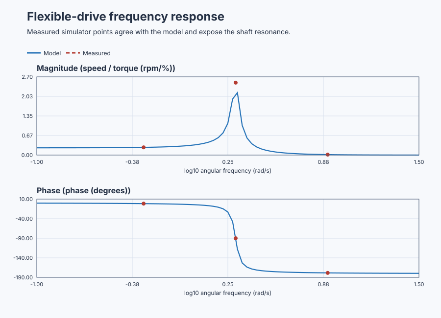
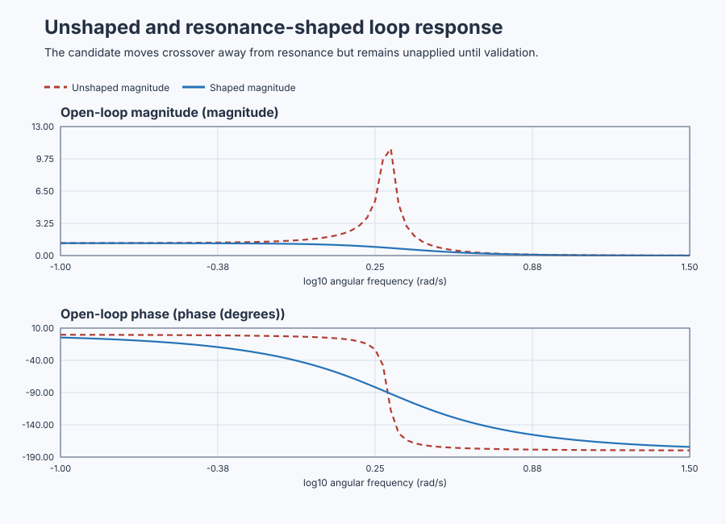

# Measure flexible-drive resonance with Bode analysis

Course position: Lesson 47 of 84. Previous lesson: [Reshape a positioning-servo root locus](../46-servo-root-locus/README.md).
Next lesson: [Count delayed-oven stability with Nyquist](../48-delayed-thermal-nyquist/README.md).

**Lesson objective:** Measure the flexible-drive frequency response, expose resonance, and compare qualified unshaped and resonance-shaped margins.

**Evidence class:** Simulation evidence from the shipped lesson project, not evidence from the physical plant.

## The problem

The equipment is a flexible-shaft motor and load: an industrial motor connected to
its load through a flexible shaft. The motor-torque actuator is bidirectional. Requested and applied torque
are percentages of rated torque. An encoder measures load-side shaft speed in
revolutions per minute.

Three independent simulated drives have the same shaft, operating speed of
1000 revolutions per minute, initial state, limits, 10-millisecond sample
interval, and deterministic seed. Each receives the same 1-percent torque
amplitude at a different frequency. This is Simulation evidence, not physical-
plant evidence.

Lesson 46 used root locus to show how closed-loop poles move and to improve one
positioning transient. A single transient does not directly show which input
frequencies the plant amplifies, how much timing lag accumulates, or how close
an entire feedback loop comes to instability. A lightly damped shaft can store
damaging torsional energy near one frequency even when a coarse step plot looks
acceptable.

We therefore measure response over frequency before applying another
controller.

## What we need

We need to measure how the flexible shaft responds across frequency, locate its resonance, and judge stability margins before shaping the loop. Any added shaping must reduce the resonant risk without hiding poor excitation or violating time-domain requirements.

## The new idea

A sinusoidal steady state is the repeating response after the starting
transient has decayed. Angular frequency ($\omega$) states how quickly the sine
wave progresses and is measured in radians per second. One cycle equals two pi
radians.

Input amplitude is half the peak-to-peak applied-torque sine wave. Output
amplitude is half the peak-to-peak load-speed sine wave after its operating
speed has been removed. Magnitude is output amplitude divided by input
amplitude, here in revolutions per minute per percent torque. Phase is the
output's timing relative to the input, in degrees. Negative phase means that
load speed lags motor torque.

A logarithmic frequency axis gives equal space to equal frequency ratios. A
decade is a ten-to-one frequency interval. A decibel expresses an amplitude
ratio logarithmically. After magnitude has been defined, its decibel value is

$M_{\mathrm{dB}}=20\log_{10}(M)$

The factor 20 appears because power is proportional to amplitude squared:
$10\log_{10}(M^2)=20\log_{10}(M)$. A ratio of 1 is therefore 0 dB, a ratio of
10 is 20 dB, and a ratio of 0.1 is -20 dB.

A Bode magnitude plot shows magnitude against logarithmic frequency. A Bode
phase plot shows phase against the same frequency. Resonance is a frequency
region where stored energy makes the response much larger. Resonant frequency
is the frequency of that peak. Bandwidth is the frequency range over which the
closed loop can respond usefully.

The open-loop transfer is the plant and controller response multiplied before
feedback is closed. A gain crossover is a frequency where open-loop magnitude
equals one, or zero decibels. Phase margin is the additional phase lag required
at a gain crossover to reach minus 180 degrees. A phase crossover is a
frequency where phase reaches minus 180 degrees. Gain margin is the gain change
required there to reach magnitude one. Delay margin converts a positive phase
margin into the additional pure delay that would consume it.

Every crossover matters. When several exist, the least favourable valid margin
governs; a convenient crossing must not hide another one. If the required
crossing does not exist, its margin is reported as `Unavailable` or `Unbounded`
according to the calculation. Coherence is a zero-to-one data-quality measure
of how much output at a frequency is consistently related to the measured
input. Poor coherence makes an estimated response ineligible for margin work.

The requested motor torque ($u_{\mathrm{requested}}$) is the command calculated by the
experiment. The applied motor torque ($u$) is the limited command received by the
plant. The load-speed deviation ($y$) is measured speed minus the 1000-rpm
operating speed. The continuous frequency variable ($s$) describes the model's
dynamic response.

Shaft stiffness restores displacement, inertia resists acceleration, and
viscous damping removes stored motion. After the physical coefficients are
scaled into the lesson's local units, the load-speed deviation obeys

$\ddot{y}+0.2\dot{y}+4y=u.$

Taking the zero-initial-condition Laplace transform gives

$G(s)=\frac{y(s)}{u(s)}=\frac{1}{s^{2}+0.2s+4}$

Setting $s=0$ gives the static gain $1/4=0.25$ rpm/%. Comparing the denominator
with $s^2+2\zeta\omega_n s+\omega_n^2$ gives $\omega_n=2$ rad/s and
$\zeta=0.2/(2\times2)=0.05$. The small damping ratio explains why resonance is
expected.

For a sinusoidal prediction, substitute $s=j\omega$. Because
$(j\omega)^2=-\omega^2$, the denominator is
$(4-\omega^2)+j0.2\omega$. Its length gives the inverse magnitude and its angle
becomes a negative output phase:

$\lvert G(j\omega) \rvert =\frac{1}{\sqrt{\left(4-\omega^{2}\right)^{2}+\left(0.2\omega\right)^{2}}}$

$\phi(\omega)=-\operatorname{atan2}\left(0.2\omega,4-\omega^{2}\right)$

These equations are valid for the local linear model around 1000 rpm. They do
not include backlash, extra shaft modes, drive-current dynamics, protection,
temperature, or installation flexibility.

## Prediction

Before running, calculate three responses:

| Probe frequency | Predicted magnitude | Predicted phase |
|---:|---:|---:|
| 0.5 rad/s | $1/\sqrt{3.75^2+0.1^2}=0.267$ rpm/% | $-\operatorname{atan2}(0.1,3.75)=-1.5^\circ$ |
| 2 rad/s | $1/\sqrt{0^2+0.4^2}=2.500$ rpm/% | $-\operatorname{atan2}(0.4,0)=-90.0^\circ$ |
| 8 rad/s | $1/\sqrt{(-60)^2+1.6^2}=0.0167$ rpm/% | $-\operatorname{atan2}(1.6,-60)=-178.5^\circ$ |

At 2 rad/s, the stiffness term and inertia term cancel in the real part of the
denominator. Only the small damping term remains, so the flexible mode amplifies
the 1-percent torque probe to approximately 2.5 rpm.

The baseline controller gain is 5, so $L(s)=5G(s)$. Gain crossover means
$|L(j\omega)|=1$. Squaring that condition gives
$(4-\omega^2)^2+(0.2\omega)^2=25$. Letting $x=\omega^2$ produces
$x^2-7.96x-9=0$. Its positive root is $x=8.964$, so
$\omega=2.99$ rad/s. The loop phase there is
$-\operatorname{atan2}(0.598,-4.964)=-173.1^\circ$. Phase margin is the distance
to $-180^\circ$, hence $180-173.1=6.9^\circ$. This is very little allowance for
extra lag or model error.

The resonance-shaped candidate is

$C_{\mathrm{shape}}(s) =5\frac{s^{2}+0.2s+4}{s^{2}+3.2s+4}$

For the nominal model, its numerator cancels the nominal plant denominator, so
the open loop reduces algebraically to

$L_{\mathrm{shape}}(s)=\frac{5}{s^{2}+3.2s+4}$

Its crossover equation is
$(4-\omega^2)^2+(3.2\omega)^2=25$. With $x=\omega^2$, this becomes
$x^2+2.24x-9=0$. The positive root is $x=2.082$, hence
$\omega=1.44$ rad/s. The phase is
$-\operatorname{atan2}(4.62,1.92)=-67.4^\circ$, giving
$180-67.4=112.6^\circ$ phase margin. This nominal result is much better, but
the cancellation is exact only if the shaft model is exact. The candidate
therefore remains unapplied until the native test perturbs damping and natural
frequency.

## Implementation

This is an open-loop measurement, not hidden feedback control. The actual
Structured Text advances one clock and creates three equal-amplitude probes:

```st
ExperimentElapsed := ExperimentElapsed + CycleTime;
LowRequested := ProbeAmplitude * SIN(LowFrequency * ExperimentElapsed);
ResonantRequested := ProbeAmplitude * SIN(ResonantFrequency * ExperimentElapsed);
HighRequested := ProbeAmplitude * SIN(HighFrequency * ExperimentElapsed);

LowApplied := MAX(MIN(LowRequested, LREAL#100.0), LREAL#-100.0);
```

The same clamp is applied independently to all three requests. Requested and
applied torque are retained separately. Structured Text contains no fitted
magnitude, phase, margin, ranking, or accepted answer; Control Studio derives
those results from retained samples and the qualified model.

## Experiment in Control Studio

The runnable project owns all three one-percent sine probes, their frequencies,
the 120-second data window, and restoration to zero torque. Control Studio may
write only the Boolean authority `P1.ExperimentEnabled`; it must not add a
fourth excitation. The Test timeout is 120.1 seconds so the project can finish
its complete window first. The deterministic Simulation seed is 20260829.

### Control Studio actions

1. **Monitor** — Start the **Simulator**, then open **truST sidebar → Control Studio → Monitor → Response**.
   - **Baseline check:** Wait until the header shows **Simulation**, **Running**, and current data. Confirm Low-frequency load speed (PV, rpm) and Resonant load speed (PV, rpm); Low applied motor torque (MV, %) and Resonant applied motor torque (MV, %), including units, limits, mode, and quality. The initial operating point is Low applied motor torque = 0 %, Resonant applied motor torque = 0 %, High applied motor torque = 0 %, Low-frequency load speed = 1000 rpm, Resonant load speed = 1000 rpm, High-frequency load speed = 1000 rpm. The unresolved baseline problem is: The unshaped loop has a large resonant peak and approximately 6.9 degrees phase margin.
   - **Decision before action:** Read **Prediction** above, then state what should move first and in which direction. Use this decision rule: Accept for further simulation only when measured response, all crossings, margins, and perturbed-model checks meet the declared criteria.
   - **Successful evidence:** The Response plot advances and the displayed values are finite and current. Select **Start recording** only after those conditions are visible.
   - **Recovery:** If recording is disabled or the plot reports unavailable or stale samples, stop the Simulator, correct the displayed runtime or binding problem, restart it, and repeat the baseline check.
   - **Record:** Write down the initial SP, PV, requested/applied MV where available, controller mode, and your predicted response before opening Test.

2. **Test** — Restart the **Simulator** from the declared initial state, then open **truST sidebar → Control Studio → Test**.
   - **Baseline check:** Confirm **Experiment** = **Observe without excitation**, **Amplitude** = **0** (disabled), and **Maximum duration (s)** = **120.1**. The reviewed authority is **Experiment authority** (`P1.ExperimentEnabled`). The observed lesson signal is **Low applied motor torque**. It does not inject a second process event.
   - **Decision before action:** Before selecting **Review test**, predict the response to Low applied motor torque. Confirm the live values are current and the reviewed plan stays inside Low applied motor torque -100 % to 100 %; Resonant applied motor torque -100 % to 100 %; High applied motor torque -100 % to 100 %; Low-frequency load speed 990 rpm to 1010 rpm; Resonant load speed 990 rpm to 1010 rpm; High-frequency load speed 990 rpm to 1010 rpm.
   - **Successful evidence:** Select **Review test**, verify the affected signal, bounds, stop conditions, and restoration, then select **Confirm and start**. The state changes to **Running**, **Abort test** remains available, and the terminal state reports completion and restoration.
   - **Recovery:** For a rejected, stale, unsafe, unavailable, failed, or aborted state, read the displayed reason, stop and restart the Simulator, correct that cause, restore the initial state, and review a new test.
   - **Record:** Compare each measured magnitude and phase with your hand calculation and retain the terminal state, restoration result, and deterministic seed **20260829**. The native lesson test owns fitting windows, coherence, every crossover, perturbed-model checks, and final eligibility; a disabled Identify, Tune, or Validate screen is not evidence.

## Evidence and decision

Every comparison below changes one thing only, so a difference is attributable.

Change only probe frequency. Hold plant coefficients, operating point,
amplitude, initial state, sample schedule, duration, limits, and seed equal.

For each run, fit the sinusoidal fundamental on the declared steady-state
window. Divide fitted output amplitude by fitted input amplitude for magnitude.
Subtract fitted input phase from fitted output phase for phase lag. Retain the
window, sample interval, amplitudes, phase, coherence, and quality decision.

The simulator records each applied command at the end of the interval over
which that command was held. Before comparing measured phase with the
continuous-time equation, reference the held command to the interval midpoint.
For the 10-millisecond interval, this removes one-half sample of known timestamp
alignment; it does not remove unknown plant delay. Retain both the raw sampled
phase and the corrected continuous-time comparison phase.

For each candidate, retain every gain crossover, the least favourable valid
phase margin, phase crossover, gain margin or explicit unavailable state, delay
margin, resonance peak and frequency, bandwidth, model revision, and evidence
class. Never select a favourable crossover while hiding another one.

A result counts only when it passes the checks declared before the run.

The executable simulation shall reproduce the three predicted magnitudes
within 3 percent and phases within 2 degrees. The independent analytical oracle
shall find the unshaped crossover near 2.99 rad/s with about 6.9 degrees phase
margin and the shaped crossover near 1.44 rad/s with about 112.6 degrees phase
margin.

Reducing damping must worsen the unshaped margin. Moving the natural frequency
must expose the error in exact nominal cancellation. Reject a candidate whose
perturbed model violates the declared margin or resonance requirement. Similar
final speed or a visually smooth short trace cannot override the frequency-
domain evidence.

### Retained evidence

The measured simulator points are shown against the independently calculated
model curve. Agreement supports using the model for design; the resonance peak
shows why a short step response was not enough.



[Complete trace](figures/flexible-drive-bode-evidence-trace.csv) ·
[Decision summary](figures/flexible-drive-bode-evidence-summary.csv)



[Complete controller Bode trace](figures/flexible-drive-controller-bode-evidence-trace.csv)

## Conclusion

Below resonance, stiffness dominates and load speed follows torque with little
lag. At 2 rad/s, stiffness and inertia nearly cancel, leaving weak damping and a
large response with 90-degree lag. Above resonance, inertia dominates and phase
approaches minus 180 degrees.

The shaped denominator adds damping around the flexible mode. Its nominal
margin improvement is large, but cancellation is only as accurate as the model.
Windowing, unresolved transients, sampling, noise, and model error must explain
differences between calculated and measured curves; results must never be
adjusted silently.

## Reason for the next lesson

You can now design a bounded sine experiment, estimate magnitude and phase,
recognize resonance, and interpret qualified Bode margins on another flexible
plant. Bode crossings still do not count unstable poles or unambiguously show
encirclement of minus one. Lesson 48 introduces Nyquist analysis for a delayed
thermal process where that distinction matters.
