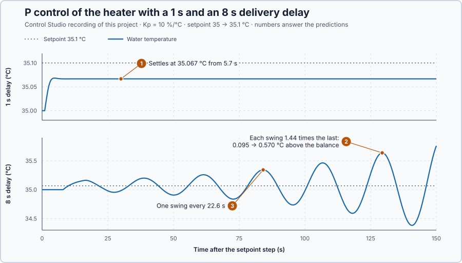

# 57. Nyquist stability

In this lesson, you will count how a delayed heater loop's complete frequency curve goes around the point −1, predict from that count whether the loop is stable, and check the prediction on a 1 s and an 8 s delivery delay. This lesson is an introduction to the Nyquist test, for plants that are stable on their own.

## The problem

Lesson 56 chose a 3 s lead for the heater's PI: the load stayed above 33.87 °C, the noise moved the command by only 0.46 %, and at the crossover, 0.219 rad/s, the loop's phase stayed 87.1° away from −180°. That number checks one frequency. The heater's delay keeps adding lag at every frequency, so the loop could come close to −1 somewhere else, and a delay makes the characteristic equation contain $e^{-s t_d}$: it is no longer a polynomial, and the Routh–Hurwitz test does not apply.

We will use the simplest delayed loop, P control with $K_p = 10$ %/°C, on two heaters whose commands arrive 1 s and 8 s late. We will count how each loop's frequency curve goes around −1 and check the count on the heaters.

## What we need

We need to:

1. decide stability from the loop's frequency response, delay included;
2. use the whole frequency curve, not one point on it; and
3. know how many closed-loop poles are unstable when the test fails.

## The new idea

**The Nyquist test** draws the loop's frequency response as a curve and counts how it goes around the point −1. That count tells whether the closed loop is stable, delay included.

**In words.** Lesson 56 judged the loop by the phase left at one speed, the crossover. A delay keeps adding lag at every speed, so somewhere else a signal could come back around the loop both large and reversed. The Nyquist test looks at every speed at once:

1. **Draw the loop as one curve.** At each speed the loop transfer function $L(j\omega)$ is a complex number, an arrow: its length says how much larger a sine comes back after one trip around the loop, its angle how much later. As the speed rises from 0, the arrow's tip draws a curve.
2. **Watch the point −1.** −1 is length 1 at angle −180°: a signal that goes once around the loop comes back equally large and reversed. Negative feedback reverses it once more, so it returns in step with itself, and the loop keeps it going on its own. A microphone held in front of its own loudspeaker howls for the same reason.
3. **Count the turns.** For a plant that is stable on its own, the closed loop is unstable if the curve goes around −1, and the number of turns gives the number of unstable closed-loop poles.

For the heater, a long delay brings the correction so late that it arrives in the wrong direction while it is still large: the curve then passes left of −1.

**The formula.** Negative frequencies give the curve's mirror image in the real axis; the curve together with its mirror image is the **Nyquist plot**. Let:

- $P$ be the number of right-half-plane poles of $L$, the loop before feedback;
- $N$ be the number of clockwise turns of the plot around −1; and
- $Z$ be the number of right-half-plane poles of the closed loop.

Then

$$
Z = P + N .
$$

The reason, in short: the closed-loop poles are the zeros of $1 + L$, and as $s$ travels once around the right half-plane, the angle of $1 + L$ turns once clockwise for every zero inside and once counterclockwise for every pole inside. A turn of $1 + L$ around 0 is a turn of $L$ around −1. The delay factor has no zeros or poles and adds no turns. The loop is stable when $Z = 0$ and the curve does not pass through −1.

For the heater under P control with $K_p = 10$ %/°C and a delay $t_d$,

$$
L(s) = \frac{2\,e^{-s t_d}}{5s + 1}, \qquad |L(j\omega)| = \frac{2}{\sqrt{1 + 25\,\omega^2}}, \qquad \angle L = -\arctan(5\omega) - \omega\,t_d ,
$$

where 2 is the loop gain $10 \times 0.2$ and $\omega\,t_d$ is in radians. $L$ has one pole, $-0.2$, so $P = 0$ and the loop is stable exactly when $N = 0$. The curve starts at $L(0) = 2$; as $\omega$ rises it shrinks while the delay keeps adding lag, so it spirals clockwise into the origin. It goes around −1 if it crosses the negative real axis while $|L| > 1$, that is, left of −1.

**Example: two other delays.** Follow the curve for delays of 4 s and 10 s:

1. **Where $|L| = 1$.** $2/\sqrt{1 + 25\omega^2} = 1$ at $\omega = \sqrt{3}/5 = 0.346$ rad/s, whatever the delay. The heater's own lag there is $\arctan\sqrt{3} = 60°$, so the curve passes through −1 when the delay adds the other 120°: $t_d = (2\pi/3)/0.346 = 6.05$ s, the **critical delay**.
2. **$t_d = 4$ s.** The curve crosses the negative real axis where $\arctan(5\omega) + 4\omega = \pi$; trying speeds gives 0.490 rad/s, where $|L| = 2/\sqrt{1 + 25 \times 0.490^2} = 0.756$. The crossing is right of −1, so $N = 0$ and $Z = 0$: stable.
3. **$t_d = 10$ s.** Here $\arctan(5\omega) + 10\omega = \pi$ at 0.229 rad/s, where $|L| = 1.316$: left of −1. The curve and its mirror image each go once clockwise around −1, so $N = 2$ and $Z = 2$.
4. **What $Z = 2$ looks like.** Two unstable closed-loop poles form a complex pair: a growing swing. Solving $5s + 1 + 2\,e^{-10s} = 0$ numerically gives $s = 0.0218 \pm j0.2331$: one swing every $2\pi/0.2331 = 27.0$ s, each $e^{0.0218 \times 27.0} = 1.80$ times the one before. The swing's speed, 0.233 rad/s, is close to the crossing's 0.229 rad/s: a loop near −1 swings at about the speed where its curve crosses the negative real axis.

The 4 s and 10 s delays are calculated examples; the experiment uses 1 s and 8 s.

**The limitation.** Near the critical delay an unstable swing grows slowly, so a short quiet recording proves nothing; the count decides. As an introduction, this lesson uses plants that are stable on their own, $P = 0$; for a plant with unstable poles of its own, the count must include them.

## Prediction

Both heaters rest at 35 °C with 75 %, and their setpoint steps to 35.1 °C. Before running, answer these questions:

1. Where does the 1 s heater settle?
2. What does the 8 s heater do?
3. About how long is one swing of the 8 s heater?
4. What are $N$ and $Z$ for each delay?

| Delay | Crossing of the negative real axis | $N$, $Z$ | Expected |
| --- | --- | --- | --- |
| 1 s | −0.235, right of −1 | 0, 0 | settles |
| 8 s | −1.176 at 0.275 rad/s, left of −1 | 2, 2 | swings, growing; about $2\pi/0.275 = 22.8$ s per swing |

## Implementation

Open [`src/Main.st`](src/Main.st). Two heaters with exact sensors, delays 1 s and 8 s, are each held by `Control.PID` as P control: $u = 75 + 10\,(SP - T)$. When the project experiment starts, both setpoints step to 35.1 °C. A heater that leaves 34–36 °C gets 75 % until the end. The two heater models are stated in [`heater-delay-1s.json`](heater-delay-1s.json) and [`heater-delay-8s.json`](heater-delay-8s.json).

**ST practice.** Find `CrossoverRadS` and `CriticalDelayS`. Calculate both by hand for a loop gain of 2 and a 5 s time constant: $\sqrt{4 - 1}/5 = 0.346$ rad/s and $(2\pi/3)/0.346 = 6.05$ s. With P control alone, the 1 s heater settles where $x = 2 \times 0.1/(1 + 2) = 0.0667$ °C above 35 °C. The tests in [`src/tests.st`](src/tests.st), run from the **Testing** view, check these values.

## Experiment in Control Studio

1. Open this lesson's project and start **Simulator**. Both heaters rest at 35 °C with 75 %. In the **truST** side bar, select **Control Studio**.
2. On **Identify**, choose **Project experiment** from **Method**. **Signals** already shows `P1.SetpointC · Setpoint (°C)`, `P1.ShortDelayC · Process value (°C)` and `P1.ShortDelayPct · Applied output (%)`; add `P1.LongDelayC · state (°C)` and `P1.LongDelayPct · state (%)`.
3. Answer the predictions. Select **Review project test**, check the declared **152.1 s** duration and select **Confirm and start**. After 2 s the setpoints step to 35.1 °C.
4. After the run, hover the maxima of the 8 s heater. At completion, Control Studio shows **Project test completed. Outputs restored.**
5. On **Identify**, choose **Supplied plant model** in **Method**, select **Open model…** and open `heater-delay-1s.json`. On **Tune**, choose **Loop response** in **Tuning method**, enter 0.01 and 40 rad/s and 512 **Frequency points**, select **Calculate feedback analysis** and set **View** to **Nyquist**.
6. Repeat step 5 with `heater-delay-8s.json`.

Select **Abort test** to stop early.

## Evidence and decision

The numbered marks answer predictions 1–3. Control Studio's Nyquist count answers prediction 4:

| Delay | Control Studio |
| --- | --- |
| 1 s | P = 0 open-loop right-half-plane poles. N = 0 clockwise encirclements of −1. Z = P + N = 0 closed-loop right-half-plane poles: the closed loop is stable. |
| 8 s | P = 0 open-loop right-half-plane poles. N = 2 clockwise encirclements of −1. Z = P + N = 2 closed-loop right-half-plane poles: the closed loop is unstable. |

1. The 1 s heater peaked at 35.068 °C and stayed within 0.001 °C of 35.067 °C from 5.7 s: P control's steady error.
2. The 8 s heater swung about 35.067 °C. Its maxima grew from 0.095 °C above that balance at 16.5 s to 0.570 °C at 129.4 s, 1.44 times per swing; the command swung between 67.3 and 82.2 %.
3. One swing lasted 22.6 s.
4. The count gave $N = 0$ and $Z = 0$ for 1 s, $N = 2$ and $Z = 2$ for 8 s.

Solving $5s + 1 + 2\,e^{-8s} = 0$ gives $s = 0.0158 \pm j0.2787$: one swing every $2\pi/0.2787 = 22.5$ s, each $e^{0.0158 \times 22.5} = 1.43$ times the one before, close to the crossing's 22.8 s. The recording grows slightly faster because each command is held for its 0.1 s update, which adds a little delay. The plot's arrows show the direction: clockwise from 2 into the origin, and out again on the mirror image. These are simulation results.

## Conclusion

The Nyquist test counts the turns of the loop's complete frequency curve, with its mirror image, around −1: $Z = P + N$. It works directly on the frequency response, so it handles a delay that no polynomial test can.

For the heater under P control, a 1 s delay leaves the curve right of −1 and the loop stable; an 8 s delay makes it pass left of −1 twice, and the recording swings with growing amplitude. Between them, a delay of 6.05 s puts the curve through −1.

## Check yourself

1. **The loop gain is raised to 3, $K_p = 15$. At which frequency is $|L| = 1$?**
   $\sqrt{9 - 1}/5 = 0.566$ rad/s.
2. **Why does a longer delay make the loop unstable, although it does not change $|L|$?**
   The delay only adds lag, $\omega t_d$. Enough lag turns the curve past −180° while $|L|$ is still above 1, so it
   passes left of −1.
3. **The 8 s heater was quiet for the first 20 s. Why does that not prove it stable?**
   Its unstable swing grows slowly, 1.44 times per 22.6 s, so a short recording looks calm. The count decides.

## Reason for the next lesson

The count decides stability for the model. But the real heater's gain and delay differ from the model's, and a count says nothing about how much difference the loop tolerates before it becomes unstable.

[Robustness margins](../88-robustness-margins/README.md) measures how far the curve stays from −1 and turns each distance into a model error the loop tolerates.
