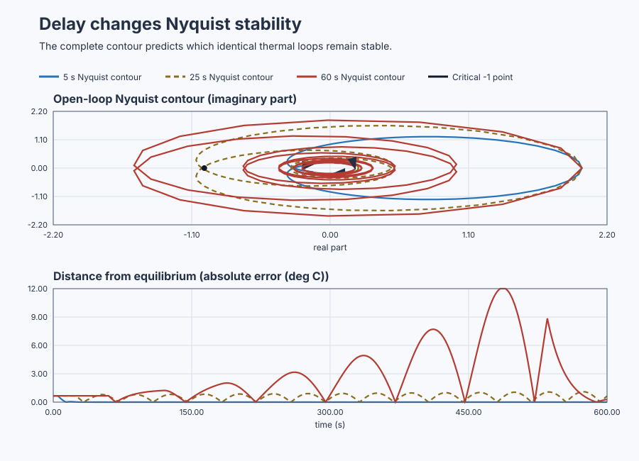

# Count delayed-loop stability with Nyquist

Course position: Lesson 48 of 84. Prerequisite: `control-flexible-drive-bode`.
Next lesson: `control-motor-sensitivity-loop-shaping`.

**Equipment:** Continuous conveyor curing oven.

**One clear objective:** use complete Nyquist contours to predict and verify
stable and unstable delayed conveyor-oven loops.

## The problem

The equipment in this lesson is Continuous conveyor curing oven.

This lesson controls product temperature in a continuous conveyor oven. The
heater changes the temperature of material travelling toward a downstream
infrared sensor. Heater command is measured in percent of installed power, and
product temperature is measured in degrees Celsius.

Three independent simulated ovens use the same 100-degree-Celsius operating
point, 50-percent holding command, thermal response, proportional controller,
one-degree-Celsius setpoint change, 100-millisecond sample interval, limits,
and deterministic seed. Only the travel delay changes: 5 seconds, 25 seconds,
or 60 seconds.

This is Simulation evidence, not physical-plant evidence. A real oven requires
independent review of product safety, heater protection, conveyor speed,
sensor position, limits, interlocks, aborts, and restoration.

Lesson 47 measured magnitude and phase and found stability margins at gain
crossovers. A display that wraps phase between minus 180 and plus 180 degrees
does not retain complete turns caused by long transport delay.

For the 60-second oven, phase at crossover wraps to about plus 2.28 degrees.
Adding 180 degrees to that displayed number appears to give 182.28 degrees of
margin. The physical loop is nevertheless unstable. We need a method that
retains the complete rotation and counts its consequence.

## What we need

We need a stability test that accounts for the conveyor oven's transport delay and the complete frequency contour, including cases that a partial plot can misclassify. Predicted encirclements must agree with stable and unstable executable runs.

## The new idea

A complex number contains a real component and an imaginary component. The
complex plane places the real component on the horizontal real axis and the
imaginary component on the vertical imaginary axis. One complex loop response
is the open-loop magnitude and phase at one frequency represented as one point
on that plane.

The positive-frequency path follows those points as positive frequency rises.
For a real physical model, the negative-frequency path is its complex
conjugate: it mirrors the positive path across the real axis. Together with the
required limiting connections, they form a closed contour. Traversal direction
states which way that contour is followed.

The critical point is minus one on the real axis. An encirclement is one
complete turn of the mapped contour around that point. Counter-clockwise turns
are positive and clockwise turns are negative in this lesson. The winding
number is the signed number of complete turns.

The open-loop right-half-plane pole count is the number of open-loop poles with
positive real component. The closed-loop right-half-plane pole count is the
number of unstable closed-loop poles. A stable closed loop has zero such poles.

The counter-clockwise encirclement count ($N_{\mathrm{ccw}}$) is the contour's signed turn
count around minus one. The open-loop right-half-plane pole count (P) is known
from the open-loop model. The closed-loop right-half-plane pole count ($Z$) is
inferred from those two quantities. With Control Studio's negative-feedback
and traversal convention, the relationship is

$Z=P-N_{\mathrm{ccw}}$

A negative value for the counter-clockwise count means clockwise
encirclements. The relationship is invalid if a pole lies on the contour, the
curve crosses minus one within numerical tolerance, or the frequency sweep
ends before the curve has approached its limiting endpoint.

Pure transport delay postpones the response. It changes phase without changing
magnitude, so increasing frequency keeps rotating the Nyquist curve even while
the thermal lag reduces its size.

The product-temperature deviation ($y$) is measured temperature minus 100
degrees Celsius. The applied heater-command deviation ($u$) is applied heater
command minus 50 percent. The continuous frequency variable ($s$) represents
dynamic response. The thermal time constant ($T$) is the 20-second time required
to complete about 63 percent of a delay-free response. The transport delay ($L$)
is the time before a heater change first reaches the downstream sensor.

The local plant model is

$G(s)=\frac{e^{-Ls}}{Ts+1}$

The proportional gain ($K$) requests two heater percentage points for each degree
Celsius of temperature error, so $K = 2 \%/{}^\circ\mathrm{C}$. The open-loop response is

$L_{\mathrm{loop}}(s)=K G(s)$

The gain-crossover angular frequency ($\omega_{\mathrm{gc}}$) is where open-loop magnitude
equals one. Delay does not change magnitude, so all three cases share

$\omega_{gc}=\frac{\sqrt{K^{2}-1}}{T}=0.08660\,\mathrm{rad/s}$

Unwrapped phase retains every complete rotation. At crossover it is

$\phi_{gc}=-\arctan\left(T\omega_{gc}\right)-L\omega_{gc}$

The product-temperature setpoint ($SP$) is 101 degrees Celsius. The process value
($PV$) is measured product temperature. The predicted equilibrium temperature
($PV_{\mathrm{eq}}$) is the value at which heater request and plant response balance. Stable
proportional control on this self-regulating oven does not imply zero error.
With unit plant gain, equilibrium satisfies

$PV_{\mathrm{eq}}=100\,{}^\circ\mathrm{C}+K\left(SP-PV_{\mathrm{eq}}\right)$

For $SP = 101 {}^\circ\mathrm{C}$ and $K = 2 \%/{}^\circ\mathrm{C}$, predict
$PV_{\mathrm{eq}} = 100.667 {}^\circ\mathrm{C}$. The remaining setpoint error is `0.333 degC`.
Stability is measured by decay toward that equilibrium, not by incorrectly
requiring the proportional loop to reach the setpoint.

## Prediction

Calculate the result before opening a contour:

| Delay | Unwrapped phase | Correct phase margin | $N_{\mathrm{ccw}}$ | P | Z | Prediction |
|---:|---:|---:|---:|---:|---:|---|
| 5 s | -84.81 degrees | 95.19 degrees | 0 | 0 | 0 | Stable |
| 25 s | -184.05 degrees | -4.05 degrees | -2 | 0 | 2 | Unstable |
| 60 s | -357.72 degrees | -177.72 degrees | -2 | 0 | 2 | Unstable |

The 25 s case has count -2, so two closed-loop poles are unstable. The 60 s
phase wraps to +2.28 degrees; the false apparent margin is 182.28 degrees. Its
complete contour still has count -2 and two unstable closed-loop poles.

## Implementation

Each actual Structured Text path is a positional proportional controller. The
50-percent holding command supplies the heat needed at zero error:

```st
ShortDelayRequested := HoldingCommand
    + ProportionalGain * (Setpoint - ShortDelayTemperature);
ShortDelayApplied := MAX(MIN(ShortDelayRequested, LREAL#100.0), LREAL#0.0);
```

The medium- and long-delay paths use the same calculation. Requested and
applied heater command are retained separately. If temperature leaves 90
through 110 degrees Celsius, that case independently aborts to the 50-percent
holding command. Structured Text contains no Nyquist point, encirclement,
right-half-plane pole count, stability label, or phase margin.

## Experiment in Control Studio

This procedure tests one declared lesson change under controlled conditions. Retain and interpret the complete Nyquist contour with one declared counter-clockwise convention. The declared event lasts 600 seconds. It restores Product-temperature setpoint to 100 degC afterward. The deterministic Simulation seed is 20260829.

### Control Studio actions

1. **Monitor** — Start the **Simulator**, then open **truST sidebar → Control Studio → Monitor → Response**.
   - **Baseline check:** Wait until the header shows **Simulation**, **Running**, and current data. Confirm Product-temperature setpoint (SP, degC); Short-delay product temperature (PV, degC) and Medium-delay product temperature (PV, degC); Short-delay applied heater command (MV, %) and Medium-delay applied heater command (MV, %), including units, limits, mode, and quality. The initial operating point is Product-temperature setpoint = 100 degC, Short-delay applied heater command = 50 %, Medium-delay applied heater command = 50 %, Long-delay applied heater command = 50 %, Short-delay product temperature = 100 degC, Medium-delay product temperature = 100 degC, Long-delay product temperature = 100 degC. The unresolved baseline problem is: Wrapped crossover phase appears to provide 182.28 degrees margin although the 60-second-delay closed loop is unstable.
   - **Decision before action:** Read **Prediction** above, then state what should move first and in which direction. Use this decision rule: Accept a stability verdict only when the complete contour is closed, clear of minus one, and its pole and encirclement counts agree with executable evidence.
   - **Successful evidence:** The Response plot advances, the displayed values are finite and current, and **Start recording** is enabled. Select **Start recording** only after those conditions are visible.
   - **Recovery:** If recording is disabled or the plot reports unavailable or stale samples, stop the Simulator, correct the displayed runtime or binding problem, restart it, and repeat the baseline check.
   - **Record:** Write down the initial SP, PV, requested/applied MV where available, controller mode, and your predicted response before opening Test.

2. **Test** — Restart the **Simulator** from the declared initial state, then open **truST sidebar → Control Studio → Test**.
   - **Baseline check:** Confirm **Experiment** = **Observe without excitation**, **Amplitude** = **0** (disabled), and **Maximum duration (s)** = **600**. The observed lesson signal is **Product-temperature setpoint**. Control Studio uses the existing Boolean project authority **P1.ExperimentEnabled** at **%MX96.0**; it does not inject a second process event.
   - **Decision before action:** Before selecting **Review test**, predict the response to Product-temperature setpoint. Confirm the live values are current and the reviewed plan stays inside Short-delay applied heater command 0 % to 100 %; Medium-delay applied heater command 0 % to 100 %; Long-delay applied heater command 0 % to 100 %; Short-delay product temperature 90 degC to 110 degC; Medium-delay product temperature 90 degC to 110 degC; Long-delay product temperature 90 degC to 110 degC.
   - **Successful evidence:** Select **Review test**, verify the affected signal, bounds, stop conditions, and restoration, then select **Confirm and start**. The state changes to **Running**, **Abort test** remains available, and the terminal state reports completion and restoration.
   - **Recovery:** For a rejected, stale, unsafe, unavailable, failed, or aborted state, read the displayed reason, stop and restart the Simulator, correct that cause, restore the initial state, and review a new test.
   - **Record:** Compare the observed event with your prediction and retain the terminal state, restoration result, and deterministic seed **20260829**.

3. **Identify** — After **Stop recording**, open **truST sidebar → Control Studio → Identify**.
   - **Baseline check:** Use **Qualify recording** to inspect sample count, duration, timing, excitation, and clipping. **Model selection**, **Fit estimation run**, and **Accept model for design** are the shared low-order model workflow; they do not replace the project-owned **DelayedThermalComparison** model and must not be accepted as this lesson's design authority.
   - **Decision before action:** Decide whether the recording contains the input/output change needed for **Nyquist encirclement and closed-loop pole counting** before fitting anything.
   - **Successful evidence:** A qualified recording has current, finite, sufficiently excited data. Use the project-owned model described under **Implementation** and **Evidence and decision**, and record its assumptions, units, validity range, and rejection rule.
   - **Recovery:** If qualification reports stale, clipped, poorly excited, or insufficient data, return to Test and repeat the bounded experiment; never force or relabel a rejected fit.
   - **Record:** State which model is retained or rejected and why, explicitly identifying the runnable project as the model authority.

4. **Tune / Design** — Open **truST sidebar → Control Studio → Tune**.
   - **Baseline check:** **Design method** and **Generate candidate** are disabled because **DelayedThermalComparison** is designed by the runnable project; shared Control.PID tuning is unavailable. Do not select an unrelated PID method.
   - **Decision before action:** Apply the equations and choices under **Implementation**, then compare the declared alternatives under **Evidence and decision** before accepting **Nyquist encirclement and closed-loop pole counting**.
   - **Successful evidence:** Use **Monitor → Signals** to correlate the implemented project-owned design with its named live states and outputs. A disabled shared designer is only a visible ownership boundary, not successful design evidence.
   - **Recovery:** If the project-owned prerequisites or qualification flags are false, return to Test or Identify as directed by the lesson and do not bypass them with a generic PID candidate.
   - **Record:** State why the project-owned design is eligible, conditional, or rejected, including the decisive trade-off.

5. **Validate** — Open **truST sidebar → Control Studio → Validate**.
   - **Baseline check:** **Run required validation** is disabled because no shared Control.PID candidate exists. **Requirement details** and **Save result** cannot be used to claim a shared result; project-owned validation is executed by the runnable project's declared oracle.
   - **Decision before action:** Use the predeclared comparisons: short_delay_late_equilibrium_deviation_envelope <= 0.001 degC (tolerance 0.0001 degC); medium_delay_late_to_early_equilibrium_envelope_ratio > 1.2 (dimensionless) (tolerance 0.01 (dimensionless)); long_delay_late_to_early_equilibrium_envelope_ratio > 1.2 (dimensionless) (tolerance 0.01 (dimensionless)); medium_delay_closed_loop_right_half_plane_poles == 2 (dimensionless) (tolerance 0 (dimensionless)).
   - **Successful evidence:** Correlate the unrounded project-owned results with the named live signals and events in Monitor. Each applicable requirement must have a value, unit, limit, tolerance, evidence class, and Pass, Conditional pass, Fail, or Inconclusive disposition.
   - **Recovery:** If the project run aborts, becomes stale, fails, or violates restoration, discard that run and repeat the declared Test. Never present a disabled button or retained README table as newly executed evidence.
   - **Record:** State the validation disposition and name every failed or inconclusive requirement before continuing.

## Evidence and decision

### Measures and comparison

Change only transport delay. Hold plant gain, time constant, controller,
operating point, setpoint event, initial state, sample schedule, duration,
limits, and seed equal.

Retain the full positive- and negative-frequency paths, traversal direction,
wrapped phase, unwrapped phase, gain crossover, every encirclement, minimum
distance to minus one, open-loop pole count, inferred closed-loop pole count,
sweep bounds and density, endpoint magnitude, model revision, controller
revision, and evidence class.

The equilibrium-deviation envelope is the largest absolute difference between
process value and the independently predicted 100.667-degree-Celsius
equilibrium in a declared window. Compare an early window with a late window. A
decreasing envelope supports the stable prediction. Use 100 through 200 seconds
for the early window and 500 through 600 seconds for the late window. A late-
to-early envelope ratio greater than 1.20, or a local-range abort, supports the
time-domain manifestation of instability. Report the separate 0.333-degree-
Celsius setpoint offset rather than calling it instability. Heater saturation
makes the linear stability measure ineligible rather than proving stability.

### Validation

The numerical oracle must return zero encirclements and zero unstable poles for
5 seconds of delay. It must return two clockwise encirclements, represented as
$N_{\mathrm{ccw}} = -2$, and two unstable poles for both 25 and 60 seconds. The 5-second
temperature-error envelope shall decay. Both longer-delay envelopes shall grow
or reach the declared abort.

Reject a contour when a pole lies on its path, it passes too close to minus one
for the declared tolerance, its data are nonfinite, or its endpoint magnitude
shows that the sweep is incomplete. Reversing traversal reverses the winding
sign; the transformed convention must still produce the same physical
stability verdict.

### Retained evidence

The complete open-loop contours retain traversal around the critical region.
The time traces independently show whether the corresponding temperature-error
envelope decays, grows, or reaches its controlled stop.



[Complete trace](figures/delayed-thermal-nyquist-evidence-trace.csv) ·
[Decision summary](figures/delayed-thermal-nyquist-evidence-summary.csv)

## Conclusion

The three loops have the same magnitude and gain crossover because pure delay
does not change magnitude. More delay rotates the response farther. The
60-second curve makes almost one additional complete turn before crossover,
which a wrapped phase display hides.

The complete Nyquist curve preserves that rotation. With no unstable open-loop
poles and two clockwise encirclements, $Z = 0 - (-2) = 2$: the closed loop has
one unstable complex pole pair. Time-domain growth confirms the contour
prediction until the safety abort deliberately changes the linear loop.

## Reason for the next lesson

You can now use a declared contour convention to determine closed-loop
stability when delay, phase wrapping, unstable open-loop poles, or ambiguous
crossings make a simple margin reading inadequate. Stability alone does not
show how disturbances, noise, uncertainty, or control effort propagate.
Lesson 49 therefore introduces sensitivity and complementary sensitivity on a
precision motor-speed loop.
