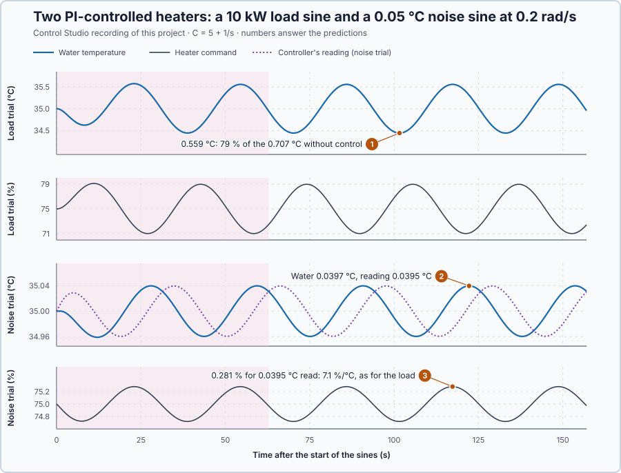

# 55. Sensitivity functions

In this lesson, you will derive how much of a heat load and how much sensor noise get through the heater's PI loop at each speed, and inject both into two identical heaters. You will see that the loop cannot reject both at the same speeds.

## The problem

Lesson 54 measured the heater with its control off: at 0.2 rad/s a sine command came back 0.1416 °C per percentage point and 57.07° late, as its model predicted. Under feedback, two other inputs enter the loop at different points. A heat extraction, such as hot water drawn off, changes the water itself; sensor noise changes only what the controller reads. Both move the reading, and the controller cannot tell them apart. How much of each reaches the water and the heater command, at each speed?

We will derive both paths for the heater under PI control, and check them by injecting a load sine into one heater and a noise sine into the reading of an identical one.

## What we need

We need to:

1. calculate how much of a load still moves the water when feedback acts;
2. calculate how much measurement noise the loop turns into real temperature and command changes; and
3. see both at every speed.

## The new idea

**The sensitivity** tells how much of a disturbance still gets through the closed loop at each speed. **The complementary sensitivity** tells how much measurement noise reaches the process. Where one is small, the other is large.

**In words.** The controller sees only its reading: the water temperature plus the sensor's noise. Two very different things can move that reading:

1. **A load really changes the water.** Hot water drawn off cools it. The controller counters the change, but late, because of the stored heat and the delay. Feedback removes the part of the load it catches in time; the sensitivity is the part that still gets through.
2. **Noise changes only the reading.** The water has not moved, but the controller cannot tell: it moves the heater as it would for a real change, and the heater moves the water. The complementary sensitivity is the part of the noise that ends up in the real temperature.

Feedback cannot treat the two differently, because it sees them in the same way. Where the loop reacts strongly enough to cancel a load, it also follows the noise; where it ignores the noise, it also lets loads through. That is why one is small where the other is large: at every speed the two add up to exactly 1, counted with their timing, so where one is close to 0 the other is close to 1.

A level controller on a tank with a sloshing surface shows the same trade-off: tuned hard enough to hold the level against real inflow changes, it also chases every ripple the sensor reports.

For the heater, the sensitivity says how much of a heat load still moves the water, and the complementary sensitivity how much of the sensor's noise the controller turns into real temperature changes.

**The formula.** Let:

- $y$ be the water temperature's deviation from 35 °C, and $r$ the setpoint's, in °C;
- $u$ be the heater command's deviation from 75 %, in %;
- $D$ be an extra heat extraction, in kW;
- $n$ be the measurement noise, in °C; and
- $C = 5 + 1/s$ be the PI with $K_p = 5$ %/°C and $K_i = 1$ %/(°C·s); dividing by $s$ integrates.

The water follows

$$
y = G\,u + G_D D, \qquad G = \frac{0.2\,e^{-s}}{5s + 1}, \qquad G_D = \frac{-0.1}{5s + 1} .
$$

The extraction acts on the water at once, without the heater's delivery delay: 10 kW held long enough lowers the water by 1 °C.

The controller reads $y + n$, so $u = C\,(r - y - n)$. The product $L = CG$ is the **loop transfer function**: what a signal passes through once around the loop. Substituting $u$ and collecting $y$ gives $(1 + L)\,y = L\,r + G_D D - L\,n$, so

$$
S = \frac{1}{1 + L}, \qquad T = \frac{L}{1 + L}, \qquad y = T\,r + S\,G_D D - T\,n, \qquad S + T = 1 .
$$

- $S$ is the sensitivity: it scales a load's effect on the water, compared with no control;
- $T$ is the complementary sensitivity: it scales noise into the water;
- for noise alone the command is $u = -C\,(y + n) = -CS\,n$, so $CS$ scales noise into the command; and
- at a speed $\omega$, each is used through its magnitude at $s = j\omega$, as in Lesson 54.

For this PI the loop is simple. Since $C = (5s + 1)/s$, the controller's zero cancels the water's lag, and

$$
L = \frac{0.2\,e^{-s}}{s}, \qquad |L(j\omega)| = \frac{0.2}{\omega}, \qquad \angle L = -90° - \omega\,\frac{180°}{\pi} .
$$

**Example: the paths at 0.05 rad/s.** A slow load and slow noise, every number one step at a time:

1. $C = 5 + 1/(0.05j) = 5 - 20j$, with $|C| = 20.6$ %/°C. $L = 0.2\,e^{-0.05j}/(0.05j) = -4j\,e^{-0.05j}$: $|L| = 4$, at −92.86°.
2. $1 + L = (1 - 4\sin 0.05) - 4j\cos 0.05 = 0.800 - 3.995j$, with $|1 + L| = 4.074$. So $|S| = 1/4.074 = 0.245$ and $|T| = 4/4.074 = 0.982$. As magnitudes they add up to 1.227: $S + T = 1$ holds for the complex numbers, not for their sizes.
3. **A 10 kW load sine.** Without control it would move the water by $10 \times 0.1/\sqrt{1 + 25 \times 0.05^2} = 0.970$ °C. With feedback: $0.245 \times 0.970 = 0.238$ °C, a quarter. The command moves $20.6 \times 0.238 = 4.91$ %, nearly the 5 points that would cancel 10 kW completely.
4. **A 0.05 °C noise sine.** The water moves $|T| \times 0.05 = 0.049$ °C: almost all of the noise ends up in the real temperature. The reading, $y + n = S\,n$, moves only $|S| \times 0.05 = 0.012$ °C: the controller holds its reading nearly still by moving the water against the noise. The command moves $|C|\,|S| \times 0.05 = 0.253$ %.

The 10 kW, 0.05 °C and the speeds are teaching choices, large enough to measure.

**The trade-off.** At slow speeds $|L|$ is large: $|S|$ is small and slow loads are rejected, but $|T|$ is near 1, so slow noise passes into the water in full. At fast speeds $|L|$ is small: $|T|$ is small, but $|S|$ near 1 leaves fast loads uncorrected. In between, $|S|$ can even exceed 1. At 0.4 rad/s, $|L| = 0.5$ at −112.92°, $|1 + L| = |0.805 - 0.461j| = 0.928$, so $|S| = 1.078$ and $|T| = 0.539$: feedback makes a load at that speed 8 % worse than no control at all, while it passes only 54 % of the noise.

**The limitation.** Because $S + T = 1$ at every speed, no choice of gains makes both small at the same speed. Changing the gains only moves where loads are rejected and where noise passes.

## Prediction

Before running, answer these questions; both sines run at 0.2 rad/s:

1. How far will the 10 kW load sine move the water, and how far would it move it without control?
2. How far will the 0.05 °C noise sine move the water and the controller's reading, and why does it move the water at all?
3. How far will each sine move the heater command, per °C of change in the reading?
4. Control Studio's **Sensitivity** view runs from 0.0125 to 3.2 rad/s. What are $|S|$ and $|T|$ at its two ends, in decibels?

| At 0.2 rad/s | Water | Reading | Command |
| --- | ---: | ---: | ---: |
| Load, 10 kW | 0.559 °C | the water | 3.95 % |
| Noise, 0.05 °C | 0.0395 °C | 0.0395 °C | 0.279 % |

| Speed | $\lvert S \rvert$ | $\lvert T \rvert$ |
| --- | ---: | ---: |
| 0.0125 rad/s | −24.1 dB | 0 dB |
| 3.2 rad/s | 0 dB | −24.1 dB |

## Implementation

Open [`src/Main.st`](src/Main.st). Two copies of the heater, with its 1 s delivery delay and an exact sensor, are each held at 35 °C by `Control.PID` as the PI $C$. When the project experiment starts, the function block `FivePeriodSine` drives the first heater's extraction with $D = 10\sin(0.2t)$ kW, and adds $0.05\sin(0.2t)$ °C to the second heater's reading, `MeasuredTemperatureC`, for five periods. [`heater-model.json`](heater-model.json) states the heater for Control Studio.

**ST practice.** Find `LoopReal`, `LoopImag`, `SensitivityMagnitude` and `ComplementaryMagnitude`, and calculate them by hand at 0.2 rad/s: $L = -0.199 - 0.980j$ and $|S| = |T| = 0.790$. Then calculate $|S|$ at 0.1 rad/s: $L = -0.200 - 1.990j$, $|1 + L| = \sqrt{0.640 + 3.960} = 2.145$, $|S| = 0.466$. The tests in [`src/tests.st`](src/tests.st), run from the **Testing** view, check the values at 0.2 rad/s, $S + T = 1$ and the predicted amplitudes.

## Experiment in Control Studio

1. Open this lesson's project and start **Simulator**. Both heaters rest at 35 °C with 75 %. In the **truST** side bar, select **Control Studio**.
2. On **Identify**, choose **Project experiment** from **Method**. **Signals** already shows the setpoint, `P1.LoadTemperatureC · Process value (°C)` and `P1.LoadCommandPct · Applied output (%)`; add `P1.LoadKw · disturbance (kW)` and, for the noise trial, `P1.NoiseTemperatureC · state (°C)`, `P1.MeasuredTemperatureC · state (°C)`, `P1.NoiseCommandPct · state (%)` and `P1.NoiseC · state (°C)`.
3. Answer the predictions. Select **Review project test** and check the declared **159.2 s** duration: 2 s at rest and five periods of 31.4 s. Select **Confirm and start**; both sines start after 2 s.
4. After the run, hover the extremes of the last three cycles. At completion, Control Studio shows **Project test completed. Outputs restored.**
5. On **Identify**, choose **Supplied plant model** in **Method**, select **Open model…** and open `heater-model.json`. On **Tune**, choose **Loop response** in **Tuning method**. Enter 0.0125 and 3.2 rad/s and 17 **Frequency points**, select **Calculate feedback analysis**, set **View** to **Sensitivity** and hover 0.2 rad/s.

Select **Abort test** to stop early. To repeat, stop and restart **Simulator**.

## Evidence and decision

The numbered marks answer predictions 1–3; Control Studio's **Sensitivity** view answers 4. Amplitudes of the last three cycles, fitted at 0.2 rad/s, with the calculation in brackets:

| Injection | Water | Reading | Command |
| --- | ---: | ---: | ---: |
| Load, 10 kW | 0.559 °C (0.559) | the water | 3.97 % (3.95) |
| Noise, 0.05 °C | 0.0397 °C (0.0395) | 0.0395 °C (0.0395) | 0.281 % (0.279) |

1. The load moved the water by 0.559 °C, 79 % of the 0.707 °C it would cause without control.
2. The noise moved the water by 0.0397 °C although no heat entered: the controller took the noise for a real change and moved the heater. Its reading moved 0.0395 °C.
3. The command moved $3.97/0.559 = 7.1$ % per °C read for the load and $0.281/0.0395 = 7.1$ % per °C for the noise: the same $|C|$, because the controller sees only its reading.
4. At 0.2 rad/s, S and T were −2.05 dB (0.790) and CS 14.94 dB. At 0.0125 rad/s S was −24.1 dB and T 0 dB; at 3.2 rad/s T was −24.1 dB and S 0 dB. CS stayed between 13.9 and 15.8 dB at every speed.

The recording matches the calculation within 0.6 %. Feedback rejects slow loads but passes slow noise into the water, and it moves the heater for noise at every speed. At 0.2 rad/s this PI removes only 21 % of the load, while 0.05 °C of noise costs 0.28 % of command swing. These are simulation results.

## Conclusion

The sensitivity $S = 1/(1 + L)$ scales a disturbance that enters the process; the complementary sensitivity $T = L/(1 + L)$ scales measurement noise into the process, and $CS$ into the command. Because $S + T = 1$, feedback cannot make both small at the same speed: where it rejects loads, it passes noise.

For the heater's PI at 0.2 rad/s, both were 0.790: a 10 kW load still moved the water by 0.559 °C, and 0.05 °C of noise moved the command by 0.281 %.

## Check yourself

1. **At 0.1 rad/s, $|S| = 0.466$. How far would the 10 kW load sine move the water?**
   Without control $10 \times 0.1/\sqrt{1.25} = 0.894$ °C; with feedback $0.466 \times 0.894 = 0.417$ °C.
2. **Why does measurement noise move the real water temperature?**
   The controller cannot tell noise from a real change: it moves the heater, and the heater moves the water.
3. **Why can $S$ and $T$ not both be small at the same speed?**
   $S + T = 1$ at every speed, so where one is close to 0 the other is close to 1.

## Reason for the next lesson

The sensitivity functions show where this PI rejects loads and where it passes noise, but not how to change the controller so that it fights a load harder without passing more noise.

[Loop shaping](../49-loop-shaping/README.md) changes the controller's frequency behaviour on purpose, raising its gain only over a chosen range of speeds.
