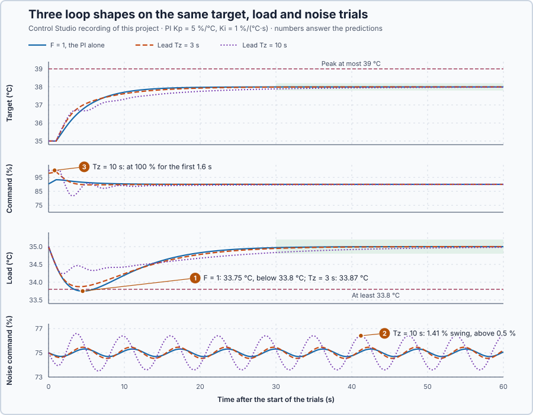

# 56. Loop shaping

In this lesson, you will design a lead element for the heater's PI controller in Control Studio, check it against the formulas, and validate it on the actual program against requirements fixed in advance. A stronger lead will show that more phase from the element can leave less phase in the loop.

## The problem

Lesson 55 found how the heater's PI loop, $C = 5 + 1/s$, treats a load and noise at 0.2 rad/s: $|S| = |T| = 0.790$. A 10 kW load moved the water by 0.559 °C, and 0.05 °C of measurement noise moved the heater command by 0.281 %. Now a 30 kW load must not pull the water below 33.8 °C, and this PI lets it fall to 33.75 °C. A larger $K_p$ would react harder to the load, but it raises the controller's gain at every rate, including the rate of the noise.

We will design an element that changes the loop's frequency behaviour only over a chosen range of rates, calculate its effect on the complete loop, and validate it on matched trials.

## What we need

We need to:

1. raise the controller's gain over a chosen range of rates while keeping its steady behaviour;
2. calculate what that does to the complete loop, not only to the controller; and
3. judge the load, the setpoint change and the noise on matched trials against fixed requirements.

## The new idea

**Loop shaping** changes the controller's frequency behaviour on purpose. A **lead** adds phase near the crossover so the loop can be made faster safely; a **lag** adds gain at slow speeds to fight loads.

**In words.** Raising $K_p$ raises the controller's gain at every speed at once: loads are fought harder, but noise moves the command more, and the loop comes closer to swinging. Loop shaping adds an element after the PI that changes the gain and the timing only over a chosen band of speeds:

1. **A lead** gives more gain to fast changes than to slow ones, and makes its answer to them earlier, a positive phase. It acts like a little derivative action that stops growing above a certain speed.
2. **A lag** does the opposite: more gain for slow changes, like extra integral action that works only on slow ones.
3. **Neither changes the steady state.** At zero speed the element passes its input unchanged, so the holding power and the integral stay as they were.

Many PLC libraries have such an element as a lead–lag block.

Where the element acts matters because of the **crossover**: the speed at which a signal comes back once around the loop exactly as large as it went in. If it also came back reversed, at −180°, it would keep itself going and the loop would swing at that speed. The phase left between the loop's angle and −180° at crossover therefore says how far the loop is from swinging. A lead adds phase there; but it also adds gain, which moves the crossover, so it must be judged on the complete loop.

For the heater, a lead pushes harder on fast changes, such as a sudden load, without changing the holding power.

**The formula.** The element $F$ comes after the PI:

$$
F(s) = \frac{1 + T_z s}{1 + T_p s}, \qquad \angle F = \arctan(\omega T_z) - \arctan(\omega T_p), \qquad |F| = \frac{\sqrt{1 + \omega^2 T_z^2}}{\sqrt{1 + \omega^2 T_p^2}} .
$$

Let:

- $T_z$ and $T_p$ be the element's two time constants, in seconds: $1/T_z$ is its zero and $1/T_p$ its pole, in 1/s;
- $a = T_z/T_p$ be its gain at high speed: a sudden change passes through $F$ multiplied by $a$;
- $\omega_m = 1/\sqrt{T_z T_p}$ be the speed of its largest phase, in rad/s, where $|F| = \sqrt{a}$ and $\angle F = \arcsin\frac{a - 1}{a + 1}$; and
- $\omega_c$ be the crossover, where the complete loop has $|L| = 1$, in rad/s.

At $s = 0$, $F = 1$. With $T_z > T_p$, $F$ is **lead compensation**: positive phase, gain rising from 1 to $a$. With $T_z < T_p$ it is **lag compensation**: negative phase, gain falling below 1.

$F$ is judged by the loop it creates, $L = C\,F\,G$, with the PI $C = 5 + 1/s$ and the heater $G = 0.2\,e^{-s}/(5s + 1)$. As in Lesson 55, the PI's zero cancels the heater's lag, so the loop before the element is $L_0 = CG = 0.2\,e^{-s}/s$, and

$$
|L| = \frac{0.2\,|F|}{\omega}, \qquad \angle L = -90° - \omega\,\frac{180°}{\pi} + \angle F, \qquad \text{phase left} = 180° + \angle L(j\omega_c) .
$$

Noise $n$ in the reading moves the command by $v/n = -CF/(1 + CFG)$. Where the loop gain is small, this is roughly $CF$: a lead multiplies the command's noise roughly by its own gain $|F|$ at the noise's speed.

**Example 1: designing a lead.** Take $T_z = 10$ s and $T_p = 2$ s:

1. $a = 10/2 = 5$: a sudden change passes five times larger.
2. $\omega_m = 1/\sqrt{10 \times 2} = 0.224$ rad/s, where $|F| = \sqrt{5} = 2.236$ and $\angle F = \arcsin(4/6) = 41.81°$.
3. Control Studio's lead/lag design works the other way round: from $\omega_m$ and the phase it returns the zero $1/T_z$, the pole $1/T_p$, and the gain that puts the crossover at $\omega_m$. Here $|L_0| = 0.2/0.224 = 0.894$ at $\omega_m$, so that gain is $1/(0.894 \times 2.236) = 0.500$: zero 0.1, pole 0.5, gain 0.5. That gain would scale the PI as well.

**Example 2: the complete loop at crossover**, with $F$ at unit gain:

1. **$F = 1$.** $|L_0| = 0.2/\omega = 1$ at $\omega_c = 0.200$ rad/s. There the delay lags $0.2$ rad, 11.46°, so $\angle L = -101.46°$ and the phase left is 78.5°.
2. **$T_z = 3$ s, $T_p = 2$ s.** Trying speeds, $0.2\,|F|/\omega = 1$ at $\omega_c = 0.219$ rad/s. There $\angle F = \arctan(0.657) - \arctan(0.438) = 9.66°$ and the delay lags 12.56°, so the phase left is $90° - 12.56° + 9.66° = 87.1°$: 8.6° more than without the lead.
3. **The noise, $F = 1$.** At 1 rad/s, $C = 5 - j$ and $L_0 = -0.168 - 0.108j$, so $|v/n| = 5.10/|0.832 - 0.108j| = 6.08$: 0.05 °C of noise moves the command by 0.304 %.

$T_p = 2$ s and the candidates $T_z = 3$ s and $T_z = 10$ s are teaching choices.

**Requirements**, fixed before choosing, each trial 60 s from 35 °C with 75 %:

- Target 35 → 38 °C: peak at most 39 °C, within 0.2 °C over 30–60 s.
- Load of 30 kW at 35 °C: water at least 33.8 °C, within 0.2 °C over 30–60 s.
- Noise of $0.05\sin t$ °C in the reading: command half-amplitude at most 0.5 % over 37.70–56.55 s.

**The limitation.** A lead buys its push on fast changes with gain at high speed: noise reaches the command roughly $|F|$ times more, and a sudden setpoint change is multiplied by $a$, which can drive the heater into its limit. And because the extra gain moves the crossover, a lead's phase at $\omega_m$ says little until the complete loop is calculated.

## Prediction

Before running, answer these questions:

1. Which candidates keep the load trial above 33.8 °C?
2. Which candidate moves the command by more than 0.5 % under the noise?
3. Which candidate's first request after the 3 °C step exceeds 100 %?
4. The 10 s lead adds the most phase, and its higher gain moves the crossover to 0.874 rad/s. Does it leave the most phase there?
5. What zero, pole and gain will Control Studio's lead/lag design return for the 3 s lead?

| Candidate | Phase left at crossover | Noise swing |
| --- | ---: | ---: |
| $F = 1$ | 78.5° | 0.304 % |
| $T_z = 3$ s | 87.1° | 0.447 % |
| $T_z = 10$ s | 63.2° | 1.332 % |

## Implementation

Open [`src/Main.st`](src/Main.st). The function block `ShapedPi` writes $F = a + (1 - a)/(1 + T_p s)$, so the command is $v = a\,w + (1 - a)\,z$, where $w$ is the PI's command and $z$ follows $w$ with the time constant $T_p$. The program limits the request to 0–100 % and passes anti-windup through $F$. It runs nine heaters: the three candidates for each trial. [`pi-loop-model.json`](pi-loop-model.json) states $L_0$ for Control Studio's design.

**ST practice.** Calculate `LeadMagnitude` and `LeadPhaseRad` by hand for $T_z = 10$ s and $T_p = 2$ s at 1 rad/s: $\sqrt{101}/\sqrt{5} = 4.494$ and $84.29° - 63.43° = 20.85°$. The tests in [`src/tests.st`](src/tests.st), run from the **Testing** view, check these values.

## Experiment in Control Studio

1. Open this lesson's project and start **Simulator**. The nine heaters rest at 35 °C with 75 %. In the **truST** side bar, select **Control Studio**, and answer the predictions.
2. On **Identify**, choose **Supplied plant model** in **Method**, select **Open model…** and open `pi-loop-model.json`. Control Studio shows **Integrating model with delay**, G(s) = (0.2) / (1s) · e^(−1s).
3. On **Tune**, choose **Lead/lag design** in **Tuning method**, keep **Lead compensation** in **Compensation**, enter 0.4082 in **Crossover (rad/s)** and 11.54 in **Phase contribution (°)**, and select **Calculate lead/lag design**.
4. On **Identify**, choose **Project experiment** from **Method**. **Signals** already shows the setpoint, `P1.TargetBaselineC · Process value (°C)` and `P1.TargetBaselinePct · Applied output (%)`; add the states `P1.TargetLead3C`, `P1.TargetLead10C`, `P1.TargetLead3Pct` and `P1.TargetLead10Pct`.
5. Select **Review project test**, check the declared **62.1 s** duration and select **Confirm and start**. The trials start after 2 s at rest; hover the step and the last 30 s.
6. Show `P1.LoadBaselineC`, `P1.LoadLead3C`, `P1.LoadLead10C` and `P1.DisturbanceKw` and hover the dips; then `P1.NoiseBaselinePct`, `P1.NoiseLead3Pct` and `P1.NoiseLead10Pct` and hover the last periods. Control Studio ends with **Project test completed. Outputs restored.**

Select **Abort test** to stop early. To repeat, stop and restart **Simulator**.

## Evidence and decision

The numbered marks answer predictions 1–3; Control Studio's lead/lag design answers 5. From the recorded run:

| Requirement | $F = 1$ | $T_z = 3$ s | $T_z = 10$ s |
| --- | ---: | ---: | ---: |
| Target: peak at most 39 °C | 38.00 °C | 38.00 °C | 37.99 °C |
| Target: within 0.2 °C, 30–60 s | 0.002 °C | 0.012 °C | 0.109 °C |
| Load: at least 33.8 °C | **33.75 °C, fails** | 33.87 °C | 34.24 °C |
| Load: within 0.2 °C, 30–60 s | 0.028 °C | 0.051 °C | 0.165 °C |
| Noise: command swing at most 0.5 % | 0.310 % | 0.460 % | **1.406 %, fails** |

1. The 3 s and 10 s leads kept the load above 33.8 °C; the PI alone fell to 33.75 °C.
2. The 10 s lead swung the command by 1.406 % under 0.05 °C of noise.
3. The 10 s lead's first request exceeded 100 %, and its command stayed at 100 % for the first 1.6 s.
4. No: the 10 s lead adds the most phase but leaves the least, 63.2°.
5. Control Studio returned **Lead compensator: C(s) = 1.67 · (1 + s/0.3333) / (1 + s/0.5).** and 11.54°: $T_z = 3$ s, $T_p = 2$ s and the gain, as calculated.

Only $T_z = 3$ s meets every requirement, so we choose it, at unit gain: its design gain of 1.67 would raise the noise swing to the calculated 0.842 %. It keeps the water 0.12 °C higher on the load at a noise cost of 0.46 %. These are simulation results.

## Conclusion

A lead keeps the steady gain and raises the high-frequency gain by $T_z/T_p$; Control Studio designs it from the frequency to centre on and the phase to add. It must be judged on the complete loop $L = CFG$: the crossover moves, and the phase left there can fall although $F$ adds phase.

For the heater, the designed 3 s lead lifted the load minimum from 33.75 to 33.87 °C and kept the noise swing below 0.5 %; the 10 s lead failed on noise.

## Check yourself

1. **What are $|F|$ and $\angle F$ of the 3 s lead at 1 rad/s?**
   $\sqrt{10}/\sqrt{5} = 1.414$ and $71.57° - 63.43° = 8.13°$.
2. **Why did the 10 s lead leave less phase at crossover, although it adds the most phase?**
   Its higher gain moved the crossover to 0.874 rad/s, where the 1 s delay takes 50°, more than the lead adds.
3. **Why is the 3 s lead applied without the gain the design returned?**
   That gain, 1.67, would scale the PI as well and raise the noise swing to 0.842 %, above the 0.5 % requirement.

## Reason for the next lesson

The phase left at crossover checks the loop at one frequency. The delay keeps adding lag at every frequency, so the loop can come close to −1 elsewhere, and one number at one frequency does not prove that the whole loop is stable.

[Nyquist stability](../47-nyquist-stability/README.md) examines the loop's complete frequency curve, delay included.
