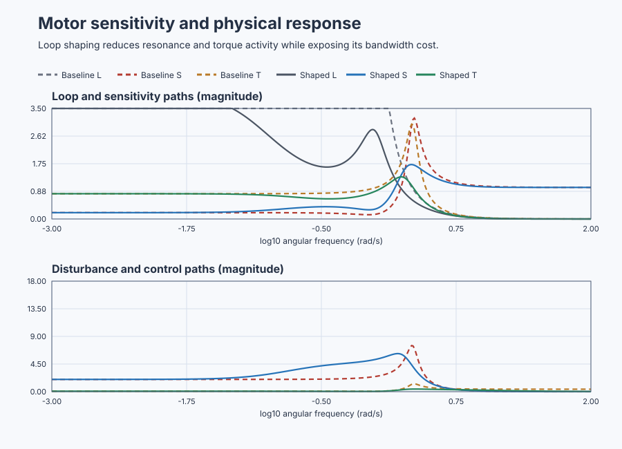
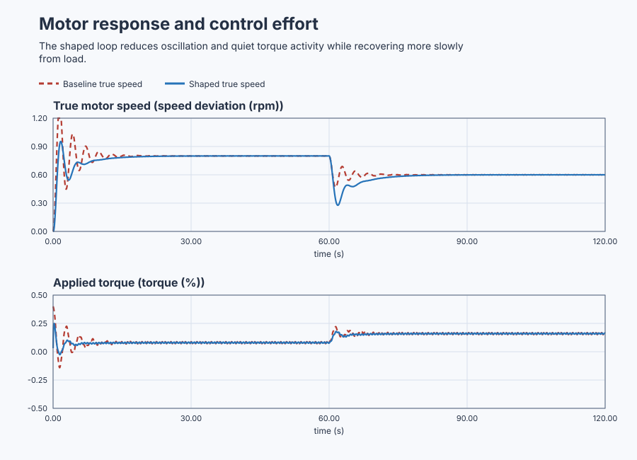

# Shape a precision motor-speed loop

Course position: Lesson 49 of 84. Previous lesson: [Count delayed-oven stability with Nyquist](../48-delayed-thermal-nyquist/README.md). Next lesson: [Prove sampled positioning stability in the z-plane](../50-position-z-plane/README.md).

**Lesson objective:** Compare proportional and loop-shaped motor-speed controllers against common frequency- and time-domain requirements.

**Evidence class:** Simulation evidence, not physical-plant evidence. A physical drive additionally requires reviewed current, guarding, and motion limits.

## The problem

The equipment is a precision motor driving a precision load through a
compliant coupling. The drive's rated-torque command is measured in percent. A
load-side encoder measures speed in revolutions per minute (rpm). The
experiment uses small speed deviations about a 1000 rpm declared teaching
operating point; a 1 rpm deviation means an actual shaft speed of 1001 rpm.

The measured-speed channel carries identical deterministic encoder
interference in both cases; a separate true-speed channel lets you distinguish
encoder noise from physical shaft motion. Opposing load torque is a second
physical plant input, not an artificial change to the speed reading.

The two simulated motors have identical dynamics, initial state, setpoint,
load event, timing, limits, interference, seed, and abort range. Only the
controller changes.

Lesson 48 used Nyquist analysis for delayed-loop stability, and Lesson 47
calculated margins near crossover, but neither says how much load torque,
encoder noise, model error, or controller action passes through this loop at
each frequency.

The baseline proportional loop is stable, but it crosses near the compliant
shaft mode with little phase reserve, so it can amplify speed motion and
torque activity badly. We need to examine every important closed-loop path
before choosing one.

## What we need

We need the motor-speed loop to reject low-frequency load changes, avoid amplifying high-frequency noise, and retain adequate stability margins together. Competing loop shapes must be compared against those requirements.

## The new idea

The plant response describes how motor torque changes load-side speed; call it
`G(s)`, where the continuous frequency variable ($s$) represents dynamic
response. The controller response describes how measured speed error produces
requested torque; call it `C(s)`. The open-loop response is the controller
response followed by the plant response around the feedback path; call this
loop response ($L$):

$L(s) = C(s)G(s)$

The sensitivity function describes how much opposing load torque or model
error still reaches motor speed after feedback acts; call it sensitivity
($S$). The complementary-sensitivity function describes how much a
speed-setpoint change or encoder-noise reading still reaches motor speed after
feedback acts; call it complementary sensitivity ($T$). Both paths use the
same feedback denominator:

$S(s) = 1 / (1 + L(s))$

$T(s) = L(s) / (1 + L(s))$

$S(s) + T(s) = 1$

The last identity follows directly:
$1/(1+L)+L/(1+L)=(1+L)/(1+L)=1$. It explains a fundamental trade-off. At a
frequency where feedback makes $S$ small, $T$ must be near one; the two cannot
both be zero.

The plant-input load-disturbance path, `G(s)S(s)`, is measured in rpm per
percent of opposing load torque. The measurement-noise path, the
control-sensitivity function `C(s)S(s)`, is measured in percent torque per rpm
of encoder noise.

Closed-loop bandwidth is the first frequency where complementary sensitivity's
magnitude falls below one divided by the square root of two times its
low-frequency value. Maximum sensitivity ($M_{s}$) and maximum complementary
sensitivity ($M_{t}$) are the largest qualified magnitudes of sensitivity and
complementary sensitivity. Roll-off is how fast a response falls at high
frequency.

A **proper** transfer function has no more zeros than poles (bounded
high-frequency gain); a **minimum-phase** one has no right-half-plane poles or
zeros (the least possible phase lag for its magnitude). For this stable,
proper, minimum-phase loop, making sensitivity small over one
frequency band forces it to recover elsewhere: the waterbed effect. Unstable,
nonminimum-phase, delayed, or nonproper plants need additional qualification;
this is not a universal statement.

This local flexible-drive balance is a **declared teaching value**, configured
directly in the plant model rather than fitted to a measured motor:

$\ddot{y}+0.6\dot{y}+y=10(u-d)$,

where $y$ is speed deviation, $u$ is controller torque, and $d$ is opposing
load torque. Matching coefficients to the standard second-order form gives
natural frequency $\omega_n=1$ rad/s and damping ratio $\zeta=0.3$: small
damping is why the coupling resonates near 1 rad/s. Taking the
zero-initial-condition Laplace transform and first setting $d=0$ gives

$G(s) = 10 / (s^{2} + 0.6s + 1) \mathrm{rpm}/\%$

The baseline positional controller requests 0.4 percent rated torque for each
rpm of speed error. Its 0.4 gain is also a **declared teaching value**,
configured directly in the baseline controller rather than calculated or
fitted:

$C_{\mathrm{base}}(s) = 0.4 \%/\mathrm{rpm}$

The shaped controller keeps the same zero-frequency gain. Its lead, lag, and
low-pass corner frequencies are declared choices set relative to the plant's
own $\omega_n=1$ rad/s resonance, not fitted values: the lead factor adds
phase near crossover, the lag factor reduces gain around the flexible mode
relative to slow-load authority, and the low-pass factor rolls off
high-frequency response:

$C_{\mathrm{shape}}(s) = 0.4 \cdot ((1+s/0.3)/(1+s/3)) \cdot ((1+s/0.8)/(1+s/0.08)) \cdot (1/(1+s/8))$

Every factor equals one at zero frequency, so the shaped controller retains
the baseline's $0.4$ DC gain. Relative to $\omega_n$: the lead zero/pole (0.3,
3 rad/s) straddle it a decade each side, adding phase at the resonance; the
lag zero/pole (0.8, 0.08 rad/s) sit at and a decade below it, its 0.1
high-frequency gain cutting loop gain tenfold right where the resonance needs
it; and the roll-off pole (8 rad/s), a decade above, rolls off gain instead of
staying flat. The controller is therefore proper, with no ideal derivative.

## Prediction

At zero frequency the baseline loop gain is
$L(0)=0.4\times10=4$. Therefore
$S(0)=1/(1+4)=0.2$, $T(0)=4/5=0.8$, and
$|G(0)S(0)|=10\times0.2=2$ rpm/%. The shaped controller has the same DC gain,
so its low-frequency values must be nearly equal.

For every other row, evaluate $s=j\omega$ on the same logarithmic grid from
0.001 through 100 rad/s: multiply $C(j\omega)G(j\omega)$ to form $L$, calculate
$S=1/(1+L)$ and $T=L/(1+L)$, and retain the largest magnitudes. Crossover is
where $|L|$ crosses one, with margin $180^\circ+\angle L$; bandwidth is where
$|T|$ first falls below $|T(0)|/\sqrt{2}$. This repeatable calculation
produces:

| Measure | Baseline | Shaped | What it means |
|---|---:|---:|---|
| $\left|S\right|$ at 0.01 rad/s | 0.200 | 0.201 | Similar slow-load rejection |
| $M_{s}$ | 3.195 | 1.723 | Less worst-case disturbance amplification |
| $M_{t}$ | 3.002 | 1.333 | Less worst-case noise amplification |
| Gain crossover | 2.187 rad/s | 1.706 rad/s | Lower shaped-loop crossover |
| Phase margin | 19.13 degrees | 44.11 degrees | More shaped-loop phase reserve |
| Bandwidth | 3.43 rad/s | 2.83 rad/s | Shaped response is intentionally slower |
| $\left|T\right|$ at 10 rad/s | 0.0420 | 0.0247 | Less high-frequency output noise |
| $\left|CS\right|$ at 10 rad/s | 0.4168 %/rpm | 0.2449 %/rpm | Less noise-driven torque activity |

At 0.01 rad/s, predict load-disturbance magnitudes of 2.000 and 2.013 rpm/%:
shaping should preserve slow-load authority, reduce resonance and noise
activity, and pay for that with lower bandwidth and slower load recovery.

The time-domain equilibria follow from the same DC algebra. The experiment
holds the setpoint at 1 rpm and applies a 0.1 percent opposing load step
partway through (timing defined in Experiment in Control Studio). Before the
load step, $y=10u$ and $u=0.4(1-y)$ using setpoint 1 rpm, so $y=4(1-y)$ and
$5y=4$: $y=0.8$ rpm. After the 0.1 percent load is applied,
$y=10(u-0.1)=4(1-y)-1$, so $5y=3$ and $y=0.6$ rpm: the reference values for
the overshoot and load-departure measures.

## Implementation

The baseline controller directly implements its positional law:

```st
BaselineError := SpeedSetpoint - BaselineMeasuredSpeed;
BaselineRequestedTorque := ProportionalGain * BaselineError;
BaselineAppliedTorque := MAX(MIN(BaselineRequestedTorque, TorqueMaximum), TorqueMinimum);
```

For a factor $H(s)=(1+s/z)/(1+s/p)$, define a state
$\dot{x}=-px+e$. Then $X/E=1/(s+p)$ and
$v=(p/z)[e+(z-p)x]$. Substituting $X=E/(s+p)$ into that definition gives
$V=(p/z)\left[E+(z-p)\dfrac{E}{s+p}\right]=(p/z)E\dfrac{(s+p)+(z-p)}{s+p}=(p/z)E\dfrac{s+z}{s+p}$,
so $V/E=(p/z)(s+z)/(s+p)=H(s)$. This identity explains the lead/lag updates
below; Forward Euler replaces $\dot{x}$ with the state change over
`CycleInterval`, and the final low-pass state produces the requested torque:

```st
LeadState := LeadState + CycleInterval * (-LeadPole * LeadState + ShapedError);
LeadOutput := (LeadPole / LeadZero) * ShapedError
    + (LeadPole / LeadZero) * (LeadZero - LeadPole) * LeadState;
LagState := LagState + CycleInterval * (-LagPole * LagState + LeadOutput);
LagOutput := (LagPole / LagZero) * LeadOutput
    + (LagPole / LagZero) * (LagZero - LagPole) * LagState;
RollOffState := RollOffState
    + CycleInterval * (-RollOffPole * RollOffState + LagOutput);
ShapedErrorFiltered := RollOffPole * RollOffState;
ShapedRequestedTorque := ProportionalGain * ShapedErrorFiltered;
```

Requested and applied torque remain separately visible because limits can make
them differ; `src/Main.st` also exposes measured and true speed, load torque,
timing, and independent abort states.

## Experiment in Control Studio

The project owns the setpoint, the 0.1-percent load step, encoder
interference, the 120-second observation, aborts, and restoration to zero.
Control Studio may write only
`P1.ExperimentEnabled`; it must not inject another load step. The 120.1-second
timeout lets restoration finish first. The deterministic Simulation seed is
20260829.

### Control Studio actions

1. **Monitor** — Start the **Simulator**, then open **truST sidebar → Control Studio → Monitor → Response**.
   - **Baseline check:** Wait until the header shows **Simulation**, **Running**, and current data. Confirm Speed-deviation setpoint (SP, rpm); Baseline measured speed deviation (PV, rpm) and Shaped measured speed deviation (PV, rpm); Baseline applied torque (MV, %) and Shaped applied torque (MV, %), including units, limits, mode, and quality. The initial operating point is Speed-deviation setpoint = 0 rpm, Baseline applied torque = 0 %, Shaped applied torque = 0 %, Baseline measured speed deviation = 0 rpm, Shaped measured speed deviation = 0 rpm. The unresolved baseline problem is: The stable proportional loop crosses near the compliant mode with large sensitivity peaks, ringing, and encoder-noise torque activity.
   - **Decision before action:** Read **Prediction** above, then state what should move first and in which direction. Use this decision rule: Accept shaping only when common frequency and executable time evidence satisfy load, noise, robustness, bandwidth, effort, limit, and validity requirements together.
   - **Successful evidence:** The Response plot advances and the displayed values are finite and current. Select **Start recording** only after those conditions are visible.
   - **Recovery:** If recording is disabled or the plot reports unavailable or stale samples, stop the Simulator, correct the displayed runtime or binding problem, restart it, and repeat the baseline check.
   - **Record:** Write down the initial SP, PV, requested/applied MV where available, controller mode, and your predicted response before opening Test.

2. **Test** — Restart the **Simulator** from the declared initial state, then open **truST sidebar → Control Studio → Test**.
   - **Baseline check:** Confirm **Experiment** = **Observe without excitation**, **Amplitude** = **0** (disabled), and **Maximum duration (s)** = **120.1**. The reviewed authority is **Experiment authority** (`P1.ExperimentEnabled`). The observed lesson signal is **Baseline opposing load torque**. It does not inject a second process event.
   - **Decision before action:** Before selecting **Review test**, predict the response to Identical 10 rad/s, 0.02 rpm measured-speed interference on both encoder channels. Confirm the live values are current and the reviewed plan stays inside Baseline applied torque -20 % to 20 %; Shaped applied torque -20 % to 20 %; Baseline measured speed deviation -5 rpm to 5 rpm; Shaped measured speed deviation -5 rpm to 5 rpm.
   - **Successful evidence:** Select **Review test**, verify the affected signal, bounds, stop conditions, and restoration, then select **Confirm and start**. The state changes to **Running**, **Abort test** remains available, and the terminal state reports completion and restoration.
   - **Recovery:** For a rejected, stale, unsafe, unavailable, failed, or aborted state, read the displayed reason, stop and restart the Simulator, correct that cause, restore the initial state, and review a new test.
   - **Record:** Compare the observed speed and torque trade-off with your frequency and equilibrium predictions. Retain the terminal state, restoration result, and deterministic seed **20260829**. The native lesson test owns the common frequency grid, maxima, crossings, time metrics, and verdicts; disabled Identify, Tune, or Validate controls are not evidence.

## Evidence and decision

Change only the controller. Hold the plant, initial state, setpoint, load event,
sample schedule, duration, limits, interference, seed, and abort logic equal.

Retain complex loop response, sensitivity, complementary sensitivity,
load/control sensitivity, the $S+T$ residual, every crossover, bandwidth,
$M_{s}$, $M_{t}$, phase margin, model revision, controller revision, and
evidence class.

For the time traces, setpoint overshoot is peak true-speed departure above the
predicted 0.8 rpm equilibrium; settling time is the first time true speed
stays within 2 percent of it; load departure is the largest true-speed
distance from the 0.6 rpm post-load equilibrium; and torque total variation
sums consecutive requested-torque changes, in percentage points. Encoder-noise
torque travel is measured over the final quiet window, distinct from physical
shaft movement.

The shaped candidate shall keep low-frequency $\left|S\right|$ and $\left|GS\right|$ within 2 percent
of baseline, reduce $M_{s}$ below 1.8, reduce $M_{t}$ below 1.4, provide at least 40
degrees phase margin, reduce both $\left|T\right|$ and $\left|CS\right|$ at 10 rad/s by at least 35
percent, and keep bandwidth between 2.6 and 3.0 rad/s. Executable time evidence
shall show less overshoot and less requested-torque movement while leaving any
slower load recovery visible.

Reject nonfinite data, incomplete frequency coverage, multiple ambiguous
crossovers, an $S+T$ residual above `1e-9`, saturation, bad or stale quality,
timing outside tolerance, local-range departure, or an unsettled run. Report
`Not settled`, `Saturated`, `Aborted`, or `Invalid` instead of inventing a
performance number.

### Retained evidence

The frequency panel compares sensitivity ($S$) and complementary sensitivity
($T$) for both controllers. The speed traces show the physical benefit and the
slower load-recovery cost on equal simulated motors.



[Complete trace](figures/motor-sensitivity-evidence-trace.csv) ·
[Decision summary](figures/motor-sensitivity-evidence-summary.csv)



[Complete response and effort trace](figures/motor-sensitivity-response-evidence-trace.csv)

The native comparison reproduces every Prediction value exactly (shaped
$M_{s}=1.723$, $M_{t}=1.333$, crossover 1.706 rad/s, phase margin 44.11
degrees, bandwidth 2.83 rad/s), and every acceptance criterion passes:
$M_{s}<1.8$, $M_{t}<1.4$, phase margin above 40 degrees, bandwidth inside
2.6-3.0 rad/s, overshoot 19.16 percent under 65 percent, and a final-window
speed error (110-120 s) of about 0.0003 rpm under the 0.01 rpm limit.

## Conclusion

Large low-frequency loop gain makes sensitivity small and rejects slow load
changes. Because sensitivity plus complementary sensitivity equals one, both
cannot be made small at the same frequency. The baseline crosses near the
flexible mode with little phase reserve, so speed and torque are amplified.

The shaped controller redistributes gain, adds crossover phase, and rolls off
high-frequency action, lowering the sensitivity peaks, ringing, and
noise-driven torque travel. Its lower bandwidth and slower load recovery are a
deliberate cost, not a hidden defect. Explain any discrepancy using the
discrete filter realization, sample timing, finite windows, interference, or
model mismatch, not by changing tolerances after seeing the result.

## Reason for the next lesson

You can now judge tracking, disturbance rejection, encoder-noise attenuation,
robustness, speed, and actuator effort together; stability or the smallest
sensitivity peak alone does not select a controller. Lesson 50 moves the
chosen continuous design into the **z-plane** and asks whether its sampled
implementation remains stable.
