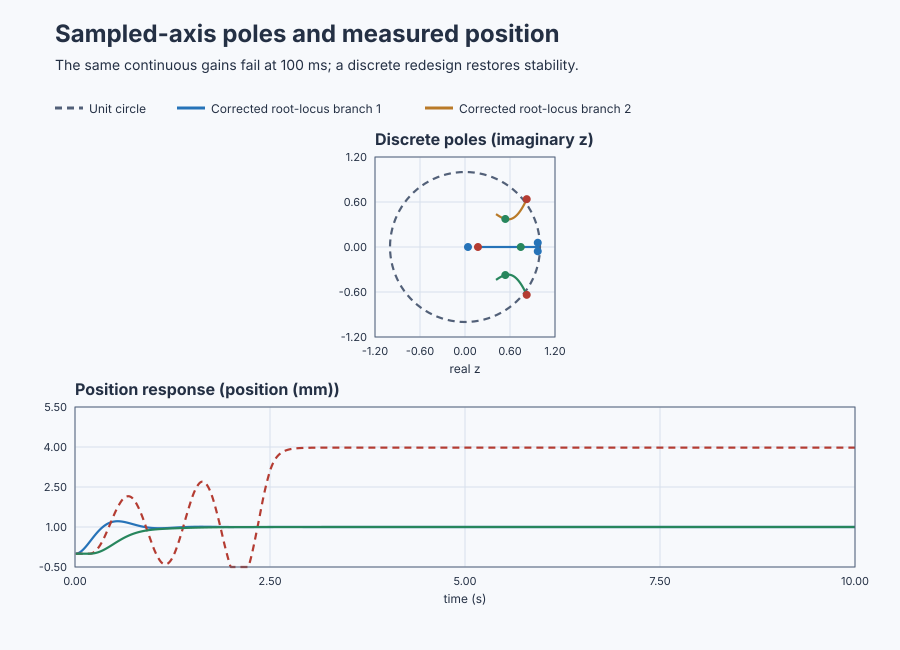
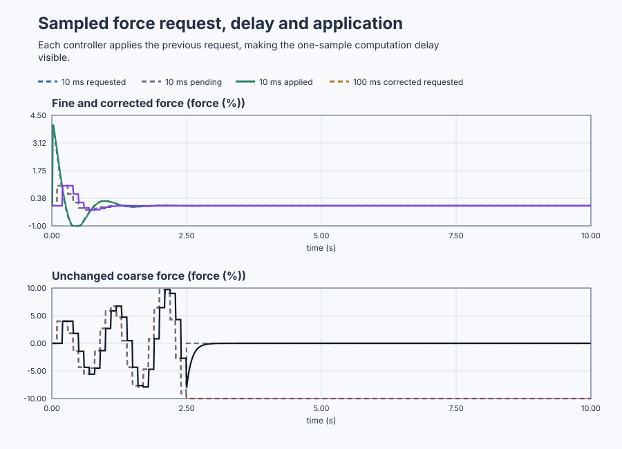

# Prove sampled positioning stability in the z-plane

Course position: Lesson 50 of 84. Prerequisite:
[`control-motor-sensitivity-loop-shaping`](../49-motor-sensitivity/).
Next lesson:
[`control-tuning-method-comparison`](../../08-tuning-qualification-and-automation/51-method-comparison/).

**Equipment:** Industrial positioning table.

**Lesson objective:** Explain and verify why unchanged continuous gains fail at 100 ms and validate a corrected digital position controller.

## The problem

An industrial positioning table moves a carriage. Motor-force command is
measured in percent of rated force. Carriage position is measured in
millimetres (mm), and carriage velocity is measured in millimetres per second.

Three simulated tables have the same mechanics, one-millimetre request, initial
state, 10 ms physical-plant integration, force limit, position range, and seed.
The fine controller updates every 10 ms. The coarse baseline and corrected
controller update every 100 ms. Each controller applies the request calculated
at the preceding update and holds that force until the next update.

This is **Simulation evidence, not physical-axis evidence**. A physical move
requires reviewed force, current, speed, travel, stopping distance, end stops,
guards, emergency stop, motion zone, and rollback.

Lesson 49 balanced sensitivity, encoder noise, robustness, bandwidth, and drive
effort for a continuous design. The controller actually executes as sampled
code. Its sample interval, output hold, computation delay, and discrete
realization can change stability. A continuous pole plot or margin therefore
does not prove the implemented loop.

## What we need

We need the positioning controller's poles and zeros to reflect the interval at which the computer actually samples and holds torque. Unchanged continuous settings at a slower interval must be rejected when the discrete response no longer meets stability and tracking requirements.

## The new idea

A sample is one measured value taken at a declared instant. A held output is a
command kept constant between controller updates. A discrete sequence lists
these values by sample index ($k$). The z-transform represents shifts and
evolution in that sequence. Call its discrete complex variable ($z$). A
one-sample delay uses a request at the next index and is written:

$z^{-1}$

A discrete pole is a natural-response multiplier per sample. Its magnitude is
its distance from the origin in the z-plane. The unit circle contains every
point of magnitude one. Poles strictly inside it decay, poles on it do not
asymptotically decay, and poles outside grow. Pole angle describes sampled
oscillation.

The continuous pole ($s$) describes response per unit of continuous time. The
sample interval ($T_{s}$) is elapsed time between controller updates. An isolated
continuous pole maps exactly to a sampled pole through:

$z=e^{sT_s}$

This maps a stable isolated continuous pole inside the unit circle. It does not
justify mapping a completed continuous closed loop while ignoring the output
hold or computation delay.

A zero-order hold keeps actuator force constant between samples. Exact hold
discretization can create a sampling zero even when the continuous plant has no
finite zero. A sampling zero is a property of the sampled input-output model;
it is not a newly discovered physical vibration mode.

The Nyquist angular frequency is the highest sinusoidal frequency that a given
sample interval can represent uniquely. Only after defining it can we write:

$\omega_{N}=\frac{\pi}{T_s}$

A higher-frequency component aliases: its samples look like a false lower
frequency. A discrete root locus traces closed-loop z-plane poles as a declared
digital gain changes.

The table position ($x$) is measured in mm, velocity ($v$) in mm/s, and applied
force ($u$) in percent. Its local mechanics are:

$\frac{dx}{dt}=v$

$\frac{dv}{dt}=-2v+10u$

The force-to-position response is:

$G(s)=\frac{10}{s(s+2)}\;\frac{\mathrm{mm}}{\%}$

To obtain it, take Laplace transforms with zero initial state. The first balance
gives $sX=V$. The second gives $sV=-2V+10U$, hence
$V/U=10/(s+2)$. Since $X=V/s$, multiplying the two stages gives
$X/U=10/[s(s+2)]$.

For one sample interval with constant force, solve
$\dot v+2v=10u$. Its exact endpoint is
$v_{k+1}=av_k+5(1-a)u_k$, where $a=e^{-2T_s}$. Integrating that velocity over
the interval gives
$x_{k+1}=x_k+[(1-a)/2]v_k+[5T_s-2.5(1-a)]u_k$. Writing those two scalar
updates as one matrix equation gives

$\mathbf{A}_d=\begin{bmatrix}1 & \frac{1-a}{2}\\0 & a\end{bmatrix}$

$\mathbf{B}_d=\begin{bmatrix}5T_s-2.5(1-a)\\5(1-a)\end{bmatrix}$

With no feedback, the eigenvalues of $\mathbf A_d$ are its diagonal entries 1
and $a$, so its characteristic denominator is
$(z-1)(z-a)=z^2-(1+a)z+a$. Combining $\mathbf A_d$, $\mathbf B_d$, and the
position output into the sampled input-output transfer function creates a
sampling zero: approximately -0.9934 at 10 ms and -0.9355 at 100 ms. It is a
consequence of how a held force changes both velocity and position during one
sample, not a physical flexible mode.

The proportional gain ($K_{p}$) requests force from position error. The
derivative gain ($K_{\mathrm{d}}$) requests damping force from measured velocity. The
position setpoint (`SP`) is desired carriage position:

$u_{\mathrm{requested}}=K_p(SP-x)-K_dv$

The continuous-design gains are $K_{p} = 4 \%/mm$ and
$K_{\mathrm{d}} = 0.4 \%/(mm/s)$. The held-force state stores the preceding request. The
sampled closed-loop state is position, velocity, and held force. The first two
rows propagate the plant using held force. The last row calculates the next
held force from $-K_px-K_dv$; setpoint changes the forced response but not pole
locations. Its homogeneous transition matrix is
$\begin{bmatrix}\mathbf{A}_d & \mathbf{B}_d\\-K_p & -K_d & 0\end{bmatrix}$.

## Prediction

Substitute each sample interval into $a$, build its augmented matrix, and
calculate all three eigenvalues. Stability requires every magnitude
$|z|=\sqrt{(\Re z)^2+(\Im z)^2}$ to be strictly below one:

| Case | Predicted sampled poles | Largest magnitude | Verdict |
|---|---|---:|---|
| 10 ms, unchanged gains | 0.03984; 0.97018 +/- j0.05688 | 0.97184 | Stable |
| 100 ms, unchanged gains | 0.17276; 0.82299 +/- j0.63790 | 1.04126 | Unstable |
| 100 ms, corrected gains | 0.74361; 0.53756 +/- j0.37370 | 0.65469 | Stable |

The corrected case uses $K_{p} = 1 \%/mm$ and $K_{\mathrm{d}} = 0.4 \%/(mm/s)$.

The 10 ms Nyquist frequency is $\pi/0.01=314.16$ rad/s; the 100 ms value is
$\pi/0.1=31.416$ rad/s. At 100 ms the sampling angular frequency is
$2\pi/T_s=62.832$ rad/s. A 40 rad/s component lies above Nyquist, so its samples
are indistinguishable from $|40-62.832|=22.832$ rad/s. At 10 ms it is below
Nyquist and remains representable. This is an analysis-only prediction; the
motion run does not inject it into the controller.

## Implementation

The real Structured Text keeps requested, pending, and applied force separately.
For the fine path, the previous pending request is applied before calculating
the next request:

```st
FineAppliedForce := FinePendingForce;
FineRequestedForce := ContinuousProportionalGain * (PositionSetpoint - FinePosition)
    - ContinuousDerivativeGain * FineVelocity;
FinePendingForce := FineRequestedForce;
```

The coarse counters perform the same operation every ten 10 ms plant cycles.
If the unstable case requests force outside its limit, its normal controller is
latched out and a separate velocity-damping controlled stop removes motion.

## Experiment in Control Studio

The project owns all three one-millimetre moves, their sample/hold schedules,
the explicit one-sample delays, the ten-second observation, controlled stops,
and restoration to zero. Control Studio may write only
`P1.ExperimentEnabled`; it must not inject another move. The 10.1-second timeout
lets project restoration finish first. The deterministic Simulation seed is
20260829.

### Control Studio actions

1. **Monitor** — Start the **Simulator**, then open **truST sidebar → Control Studio → Monitor → Response**.
   - **Baseline check:** Wait until the header shows **Simulation**, **Running**, and current data. Confirm Carriage-position setpoint (SP, mm); Fine carriage position (PV, mm) and Coarse carriage position (PV, mm); Fine applied force (MV, %) and Coarse applied force (MV, %), including units, limits, mode, and quality. The initial operating point is Carriage-position setpoint = 0 mm, Fine applied force = 0 %, Coarse applied force = 0 %, Corrected applied force = 0 %, Fine carriage position = 0 mm, Coarse carriage position = 0 mm, Corrected carriage position = 0 mm. The unresolved baseline problem is: The unchanged gains create a sampled pole pair of magnitude 1.04126 and therefore an unstable 100 ms implementation.
   - **Decision before action:** Read **Prediction** above, then state what should move first and in which direction. Use this decision rule: Accept the corrected controller only when exact augmented poles and bounded executable motion agree under the actual sample, hold, delay, and limits.
   - **Successful evidence:** The Response plot advances and the displayed values are finite and current. Select **Start recording** only after those conditions are visible.
   - **Recovery:** If recording is disabled or the plot reports unavailable or stale samples, stop the Simulator, correct the displayed runtime or binding problem, restart it, and repeat the baseline check.
   - **Record:** Write down the initial SP, PV, requested/applied MV where available, controller mode, and your predicted response before opening Test.

2. **Test** — Restart the **Simulator** from the declared initial state, then open **truST sidebar → Control Studio → Test**.
   - **Baseline check:** Confirm **Experiment** = **Observe without excitation**, **Amplitude** = **0** (disabled), and **Maximum duration (s)** = **10.1**. The observed lesson signal is **Carriage-position setpoint**. Control Studio uses the existing Boolean project authority **P1.ExperimentEnabled** at **%MX96.0**; it does not inject a second process event.
   - **Decision before action:** Before selecting **Review test**, predict the response to Analysis-only 40 rad/s alias calculation; no injected motion-run disturbance. Confirm the live values are current and the reviewed plan stays inside Fine applied force -10 % to 10 %; Coarse applied force -10 % to 10 %; Corrected applied force -10 % to 10 %; Fine carriage position -5 mm to 5 mm; Coarse carriage position -5 mm to 5 mm; Corrected carriage position -5 mm to 5 mm.
   - **Successful evidence:** Select **Review test**, verify the affected signal, bounds, stop conditions, and restoration, then select **Confirm and start**. The state changes to **Running**, **Abort test** remains available, and the terminal state reports completion and restoration.
   - **Recovery:** For a rejected, stale, unsafe, unavailable, failed, or aborted state, read the displayed reason, stop and restart the Simulator, correct that cause, restore the initial state, and review a new test.
   - **Record:** Compare the fine, coarse, and corrected motion with the pole predictions and retain the terminal state, restoration result, and deterministic seed **20260829**. The native lesson test owns exact matrices, sampling zeros, eigenvalues, aliasing, time metrics, and verdicts; disabled Identify, Tune, or Validate controls are not evidence.

## Evidence and decision

### Measures and comparison

First, change only the controller update interval from 10 ms to 100 ms. Keep
the mechanics, gains, one-sample delay, setpoint, integration interval, limits,
and seed equal. Next, hold the 100 ms interval and delay constant and change
only $K_{p}$ from 4 to 1; keep $K_{\mathrm{d}} = 0.4$.

Retain continuous and exact discrete models, sampling zero, every augmented
pole and magnitude, unit-circle clearance, Nyquist frequency, alias result,
sample/hold/delay convention, and revisions. For time evidence, define
overshoot, two-percent settling time, final-window position error, requested-
and applied-force total variation in percentage points, saturation duration,
abort trigger, controlled stop, and timing tolerance before reporting values.

### Validation

Control Studio and an independent oracle shall agree on poles and magnitudes
within `1e-6`, sampling zeros within `1e-4`, and alias frequency within
`0.001 rad/s`. The fine and corrected cases must stay inside the unit circle,
avoid saturation and abort, settle in the ten-second record, and finish within
0.02 mm of setpoint. The unchanged 100 ms case must be classified unstable
from its pole pair before its bounded motion reaches the controlled stop.

Reject nonfinite or inconsistent matrices, a different executed interval or
delay, incomplete root-locus gains, bad or stale data, timing outside tolerance,
saturation where a linear metric is claimed, or a missing controlled stop.
Report `Not settled`, `Saturated`, `Aborted`, or `Invalid`; an attractive early
sample cannot override an outside-unit-circle pole.

### Retained evidence

The unit circle makes the sampled stability boundary visible. The position
traces then show why the unchanged coarse controller is rejected and why the
discrete redesign is accepted.



[Complete trace](figures/position-z-plane-evidence-trace.csv) ·
[Decision summary](figures/position-z-plane-evidence-summary.csv)



[Complete force trace](figures/position-z-plane-force-evidence-trace.csv)

## Conclusion

At 100 ms, more mechanical motion occurs before each correction. The hold
delays output changes, and the one-sample pipeline adds another discrete state.
Together they move the unchanged-gain pole pair outside the unit circle.

Reducing proportional gain at the same 100 ms interval brings the corrected
poles inside the circle but slows the move. The sampling zero and alias result
come from sampling and holding the continuous system, not from new mechanical
modes.

## Reason for the next lesson

Digital stability must be proved for the sample interval, hold, computation
delay, realization, limits, and timing that actually execute. A stable
continuous design or short calm trace is insufficient. Lesson 51 compares
**tuning methods** only after time-, frequency-, and discrete-domain
qualification are available.
