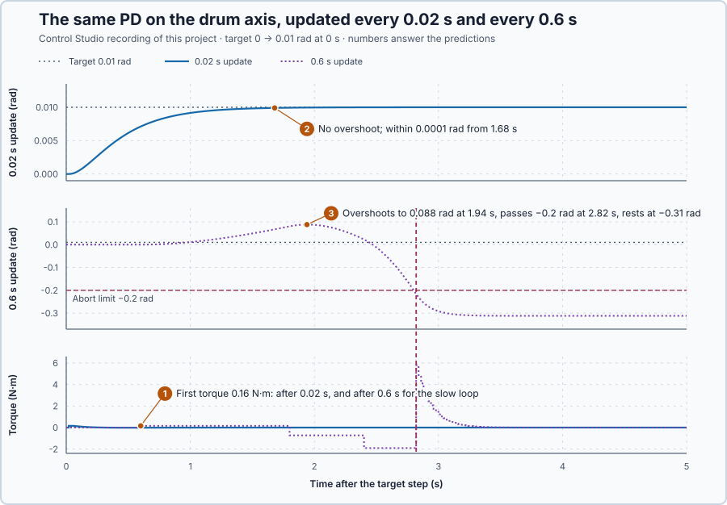

# 60. Sampled-data stability

In this lesson, you will model the drum axis's PD loop exactly as the PLC task runs it, with the torque held between updates and applied one update late, and test it with a 0.02 s and a 0.6 s update period. The long period will turn a stable design unstable.

## The problem

Lesson 59 measured the flexible axis's phase at 3 Hz 11° later than its continuous model, because the PID holds each torque for its 20 ms update. Every analysis so far treated the controller as continuous. A PLC task measures and calculates only at its updates, holds the torque in between, and applies a newly calculated torque one update later. How long may the update period become before this timing destabilizes a loop?

We return to the rigid drum axis, $J = 1$ kg·m² and $B = 1$ N·m·s/rad, under PD control with $K_p = 16$ N·m/rad and $K_d = 7$ N·m·s/rad, designed as continuous: $s^2 + 8s + 16 = (s + 4)^2$, both poles at −4. We will model the loop update by update and compare a 0.02 s and a 0.6 s period.

## What we need

We need to:

1. describe the axis from one update to the next while the torque is held;
2. include the update the calculation takes; and
3. decide from that description whether the loop is stable.

## The new idea

**Sampled-data analysis** models a digital controller exactly as it runs: it looks and acts only at its update instants and holds its command in between. The loop is stable when every pole lies inside the **unit circle**.

**In words.** Every analysis so far treated the controller as acting continuously. A PLC task does not: once per cycle it reads its inputs, calculates, and writes its outputs, and between cycles the outputs keep their last value. Three things follow:

1. **The held command.** Between updates the torque stays fixed, while the shaft keeps moving.
2. **The computation delay.** A torque calculated from one update's measurement reaches the drive only at the next update, one period later.
3. **An exact model from update to update.** Because the torque is constant over each period, the shaft's motion over one period can be calculated exactly. The loop then becomes a rule that gives the next update's values from this update's.

In PLC terms: $h$ is the task's cycle time, the output image is written once per cycle and held, and a value calculated in this cycle reaches the output in the next. A long cycle means the shaft travels far on an old torque, and the correction arrives late and is held too long, like steering a car while looking at the road only every few seconds.

A free motion of such a rule is multiplied by the same factor $z$ at every update. If $|z| < 1$ it shrinks, and if $|z| > 1$ it grows: the circle $|z| = 1$ is the stability boundary, and these factors are the poles of the sampled loop.

For the drum axis, the PD reads the angle and velocity every $h$ seconds; between updates the torque stays fixed while the shaft keeps moving.

**The formula.** The shaft obeys $\dot\omega = u - \omega$ and $\dot\theta = \omega$. With the torque $u_k$ held, the velocity relaxes towards $u_k$: $\omega(t_k + t) = u_k + (\omega_k - u_k)\,e^{-t}$. Its value at $t = h$, and its integral over the period, give the next velocity and angle exactly:

$$
x_{k+1} = x_k + b\,\omega_k + c\,u_k, \qquad \omega_{k+1} = a\,\omega_k + d\,u_k, \qquad a = e^{-h},\ b = d = 1 - e^{-h},\ c = h - 1 + e^{-h} .
$$

Let:

- $h$ be the update period, in s;
- $x_k$ be the angle's deviation from the target at update $k$, in rad;
- $\omega_k$ be the velocity at update $k$, in rad/s;
- $u_k$ be the torque held during period $k$, in N·m; and
- $a$, $b$, $c$ and $d$ be the coefficients of the exact update: $a$ is the share of the velocity left after one period, $d$ the velocity one N·m adds over it.

The **computation delay** is the update the calculation takes: the torque calculated from the measurement at update $k$ is applied from update $k + 1$,

$$
u_{k+1} = -K_p\,x_k - K_d\,\omega_k .
$$

Putting the mode $x_k = Xz^k$, and likewise $\omega_k$ and $u_k$, into the three update equations and eliminating $X$, $\omega$ and $u$ gives the characteristic polynomial

$$
z(z - 1)(z - a) + K_d\,d\,(z - 1) + K_p\,[c\,(z - a) + bd] = 0 .
$$

Multiplied out, it is $z^3 - (1 + a)\,z^2 + (a + K_d d + K_p c)\,z + K_p\,(bd - ac) - K_d d = 0$.

Two simple tests locate its three roots without solving it:

- **Sign changes.** Where the polynomial changes sign between two values of $z$, a root lies between them.
- **The product.** The three roots multiply to minus the constant term. If that product is larger than 1 in size, at least one root lies outside the unit circle.

**Example: three update periods.** With $K_p = 16$ N·m/rad and $K_d = 7$ N·m·s/rad:

1. **The coefficients.** For $h = 0.02$ s: $a = 0.9802$, $b = d = 0.0198$ and $c = 0.000199$. For $h = 0.6$ s: $a = 0.5488$, $b = d = 0.4512$ and $c = 0.1488$. For $h = 0.3$ s: $a = 0.7408$, $b = d = 0.2592$ and $c = 0.0408$.
2. **The hold.** With $h = 0.3$ s, a torque calculated at an update is applied 0.3 s later and held for another 0.3 s: each correction is up to 0.6 s old before it is replaced.
3. **$h = 0.02$ s.** The polynomial is $z^3 - 1.9802z^2 + 1.1220z - 0.1355$. Its signs at $z$ = 0, 0.2, 0.8, 0.9 and 1 are −, +, +, −, +, so it has a root at each sign change: three roots between 0 and 1, all inside the unit circle. Two lie near $e^{-4 \times 0.02} = 0.923$, the continuous poles $-4$ seen once per update; the third comes from the delay.
4. **$h = 0.3$ s.** The polynomial is $z^3 - 1.7408z^2 + 3.2082z - 1.2233$. The product of its roots is 1.2233, larger than 1, so at least one root lies outside the unit circle: the loop is unstable. Solving shows a pair at $0.636 \pm 1.486j$, $|z| = 1.62$: each update, that motion grows 1.62 times.

Both shafts in the experiment are simulated in the same 10 ms steps, so only the controller's timing differs. The 0.6 s period is a teaching choice, far slower than a real motion task, to make the effect visible; the 0.3 s period is a calculated example.

**The limitation.** Sampled or not, feedback produces torque only from an error that has already appeared: after a target step, the first torque exists only because the angle is short of the target.

## Prediction

Before running, answer these questions:

1. When does each loop apply its first torque after the target step?
2. Does the 0.02 s loop overshoot, and how fast does it settle?
3. What does the 0.6 s loop do?
4. Where does Control Studio put each loop's poles?

| $h$ | $a$ | $b = d$ | $c$ | Root test |
| --- | ---: | ---: | ---: | --- |
| 0.02 s | 0.9802 | 0.0198 | 0.000199 | three roots between 0 and 1: stable |
| 0.6 s | 0.5488 | 0.4512 | 0.1488 | root product 1.208: unstable |

## Implementation

Open [`src/Main.st`](src/Main.st). Two copies of the drum axis, simulated in 10 ms steps, are each held by the function block `DelayedPd`: $u = 16\,(r - \theta) - 7\omega$, limited to ±20 N·m and applied one update after its calculation. The first updates at every 20 ms scan, the second at every 30th scan, 0.6 s. When the project experiment starts, the target steps from 0 to 0.01 rad. Outside ±0.2 rad or ±2 rad/s the block latches its abort, clears the pending torque and brakes the shaft with $-7\omega$. [`sampled-loop-20ms.json`](sampled-loop-20ms.json) and [`sampled-loop-600ms.json`](sampled-loop-600ms.json) state the two sampled loops for Control Studio as discrete state-space models.

**ST practice.** Calculate `HeldVelocityFactor`, `HeldVelocityGain` and `HeldAngleGain` by hand for $h = 0.1$ s: $a = 0.9048$, $b = d = 0.0952$ and $c = 0.0048$. Then evaluate `SampledLoopPolynomial` at $z = 0$ for $h = 0.6$ s: $-K_d d + K_p(bd - ac) = -3.158 + 1.950 = -1.208$. The tests in [`src/tests.st`](src/tests.st), run from the **Testing** view, check $a$, $b$ and $c$ for both periods and the polynomial's values.

## Experiment in Control Studio

1. Open this lesson's project and start **Simulator**. Both axes rest at 0 rad. In the **truST** side bar, select **Control Studio**.
2. On **Identify**, choose **Project experiment** from **Method**. **Signals** already shows `P1.TargetRad · Setpoint (rad)`, `P1.FastAngleRad · Process value (rad)` and `P1.FastTorqueNm · Applied output (N·m)`, the 0.02 s loop; add `P1.SlowAngleRad · state (rad)`, `P1.SlowTorqueNm · state (N·m)` and `P1.SlowPendingNm · state (N·m)`, the 0.6 s loop's angle, applied torque and calculated torque waiting to be applied.
3. Answer the predictions. Select **Review project test**, check the declared **12.1 s** duration and select **Confirm and start**. After 2 s the target steps to 0.01 rad.
4. After the run, hover the torque steps and the 0.6 s angle's peak. At completion, Control Studio shows **Project test completed. Outputs restored.**
5. On **Identify**, choose **Supplied plant model** in **Method**, select **Open model…** and open `sampled-loop-20ms.json`. On **Tune**, choose **Poles and zeros** in **Tuning method**, keep **Pole view** at **Unreduced internal model** and select **Calculate poles and zeros**.
6. Repeat step 5 with `sampled-loop-600ms.json`.

Select **Abort test** to stop early. To repeat, stop and restart **Simulator**.

## Evidence and decision

The numbered marks answer predictions 1–3; Control Studio's poles answer 4, under the note **Discrete z-plane; the unit circle is the stability boundary.**

| $h$ | Poles | Largest $\lvert z \rvert$ | Result |
| --- | --- | ---: | --- |
| 0.02 s | 0.1645, 0.8777, 0.938 | 0.938 | inside: stable |
| 0.6 s | 0.2079, 0.6704 ± 2.32j | 2.41 | outside: unstable |

1. The first torque, 0.16 N·m, came one update after the step: after 0.02 s, and after 0.6 s in the slow loop.
2. The 0.02 s loop reached 0.01 rad without overshoot and stayed within 0.0001 rad from 1.68 s.
3. The 0.6 s loop held 0.16 N·m for two periods, then −0.73 N·m from 1.8 s and −1.91 N·m from 2.4 s, each one period after its calculation. The angle overshot to 0.088 rad at 1.94 s and passed −0.2 rad at 2.82 s, where the abort braked it to rest at −0.31 rad.
4. The 0.6 s loop's complex pair has $|z| = \sqrt{0.6704^2 + 2.32^2} = 2.41$ at 73.9°: each update, that motion grows 2.41 times and turns by 73.9°. All the 0.02 s poles lie inside, the largest at 0.938.

Control Studio also lists one zero per loop, −0.99 and −0.82; zeros do not decide stability. The sampled model predicted both outcomes before the run: that is its benefit. Its cost is that the update period becomes part of the design. These are simulation results.

## Conclusion

A sampled loop moves from update to update with its command held in between. Its exact update and the computation delay give a characteristic polynomial in $z$, and the loop is stable when every root lies inside the unit circle.

For the drum axis, the same PD was stable at 0.02 s, with every pole inside and the largest at 0.938, and unstable at 0.6 s, where a pole pair at $|z| = 2.41$ drove the angle past the abort limit.

## Check yourself

1. **What are $a$ and $c$ for $h = 0.2$ s?**
   $a = e^{-0.2} = 0.819$ and $c = 0.2 - 1 + 0.819 = 0.0187$.
2. **Why does the 0.6 s loop apply no torque during the first 0.6 s?**
   The torque calculated at the step is applied one update later; until then the previous torque, 0, stays held.
3. **A pole lies at $z = -0.5$. Is that motion stable, and what does it do?**
   Yes: $|z| = 0.5 < 1$, so it halves at every update, changing sign each time.

## Reason for the next lesson

With a 0.02 s update the loop behaves as designed. Feedback still acts only on errors that have appeared, though: in a planned move it waits for a following error, a lag behind the plan, before it supplies the torque the move needs.

[Trajectory feedforward](../../09-industrial-control-structures/90-trajectory-feedforward/README.md) calculates that torque from the planned motion and gives it right away.
