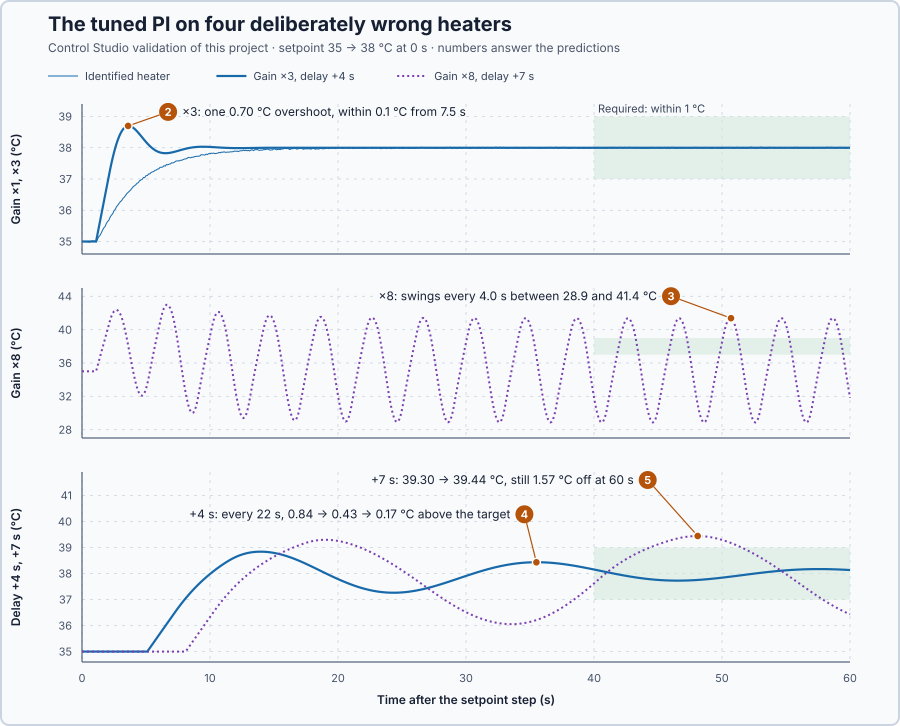

# 58. Robustness margins

In this lesson, you will read from the heater loop's frequency curve how much stronger heating and how much more delay the loop tolerates, and test these margins on four deliberately wrong heaters. You will also see that a loop inside its margins can still ring for a long time.

## The problem

Lesson 57 counted how the P-controlled heater's frequency curve goes around −1. With a 1 s delay the water settled at 35.067 °C; with 8 s each swing grew 1.44 times, and a 6.05 s delay put the curve through −1. A count answers yes or no for one model, but the real heater never matches its model: at a lower water flow the same power raises the temperature more, and a longer pipe delays the hot water. The count does not say how much error the loop tolerates.

Lesson 57 used P control as the simplest delayed loop; the heater normally runs PI, so we return to a PI tuned by Control Studio. We will read its tolerated gain error and extra delay from its frequency curve and test both on wrong heater models.

## What we need

We need to:

1. state how much stronger the heating may be than the model says before the loop becomes unstable;
2. state how much longer the delay may be; and
3. read both from the loop's frequency curve.

## The new idea

**Robustness margins** say how much the real plant may differ from its model before the loop becomes unstable: how much more gain, how much more lag, how much more delay.

**In words.** No model is exact. At a lower water flow the same power heats the water more, so the real gain is larger; a longer pipe delays the hot water more. Each kind of error moves the loop's frequency curve towards −1 in its own way:

1. **A gain error** stretches every point of the curve by the same factor.
2. **An extra delay** turns every point clockwise by $\omega\,\Delta t$ radians without changing its length, so it turns the fast points most.

A margin measures how far the curve can move one way before it reaches −1, the point where the loop keeps a swing going on its own. The **gain margin** is how much the curve may be stretched, the **phase margin** how much it may be turned at the crossover, and the **delay margin** how much extra delay that turn allows. The **peak sensitivity** measures the curve's closest approach to −1, whatever the direction.

They work like the safety factor of a mechanical part: the part is designed for a load, and the factor says how much more it can take before it fails. A margin says how much worse than its model the plant may be before the loop fails.

For the heater, they say how much stronger the heating may be, and how much later the hot water may arrive, before the temperature starts to swing.

**The formula.** Let:

- $\omega_c$ be the crossover frequency, where $|L| = 1$, and $\omega_{180}$ the frequency where the angle of $L$ is −180°, both in rad/s;
- $GM = 1/|L(j\omega_{180})|$ be the gain margin: the factor by which the loop gain may grow;
- $PM = 180° + \angle L(j\omega_c)$ be the phase margin: the extra lag allowed at crossover, in degrees;
- $DM = PM/\omega_c$, with PM in radians, be the delay margin: the extra delay allowed, in seconds; and
- $M_s = \max_\omega |1/(1 + L)|$ be the peak sensitivity. Since $|1 + L|$ is the distance from the curve to −1, $1/M_s$ is the curve's closest approach to −1.

Beyond the gain margin the curve passes left of −1 at $\omega_{180}$, and the loop swings at that speed. Beyond the delay margin the angle at crossover passes −180°.

For a loop of the form $L(s) = \dfrac{a}{s}\,e^{-s t_d}$, with $a$ in 1/s and the delay $t_d$ in seconds, the size is $a/\omega$ and the angle $-90° - \omega t_d$, with $\omega t_d$ turned into degrees. Then

$$
\omega_c = a, \qquad PM = 90° - a\,t_d, \qquad \omega_{180} = \frac{\pi}{2 t_d}, \qquad GM = \frac{\pi}{2a\,t_d}, \qquad DM = \frac{\pi}{2a} - t_d .
$$

**Example: the heater's tuned PI.** Control Studio identifies the heater as $0.2001\,e^{-s}/(5.1s + 1)$ and tunes $K_p = 5.79$ %/°C, $K_i = 1.14$ %/(°C·s). The integral time $K_p/K_i = 5.08$ s nearly equals the 5.1 s time constant, so the controller's zero cancels the heater's lag, as in Lesson 55:

$$
L(s) = \frac{a}{s}\,e^{-s t_d}, \qquad a = \frac{K K_p}{\tau} = \frac{0.2001 \times 5.79}{5.1} = 0.227\ \text{1/s},
$$

with $t_d = 1$ s, $K$ the heater's gain and $\tau$ its time constant. Follow the margins:

1. **Phase margin.** $|L| = 1$ at $\omega_c = a = 0.227$ rad/s, where the delay lags 0.227 rad, 13.0°. The angle is −103.0°, so $PM = 77.0°$.
2. **Gain margin.** The angle reaches −180° when $\omega t_d = \pi/2$: $\omega_{180} = 1.571$ rad/s, where $|L| = 0.227/1.571 = 0.145$. So $GM = 1/0.145 = 6.91$, or $20\log_{10} 6.91 = 16.79$ dB: the loop gain may grow almost seven times.
3. **Delay margin.** $DM = 1.344/0.227 = 5.91$ s, the same as $\pi/(2 \times 0.227) - 1$: the hot water may arrive almost 6 s later.
4. **Peak sensitivity.** Trying speeds, the curve comes closest to −1 at 0.93 rad/s, 0.817 away: $M_s = 1/0.817 = 1.22$. Since $S = 1/(1 + L)$, no load at any speed is amplified more than 1.22 times.

**The limitation.** Each margin covers one error at a time, and an error inside a margin uses up part of the others:

1. With twice the gain, the crossover moves to $2a = 0.454$ rad/s, where the delay lags 26.0°: only $90° - 26.0° = 64.0°$ of phase margin is left.
2. With 2 s more delay, the angle at crossover is $-90° - 0.227 \times 3 \times 57.3° = -129.0°$: 51.0° left. The gain margin shrinks too, from 6.91 to $\pi/(2 \times 0.227 \times 3) = 2.31$.

The less margin is left, the less damping: a loop inside its margins can still ring for a long time.

## Prediction

Before running, answer these questions:

1. Will Control Studio report the same margins as the formulas, although it calculates the complete loop without assuming exact cancellation?
2. The heater's gain is three times the model's. Does the temperature settle?
3. The gain is eight times the model's. What does the temperature do, and how long is one swing?
4. The delay is 4 s longer. Does the temperature settle, and how?
5. The delay is 7 s longer. Does it settle?

| Heater | Margin check | Expected |
| --- | --- | --- |
| Gain ×3 | 3 < 6.91 | settles; phase margin 51.0° |
| Gain ×8 | 8 > 6.91 | swings, one swing every 4.0 s |
| Delay +4 s | 4 s < 5.91 s | settles slowly; phase margin 24.9° |
| Delay +7 s | 7 s > 5.91 s | swings without settling |

## Implementation

Open [`src/Main.st`](src/Main.st). The heater has its 1 s delivery delay and ±0.02 °C noise. `Control.PID` runs as PI with the gains in `Parameters`, which **Apply** replaces; an invalid measurement latches `SafetyAbort`, which removes heating. `LoopCrossoverRate`, `GainMargin`, `PhaseMarginDeg` and `DelayMarginS` calculate $a$ and the three margins. [`control-loop.json`](control-loop.json) declares four validation scenarios, deliberately wrong heater models: three and eight times the gain, 4 s and 7 s more delay. Each requires the temperature within 1 °C of the target from 40 to 60 s after a 3 °C setpoint step.

**ST practice.** Calculate the four functions by hand for the identified heater and the tuned gains: `LoopCrossoverRate` with 0.2001, 5.79 and 5.1 gives 0.227 1/s; with `DelayS` = 1, the margins are 6.91, 77.0° and 5.91 s. The tests in [`src/tests.st`](src/tests.st), run from the **Testing** view, check the functions for $0.2/(5s + 1)$ with $K_p = 5.769$ %/°C: 0.2308 1/s, 6.81, 76.8° and 5.81 s.

## Experiment in Control Studio

1. Open this lesson's project and start **Simulator**. The heater rests at 35 °C with 75 %. In the **truST** side bar, select **Control Studio**.
2. On **Identify**, keep **Automatic** in **Method** and select **Identify plant**. The command steps from 75 to 95 % for 60 s; Control Studio shows G(s) = (0.2001) / (5.1s +1) · e^(−1s).
3. Answer the predictions.
4. On **Tune**, keep **P1.Controller · PI — recommended** and **Automatic**. Select **Requirements…**, enter **Setpoint change (°C)** 3, **Maximum steady-state error (°C)** 0.2, **Maximum settling time (s)** 15, **Settling band (±°C)** 0.1 and **Validation duration (s)** 60, and select **Done**.
5. Select **Tune controller** and read the line under the gains: **Gain margin 16.79 dB · phase margin 76.98° · delay margin 5.91 s · peak sensitivity Ms 1.22**.
6. On **Validate**, select **Validate controller**. Control Studio checks the model on the simulated heater, then runs the tuned PI for 60 s on the model and on each scenario.
7. Two rows fail: **Apply** stays unavailable, and Control Studio shows **Verification failed: Observed measurement exceeds the declared limit. Next: Tune again.**

Select **Abort** to stop identification or validation early. To repeat, stop and restart **Simulator**.

## Evidence and decision

The numbered marks answer predictions 2–5; Control Studio's tuning line answers 1. Its validation:

| Heater | Measured | Limit | Result |
| --- | ---: | ---: | --- |
| Identified, settling time | 9.9 s | 15 s | Pass |
| Gain ×3, error 40–60 s | 1.53e-5 °C | 1 °C | Pass |
| Gain ×8, error 40–60 s | 9.14 °C | 1 °C | Fail |
| Delay +4 s, error 40–60 s | 0.2736 °C | 1 °C | Pass |
| Delay +7 s, error 40–60 s | 1.57 °C | 1 °C | Fail |

1. Control Studio reported 16.79 dB, a factor of 6.91, 76.98°, 5.91 s and $M_s$ 1.22: the formulas' values. It calculates the complete loop, without assuming exact cancellation.
2. With three times the gain, the temperature overshot once, to 38.70 °C at 3.6 s, and stayed within 0.1 °C from 7.5 s.
3. With eight times the gain, it swung once every 4.0 s, as $\omega_{180}$ predicts. The heater's 100 % limit stopped the growth at 28.9–41.4 °C from about 30 s.
4. With 4 s more delay, it rang once every 22 s, with maxima 0.84, 0.43 and 0.17 °C above the target, and stayed within 0.27 °C from 40 s.
5. With 7 s more delay, it swung once every 29 s without settling: the second maximum, 39.44 °C, was above the first, 39.30 °C.

Every wrong heater inside its margin passed and every one beyond it failed, as the margins said in advance: that is their benefit. Their cost is what they leave out: the heater with 4 s more delay passed but still swung 0.27 °C after 40 s. Two scenarios fail, so this PI is not applied. These are simulation results.

## Conclusion

Robustness margins turn the distance between the loop's frequency curve and −1 into model errors the loop tolerates: a gain factor, a lag at crossover and an extra delay; the peak sensitivity gives the closest approach. Each covers one error at a time, and an error inside a margin uses up part of it.

For the heater's tuned PI, the margins were a gain factor of 6.91 and 5.91 s of extra delay. Three times the gain and 4 s more delay settled; eight times the gain and 7 s more delay swung.

## Check yourself

1. **The PI's gain is halved, so $a = 0.114$ 1/s. What are the gain and delay margins?**
   $GM = \pi/(2 \times 0.114 \times 1) = 13.8$ and $DM = \pi/(2 \times 0.114) - 1 = 12.8$ s.
2. **Why did the heater with 4 s more delay pass, although it rang for a long time?**
   4 s is inside the 5.91 s delay margin, so the loop stays stable; but only 24.9° of phase margin remains, which
   leaves little damping.
3. **What does $M_s = 1.22$ tell you about the curve?**
   It never comes closer than $1/1.22 = 0.82$ to −1, and no load at any speed is amplified more than 1.22 times.

## Reason for the next lesson

The margins assume the model's shape. A drive whose shaft twists swings strongly at one frequency, like a weight on a spring; there its gain rises sharply and can use up the gain margin a rigid model promised.

[Mechanical resonance](../89-mechanical-resonance/README.md) measures that swing and removes its frequency from the loop.
