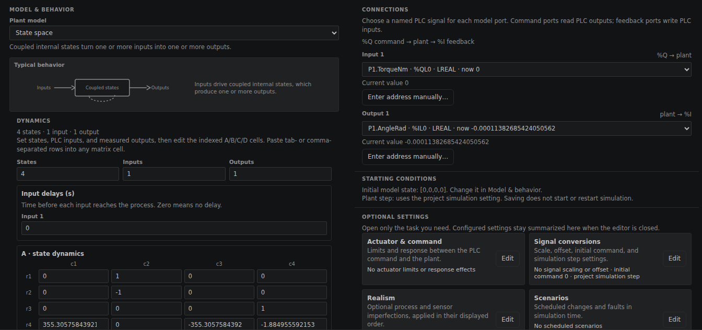
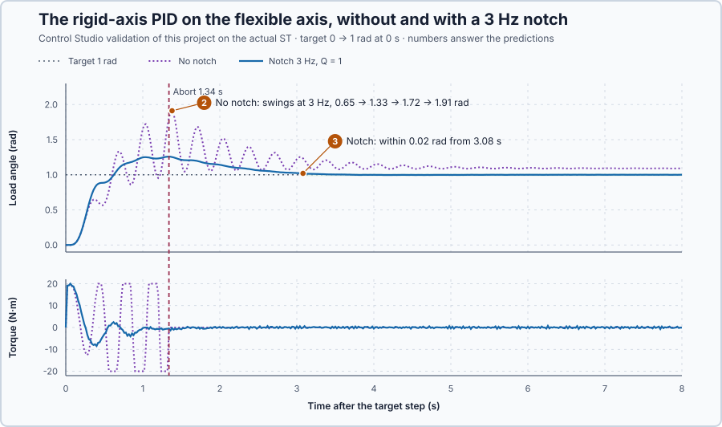

# 59. Mechanical resonance

In this lesson, you will measure a positioning axis whose load turns through a flexible coupling, see how the coupling's resonance uses up the gain margin of a PID tuned on a rigid model, and let Control Studio choose a notch filter on the actual ST. You will also see what the notch costs.

## The problem

Lesson 58 read the heater PI's margins from its model: its gain could grow 6.91 times and its delay 5.91 s, and four wrong heaters behaved as the margins said. Margins assume that the model's shape is right, but drive couplings twist. The drum axis, $J = 1$ kg·m² and $B = 1$ N·m·s/rad, now turns its load through a long, flexible coupling, with the encoder on the load. A PID tuned on the rigid model, $K_p = 18.77$ N·m/rad, $K_i = 17.46$ N·m/(rad·s) and $K_d = 7.27$ N·m·s/rad, makes it swing about three times per second, more each time, until the 1.8 rad safety limit removes the torque.

We will measure the axis's frequency response, find why it destabilizes the loop, and remove the swing's frequency from the measurement without changing the PID.

## What we need

We need to:

1. measure what the coupling adds to the axis's frequency response;
2. explain why that addition makes the loop unstable; and
3. take that one frequency out of the loop while the PID stays as it is.

## The new idea

**A resonance** is a frequency at which a flexible part swings strongly, like a weight on a spring. A **notch filter** removes just that frequency from the measurement, so the controller stops pushing the swing.

**In words.** The long coupling is a spring between motor and load. How the load answers the motor depends on how fast the motor moves:

1. **Slowly:** the load follows the motor, as if the coupling were rigid.
2. **At the coupling's own rate:** each push arrives just in time to add to the swing, and little damping takes energy out, so the load swings much farther than the motor. Pushing a child on a swing works the same way: small pushes in time build a large swing.
3. **Faster:** the load cannot keep up; it swings less and lags half a turn behind.

With the encoder on the load, the controller sees that large swing and pushes against it, at exactly the rate that feeds it. Near that rate the resonance lifts the loop's gain far above what the rigid model promised, and it can use up the whole gain margin. A notch filter takes that one frequency out of the measurement. The controller no longer sees the swing, so it stops feeding it, while it still sees slower motion as before. Analog input modules that reject 50 Hz mains hum use the same idea: a notch at one frequency.

A notch has a cost. Below its frequency it also delays the measurement a little, and the wider the notch, the more delay it adds at the slower rates the PID works at.

For the axis, the load swings on its coupling three times per second, and the encoder on the load reports the swing to the PID, which pushes it further.

**The formula.** The load follows the motor through the coupling:

$$
\ddot\theta_l + 2\zeta\omega_r\,\dot\theta_l + \omega_r^2\,\theta_l = \omega_r^2\,\theta_m .
$$

Let:

- $\theta_m$ and $\theta_l$ be the motor and load angles, in rad;
- $\omega_r$ be the natural frequency, the rate at which the load swings freely, in rad/s; and
- $\zeta$ be the damping ratio, without unit: how quickly a free swing dies away.

For a sine, the load answers the motor with

$$
R(j\omega) = \frac{\omega_r^2}{\omega_r^2 - \omega^2 + j\,2\zeta\omega_r\omega} .
$$

At $\omega = \omega_r$ the real part of the denominator vanishes and $R = 1/(j\,2\zeta)$: the gain is $1/(2\zeta)$ times the rigid value, at −90°.

The notch on the measurement is

$$
N(s) = \frac{s^2 + \omega_n^2}{s^2 + (\omega_n/Q)\,s + \omega_n^2} ,
$$

with $\omega_n$ the notch frequency, in rad/s. Its gain is 0 at $\omega_n$, where the numerator vanishes, and 1 at steady state. The **quality factor** $Q$, without unit, sets its width: the band where the gain is below $1/\sqrt2$ is $\omega_n/Q$ wide. A smaller $Q$ makes a wider notch.

A **multisine**, a sum of sines that each complete whole periods in every recorded segment, measures the frequency response at all its tones in one recording.

**Example: the flexible axis.** The coupling has $\omega_r = 2\pi \times 3 = 18.85$ rad/s and $\zeta = 0.05$, as configured in the simulated plant: $\omega_r^2 = 355.3$ and $2\zeta\omega_r = 1.885$.

1. **At 2 Hz,** $\omega = 12.57$ rad/s: $|R| = 355.3/|355.3 - 157.9 + 1.885 \times 12.57\,j| = 355.3/|197.4 + 23.7j| = 1.79$. Already below the resonance, the load swings 79 % more than the motor.
2. **At 3 Hz,** $|R| = 1/(2 \times 0.05) = 10$, at −90°: the load swings ten times as far as a rigid coupling would let it.
3. **Above** $\omega_r$ the size falls and the angle approaches −180°.
4. **The loop at the resonance.** With the encoder on the load, the axis is $G = R/(s(Js + B))$. At $\omega_r$ the rigid part gives 0.00281 rad/(N·m), and the PID gives $|C(j\omega_r)| = 137.4$ N·m/rad, so

$$
|L(j\omega_r)| = \frac{|C(j\omega_r)|\,|G_{rigid}(j\omega_r)|}{2\zeta} = \frac{137.4 \times 0.00281}{0.1} = 3.86 .
$$

There the angle is −185°, past −180°: the gain margin is $1/3.86 = 0.26$, and the loop is unstable.

5. **Just below the resonance,** at 17.0 rad/s, the loop gain without a notch is still 2.07. A notch must bring every such point below 1, not only the peak.
6. **The notch's width.** For a 3 Hz notch at 2 Hz, $s = 12.57j$: $|N| = 197.4/|197.4 + 236.9j/Q|$, which is 0.640 with $Q = 1$ and 0.929 with $Q = 3$. The wide notch already cuts well below 3 Hz; the narrow one hardly touches 2 Hz.
7. **The notch's cost.** At the rigid loop's crossover, 7.33 rad/s, the notch delays the measurement by $\arctan\big(138.2/(Q \times 301.6)\big)$: 24.6° with $Q = 1$ and 8.7° with $Q = 3$.

The 3 Hz coupling and the candidate notches are teaching choices.

**The limitation.** A notch removes one frequency; it cannot help if the resonance moves, for example with a different load. And every notch costs phase at the slower rates where the PID does its work, so the narrowest notch that covers the whole peak is the best one.

## Prediction

Before running, answer these questions:

1. Beside the peak at 3 Hz, what gain ratios to the rigid model do you expect at 2.5 Hz and 3.5 Hz?
2. What does the PID do without a notch, and how fast does the load swing?
3. Which 3 Hz notch should Control Studio choose, and does the loop then settle within 4 s?

| Notch | Loop gain at 17.0 rad/s | Loop gain at 18.85 rad/s | Notch delay at 7.33 rad/s |
| --- | ---: | ---: | ---: |
| Off | 2.07 | 3.86 | 0° |
| 3 Hz, $Q = 3$ | 1.09 | 0 | 8.7° |
| 3 Hz, $Q = 1$ | 0.42 | 0 | 24.6° |

| Tone | 2.5 Hz | 3 Hz | 3.5 Hz |
| --- | ---: | ---: | ---: |
| Ratio to the rigid model, $\lvert R \rvert$ | 3.16 | 10 | 2.64 |

## Implementation

Open [`src/Main.st`](src/Main.st). `Control.PID` runs the rigid-model PID on the notch-filtered load angle; `NotchFrequencyHz` and `NotchQuality` set the notch, and 0 Hz switches it off. Above 1.8 rad, `SafetyAbort` removes the torque. In the project experiment the program drives seven 1 N·m tones at 1, 2, 2.5, 3, 3.5, 4 and 5 Hz, each a whole number of periods in 2 s. [`control-loop.json`](control-loop.json) lets Tune search only the notch: 0, 2, 3 and 4 Hz with $Q$ = 1 and 3. Control Studio does not see the PID's gains, so **Requirements…** needs the **Auto-entry tolerance**: the most the first Auto output can move with the encoder noise, 1.5 N·m, almost all from the derivative, $4K_dn/\Delta t = 1.45$ N·m with $n = 0.001$ rad.

**ST practice.** Calculate `LoopGainAtResonance` for this PID and axis: 3.86. Then `NotchGain` at 2 Hz for $Q$ = 1 and 3, 0.640 and 0.929, and `NotchPhaseLagDeg` at 7.33 rad/s, 24.6° and 8.7°. The tests in [`src/tests.st`](src/tests.st), run from the **Testing** view, check these values.

## Experiment in Control Studio

1. Open this lesson's project and start **Simulator**. In the **truST** side bar, select **Devices & Connections**, then select the simulated plant **flexible-axis** inside **Simulator** to open **Configure plant**.

   

   The **State space** model has 4 states, the motor and load angles and velocities. **Input 1** is `P1.TorqueNm · %QL0` and **Output 1** `P1.AngleRad · %IL0`, the encoder on the load. The last row of **A · state dynamics** holds 355.3 and −1.885; **Realism** adds the encoder's ±0.001 rad. Select **Cancel**.
2. Select **Control Studio**. On **Identify**, choose **Project experiment** from **Method**. Answer the predictions, select **Review project test**, check the declared **26 s** duration and select **Confirm and start**: 2 s at rest, then 24 s of tones.
3. On **Tune**, choose **Measured frequency response**. Enter 6.283, 12.566, 15.708, 18.850, 21.991, 25.133, 31.416 in **Frequencies (rad/s, comma separated)**, 10 **Segments**, 0.8 **Minimum coherence** and **Discard startup samples** 300, the rest and the first 4 s of tones. Select **Calculate measured frequency response**.
4. On **Identify**, choose **Supplied plant model** in **Method**, select **Open model…** and open `flexible-axis-model.json`.
5. On **Tune**, keep **P1 · PID** and **Automatic**. Select **Requirements…**, enter **Setpoint change (rad)** 1, **Maximum steady-state error (rad)** 0.02, **Maximum settling time (s)** 4, **Settling band (±rad)** 0.01, **Validation duration (s)** 8 and **Auto-entry tolerance (N·m)** 1.5, select **Done**, then **Tune controller**.
6. On **Validate**, select **Validate controller**. When every row passes, select **Apply**; Control Studio shows **Applied**.

Select **Abort test** to stop early.

## Evidence and decision

The numbered marks answer predictions 2 and 3; the measured frequency response answers 1. Its coherence was at least 0.944:

| Tone | Measured gain (rad/(N·m)) | Ratio to the rigid model |
| --- | ---: | ---: |
| 1 Hz | 0.0282 | 1.13 |
| 2 Hz | 0.0113 | 1.79 |
| 2.5 Hz | 0.0127 | 3.14 |
| 3 Hz | 0.0278 | 9.89 |
| 3.5 Hz | 0.00537 | 2.60 |
| 4 Hz | 0.00199 | 1.26 |
| 5 Hz | 0.000537 | 0.53 |

1. At 2.5 and 3.5 Hz the ratios were 3.14 and 2.60, against 3.16 and 2.64 calculated. At 3 Hz the gain was 9.89 times the rigid model's, so the measurement gives $\zeta = 1/(2 \times 9.89) = 0.05$, as configured. The other ratios follow $|R|$ too, 1.79 at 2 Hz as calculated; at 5 Hz the tone barely exceeds the encoder noise, so the coherence fell to 0.944.
2. Without a notch, the load swung at 3 Hz with maxima of 0.65, 1.33, 1.72 and 1.91 rad; at 1.34 s it passed 1.8 rad and the abort removed the torque.
3. Tune recommended 3 Hz with $Q = 1$, the candidate with the smallest error. Validate found the load within 0.02 rad from 3.08 s, a steady-state error of 0.003371 rad and 34 range, state and transfer checks passed; Control Studio applied it.

The wide notch cuts the whole peak at a cost of 24.6° of phase at crossover. The measured phase at 3 Hz, −277.7°, is also 11° later than the model's −267°: each torque is held for its 20 ms update. These are simulation results.

## Conclusion

A resonance lifts the plant's gain at its natural frequency by $1/(2\zeta)$, so a loop tuned on a rigid model can lose its whole gain margin there. A notch wide enough to cover every frequency where the loop gain would exceed 1 removes the peak from the loop, at the price of phase at crossover.

For the flexible axis, the 3 Hz peak was 9.89 times the rigid gain. Without a notch the loop gain there was 3.86 and the load swung until the abort; with a 3 Hz notch, $Q = 1$, the same PID settled within 0.02 rad from 3.08 s.

## Check yourself

1. **If $\zeta$ were 0.1, what would the loop gain at 3 Hz be without a notch?**
   $0.386/(2 \times 0.1) = 1.93$: still above 1, so the loop would still be unstable.
2. **Why must the notch be wide, although a wide notch costs more phase?**
   The resonance lifts the gain over a band around 3 Hz; a narrow notch leaves $|L|$ near 1 just below the peak,
   where the angle is already near −180°.
3. **Why does the notch go on the measurement instead of a new PID?**
   It removes only the swing's frequency from what the PID sees, so the PID keeps the behaviour it was tuned for at
   slower rates.

## Reason for the next lesson

So far the controller was treated as continuous. The PID runs once every 20 ms and holds its torque in between; that hold already made the measured phase at 3 Hz 11° later than the model's.

[Sampled-data stability](../50-position-z-plane/README.md) models the loop exactly as the controller executes it, update by update.
