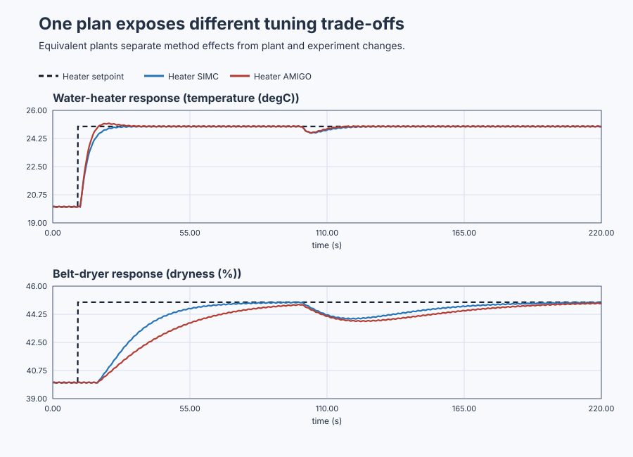

# Compare PI tuning methods without inventing a winner

Course position: Lesson 51 of 84. Previous lesson: [Prove sampled positioning stability in the z-plane](../../07-classical-stability-and-frequency-design/50-position-z-plane/README.md).
Next lesson: [Audit a complete Automatic Tune sequence](../52-automatic-water-heater/README.md).

**Lesson objective:** Use accepted models of three real industrial processes to decide which PI tuning methods are eligible, validate every real candidate under the same conditions, and conclude whether one candidate, several trade-off candidates, or no acceptable candidate meets the requirements.

**Evidence class:** Simulation evidence from the shipped lesson project, not evidence from the physical plant.

## The problem

Plants: Recirculating water heater, integrating buffer tank, and continuous belt dryer. Heater power controls water temperature, inlet-valve position controls
level against outlet flow, and dryer heater command controls product dryness
against incoming moisture load.

Heater power, inlet-valve position, and dryer heater command are manipulated
variables limited from 0 through 100 percent. The controller runs every 0.1
seconds. Each sensor has the same deterministic 0.02-unit sinusoidal
interference. This is Simulation evidence, not physical-plant evidence.

Lesson 44 compared Fast, Balanced, and Robust response targets inside one SIMC
method. It did not answer what to do when another qualified method returns
different gains for the same model. Lessons 45 through 50 added stability,
root-locus, Bode, Nyquist, sensitivity, and sampled-system evidence. We can now
compare methods without treating the smallest error or fastest trace as an
automatic winner.

## What we need

We need to compare tuning rules only on plant classes for which their assumptions are eligible and then run every real candidate under the same requirements. The result may be one choice, several explicit trade-offs, or no acceptable candidate.

## The new idea

Method eligibility means that the accepted plant model satisfies the
assumptions under which a published tuning rule was qualified. An ineligible
method is `Unavailable`; no controller candidate is created.

SIMC proportional-integral tuning is eligible for stable, monotone,
positive-gain first-order and first-order-plus-dead-time models. It is also
eligible for an integrating model when that model has a positive rate gain and
a resolved positive effective delay. AMIGO proportional-integral tuning is
eligible only for a stable, monotone, positive-gain
first-order-plus-dead-time model with positive dead time and a dead-time-to-
time-constant ratio no greater than one. AMIGO is unavailable for an
integrating model.

Both methods produce the same parallel `Control.PID` controller form. The
proportional gain ($K_p$) states requested actuator percentage points per unit of
present process error. The integral time ($T_i$), in seconds, describes the
relative time scale of integral action. The parallel integral gain ($K_i$) states
accumulated actuator percentage points per process unit per second.

$K_i = K_p / T_i$

SIMC uses a desired closed-loop time called lambda to make response speed an
explicit choice. This lesson uses the Balanced value already justified in
Lesson 44. Published AMIGO PI has no adjustable response-speed parameter. A
later comparison preference must not silently rewrite the AMIGO formula.

For a stable first-order-plus-dead-time model with gain $K$, time constant $T$,
dead time $L$, and selected response time $\lambda$, SIMC PI uses

$K_p=\frac{T}{K(\lambda+L)},\qquad
T_i=\min[T,4(\lambda+L)],\qquad K_i=K_p/T_i.$

The gain rises for a slower plant and falls for a larger plant gain or a more
conservative response target. For an integrating model with rate gain $K'$ and
effective delay $L$, SIMC instead uses
$K_p=1/[K'(\lambda+L)]$ and $T_i=4(\lambda+L)$.

For an eligible stable FOPDT model, the AMIGO PI equations used here are

$K_p=\frac{1}{K}\left[0.15+\left(0.35-\frac{LT}{(L+T)^2}\right)\frac{T}{L}\right]$

$T_i=0.35L+\frac{13LT^2}{T^2+12LT+7L^2},\qquad K_i=K_p/T_i.$

These empirical coefficients belong to the published rule; they are not knobs
to change after seeing a response. The divisions by $K$ and $L$ explain why
positive finite gain and dead time are eligibility requirements.

The setpoint ($SP$) is the desired temperature, level, or dryness. The process
value ($PV$) is the corresponding measured value. The control error ($e$) is the
difference between them.

$e = SP - PV$

Integral absolute error ($IAE$) accumulates the magnitude of error. Its units are
the process unit multiplied by seconds. Integral squared error ($ISE$) penalizes
large errors more strongly and has squared-process-unit seconds. Integral
time-weighted absolute error ($ITAE$) penalizes error that persists late in the
run and has process-unit seconds squared. For samples separated by sample
interval ($\Delta t$), the calculations are:

$IAE = \sum\left(|e_{k}| \cdot \Delta t\right)$

$ISE = \sum\left(e_{k}^{2} \cdot \Delta t\right)$

$ITAE = \sum\left(t_{k} \cdot |e_{k}| \cdot \Delta t\right)$

Overshoot is the peak process value above the requested change, expressed as a
percentage of that change. Settling means that the process value enters and
remains inside a declared band for a declared dwell. A response that does not
meet that rule is `Not settled`; its last sample is not steady-state evidence.

Cumulative applied-output movement measures actuator activity as total
variation. It is reported in percentage points and can exceed 100 because it
adds every movement rather than describing one command.

$MV_{\mathrm{travel}} = \sum\left(|MV_{\mathrm{applied},k} - MV_{\mathrm{applied},k-1}|\right)$

The requested manipulated variable is the controller's calculated output. The
applied manipulated variable is what reaches the simulated actuator after
limits. Requested and applied output remain separate even when they happen to
be equal in a valid run.

Gain margin is the additional loop-gain factor available at the
minus-180-degree phase crossing. Phase margin is the remaining phase before
minus 180 degrees at the unity-gain crossing. Delay margin is the additional
pure delay predicted to consume that phase margin at crossover.

The sensitivity function describes how output disturbance appears in control
error. After introducing sensitivity ($S$), complementary sensitivity describes
how the closed loop passes setpoint changes or measurement noise to process
output. It is written as complementary sensitivity ($T$). Loop transfer
($L_{\mathrm{loop}}$) is controller response multiplied by plant response.

$S = 1 / (1 + L_{\mathrm{loop}})$

$T = L_{\mathrm{loop}} / (1 + L_{\mathrm{loop}})$

Maximum sensitivity ($Ms$) and maximum complementary sensitivity ($Mt$) are the
largest magnitudes found on the declared frequency grid. Large peaks warn that
model uncertainty or disturbances can be amplified even when a nominal trace
looks acceptable.

Eligibility is checked first. Mandatory requirements are checked second. Only
then may feasible candidates be compared by preference. Pareto dominance means
one candidate is no worse on every declared preference measure and better on
at least one. Several candidates may remain because speed, robustness, and
actuator movement conflict. A visible weighted score
must disclose its inputs, normalization, weights, objective, and tie rule; it
must never hide the raw measures. If no candidate passes, report
`No acceptable candidate`. If several remain and no declared preference
separates them, report `Inconclusive`.

## Prediction

The heater model has plant gain $K = 0.20 {}^\circ\mathrm{C}/\%$, time constant $T = 5.0 s$,
and dead time $L = 1.0 s$. Balanced SIMC gives $K_p = 5.769 \%/{}^\circ\mathrm{C}$,
$T_i = 5.000 s$, and $K_i = 1.154 \%/({}^\circ\mathrm{C} \cdot s)$. AMIGO gives
$K_p = 6.028 \%/{}^\circ\mathrm{C}$, $T_i = 3.883 s$, and $K_i = 1.552 \%/({}^\circ\mathrm{C} \cdot s)$.
Predict that AMIGO rejects heater error sooner but uses more heater movement
and has smaller margins. For SIMC, $\lambda=3.333$ s, so
$K_p=5/[0.2(3.333+1)]=5.769$, $T_i=\min(5,17.333)=5$, and
$K_i=5.769/5=1.154$. Substitution in AMIGO gives $K_p=6.028$ and
$T_i=3.883$ s, hence $K_i=6.028/3.883=1.552$.

The tank model has integrating rate gain
$Kprime = 0.05 level-\%/(valve-\% \cdot s)$ and effective delay $L = 0.5 s$.
Balanced SIMC gives $K_p = 13.333 valve-\%/level-\%$, $T_i = 6.000 s$, and
$K_i = 2.222 valve-\%/(level-\% \cdot s)$. With $\lambda=1.0$ s, these follow
from $K_p=1/[0.05(1+0.5)]=13.333$ and $T_i=4(1+0.5)=6$. AMIGO must be `Unavailable` for this
integrating model; there is no finite steady plant gain or time constant to put
into its formula.

The dryer model has $K = 0.40 dryness-\%/heater-\%$, $T = 20.0 s$, and
$L = 8.0 s$. Balanced SIMC gives $K_p = 2.083 heater-\%/dryness-\%$,
$T_i = 20.000 s$, and $K_i = 0.104 heater-\%/(dryness-\% \cdot s)$. AMIGO gives
$K_p = 1.287 heater-\%/dryness-\%$, $T_i = 17.829 s$, and
$K_i = 0.072 heater-\%/(dryness-\% \cdot s)$. For SIMC, $\lambda=16$ s gives
$K_p=20/[0.4(16+8)]=2.083$ and $T_i=\min(20,96)=20$; both integral gains then
follow from $K_i=K_p/T_i$. Predict that AMIGO trades slower dryer
recovery for less actuator movement and larger robustness margins.

## Implementation

Each candidate uses a real `Control.PID`. This excerpt shows that only the
reviewed gains differ; the form, limits, initialization, and update interval
stay equal.

```st
HeaterSimcParameters.ProportionalGain := LREAL#5.769230769;
HeaterSimcParameters.IntegralGain := LREAL#1.153846154;
HeaterSimcController.Configure(Parameters := HeaterSimcParameters);

HeaterSimcInput.Setpoint := HeaterSetpoint;
HeaterSimcInput.ProcessValue := HeaterSimcTemperature;
HeaterSimcInput.CycleTime := LREAL#0.1;
HeaterSimcRequested := HeaterSimcController.Update(Input := HeaterSimcInput);
HeaterSimcApplied := MAX(MIN(HeaterSimcRequested, LREAL#100.0), LREAL#0.0);
```

There is no tank AMIGO controller. `TankAmigoEligible` remains false.

## Experiment in Control Studio

The project owns all five real controller runs, their setpoint and disturbance
schedule, the 220-second observation, and restoration to the declared operating
points. Control Studio may write only `P1.ExperimentEnabled`; it must not inject
another step. The 220.1-second timeout lets project restoration finish first.
The deterministic Simulation seed is 20260829.

### Control Studio actions

1. **Monitor** — Start the **Simulator**, then open **truST sidebar → Control Studio → Monitor → Response**.
   - **Baseline check:** Wait until the header shows **Simulation**, **Running**, and current data. Confirm Heater temperature setpoint (SP, degC) and Tank level setpoint (SP, %); Heater SIMC temperature (PV, degC) and Heater AMIGO temperature (PV, degC); Heater SIMC applied power (MV, %) and Heater AMIGO applied power (MV, %), including units, limits, mode, and quality. The initial operating point is Experiment enable = 0 (dimensionless), Tank AMIGO eligible = 0 (dimensionless), Heater temperature setpoint = 20 degC, Tank level setpoint = 50 %, Dryer dryness setpoint = 40 %, Heater SIMC applied power = 20 %, Heater AMIGO applied power = 20 %, Tank SIMC applied inlet valve = 50 %. The unresolved baseline problem is: One qualified method does not show whether another eligible published method offers a different response, robustness, or actuator-use trade-off.
   - **Decision before action:** Read **Prediction** above, then state what should move first and in which direction. Use this decision rule: Retain eligibility, unavailability reasons, raw measures, failed requirements, and Pareto trade-offs without inventing a universal winner.
   - **Successful evidence:** The Response plot advances and the displayed values are finite and current. Select **Start recording** only after those conditions are visible.
   - **Recovery:** If recording is disabled or the plot reports unavailable or stale samples, stop the Simulator, correct the displayed runtime or binding problem, restart it, and repeat the baseline check.
   - **Record:** Write down the initial SP, PV, requested/applied MV where available, controller mode, and your predicted response before opening Test.

2. **Test** — Restart the **Simulator** from the declared initial state, then open **truST sidebar → Control Studio → Test**.
   - **Baseline check:** Confirm **Experiment** = **Observe without excitation**, **Amplitude** = **0** (disabled), and **Maximum duration (s)** = **220.1**. The reviewed authority is **Experiment authority** (`P1.ExperimentEnabled`). The observed lesson signal is **Heater temperature setpoint**. It does not inject a second process event.
   - **Decision before action:** Before selecting **Review test**, predict the response to A minus-1-degC heater equilibrium shift at 100 s. Confirm the live values are current and the reviewed plan stays inside Heater SIMC applied power 0 % to 100 %; Heater AMIGO applied power 0 % to 100 %; Tank SIMC applied inlet valve 0 % to 100 %; Dryer SIMC applied heater command 0 % to 100 %; Dryer AMIGO applied heater command 0 % to 100 %; Tank SIMC level 0 % to 100 %.
   - **Successful evidence:** Select **Review test**, verify the affected signal, bounds, stop conditions, and restoration, then select **Confirm and start**. The state changes to **Running**, **Abort test** remains available, and the terminal state reports completion and restoration.
   - **Recovery:** For a rejected, stale, unsafe, unavailable, failed, or aborted state, read the displayed reason, stop and restart the Simulator, correct that cause, restore the initial state, and review a new test.
   - **Record:** Compare each real candidate with your calculated gains and predicted trade-off. Retain the terminal state, restoration result, and deterministic seed **20260829**. The native lesson test owns eligibility, common-plan metrics, margins, Pareto results, and verdicts; disabled Tune or Validate controls are not evidence.

## Evidence and decision

Every comparison below changes one thing only, so a difference is attributable.

Change only the tuning method and the resulting proportional gain ($K_p$) and
integral gain ($K_i$). Hold model and revision, controller form, bias, setpoint
weights, anti-windup, limits, rate limits, tracking time, initial state, sample
interval, duration, events, noise, seed, metric windows, frequency grid,
uncertainty cases, and abort rules equal.

Before viewing results, record IAE, ISE, ITAE, overshoot, settling status,
final-window absolute error, requested and applied peaks, cumulative applied-
output movement, maximum output rate, saturation duration, noise-driven output
activity, gain margin, phase margin, delay margin, maximum sensitivity, and
maximum complementary sensitivity. Show status and failed requirements before
any Pareto frontier or objective score.

Use the same qualification windows for every candidate. Setpoint tracking uses
10 through 100 seconds. A response is settled only when it remains within 5
percent of the commanded process-value change for 5 continuous seconds.
Disturbance rejection uses 100 through 220 seconds, with final mean absolute
error measured from 210 through 220 seconds. In that same final window,
noise-driven output activity is the root-mean-square deviation of applied
output from its mean; the limit is 0.5 percent RMS for the declared 0.02-unit,
0.5-hertz interference. Peak applied output must not exceed 100 percent,
maximum applied-output rate must not exceed 1000 percent per second, and time
at either output limit must remain zero. Record separate dispositions for
setpoint tracking, disturbance rejection, measurement noise, and bounded model
variation.

A result counts only when it passes the checks declared before the run.

First reject mismatched, stale, nonfinite, unstable, unbounded, or incomplete
runs. Applied output must remain from 0 through 100 percent. Gain margin must be
at least 6 dB and phase margin at least 30 degrees. A declared sensitivity
measure must be computed, not omitted. Each controller must remain bounded
under the declared gain and delay variations. Formula values must agree with
independent arithmetic within relative tolerance `1e-7`.

The executable run must confirm the predicted directions: heater AMIGO reduces
accumulated error but increases applied heater movement; dryer AMIGO increases
accumulated error but reduces applied heater movement. The tank SIMC response
must finish within 0.25 level percentage points, while AMIGO remains
unavailable and is never executed. Heater and dryer candidates must remain
within 10 percent overshoot. The integrating tank uses its own absolute
level-excursion requirement: no more than 0.8 level percentage points above
the 52-percent setpoint. All five real candidates must remain within 0.25
process units of final-window mean absolute error. Frequency and sensitivity
results come from the qualified Control Studio analyzer, not constants embedded
in Structured Text.

The retained common-plan evidence is:

| Candidate | IAE | Applied movement | Overshoot | Gain margin | Phase margin | Delay margin | Ms |
|---|---:|---:|---:|---:|---:|---:|---:|
| Heater SIMC | 27.44 degC*s | 93.34 pp | 0.39% | 16.66 dB | 76.78 deg | 5.81 s | 1.227 |
| Heater AMIGO | 23.87 degC*s | 102.48 pp | 3.88% | 16.02 dB | 67.52 deg | 4.40 s | 1.264 |
| Tank SIMC | 8.76 level-%*s | 179.04 pp | 0.69 level-pp | qualified separately | qualified separately | qualified separately | qualified separately |
| Dryer SIMC | 167.11 dryness-%*s | 33.94 pp | 0.11% | 13.46 dB | 70.90 deg | 29.70 s | 1.349 |
| Dryer AMIGO | 240.63 dryness-%*s | 23.04 pp | 0.00% | 17.41 dB | 74.37 deg | 46.11 s | 1.218 |

The time measures come from the 220-second executable simulation. Margins and
maximum sensitivity come from the accepted continuous model on a common
`0.0001` through `100 rad/s` logarithmic grid with 100 points per decade. The
tank's integrating frequency response is not replaced by a self-regulating
formula merely to fill this table.

These results create trade-offs rather than a universal winner. If a declared
application values faster heater recovery, AMIGO may remain preferable there.
If dryer actuator movement or robustness is limiting, its slower AMIGO
candidate may remain preferable. Without those application preferences, the
honest result is `Inconclusive`. Every candidate remains unapplied.

### Retained evidence

The figure compares equal experiments; the trace retains requested and applied
outputs. It is not a winner chart.



[Complete trace](figures/tuning-method-comparison-evidence-trace.csv) ·
[Decision summary](figures/tuning-method-comparison-evidence-summary.csv) ·
[Qualification record](figures/tuning-method-comparison-qualification.json)

## Conclusion

Heater AMIGO removes error sooner and moves the heater more. Dryer AMIGO moves
less and preserves larger margins while allowing error to persist. A method
name therefore does not determine aggressiveness.

AMIGO is unavailable rather than inferior for the buffer tank. The tank output
continues changing while net flow is nonzero, so the steady plant gain and time
constant required by the AMIGO formula do not exist. Inventing replacements
would conceal a model-domain error.

## Reason for the next lesson

Choose a tuning in three steps: prove method eligibility, prove candidate
feasibility with one common validation plan, then apply an explicit preference
among remaining trade-offs. A finite formula result is not an acceptance
certificate, and no method is universally best. The correct answer may be a
Pareto set, `Inconclusive`, or `No acceptable candidate`.

Lesson 52 automates the same inspectable decisions without concealing
uncertainty or applying a controller.
