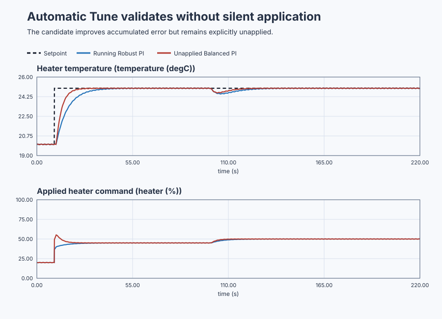

# Audit a complete Automatic Tune sequence

Course position: Lesson 52 of 84. Prerequisite:
[`control-tuning-method-comparison`](../51-method-comparison/).
Next lesson:
[`control-conveyor-oven-feedforward`](../../09-industrial-control-structures/53-conveyor-oven-feedforward/).

**Lesson objective:** Run and audit Automatic Tune for a recirculating water heater, explain why each stage passes or stops, recover from the taught failures, and export one validated but unapplied controller recommendation.

## The problem

Equipment: Recirculating electric water heater with independent
candidate-validation copy.

A one-sided electric heater adds heat to recirculating water. Heater power is
the manipulated variable from 0 through 100 percent. Water temperature is the
process value in degrees Celsius. The controller runs every 0.1 seconds.

The saved local model has plant gain 0.20 degrees Celsius per heater percentage
point, a 5.0-second time constant, and 1.0-second dead time. At the operating
point, 20 percent power holds 20 degrees Celsius. The running controller is the
reviewed Robust PI from Lesson 44. An independent simulated copy executes the
candidate only for validation. This is Simulation evidence, not physical
evidence.

Lesson 51 separated method eligibility, candidate feasibility, and engineering
preference. Repeating every decision manually is slow, but automation becomes
unsafe if it hides reused evidence, performs an unapproved test, weakens a
requirement, or applies its own recommendation. This lesson teaches what the
automation is allowed to sequence and what it must leave visible.

## What we need

We need a visible, recoverable sequence that qualifies data, accepts a model, generates a candidate, validates it, and stops honestly when any prerequisite fails. Completion must produce an unapplied recommendation rather than silently changing the running heater.

## The new idea

Automatic Tune is an orchestrator over the existing **Test**, **Identify**,
**Tune**, and **Validate** functions. It must not contain private copies of
their excitation, identification, formula, numerical, validation, application,
or rollback behavior.

A stage is one bounded engineering decision with declared inputs, outputs,
pass condition, failure reason, and recovery. A stage may reuse evidence only
when source, identity, revision, units, operating region, and freshness match
the next stage's contract.

Before running, the plan states whether evidence is reused, any proposed test
and restoration, model and controller structures, tuning methods, validation
requirements, and whether the result may only be exported. A Simulation plan
is confirmed once. A physical action requires an independently reviewed
topology and explicit approval immediately before that exact action.

Data qualification checks that signals are trustworthy and informative. It
checks quality, freshness, units, ordered sample times, missing or forced
values, limits, operating range, excitation, noise, stop state, and
restoration. This lesson has an exact saved simulated model as configuration
evidence, so no excitation is required. That shortcut is not an identified
physical model and must never be presented as one.

Model structure describes the dynamics represented by a model. Model
parameters give their numerical scale. Identification normally fits one data
interval and uses independent validation data to test prediction. Here the
**Identify** stage verifies the saved first-order-plus-dead-time structure,
revision, operating region, units, positive gain and time constant, and
nonnegative delay. It does not pretend to estimate already known parameters.

The **Tune** stage evaluates SIMC, AMIGO, and the qualified bounded P/PI/PD/PID
comparison. Every attempt remains `Feasible`, `Rejected`, or `Unavailable` with
its raw measures and reason. It may not substitute another formula or change a
requirement to obtain a result.

A lower comparison score is treated as a meaningful improvement only when it
is at least 10 percent lower than the current choice. If $J_c$ is the current
score and $J_n$ the new score, the percentage improvement is

$100\frac{J_c-J_n}{J_c}.$

This normalization answers “lower by what fraction of the current cost?” rather
than comparing score units with a percentage. Smaller differences stay
inside a 10-percent material-benefit band, where the declared deterministic
method order breaks the tie. In this experiment AMIGO's raw score is about 7.4
percent lower, below the 10-percent material-benefit threshold, so SIMC remains
the selected method. The visible explanation matters because the score table
alone would otherwise appear to contradict the recommendation.

The **Validate** stage compares the running controller and candidates with one
immutable validation-conditions record. That record fixes initial state,
setpoint and load events, noise and seed, sample times, duration, limits, and
model variations. Each requirement reports `Pass`, `Fail`, or `Inconclusive`
with value, limit, unit, evidence source, and reason.

An abort stops an actual experiment early. Restoration is the observed return
to the reviewed setpoint, mode, and safe applied output. Sending a restoration
request is not proof that restoration completed. A restoration failure is a
distinct terminal result.

A recommendation means that a candidate passed the declared comparison. It is
not permission to change a controller. **Apply** is a separate review and
authorization with current and candidate settings, revision checks, read-back,
and rollback. This lesson neither applies nor rolls back gains.

## Prediction

Predict this exact stage sequence:

$Test -> Identify -> Tune -> Validate$

The Test stage should reuse the exact saved Simulation model with zero
excitation. Identify should accept plant gain 0.20 degrees Celsius per percent,
time constant 5.0 seconds, and dead time 1.0 second without fitting.

For a FOPDT model, Balanced SIMC uses
$K_p=T/[K(\lambda+L)]$, $T_i=\min[T,4(\lambda+L)]$, and $K_i=K_p/T_i$.
With $K=0.20$, $T=5$, $L=1$, and balanced $\lambda=3.333$ s:

$K_p=\frac{5}{0.20(3.333+1)}=5.769,$

$T_i=\min[5,4(4.333)]=5.000\text{ s},$

$K_i=5.769/5=1.154.$

Therefore predict a SIMC PI recommendation with
proportional gain ($K_p$) `5.769 %/degC`, integral time ($T_i$) `5.000 s`, and
integral gain ($K_i$) `1.154 %/(degC*s)`. Model prediction should settle in about
`13.5 s`, overshoot by about `0.094 percent`, and end with normalized absolute
error below `0.001`. Those response values come from evaluating the complete
delayed closed-loop model, not directly from the gain formula, so the native
test must reproduce them independently. They are predictions, not PLC constants.

## Implementation

The confirmed Robust controller and the independent validation candidate use
the same real `Control.PID` form. Only the candidate gains differ.

```st
CurrentParameters.ProportionalGain := LREAL#3.260869565;
CurrentParameters.IntegralGain := LREAL#0.652173913;
CurrentController.Configure(Parameters := CurrentParameters);

CandidateParameters := CurrentParameters;
CandidateParameters.ProportionalGain := LREAL#5.769230769;
CandidateParameters.IntegralGain := LREAL#1.153846154;
CandidateController.Configure(Parameters := CandidateParameters);
```

Both paths retain requested and applied heater power separately. The program
contains no model fit, stage verdict, method winner, or controller write.

## Experiment in Control Studio

The visible lesson uses the same workflow as Lesson 8. The project owns the
five-degree setpoint change on both heater copies, the load event, the
220-second observation, and restoration to 20 degrees and 20-percent power.
Control Studio may write only `P1.ExperimentEnabled`; it must not inject another
step. The native lesson test owns the internal automatic stage sequence and its
failure branches. The 220.1-second timeout lets project restoration finish
first. The deterministic Simulation seed is 20260829.

### Control Studio actions

1. **Monitor** — Start the **Simulator**, then open **truST sidebar → Control Studio → Monitor → Response**.
   - **Baseline check:** Wait until the header shows **Simulation**, **Running**, and current data. Confirm Water-temperature setpoint (SP, degC); Current water temperature (PV, degC) and Candidate water temperature (PV, degC); Current applied heater power (MV, %) and Candidate applied heater power (MV, %), including units, limits, mode, and quality. The initial operating point is Experiment enable = 0 (dimensionless), Water-temperature setpoint = 20 degC, Current requested heater power = 20 %, Candidate requested heater power = 20 %, Current applied heater power = 20 %, Candidate applied heater power = 20 %, Current water temperature = 20 degC, Candidate water temperature = 20 degC. The unresolved baseline problem is: A manually reviewed controller does not yet prove that the complete automatic evidence, candidate, failure, and recovery sequence is inspectable and fail-closed.
   - **Decision before action:** Read **Prediction** above, then state what should move first and in which direction. Use this decision rule: Accept the workflow only when every stage and failure remains inspectable, the recommendation is validated, and the running controller revision remains unchanged.
   - **Successful evidence:** The Response plot advances and the displayed values are finite and current. Select **Start recording** only after those conditions are visible.
   - **Recovery:** If recording is disabled or the plot reports unavailable or stale samples, stop the Simulator, correct the displayed runtime or binding problem, restart it, and repeat the baseline check.
   - **Record:** Write down the initial SP, PV, requested/applied MV where available, controller mode, and your predicted response before opening Test.

2. **Test** — Restart the **Simulator** from the declared initial state, then open **truST sidebar → Control Studio → Test**.
   - **Baseline check:** Confirm **Experiment** = **Observe without excitation**, **Amplitude** = **0** (disabled), and **Maximum duration (s)** = **220.1**. The observed lesson signal is **Water-temperature setpoint**. Control Studio uses the existing Boolean project authority **P1.ExperimentEnabled** at **%MX96.0**; it does not inject a second process event.
   - **Decision before action:** Before selecting **Review test**, predict the response to A minus-1-degC equilibrium-temperature load at 100 s. Confirm the live values are current and the reviewed plan stays inside Current applied heater power 0 % to 100 %; Candidate applied heater power 0 % to 100 %; Current water temperature 0 degC to 60 degC; Candidate water temperature 0 degC to 60 degC.
   - **Successful evidence:** Select **Review test**, verify the affected signal, bounds, stop conditions, and restoration, then select **Confirm and start**. The state changes to **Running**, **Abort test** remains available, and the terminal state reports completion and restoration.
   - **Recovery:** For a rejected, stale, unsafe, unavailable, failed, or aborted state, read the displayed reason, stop and restart the Simulator, correct that cause, restore the initial state, and review a new test.
   - **Record:** Compare both heater copies with the derived gains and predictions, then retain the terminal state, restoration result, and deterministic seed **20260829**. The native lesson test must execute the internal `Test → Identify → Tune → Validate` sequence, every fail-closed branch, the unchanged-controller-revision check, and the unapplied result. Those internal service stages are evidence owned by the test; they are not extra student screens in this lesson.

## Evidence and decision

### Measures and comparison

Use one saved conditions record for the running Robust PI and the unapplied
candidate. Retain setpoint, process value, requested and applied power, IAE,
ISE, ITAE, overshoot, settling, final-window error, applied-power movement in
percentage points, saturation, margins, noise response, and bounded variation.

Also retain exact orchestration evidence: planned and executed stage order,
evidence revisions, confirmation count, excitation count, completed-stage
prefix, failed stage, stop reason, abort state, restoration state, candidate
$applied = false$, and active-controller revision before and after each path.

### Validation

The successful path must execute exactly Test, Identify, Tune, and Validate;
reuse the exact Simulation model with zero excitation; retain every method
attempt and requirement; reproduce the predicted Balanced PI within relative
tolerance `1e-7`; and leave the active-controller revision unchanged.

Every failure must stop at the first failed stage, execute no later stage,
preserve completed evidence, and offer the nearest recovery. Abort must stop
output changes. Restoration must be proven from observed state. Silent
excitation, repeated approval, weaker requirements, missing reasons, fabricated
models, evidence promotion, a changed active controller, or $applied = true$
fails the lesson.

### Retained evidence

The isolated validation compares the running Robust PI with the candidate
Balanced PI under one saved conditions record. The candidate trace demonstrates
performance; it does not grant permission to replace the running controller.



[Complete trace](figures/automatic-water-heater-evidence-trace.csv) ·
[Decision summary](figures/automatic-water-heater-evidence-summary.csv) ·
[Orchestration record](figures/automatic-water-heater-orchestration-evidence.json)

## Conclusion

This path is short because the exact saved Simulation model already supplies
accepted configuration evidence. Identification is not optional on an unknown
plant. With recorded or physical evidence, the same orchestrator must request a
bounded approved Test and independently validate the fitted model.

Stopping early with a specific recovery is correct automation. Continuing with
bad data or an unsupported model would create a plausible-looking but
unqualified controller.

## Reason for the next lesson

Automatic Tune is useful when it makes the engineering sequence reproducible
while leaving every decision inspectable. It must never turn Simulation
evidence into physical evidence, perform an unapproved action, conceal a
rejected result, weaken a requirement, or silently apply gains. Completion
means validated and unapplied; Apply and rollback remain separate authorized
operations.
