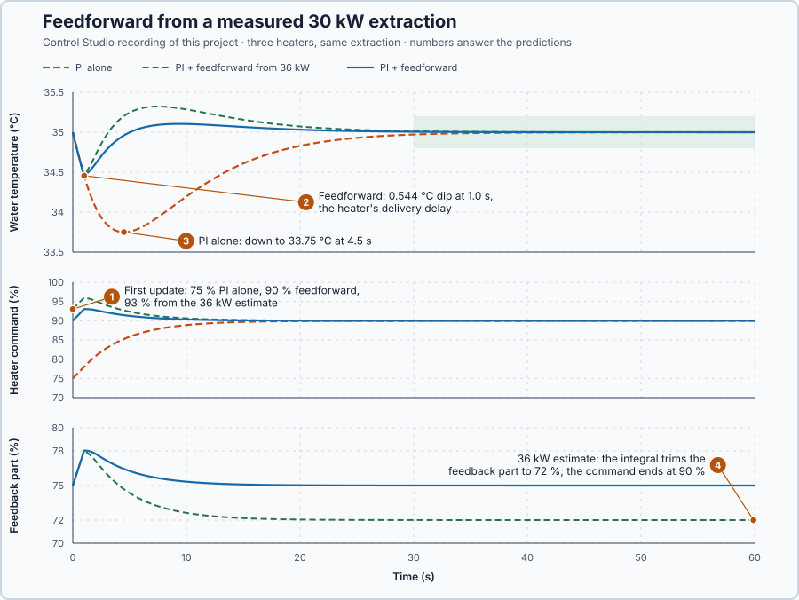

# 62. Feedforward control

In this lesson, you will calculate the heater command that replaces a measured heat extraction, add it to the PI, and compare PI alone, PI with feedforward and PI with feedforward from a wrong estimate on the same 30 kW extraction.

## The problem

Lesson 61's trajectory feedforward cut the drum axis's following error from 0.0922 to 0.00099 rad, because the plan said in advance which torque each part of the move would need. Many disturbances are not planned. On the water heater, colder inlet water draws heat from the moment it arrives. It can be measured, as the inlet flow and its temperature drop, yet a PI controller acts only after the water has cooled.

We return to the water heater for this reason: its disturbance is easy to measure, and its heat balance says exactly how much heater power replaces it. We will calculate that power from the measured extraction and give it to the heater at once.

## What we need

We need to:

1. measure the disturbance while it happens;
2. calculate from the heat balance the heater command that replaces it; and
3. add that command to the PI's request, with the PI still correcting what the calculation misses.

## The new idea

**Feedforward control** measures a disturbance and acts on it right away, before the temperature has changed, with the command that cancels it. Feedback then corrects whatever the feedforward gets wrong. For the heater, a measured extraction of 30 kW is answered at once with the heater power that replaces it.

**In words.** Feedback waits for an error: the water must first cool before the PI adds heat. Colder inlet water, though, can be measured the moment it arrives, as its flow and its temperature drop, and the heat balance says how much heater power replaces the heat it takes. Feedforward sends that power at once. It is the same idea as a sequence that starts a second pump as soon as a large consumer opens, instead of waiting for the pressure to fall. The heater command then has two parts:

1. **The feedforward part** comes from the measured disturbance: each kilowatt taken adds the command that puts a kilowatt back.
2. **The feedback part** comes from the PI, as before. It removes whatever the feedforward gets wrong: an error in the measurement, an error in the model, or a disturbance nobody measures.

Feedforward cannot do better than the process allows. The heater's power still takes 1 s to arrive, so for that second the water cools whatever the controller does.

**The formula.** Dividing the measured heat by the heater's power per point gives the command that replaces it, and that command is added to the PI's request:

$$
u_{ff} = \frac{D_m}{a}, \qquad u_r = P + I + u_{ff}.
$$

Let:

- $D_m$ be the measured extraction, in kW;
- $a$ be the heater power per command point, 2 kW per percentage point;
- $u_{ff}$ be the feedforward command, in percentage points;
- $P$ and $I$ be the PI's proportional and integral parts, in percent; and
- $u_r$ be the complete request, in percent. The output limits act on the complete request.

**Example: a 30 kW extraction on the water heater.** The water stores 50 kJ per °C, each command point delivers 2 kW one second after it is commanded, and the water loses 10 kW per °C above its 20 °C surroundings. With $T$ the water temperature in °C, $u$ the heater command in % and $D$ the extra extraction in kW, its energy balance is

$$
50\dot T = 2u(t - 1) - 10(T - 20) - D .
$$

At 35 °C the water loses $10 \times 15 = 150$ kW, which the heater replaces at 75 %. With 30 kW extracted as well, holding 35 °C needs 180 kW: 90 %. Follow the numbers:

1. The feedforward: $u_{ff} = 30/2 = 15$ points, so the request goes from 75 % to 90 % at the next update, exactly the command that holds 35 °C with the extraction.
2. Could it cancel the extraction perfectly? Around 35 °C and 75 %, with $x = T - 35$ and $v = u - 75$, dividing the balance by 10 gives $5\dot x + x = 0.2\,v(t - 1) - 0.1\,D(t)$. Perfect cancellation would need $0.2\,v(t - 1) = 0.1\,D(t)$ at every instant, so $v(t) = D(t + 1)/2$: the command would have to know the extraction one second before it happens. No controller can do that.
3. So for 1 s the extra heat is on its way. The water follows $5\dot x + x = -0.1 \times 30 = -3$: it heads for 3 °C below 35 °C with a 5 s time constant, and in that one second falls by $3(1 - e^{-1/5}) = 0.544$ °C.
4. Then the heat arrives and replaces the extraction, and the deviation dies away with the 5 s time constant. The PI corrects the small error that is left.

**The limitation.** Feedforward does not remove the delivery delay: the 0.544 °C dip belongs to the delay, and only a faster heater could make it smaller. And it is only as good as its measurement and model. If the estimate is 36 kW, 20 % too high, the feedforward requests 18 points and, after the delay, supplies 6 kW too much. Only the integral can remove the resulting error: it lowers the feedback part from 75 % to 72 %, so that $72 + 18 = 90$ % again.

## Prediction

Before running, answer these questions:

1. What command does each heater request at the first update after the extraction starts?
2. How far does the water fall with exact feedforward, and when?
3. Does PI alone let the water fall more or less, and why? The exact value needs the run.
4. With the 36 kW estimate, where do the command and its feedback part end?

| | PI alone | PI + feedforward | PI + feedforward from 36 kW |
| --- | ---: | ---: | ---: |
| First command | 75 % | 90 % | 93 % |
| Dip during the 1 s delay | — | 0.544 °C | 0.544 °C |
| Final command (feedback part) | 90 % (90 %) | 90 % (75 %) | 90 % (72 %) |

## Implementation

Open [`src/Main.st`](src/Main.st). The project holds three copies of the heater at 35 °C, each with `Control.PID` as PI with $K_p$ = 5 %/°C and $K_i$ = 1 %/(°C·s), a faster PI than the heater had before, so feedback alone gets a fair chance; this is a teaching choice. When Control Studio starts the project test, a 30 kW extraction starts on all three. The first runs PI alone. The second receives $u_{ff}$ from the measured extraction through the PID's `FeedForward` input, which adds it before the output limits. The third receives the feedforward from an estimate 20 % too high, 36 kW. Two functions do this lesson's calculations:

```st
LoadFeedforwardPct := MeasuredLoadKw / KwPerPoint;
UnavoidableDropC := LoadKw / LossKwPerC * (LREAL#1.0 - EXP(-DelayS / TimeConstantS));
```

**Exercise.** By hand, `LoadFeedforwardPct` gives 15 points for 30 kW and 18 points for 36 kW, and `UnavoidableDropC` with 30 kW, 10 kW per °C, a 5 s time constant and a 1 s delay gives 0.5438 °C. Open [`src/tests.st`](src/tests.st) and run its tests from the **Testing** view to check the same three values.

## Experiment in Control Studio

1. Open this lesson's project and start **Simulator**. The three heaters rest at 35 °C with 75 %. In the **truST** side bar, select **Control Studio**.
2. On **Identify**, choose **Project experiment** from **Method**. **Signals** already shows `P1.SetpointC · Setpoint (°C)`, `P1.PiOnlyC · Process value (°C)` and `P1.PiOnlyPct · Applied output (%)`, the PI-alone heater; add `P1.FeedforwardC · state (°C)`, `P1.BiasedC · state (°C)`, `P1.FeedforwardHeaterPct · state (%)` and `P1.BiasedHeaterPct · state (%)`.
3. Answer the predictions before starting.
4. Select **Review project test** and check the declared **62.1 s** duration: 2 s at rest, then 60 s with the 30 kW extraction on all three heaters.
5. Select **Confirm and start**.
6. After the run, hover the first update after 2 s and each heater's lowest temperature. Then add `P1.FeedbackPct · state (%)` and `P1.BiasedFeedbackPct · state (%)` and hover the end. Control Studio shows **Project test completed. Outputs restored.**

Select **Abort test** to stop early. To repeat, stop and restart **Simulator** so all three heaters start at 35 °C again.

## Evidence and decision



The numbered marks answer the predictions with the same numbers. From Control Studio's recording, times from the start of the extraction:

| | PI alone | PI + feedforward | PI + feedforward from 36 kW |
| --- | ---: | ---: | ---: |
| First command | 75 % | 90 % | 93 % |
| Lowest temperature | 33.75 °C at 4.5 s | 34.456 °C at 1.0 s | 34.456 °C at 1.0 s |
| Highest temperature | 35.00 °C | 35.10 °C at 9.4 s | 35.32 °C at 7.5 s |
| Largest error, 30–60 s | 0.028 °C | 0.006 °C | 0.013 °C |
| Command at 60 s (feedback part) | 90 % (90 %) | 90 % (75 %) | 90 % (72 %) |

1. At the first update, PI alone still requested 75 %; the feedforward heaters requested 90 % and 93 %, the calculated 15 and 18 extra points.
2. Both feedforward heaters fell by exactly the calculated 0.544 °C, to 34.456 °C at 1.0 s, and no further: the dip is the delivery delay and nothing else.
3. PI alone fell 2.3 times as far, to 33.75 °C, and later, at 4.5 s, because it had to see the error first.
4. The 36 kW estimate overheated the water to 35.32 °C before the integral trimmed its feedback part to 72 %; its command ended at 90 %, like the others.

The physics decides the final command; the feedforward decides only how soon it is reached. Every heater was within 0.2 °C of 35 °C from 30 s. The benefit is a dip 2.3 times smaller and over in a second; the cost is a measurement and a model, whose errors the integral must remove. Feedforward is accepted for this heater. These are simulation results.

## Conclusion

Feedforward adds $D_m/a$ from a measured disturbance to the feedback request, so the correction starts with the disturbance instead of with the error. It cannot act before the delivery delay, and it is only as good as its measurement and model; the integral removes what it gets wrong.

For the heater, the measured 30 kW extraction was answered with 15 points at once, the water dipped only the 0.544 °C the delay allows, and a 20 % wrong estimate was corrected by the integral.

## Check yourself

1. **A measured extraction of 24 kW with a = 2 kW per point: what feedforward command, and what request from 75 %?**
   24/2 = 12 points, so the request becomes 87 % at the next update.
2. **Why can exact feedforward not prevent the 0.544 °C dip?**
   The heater's power arrives 1 s after it is commanded. Cancelling the extraction exactly would need to know it
   1 s before it happens.
3. **The 36 kW estimate ends at 90 %, like the exact one. Why?**
   Holding 35 °C with the extraction needs 180 kW, 90 %, whatever the estimate. The integral trims the feedback part
   to 72 % so the total is right.

## Reason for the next lesson

Feedforward needs a measurement of the disturbance. A disturbance nobody measures, such as a heat loss through the jacket wall of a jacketed vessel, still reaches the process before feedback reacts.

[Cascade control](../52-cascade/README.md) closes an inner loop around the vessel's jacket temperature, a measurement that shows that disturbance early.
