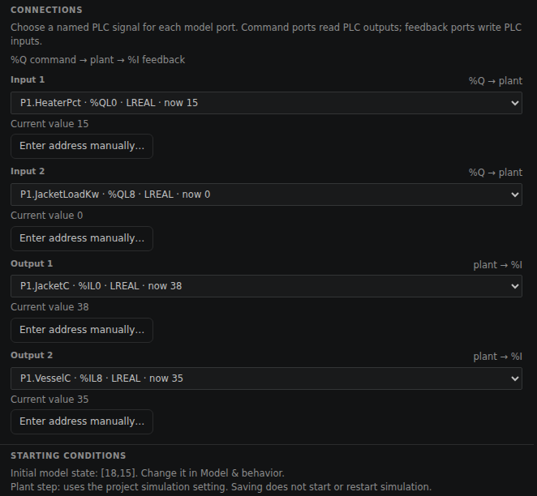
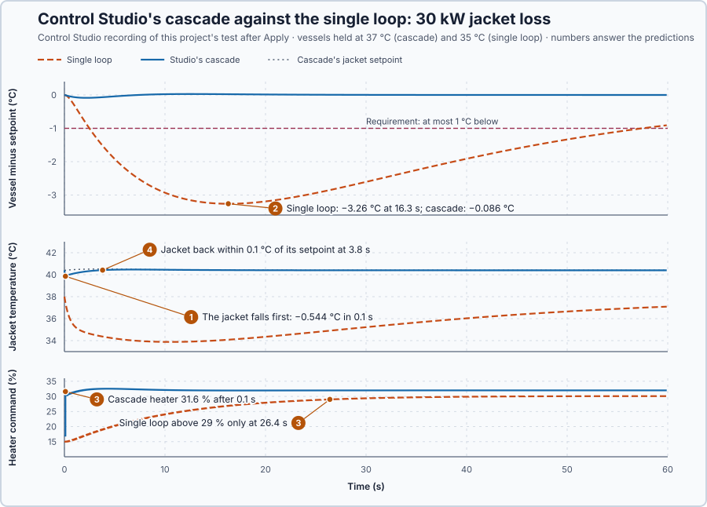

# 63. Cascade control

In this lesson, you will let Control Studio design a cascade for a jacketed vessel, inner loop first, and compare it with a single vessel loop on an unmeasured heat loss in the jacket.

## The problem

Lesson 62's feedforward answered a measured 30 kW extraction on the water heater at once: the water dipped only 0.544 °C, while PI alone let it fall to 33.75 °C. That needs a measurement of the disturbance. In a jacketed vessel, the heater warms a jacket of water around the vessel, and the jacket warms the liquid inside. A heat loss through the jacket wall is not measured, and it reaches the liquid before a vessel-temperature loop can respond.

The jacket temperature shows such a loss early. We will put a fast loop around it inside the vessel-temperature loop.

## What we need

We need to:

1. act on the measurement the disturbance moves first, the jacket temperature;
2. keep the vessel temperature as the objective;
3. tune the inner loop first and the outer loop through it, each with its own output limits.

## The new idea

**Cascade control** uses two loops, one inside the other. The **inner loop** quickly holds an intermediate temperature, the jacket, that shows a disturbance early. The **outer loop** sets the inner loop's target to hold the product temperature. For the vessel, the inner loop corrects a jacket loss before the liquid notices it.

**In words.** The heater does not warm the liquid directly: it warms the jacket, and the jacket warms the liquid. A heat loss in the jacket therefore shows in the jacket temperature at once, and in the liquid only later. A single loop on the liquid must wait until the liquid has cooled. A cascade splits the work between two controllers:

1. **Outside: the vessel temperature.** The outer controller reads the vessel temperature, the one that matters, and decides which jacket temperature the vessel needs. Its output is not a heater command but the inner controller's setpoint.
2. **Inside: the jacket temperature.** The inner controller reads the jacket temperature and moves the heater to hold the jacket at that setpoint. When the jacket loses heat, it raises the heater on its next update, before the liquid misses the heat.

In PLC terms it is the familiar level loop that writes the setpoint of a flow loop instead of a valve position: the flow loop removes supply-pressure changes within seconds, and the level loop never sees them. The arrangement works only if the inner loop is clearly faster than the outer one, because the outer loop counts on the jacket simply following its setpoint.

**The formula.** The jacket and the liquid each store heat, so each gets an energy balance: the heat stored per °C times the rate of change equals the heat in minus the heat out.

$$
5\,\dot T_j = 2u - 10\,(T_j - T_v) - D_j, \qquad 50\,\dot T_v = 10\,(T_j - T_v) - 2\,(T_v - 20) - D_v .
$$

Let:

- $T_j$ and $T_v$ be the jacket and vessel temperatures, in °C, and $\dot T_j$ and $\dot T_v$ how fast they change, in °C/s;
- $u$ be the heater command, in %, each point delivering 2 kW;
- 5 and 50 be the heat the jacket and the liquid store, in kJ per °C;
- 10 be the heat the jacket passes to the liquid, in kW per °C of difference, and 2 the heat the liquid loses to the 20 °C surroundings, in kW per °C; and
- $D_j$ and $D_v$ be extra losses from the jacket and from the liquid, in kW.

The liquid stores ten times as much heat as the jacket, and that sets the design order:

1. **Inner loop first.** On the jacket's time scale the vessel hardly moves. With $T_v$ held, dividing the jacket balance by 10 gives $0.5\,\dot T_j + T_j = 0.2\,u + \ldots$: gain 0.2 °C/%, time constant 0.5 s.
2. **Outer loop through the closed inner loop.** If the jacket follows its setpoint, $T_j = T_{j,sp}$, the vessel balance becomes $50\dot T_v = 10\,T_{j,sp} - 12\,T_v + 40$: gain 10/12 = 0.833, time constant 50/12 = 4.17 s.
3. Step 2 holds only if the closed inner loop is clearly faster than the 4.17 s of the outer process.

**Example: the jacketed vessel at 35 °C.** Follow the numbers:

1. Holding 35 °C: the liquid loses $2 \times 15 = 30$ kW, so the jacket must pass 30 kW, which takes $30/10 = 3$ °C of difference: the jacket at 38 °C. The heater supplies the 30 kW at 15 %.
2. With a 30 kW jacket loss, the heater must supply 60 kW: 30 %. At 37 °C the liquid loses 34 kW, so the heater needs 17 %, and 32 % with the loss.
3. The moment the jacket loss starts, $\dot T_j = -30/5 = -6$ °C/s while $\dot T_v = 0$: in one 0.1 s update the jacket falls about 0.6 °C, and the vessel has not moved. The inner loop sees the fall on its next update; a single vessel loop sees nothing yet.
4. A 30 kW loss taken from the liquid instead starts with $\dot T_v = -30/50 = -0.6$ °C/s and $\dot T_j = 0$: it does not show in the jacket first.

Control Studio steps the heater with both PIDs in Manual, fits one model to both temperatures, and designs the inner PI first and the outer PI through the closed inner loop. The outer PI's output, the jacket setpoint, is limited to 20–50 °C; the inner PI's, the heater command, to 0–100 %. Two checks of its gains follow from the design order: with the vessel held, the inner closed-loop poles solve $0.5s^2 + (1 + 0.2K_{p,i})s + 0.2K_{i,i} = 0$; and an outer PI whose integral time cancels the vessel's 4.17 s responds in $\lambda = 4.17/(0.833\,K_{p,o})$.

The comparison is a single vessel loop with $K_p = 2.5$ %/°C and $K_i = 0.1$ %/(°C·s): Lesson 19's rule for the whole vessel, with gain 1 °C/%, time constant $50/2 = 25$ s from the liquid's store and loss, and $\lambda = 10$ s.

The requirements, fixed before the test: a 2 °C setpoint step settles within ±0.2 °C in 30 s with a steady error of at most 0.3 °C; after a 30 kW jacket loss the vessel stays within 1 °C of its setpoint.

**The limitation.** A cascade helps only against disturbances that reach the inner measurement first. Step 4 shows that a loss from the liquid itself does not move the jacket first, so the inner loop sees it no earlier than the outer loop would. The cascade also needs a second sensor and a second controller, designed first, and an inner loop as slow as the outer one would make the outer loop's model, a jacket that simply follows its setpoint, wrong.

## Prediction

Before running, answer these questions:

1. Which temperature moves first after the jacket loss, and at what rate?
2. Which architecture lets the vessel fall further after the loss, and why?
3. How quickly does each heater command reach what the loss requires?
4. How much faster is Studio's inner loop than its outer loop?

| Quantity | Predicted |
| --- | ---: |
| Jacket rate just after a 30 kW loss | −6 °C/s, −0.6 °C per 0.1 s update |
| Heater command with the loss | 30 % at 35 °C, 32 % at 37 °C |

## Implementation

Open [`src/Main.st`](src/Main.st). The project holds two vessels at rest at 35 °C. The first has two `Control.PID` blocks in cascade, the outer one for the jacket setpoint and the inner one for the heater, each with its own Auto/Manual switch and manual output, both starting in Manual. The second keeps the single loop, `VesselPi`. The project test takes 30 kW from both jackets.

```st
HoldingJacketC := VesselC + LREAL#0.2 * (VesselC - LREAL#20.0);
HoldingCommandPct := (LREAL#2.0 * (VesselC - LREAL#20.0) + JacketLoadKw) / LREAL#2.0;
```

**Exercise.** By hand: `HoldingJacketC` is 38 °C at 35 °C; `HoldingCommandPct` is 15 % without and 30 % with the 30 kW loss; the single loop's gains are $25/(1 \times 10) = 2.5$ and $1/(1 \times 10) = 0.1$. Run [`src/tests.st`](src/tests.st) from the **Testing** view.

## Experiment in Control Studio

1. Open this lesson's project and start **Simulator**. In the **truST** side bar, select **Devices & Connections**: inside **Simulator**, two boxes marked **SIMULATED PLANT** hold the two vessels. Select **cascade-vessel**; **Configure plant** opens. Under **CONNECTIONS**:
   - **Input 1** is `P1.HeaterPct` (%QL0), the heater command;
   - **Input 2** is `P1.JacketLoadKw` (%QL8), the jacket loss in kW, which the project test sets;
   - **Output 1** is `P1.JacketC` (%IL0), the jacket temperature, 38 °C; and
   - **Output 2** is `P1.VesselC` (%IL8), the vessel temperature, 35 °C.

   **MODEL & BEHAVIOR** shows 2 states, one per store. Close the panel with **Cancel**.

   

2. Open the Command Palette and run **truST: Configure control loop**. **Set up control loop** recognises the cascade, **Cascade: one PID sets the other's setpoint**, with **Outer controller** `P1.Outer` and **Inner controller** `P1.Inner`. Enter **Loop name** `Vessel temperature`, each **Auto/Manual signal**, `P1.OuterAuto` and `P1.InnerAuto`, the units and ranges (vessel degC 20–60, jacket degC 20–80, heater % 0–100), **Identification step** 10, **Identification duration (s)** 120 and **Startup-done flag** `P1.Initialized`. Select **Save loop**; Control Studio opens on the new loop.
3. Answer the predictions before going on.
4. On **Identify**, keep **Method** **Automatic** and select **Identify plant**.
5. On **Tune**, check **Controller** **P1.Inner · Cascade**. Select **Requirements…**, enter **Setpoint change (°C)** 2, **Maximum steady-state error (°C)** 0.3, **Maximum settling time (s)** 30, **Settling band (±°C)** 0.2 and **Validation duration (s)** 60, select **Done**, then **Tune controller**.
6. On **Validate**, select **Validate controller**, then **Apply**. Studio shows **Applied**.
7. In the **truST** side bar, select **Control Studio** and choose **Jacket-loss test**. On **Identify**, choose **Project experiment** from **Method**; to the **Signals** shown, `P1.VesselSetpointC · Setpoint (°C)`, `P1.VesselC · Process value (°C)` and `P1.HeaterPct · Applied output (%)`, add `P1.SingleVesselC · state (°C)`, `P1.SinglePct · state (%)` and `P1.JacketLoadKw · disturbance (kW)`. Select **Review project test**, check **62.1 s**, and **Confirm and start**. Control Studio shows **Project test completed. Outputs restored.**

**Abort test** stops the test early; **Restore previous settings** on **Validate** returns the cascade to Manual.

## Evidence and decision



The numbered marks answer the predictions with the same numbers. Control Studio designed the inner PI with $K_p = 25.25$ %/°C and $K_i = 13.59$ %/(°C·s), the outer PI with $K_p = 0.8717$ and $K_i = 0.21$ per second. Its validation of the 2 °C step all passed: settling time 10.5 s (≤ 30 s), steady error 0.0129 °C (≤ 0.3 °C) and 50 range, state and transfer checks; the vessel reached 63 % at 5.7 s. After **Apply** the cascade held 37 °C, the end of that step, and the single loop 35 °C; the plant is linear, so each vessel is compared by its deviation. From the project test:

| Jacket loss of 30 kW | Single loop | Studio's cascade |
| --- | ---: | ---: |
| Largest fall of the vessel | **3.26 °C at 16.3 s, fails** | 0.086 °C at 2.2 s |
| Largest error, 30–60 s | **2.61 °C** | 0.003 °C |
| Heater above 29 % | after 26.4 s | after 0.1 s |
| Heater at 60 s | 30.09 % | 32.00 % |

1. The jacket fell 0.544 °C in the first 0.1 s, close to the predicted 0.6 °C; the vessel moved 0.006 °C.
2. The single loop waited for the vessel to cool and let it fall 3.26 °C.
3. The inner loop raised the heater to 31.6 % on its first update and held 32.00 %; the single loop's command passed 29 % only after 26.4 s.
4. The inner poles are −11.6 and −0.47 per second, the slow one nearly cancelled by the PI's zero at −13.59/25.25 = −0.54: the jacket follows in about 0.09 s. The outer response time, 4.17/(0.833 × 0.8717) = 5.7 s, is about 60 times slower, as validated. After the loss the jacket was back within 0.1 °C of its setpoint at 3.8 s.

The benefit is a jacket loss that never reaches the product; the cost, a second, much faster controller designed first. The cascade meets every requirement; the single loop fails the jacket loss. Studio's cascade is accepted and applied for this vessel. These are simulation results.

## Conclusion

A cascade lets a fast inner loop correct the disturbances that reach the intermediate measurement first, while the outer loop sets its target from the real objective. The inner loop is designed first and must be clearly faster.

For the jacketed vessel, Control Studio's inner loop was about 60 times faster than its outer loop; the applied cascade held the vessel within 0.086 °C through a 30 kW jacket loss, where the single loop let it fall 3.26 °C.

## Check yourself

1. **The vessel is held at 40 °C. What jacket temperature and heater command does that need?**
   The vessel loses 2 × 20 = 40 kW, so the jacket must be 4 °C warmer, 44 °C, and the heater must give 40 kW: 20 %.
2. **Why must the inner loop be designed first?**
   The outer loop's plant includes the closed inner loop: it assumes the jacket follows its setpoint, which holds only
   once the inner loop exists and is much faster.
3. **Why did the cascade catch the loss before the vessel moved?**
   The loss lowers the jacket at once; the inner loop raises the heater on its next update, before the vessel misses
   the heat.

## Reason for the next lesson

A new production requirement is of a different kind: an additive must be dosed in a fixed proportion to a carrier flow that keeps changing. A fixed setpoint for the additive flow cannot do that.

[Ratio control](../53-ratio-control/README.md) calculates the additive's setpoint from the measured carrier flow.
