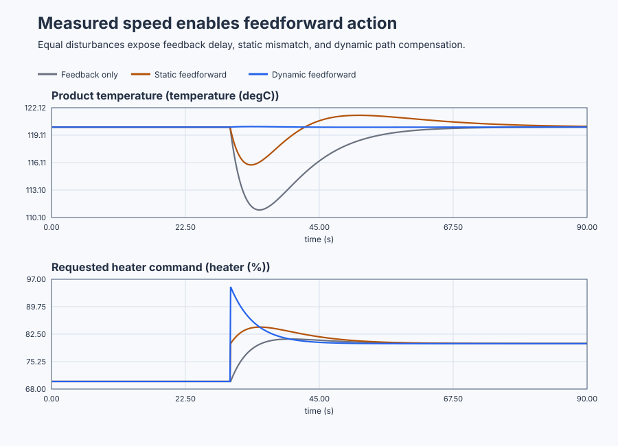

# Conveyor-oven measured-disturbance feedforward

Course position: Lesson 53 of 84. Previous lesson: [Automatic Tune](../../08-tuning-qualification-and-automation/52-automatic-water-heater/README.md). Next lesson: [Cascade control](../54-reactor-cascade/README.md).

**Lesson objective:** Use measured conveyor speed to design static and dynamic feedforward, compare both with feedback-only proportional-integral control, and decide whether early compensation justifies its actuator movement and dependence on a plant model.

## The problem

A continuous conveyor carries product through an industrial heating zone. The
heater can add heat but cannot actively cool. Heater power is limited from 0 to
100 percent. Product-zone temperature is measured in degrees Celsius. Conveyor
speed is measured as a ratio to nominal production speed: 1.0 is nominal and
2.0 is twice nominal.

The desired temperature is 120 degrees Celsius. At nominal speed, 70 percent
heater power holds that temperature. The controller runs every 0.1 seconds.
Three equivalent simulated ovens let us change only the feedforward structure:
feedback-only, static feedforward, or dynamic feedforward. This is Simulation
evidence, not physical-plant evidence.

Lesson 52 validated a complete tuning workflow, but a qualified feedback
controller can still accumulate load-disturbance error. Feedback must wait
until the process value changes.

Here, conveyor speed is measured before faster product changes the measured
zone temperature. We therefore know the cause before feedback sees the
consequence. The question is whether we can use that early measurement without
removing feedback, trusting a model outside its valid range, or bypassing the
heater limits.

## What we need

We need the measured conveyor-speed change to influence heater demand before downstream temperature error appears, while feedback still corrects model error and unmeasured loads. Early action is useful only if it remains inside controller and actuator constraints.

## The new idea

The **setpoint ($SP$)** is the desired product-zone temperature, 120 degrees
Celsius. The **process value ($PV$)** is the measured product-zone temperature in
degrees Celsius. The **temperature error ($e$)** is desired temperature minus
measured temperature. Positive error means the product is colder than desired.

$e = SP - PV$

The **requested manipulated variable ($MV_{\mathrm{requested}}$)** is the heater command
sent by the controller in percent. The **applied manipulated variable
($MV_{\mathrm{applied}}$)** is the heater power that reaches the oven after controller and
actuator constraints. The simulator reports the applied value separately even
though its nominal actuator has no extra lag or deadband.

The **measured disturbance ($d$)** is conveyor speed relative to nominal speed.
The **disturbance deviation ($\Delta d$)** is measured speed minus 1.0. A speed of
2.0 therefore gives a disturbance deviation of 1.0.

Feedback changes heater power because temperature error has already appeared.
Feedforward changes heater power because a measured disturbance predicts future
temperature error. The **process path** describes how heater power changes
temperature. The **disturbance path** describes how conveyor speed changes
temperature.

The requested heater command combines both actions:

$MV_{\mathrm{requested}} = MV_{\mathrm{feedback}} + MV_{\mathrm{feedforward}}$

The real feedforward value enters `PIDInput.FeedForward` before the controller's
rate limit, amplitude limit, anti-windup, and tracking calculations. Adding it
after `PID.Update` would hide part of the heater request from those protections.

### Static feedforward

The **steady heater-path gain ($K_{u}$)** is the eventual temperature change for
one percentage point of heater power. It is 2.0 degrees Celsius per percent.
The **steady disturbance-path gain ($\mathbf{K}_{\mathrm{d}}$)** is the eventual temperature change
for one unit of relative speed. It is -20.0 degrees Celsius: faster product
removes more heat from the controlled zone.

Static feedforward cancels the predicted final disturbance effect:

$MV_{\mathrm{feedforward\,static}} = -(K_{\mathrm{d}} / K_{u}) \cdot \Delta d$

For a speed change from 1.0 to 2.0:

$MV_{\mathrm{feedforward\,static}} = -(-20 / 2) \cdot 1 = 10.0 percentage points$

This is the correct final correction for the local model. It does not yet say
how quickly that correction should appear.

### Dynamic feedforward

The **heater-path time constant ($T_{u}$)** is 10.0 seconds. The **disturbance-path
time constant ($\mathbf{T}_{\mathrm{d}}$)** is 4.0 seconds. Conveyor speed therefore affects product
temperature faster than ordinary heater power does.

The **filtered disturbance deviation ($z$)** is a first-order representation of
the four-second disturbance path. After these quantities have been defined, the
two local path models are:

$G_{u}(s) = 2 / (10 \cdot s + 1)$

$G_{\mathrm{d}}(s) = -20 / (4 \cdot s + 1)$

Matching both path gain and timing gives this executable lead-lag form:

$MV_{\mathrm{feedforward\,dynamic}} = 25 \cdot \Delta d - 15 \cdot z$

$4 \cdot dz/dt + z = \Delta d$

Immediately after the speed step, the filtered value has barely moved. Dynamic
feedforward therefore requests a 25 percentage-point increase. As the filtered
value approaches 1.0, the correction approaches 10 percentage points. The
large initial action is compensation for the slower heater path, not an
arbitrary kick.

Feedback trim remains active in every case. It removes residual error caused by
model mismatch and unmeasured heat loss. Speed data that are stale, forced,
nonfinite, badly scaled, or outside their reviewed range must not retain
feedforward authority.

## Prediction

At the instant speed changes, product temperature is still 120 degrees Celsius,
so feedback-only initially remains at 70 percent heater power. Static
feedforward requests 80 percent: 70 percent plus 10 percentage points. Dynamic
feedforward initially requests 95 percent, then approaches 80 percent.

Predict the following order before viewing the plots:

1. Dynamic feedforward has the smallest nominal temperature excursion.
2. Static feedforward improves on feedback-only but leaves a transient because
   it ignores the two path time constants.
3. A dynamic scale of 0.8 leaves residual error that PI must remove.
4. Invalid speed data makes both feedforward values zero while feedback remains
   active.

## Implementation

The program uses three real `Control.PID` instances and one
`Control.LowPass`. All controllers have $K_p = 0.8 \%/{}^\circ\mathrm{C}$,
$K_i = 0.08 \%/({}^\circ\mathrm{C} \cdot s)$, zero derivative action, a 70-percent initialized
output, identical limits, and the same 0.1-second cycle.

The important implementation is deliberately short:

```st
StaticFeedforward := LREAL#10.0 * DisturbanceDeviation;
FilteredDisturbance := DisturbanceFilter.Update(
    Input := DisturbanceDeviation,
    CycleTime := LREAL#0.1
);
DynamicFeedforward := DynamicFeedforwardScale
    * (LREAL#25.0 * DisturbanceDeviation - LREAL#15.0 * FilteredDisturbance);

StaticInput.FeedForward := StaticFeedforward;
DynamicInput.FeedForward := DynamicFeedforward;
StaticHeaterRequest := StaticController.Update(Input := StaticInput);
DynamicHeaterRequest := DynamicController.Update(Input := DynamicInput);
```

When speed quality is invalid, the program sets both feedforward values to
zero. It does not embed an event metric, preferred design, or acceptance flag.

## Experiment in Control Studio

This procedure tests one declared lesson change under controlled conditions. Compare static gain compensation and dynamic gain-and-timing compensation, then change only the dynamic scale to 0.8 and separately invalidate measured speed. The declared event lasts 90 seconds. It restores Actual conveyor speed to 1 1 afterward. The deterministic Simulation seed is 20260829.

### Control Studio actions

1. **Monitor** — Start the **Simulator**, then open **truST sidebar → Control Studio → Monitor → Response**.
   - **Baseline check:** Wait until the header shows **Simulation**, **Running**, and current data. Confirm Product-temperature setpoint (SP, degC); Feedback-only product temperature (PV, degC); Feedback-only heater request (MV, %), including units, limits, mode, and quality. The initial operating point is Conveyor-speed validity = 1 (dimensionless), Actual conveyor speed = 1 (dimensionless), Measured conveyor speed = 1 (dimensionless), Dynamic feedforward scale = 1 (dimensionless), Static feedforward = 0 %, Dynamic feedforward = 0 %, Product-temperature setpoint = 120 degC, Feedback-only product temperature = 120 degC. The unresolved baseline problem is: Feedback-only PI cannot act at the speed event because product temperature has not changed yet. In Control Studio Monitor retain the pre-event state through 30.0 s and the restored terminal state at 90.0 s.
   - **Decision before action:** Read **Prediction** above, then state what should move first and in which direction. Use this decision rule: Accept feedforward only when equivalent runs reduce qualified temperature error without saturation and invalid speed data visibly removes feedforward authority.
   - **Successful evidence:** The Response plot advances, the displayed values are finite and current, and **Start recording** is enabled. Select **Start recording** only after those conditions are visible.
   - **Recovery:** If recording is disabled or the plot reports unavailable or stale samples, stop the Simulator, correct the displayed runtime or binding problem, restart it, and repeat the baseline check.
   - **Record:** Write down the initial SP, PV, requested/applied MV where available, controller mode, and your predicted response before opening Test.

2. **Test** — Open **truST sidebar → Control Studio → Test**.
   - **Baseline check:** Set **Experiment** = **Load disturbance step**, **Amplitude** = **1 (dimensionless)**, and **Maximum duration (s)** = **90**. The affected signal is **Actual conveyor speed**; it starts at 1 (dimensionless) and must restore to 1 (dimensionless).
   - **Decision before action:** Before selecting **Review test**, predict the response direction and confirm the requested change remains inside Feedback-only heater request 0 % to 100 %; Static-feedforward heater request 0 % to 100 %; Dynamic-feedforward heater request 0 % to 100 %; Feedback-only product temperature 90 degC to 145 degC; Static-feedforward product temperature 90 degC to 145 degC; Dynamic-feedforward product temperature 90 degC to 145 degC.
   - **Successful evidence:** Select **Review test**, verify the signal, requested bound, duration, restoration, and stop conditions, then select **Confirm and start**. The state changes to **Running**, **Abort test** remains available, and the terminal state confirms completion and restoration while Response shows the measured SP/PV/MV sequence.
   - **Recovery:** For a rejected, stale, unsafe, unavailable, failed, or aborted state, read the displayed reason, restore Actual conveyor speed to 1 (dimensionless), wait for current data, and review a new test.
   - **Record:** Compare the response with your prediction and retain the terminal state, restoration result, and deterministic seed **20260829**.

3. **Identify** — After **Stop recording**, open **truST sidebar → Control Studio → Identify**.
   - **Baseline check:** Use **Qualify recording** to inspect sample count, duration, timing, excitation, and clipping. **Model selection**, **Fit estimation run**, and **Accept model for design** are the shared low-order model workflow; they do not replace the project-owned **Static and dynamic measured-disturbance feedforward with PI trim** model and must not be accepted as this lesson's design authority.
   - **Decision before action:** Decide whether the recording contains the input/output change needed for **Static and dynamic measured-disturbance feedforward with PI trim** before fitting anything.
   - **Successful evidence:** A qualified recording has current, finite, sufficiently excited data. Use the project-owned model described under **Implementation** and **Evidence and decision**, and record its assumptions, units, validity range, and rejection rule.
   - **Recovery:** If qualification reports stale, clipped, poorly excited, or insufficient data, return to Test and repeat the bounded experiment; never force or relabel a rejected fit.
   - **Record:** State which model is retained or rejected and why, explicitly identifying the runnable project as the model authority.

4. **Tune / Design** — Open **truST sidebar → Control Studio → Tune**.
   - **Baseline check:** **Design method** and **Generate candidate** are disabled because **Static and dynamic measured-disturbance feedforward with PI trim** is designed by the runnable project; shared Control.PID tuning is unavailable. Do not select an unrelated PID method.
   - **Decision before action:** Apply the equations and choices under **Implementation**, then compare the declared alternatives under **Evidence and decision** before accepting **Static and dynamic measured-disturbance feedforward with PI trim**.
   - **Successful evidence:** Use **Monitor → Signals** to correlate the implemented project-owned design with its named live states and outputs. A disabled shared designer is only a visible ownership boundary, not successful design evidence.
   - **Recovery:** If the project-owned prerequisites or qualification flags are false, return to Test or Identify as directed by the lesson and do not bypass them with a generic PID candidate.
   - **Record:** State why the project-owned design is eligible, conditional, or rejected, including the decisive trade-off.

5. **Validate** — Open **truST sidebar → Control Studio → Validate**.
   - **Baseline check:** **Run required validation** is disabled because no shared Control.PID candidate exists. **Requirement details** and **Save result** cannot be used to claim a shared result; project-owned validation is executed by the runnable project's declared oracle.
   - **Decision before action:** Use the predeclared comparisons: static_event_iae_improvement < 0 degC*s (tolerance 0.01 degC*s); dynamic_event_iae_improvement < 0 degC*s (tolerance 0.01 degC*s); nominal_dynamic_feedforward_peak == 25 % (tolerance 0.2 %); nominal_dynamic_feedforward_final == 10 % (tolerance 0.05 %).
   - **Successful evidence:** Correlate the unrounded project-owned results with the named live signals and events in Monitor. Each applicable requirement must have a value, unit, limit, tolerance, evidence class, and Pass, Conditional pass, Fail, or Inconclusive disposition.
   - **Recovery:** If the project run aborts, becomes stale, fails, or violates restoration, discard that run and repeat the declared Test. Never present a disabled button or retained README table as newly executed evidence.
   - **Record:** State the validation disposition and name every failed or inconclusive requirement before continuing.

## Evidence and decision

### Measures and comparison

For the nominal comparison, change only feedforward structure. Keep plant,
initial state, PI settings, speed event, timing, limits, seed, duration, and
metric windows identical. For the mismatch run, change only the dynamic scale.

Define every decision measure before opening the result:

- **Event-window integral absolute temperature error ($IAE_{\mathrm{event}}$)** is the
  0.1-second-weighted sum of absolute temperature error from 30.0 through 60.0
  seconds, in `degC*s`.
- **Peak temperature deviation** is the largest absolute difference between PV
  and 120 degrees Celsius over the same window.
- **Cumulative applied-heater movement** is the sum of absolute changes between
  consecutive applied commands from 30.0 through 60.0 seconds, in percentage
  points.
- **Final-window mean absolute error** is the mean absolute temperature error
  from 80.0 through 90.0 seconds. Report it only when PV range is at most 0.05
  degrees Celsius and applied-heater range is at most 0.10 percentage points in
  that window; otherwise report `Not settled`.

### Validation

First qualify every run: values must be finite, heater power must remain from 0
through 100 percent, and accepted comparisons must not depend on saturation.
Then require static event IAE below feedback-only event IAE and dynamic event
IAE below static event IAE. Confirm a nominal dynamic peak near 25 percentage
points and a final value near 10 percentage points. In the shipped 90-second
run, the static case does not satisfy the final-window temperature-span rule;
report its final error as `Not settled`, not as a steady-state measurement.

The 0.8-scale case must show more residual error than the nominal dynamic case,
recover through PI, remain bounded, and still improve on feedback-only. With
invalid speed data, static and dynamic feedforward must both remain zero and all
three ovens must follow the feedback-only response.

### Retained evidence

The plot comes from the executable comparison above. It shows when the speed change reaches each oven, how much temperature error remains, and how the three heater commands differ.



[Complete trace](figures/conveyor-oven-feedforward-evidence-trace.csv) · [Decision summary](figures/conveyor-oven-feedforward-evidence-summary.csv)

## Conclusion

Feedback-only does not move at the speed event because its temperature error is
still zero. Static feedforward knows the required final heater increase, but the
disturbance path is faster than the heater path, so temperature still dips.
Dynamic feedforward requests more heater power initially to align those two
path responses.

That lower temperature error costs more immediate heater movement and depends
on model accuracy. The mismatch run shows why feedback trim remains necessary.
A smaller error is useful evidence, not permission to bypass actuator limits or
commission the same design on a physical oven.

## Reason for the next lesson

Use measured-disturbance feedforward when a trustworthy disturbance is
available early, both paths are valid over the operating region, and equivalent
tests show worthwhile improvement. Static feedforward compensates steady gain;
dynamic feedforward also compensates timing.

Lesson 54 introduces cascade control. It is needed when the useful early signal
is not an external disturbance but a faster controlled variable with its own
inner actuator-facing loop.
