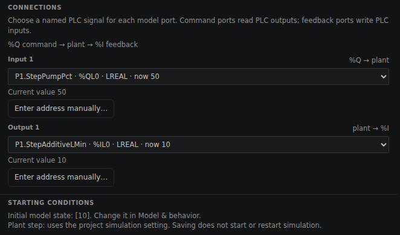
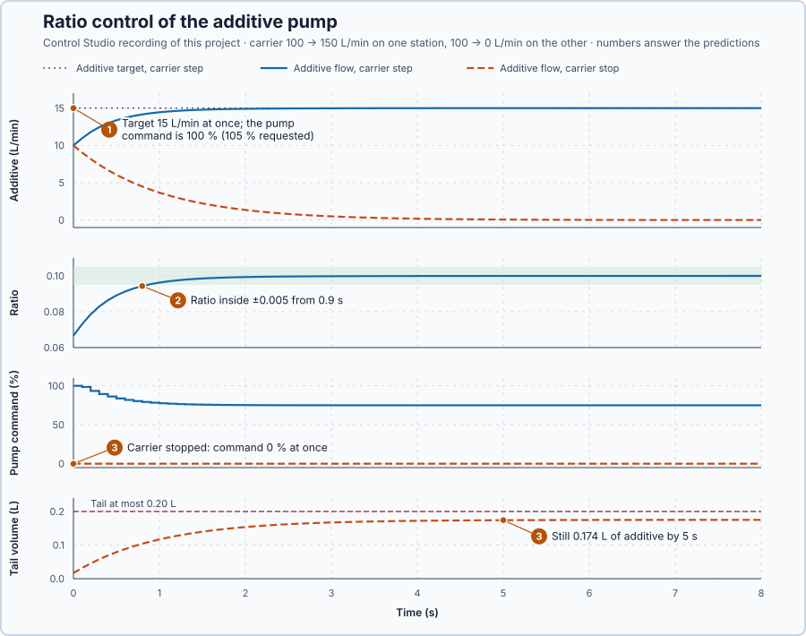

# 64. Ratio control

In this lesson, you will make an additive pump follow a target proportional to the measured carrier flow, watch the pump lag behind a carrier step, and stop it safely when the carrier stops.

## The problem

Lesson 63's cascade, designed by Control Studio, held the jacketed vessel within 0.086 °C of its setpoint through a 30 kW jacket loss, because its outer loop calculated the inner loop's setpoint and the inner loop corrected the jacket early. A new production requirement needs a different relationship. A mixing line doses an additive into a carrier stream at 0.1 L of additive per litre of carrier, and the carrier flow keeps changing. A fixed additive setpoint gives the right mixture at only one carrier flow, and when the carrier stops, the pump may still be delivering additive.

We will calculate the additive's target from the measured carrier flow and make the pump follow it.

## What we need

We need to:

1. give the additive pump a target that follows the measured carrier flow;
2. make the pump deliver that target despite its own lag; and
3. stop dosing when the carrier stops, and know how much additive still enters.

## The new idea

**Ratio control** keeps one flow at a fixed proportion of another by giving the dependent flow's controller a target calculated from the measured main flow. On the mixing line, the main flow is the carrier and the dependent flow is the additive: 0.1 L of additive for every litre of carrier, whatever the carrier does.

**In words.** The additive's setpoint is no longer a number an operator types in: the program calculates it every update from the measured carrier flow. When the carrier speeds up, the target rises with it; when the carrier slows down, the target falls. The arrangement has two parts:

1. **The ratio station** multiplies the measured carrier flow by the ratio and writes the result as the additive's setpoint.
2. **The additive loop**, an ordinary PI, makes the pump deliver that setpoint. It cannot follow at once, because the pump has its own lag.

In PLC terms the ratio station is a single multiplication in front of a setpoint, like scaling a dosing setpoint from a flow meter. The new part is what happens when the main flow stops: a proportion of nothing has no meaning, so the station needs a stop rule.

**The formula.** The target is the ratio times the measured main flow:

$$
q_{a,sp} = R\,q_c .
$$

Let:

- $q_c$ be the measured carrier flow, in L/min;
- $q_a$ and $q_{a,sp}$ be the additive flow and its target, in L/min; and
- $R$ be the required ratio, in litres of additive per litre of carrier.

The pump delivers $0.2u$ L/min at the command $u$ in %, and reaches a new flow with a 1 s lag: $\dot q_a + q_a = 0.2\,u$, so its gain is $K = 0.2$ L/min per % and its time constant $\tau = 1$ s. Lesson 19's rule with a response time $\lambda = 0.5$ s, a teaching choice, gives $K_p = \tau/(K\lambda) = 10$ % per L/min and $K_i = K_p/\tau = 10$ % per L/min·s.

**Example: the mixing line.** Follow the numbers:

1. At 100 L/min of carrier, the target is $0.1 \times 100 = 10$ L/min, which the pump delivers at $10/0.2 = 50$ %. A ratio of 0.1 is not 10 % of the mixture: the additive makes up $10/(100 + 10) = 9.09$ %.
2. The carrier steps from 100 to 150 L/min. The target jumps at once to $0.1 \times 150 = 15$ L/min, while the pump still delivers 10: an error of 5 L/min.
3. The first request is $50 + 10 \times 5 \times 0.1 + 10 \times 5 = 105$ %: the holding 50 %, the integral's first increment and P. The 0–100 % limit cuts it to 100 %.
4. The flow rises with the pump's 1 s lag, and the ratio stays below 0.1 until it has caught up: the lag, not a wrong target.
5. The command settles where the pump delivers 15 L/min: $15/0.2 = 75$ %.

**The limitation.** The ratio has no meaning when the carrier stops. Below 5 L/min of carrier, a teaching threshold, the station sets the pump command to 0 % in the same update, evaluates no ratio, and stays stopped until it is restarted. A zero command does not mean zero flow: from 10 L/min the flow decays as $q_a = 10\,e^{-t}$ L/min and still delivers

$$
\int_0^\infty \frac{10\,e^{-t}}{60}\,dt = \frac{10}{60} = 0.167\ \mathrm{L},
$$

where dividing by 60 turns litres per minute into litres per second. The program sums the tail as $V_{k+1} = V_k + q_{a,k}\,\Delta t/60$, with $V_k$ the volume so far in L, $q_{a,k}$ the flow at update $k$ and $\Delta t = 0.1$ s. Each update counts its whole 0.1 s at the flow it starts with, so the sum comes out slightly above the integral, by at most one update at full flow: $10 \times 0.1/60 = 0.017$ L.

The requirements, fixed before the run: ratio within ±0.005 from 10 to 60 s after the carrier step; additive flow within 0–20 L/min; tail after a stop at most 0.20 L.

## Prediction

Before running, answer these questions:

1. What are the additive target and the first pump command after the carrier step to 150 L/min?
2. For how long does the ratio stay outside ±0.005 after the step, and why?
3. What does the pump command do when the carrier stops, and how much additive still enters?

| Quantity | Predicted |
| --- | ---: |
| Additive target, before / after the step | 10 / 15 L/min |
| First request after the step | 105 %, applied as 100 % |
| Steady command at 150 L/min | 75 % |
| Tail after a stop from 10 L/min | 0.167 L, up to 0.017 L more |

## Implementation

Open [`src/Main.st`](src/Main.st). The project holds two copies of the additive pump, at 10 L/min with 50 %. The function block `RatioStation` sets the target $0.1\,q_c$ and runs `Control.PID` as PI with the gains above. Below 5 L/min of carrier it latches its stop, puts `Control.PID` in Manual at 0 %, evaluates no ratio and sums the tail volume. The carrier flows come from the project test: on the first station the carrier steps from 100 to 150 L/min, on the second it stops.

```st
AdditiveSetpointLMin := Ratio * CarrierLMin;
MixtureFraction := Ratio / (LREAL#1.0 + Ratio);
TailVolumeL := FlowLMin * TimeConstantS / LREAL#60.0;
```

**Exercise.** By hand, the target is 10 L/min at 100 L/min and 15 L/min at 150 L/min, the mixture fraction 9.09 % and the tail from 10 L/min with a 1 s lag 0.167 L. Open [`src/tests.st`](src/tests.st) and run its tests from the **Testing** view to check the same values.

## Experiment in Control Studio

1. Open this lesson's project and start **Simulator**. First look at the new plant. In the **truST** side bar, select **Devices & Connections**: inside **Simulator**, two boxes marked **SIMULATED PLANT** hold the two pumps. Select **additive-pump-step**; **Configure plant** opens. Under **CONNECTIONS**, **Input 1** is `P1.StepPumpPct` (%QL0), the pump command, and **Output 1** is `P1.StepAdditiveLMin` (%IL0), the measured additive flow. The carrier flow is not a plant here: the project's test supplies it, as a carrier flow meter would. Close the panel with **Cancel**.

   

2. In the **truST** side bar, select **Control Studio**. On **Identify**, choose **Project experiment** from **Method**. **Signals** already shows `P1.StepSetpointLMin · Setpoint (L/min)`, `P1.StepAdditiveLMin · Process value (L/min)` and `P1.StepPumpPct · Applied output (%)`; add `P1.MixRatio · state (1)`.
3. Answer the predictions before starting.
4. Select **Review project test** and check the declared **62.1 s** duration: 2 s at rest, then 60 s in which the first carrier steps to 150 L/min and the second stops.
5. Select **Confirm and start**.
6. After the run, hover the first second after the step. Then show the stopping station, `P1.StopAdditiveLMin`, `P1.StopSetpointLMin`, `P1.StopPumpPct` and `P1.TailL`, and hover 1 s and 5 s after the stop. Control Studio shows **Project test completed. Outputs restored.**

Select **Abort test** to stop early. To repeat, stop and restart **Simulator** so both pumps start at 10 L/min again.

## Evidence and decision



The numbered marks answer the predictions with the same numbers. From Control Studio's recording, times from the carrier changes:

| | Carrier 100 → 150 L/min | Carrier 100 → 0 L/min |
| --- | --- | --- |
| First command | 100 % | 0 % |
| Additive flow | 11.78 L/min at 0.2 s, 14.44 at 1 s, then 15.00 | 3.68 L/min at 1 s, 0.067 at 5 s |
| Ratio | 0.067 at the step; within ±0.005 from 0.9 s to 60 s | not evaluated |
| Command at 60 s | 75 % | 0 % |
| Tail volume | — | 0.174 L at 5 s, 0.175 L in all |

1. The target jumped to 15 L/min at the step and the pump command to 100 %, the limited 105 % request; it settled at the calculated 75 %.
2. The ratio was 0.067 at the step and inside ±0.005 from 0.9 s: the pump's lag, not a wrong target. From 10 s it stayed within 3·10⁻⁷ of 0.1.
3. The stopped pump got 0 % in the same update and no ratio was calculated, yet it delivered 0.175 L while its flow decayed: the calculated 0.167 L plus the sum's small overestimate, inside the 0.20 L limit.

Both flows stayed within 0–20 L/min. The benefit is a mixture that stays right while the carrier changes; the cost is a pump loop to tune and a stop rule to qualify. If the dose after a stop had to be zero, the pump would need a shut-off valve: a zero command cannot achieve it. Ratio control is accepted for this line. These are simulation results.

## Conclusion

Ratio control turns a measured main flow into the target of a dependent flow, $q_{a,sp} = R\,q_c$, so the proportion holds while the main flow changes; a separate loop makes the dependent flow follow, with its own lag. The ratio has no meaning when the main flow stops, so a stop rule must take over.

For the additive pump, the ratio was back within 0.005 of 0.1 after 0.9 s, and a carrier stop left a tail of 0.175 L that the command alone cannot prevent.

## Check yourself

1. **The carrier runs at 120 L/min with R = 0.1. What are the additive target and the pump's steady command?**
   12 L/min, and 12/0.2 = 60 %.
2. **Why was the ratio below 0.1 for 0.9 s after the carrier step?**
   The target jumped at once, but the pump's flow follows its command with a 1 s lag.
3. **The stopped pump's command was 0 %. Why did 0.175 L of additive still enter?**
   The pump's flow decays with its lag after the command drops; from 10 L/min that is about 10/60 = 0.167 L, plus the
   sum's overestimate.

## Reason for the next lesson

Back at the jacketed vessel, another process now delivers heat into the jacket, more than the vessel loses. The vessel needs both heating and cooling, and one positive heater command cannot ask for both.

[Split-range control](../54-split-range/README.md) divides one controller output between a heater and a cooler.
