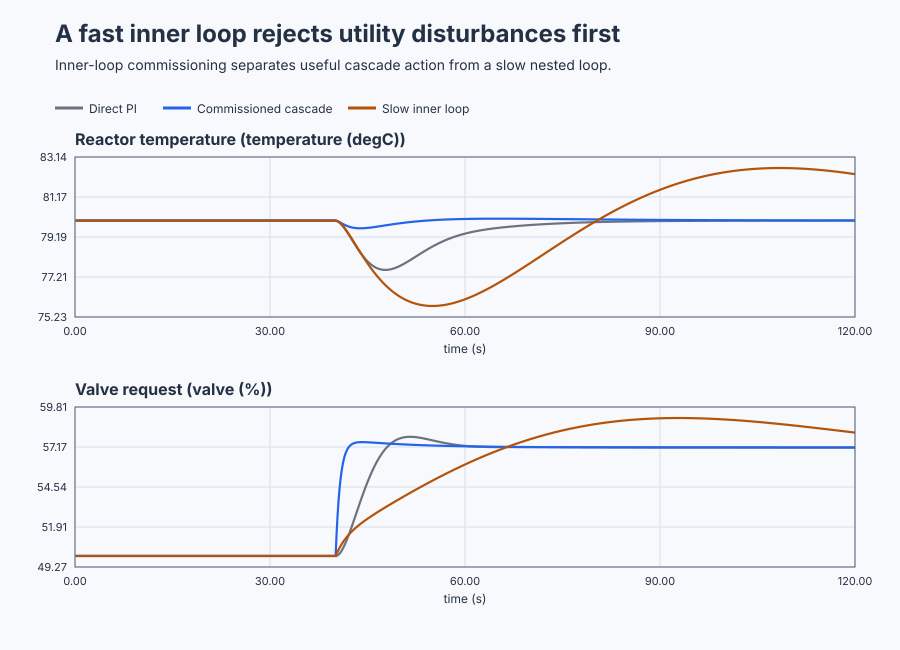

# Commission a jacketed-reactor cascade

Course position: Lesson 54 of 84. Prerequisite: measured-disturbance feedforward in
Lesson 53. All results in this lesson are **Simulation evidence**. They do not
authorize an experiment on a physical reactor.

**Lesson objective:** Commission a jacket-temperature inner loop before closing a reactor-temperature outer loop.

## The problem

A jacketed production reactor heats its product indirectly. A valve changes
the flow of steam or hot water through the jacket; heat then passes from the
jacket into the product.

Reactor temperature is the **primary controlled variable**, measured in
degrees Celsius. Jacket temperature is the **secondary controlled variable**,
also measured in degrees Celsius. The heating valve is a one-sided actuator:
its command ranges from 0 through 100 percent. It can admit more or less
heating utility, but it cannot actively refrigerate the reactor.

The operating point is 80 degrees Celsius product temperature, 70 degrees
Celsius jacket temperature, and 50 percent valve position. The three simulated
reactors have identical dynamics and begin at this point. One uses direct
reactor-temperature PI, one uses a fast commissioned cascade, and one uses an
intentionally slow inner loop. Every controller runs every 0.1 seconds.

Lesson 53 used feedforward because measured conveyor speed revealed a load
change before oven temperature moved. That solution required a trustworthy
disturbance measurement and models of both disturbance and actuator paths.

Here, utility condition need not be measured directly. Jacket temperature is a
faster variable through which the disturbance passes, and the same valve can
control it. Cascade control closes an inner feedback loop around that variable.
The added loop is justified only if it detects the disturbance earlier and can
respond substantially faster than the outer reactor loop.

## What we need

We need the jacket-temperature loop to reject utility disturbances before they propagate into reactor product temperature. The inner loop must be commissioned and proven sufficiently faster before the slower outer loop is allowed to command it.

## The new idea

### Which loop owns what?

The desired reactor temperature is the **primary setpoint ($SP_{\mathrm{primary}}$)**. The
measured reactor temperature is the **primary process value ($PV_{\mathrm{primary}}$)**.
Their difference is the **primary error ($e_{\mathrm{primary}}$)**. All three are in degrees
Celsius.

The jacket temperature requested by the outer controller is the **secondary
setpoint ($SP_{\mathrm{secondary}}$)**. Measured jacket temperature is the **secondary
process value ($PV_{\mathrm{secondary}}$)**. Their difference is the **secondary error
($e_{\mathrm{secondary}}$)**. These quantities are also in degrees Celsius.

The controller's calculated valve command is the **valve request
($MV_{\mathrm{requested}}$)**. The command that the final element actually achieves is the
**applied valve position ($MV_{\mathrm{applied}}$)**. Both use percent. They are equal in
this ideal simulation, but remain separate engineering quantities because a
real valve can saturate, rate-limit, stick, or be blocked by an interlock.

After defining those quantities, the cascade relationships are:

$e_{\mathrm{primary}} = SP_{\mathrm{primary}} - PV_{\mathrm{primary}}$

$SP_{\mathrm{secondary}}=PI_{\mathrm{outer}}\left(e_{\mathrm{primary}}\right)$

$e_{\mathrm{secondary}} = SP_{\mathrm{secondary}} - PV_{\mathrm{secondary}}$

$MV_{\mathrm{requested}}=PI_{\mathrm{inner}}\left(e_{\mathrm{secondary}}\right)$

The outer loop owns only the secondary setpoint. The inner loop has direct
valve authority. If both controllers write independently to the valve, the
structure is not cascade control.

### Why can the jacket loop be faster?

Jacket-temperature deviation **($x_{j}$)** is jacket temperature minus 70 degrees
Celsius. Reactor-temperature deviation **($x_{r}$)** is reactor temperature minus
80 degrees Celsius. Valve deviation **($u_{v}$)** is valve request minus 50
percent. Utility disturbance **($w$)** is the utility's equivalent jacket-path
contribution in degrees Celsius.

The jacket loses heat, gains heat from the valve, and is changed by utility
condition. Product temperature changes more slowly as jacket heat crosses into
the reactor. Around this operating point, the simulator uses:

$2 \cdot dx_{j}/dt = -x_{j} + 1.4 \cdot u_{v} + w$

$12 \cdot dx_{r}/dt = -x_{r} + (8/7) \cdot x_{j}$

The open jacket path has a 2-second time constant; the product path has a
12-second time constant. Those model numbers suggest an opportunity, but they
do not prove the closed inner controller is fast enough. We require its
measured settling time to be at least three times faster than the outer
response under the tested operating conditions.

### Commission the inner loop first

Tune and validate the inner loop first while the outer controller tracks its
jacket setpoint. Only then close the outer loop. If the inner tuning changes
afterward, the effective plant seen by the outer controller has changed and
the outer validation is no longer valid.

The inner controller owns valve saturation and anti-windup. **Saturation
propagation** means exposing lost valve authority so the outer integral does
not keep demanding an impossible jacket temperature. During commissioning or
loss of inner-loop availability, tracking aligns inactive controller state
with the value actually in authority. This supports a bumpless return.

## Prediction

First predict the commissioning result. A 5-degree-Celsius jacket-setpoint
step from 70 to 75 degrees Celsius should settle much faster with the
commissioned tuning than with the intentionally slow tuning.

Then predict the regulatory result. At 40.0 seconds, utility disturbance drops
from 0 to -10 degrees Celsius. Jacket temperature should cross a 0.10-degree-
Celsius deviation before reactor temperature. Direct PI initially sees almost
no primary error and leaves the valve near 50 percent. The fast inner loop sees
secondary error and opens the valve immediately, so it should accumulate less
reactor-temperature error. The slow inner loop should lose much of that
benefit.

Write these predictions down before revealing any trace.

## Implementation

The shipped program contains five real `Control.PID` instances: one direct PI,
two outer PIs, and fast and slow inner PIs. This is the governing structure:

```st
FastOuterInput.Setpoint := ReactorSetpoint;
FastOuterInput.ProcessValue := FastReactorTemperature;
FastJacketSetpoint := FastOuterController.Update(Input := FastOuterInput);

FastInnerInput.Setpoint := FastJacketSetpoint;
FastInnerInput.ProcessValue := FastJacketTemperature;
FastValveRequest := FastInnerController.Update(Input := FastInnerInput);
```

In commissioning mode, the outer controller uses Track mode and the bounded
jacket test setpoint goes to the inner controller. In normal operation, the
outer output becomes the inner setpoint. The simulation consumes the valve
request and separately exposes the plant measurements; no result metric or
preferred architecture is embedded in the PLC program.

## Experiment in Control Studio

This procedure tests one declared lesson change under controlled conditions. Commission the two jacket loops first, reject the deliberately slow one, then close the qualified fast inner loop beneath the same outer tuning. The declared event lasts 120 seconds. It restores Heating-utility disturbance to 0 degC afterward. The deterministic Simulation seed is 20260829.

### Control Studio actions

1. **Monitor** — Start the **Simulator**, then open **truST sidebar → Control Studio → Monitor → Response**.
   - **Baseline check:** Wait until the header shows **Simulation**, **Running**, and current data. Confirm Reactor-temperature setpoint (SP, degC); Direct reactor temperature (PV, degC); Direct valve request (MV, %), including units, limits, mode, and quality. The initial operating point is Reactor-temperature setpoint = 80 degC, Heating-utility disturbance = 0 degC, Jacket test setpoint = 70 degC, Direct reactor temperature = 80 degC, Direct jacket temperature = 70 degC, Fast-cascade reactor temperature = 80 degC, Fast-cascade jacket temperature = 70 degC, Slow-cascade reactor temperature = 80 degC. The unresolved baseline problem is: Direct reactor-temperature PI cannot act until the slow product temperature has already changed. In Control Studio Monitor select commissioning mode, retain the inner-loop boundary at 10.0 s, and retain the outer-loop boundary at 40.0 s.
   - **Decision before action:** Read **Prediction** above, then state what should move first and in which direction. Use this decision rule: Accept cascade only when the inner loop is commissioned first, detects the disturbance earlier, is at least three times faster, and improves equivalent reactor-temperature evidence.
   - **Successful evidence:** The Response plot advances, the displayed values are finite and current, and **Start recording** is enabled. Select **Start recording** only after those conditions are visible.
   - **Recovery:** If recording is disabled or the plot reports unavailable or stale samples, stop the Simulator, correct the displayed runtime or binding problem, restart it, and repeat the baseline check.
   - **Record:** Write down the initial SP, PV, requested/applied MV where available, controller mode, and your predicted response before opening Test.

2. **Test** — Open **truST sidebar → Control Studio → Test**.
   - **Baseline check:** Set **Experiment** = **Load disturbance step**, **Amplitude** = **-10 degC**, and **Maximum duration (s)** = **120**. The affected signal is **Heating-utility disturbance**; it starts at 0 degC and must restore to 0 degC.
   - **Decision before action:** Before selecting **Review test**, predict the response direction and confirm the requested change remains inside Direct valve request 0 % to 100 %; Fast-cascade valve request 0 % to 100 %; Slow-cascade valve request 0 % to 100 %; Fast-cascade jacket temperature 45 degC to 90 degC; Fast-cascade reactor temperature 60 degC to 95 degC.
   - **Successful evidence:** Select **Review test**, verify the signal, requested bound, duration, restoration, and stop conditions, then select **Confirm and start**. The state changes to **Running**, **Abort test** remains available, and the terminal state confirms completion and restoration while Response shows the measured SP/PV/MV sequence.
   - **Recovery:** For a rejected, stale, unsafe, unavailable, failed, or aborted state, read the displayed reason, restore Heating-utility disturbance to 0 degC, wait for current data, and review a new test.
   - **Record:** Compare the response with your prediction and retain the terminal state, restoration result, and deterministic seed **20260829**.

3. **Identify** — After **Stop recording**, open **truST sidebar → Control Studio → Identify**.
   - **Baseline check:** Use **Qualify recording** to inspect sample count, duration, timing, excitation, and clipping. **Model selection**, **Fit estimation run**, and **Accept model for design** are the shared low-order model workflow; they do not replace the project-owned **Inner-first cascade commissioning and time-scale separation** model and must not be accepted as this lesson's design authority.
   - **Decision before action:** Decide whether the recording contains the input/output change needed for **Inner-first cascade commissioning and time-scale separation** before fitting anything.
   - **Successful evidence:** A qualified recording has current, finite, sufficiently excited data. Use the project-owned model described under **Implementation** and **Evidence and decision**, and record its assumptions, units, validity range, and rejection rule.
   - **Recovery:** If qualification reports stale, clipped, poorly excited, or insufficient data, return to Test and repeat the bounded experiment; never force or relabel a rejected fit.
   - **Record:** State which model is retained or rejected and why, explicitly identifying the runnable project as the model authority.

4. **Tune / Design** — Open **truST sidebar → Control Studio → Tune**.
   - **Baseline check:** **Design method** and **Generate candidate** are disabled because **Inner-first cascade commissioning and time-scale separation** is designed by the runnable project; shared Control.PID tuning is unavailable. Do not select an unrelated PID method.
   - **Decision before action:** Apply the equations and choices under **Implementation**, then compare the declared alternatives under **Evidence and decision** before accepting **Inner-first cascade commissioning and time-scale separation**.
   - **Successful evidence:** Use **Monitor → Signals** to correlate the implemented project-owned design with its named live states and outputs. A disabled shared designer is only a visible ownership boundary, not successful design evidence.
   - **Recovery:** If the project-owned prerequisites or qualification flags are false, return to Test or Identify as directed by the lesson and do not bypass them with a generic PID candidate.
   - **Record:** State why the project-owned design is eligible, conditional, or rejected, including the decisive trade-off.

5. **Validate** — Open **truST sidebar → Control Studio → Validate**.
   - **Baseline check:** **Run required validation** is disabled because no shared Control.PID candidate exists. **Requirement details** and **Save result** cannot be used to claim a shared result; project-owned validation is executed by the runnable project's declared oracle.
   - **Decision before action:** Use the predeclared comparisons: inner_time_scale_separation >= 3 (dimensionless) (tolerance 0.05 (dimensionless)); jacket_detection_lead > 0 s (tolerance 0.1 s); cascade_reactor_event_iae_ratio < 0.7 (dimensionless) (tolerance 0.01 (dimensionless)); cascade_peak_improvement < 0 degC (tolerance 0.01 degC).
   - **Successful evidence:** Correlate the unrounded project-owned results with the named live signals and events in Monitor. Each applicable requirement must have a value, unit, limit, tolerance, evidence class, and Pass, Conditional pass, Fail, or Inconclusive disposition.
   - **Recovery:** If the project run aborts, becomes stale, fails, or violates restoration, discard that run and repeat the declared Test. Never present a disabled button or retained README table as newly executed evidence.
   - **Record:** State the validation disposition and name every failed or inconclusive requirement before continuing.

## Evidence and decision

### Measures and comparison

Change only controller structure between direct PI and commissioned cascade.
Change only inner tuning between the commissioned and deliberately slow
cascades. Keep model equations, initial state, outer tuning, disturbance,
sample time, duration, limits, random seed, and evaluation windows equal.

Define every measure before viewing results:

- **Inner-loop settling time** is the time after the 10.0-second setpoint step
  at which jacket temperature enters and remains within 0.10 degrees Celsius
  of 75 degrees Celsius. Report seconds. The fast response must be at least
  three times faster than the slow response used to demonstrate failure.
- **Disturbance-detection lead** is the reactor threshold-crossing time minus
  the jacket threshold-crossing time after 40.0 seconds. Each threshold is an
  absolute 0.10-degree-Celsius departure from its operating value. Positive
  seconds mean the jacket provides an earlier signal.
- **Reactor event integral absolute error** adds absolute reactor-temperature
  error multiplied by the 0.1-second sample interval from 40.0 through 90.0
  seconds. Its unit is degree-Celsius seconds; lower is better.
- **Peak reactor deviation** is the largest absolute departure from 80 degrees
  Celsius over the same event window. Its unit is degrees Celsius; lower is
  better.
- **Cumulative applied-valve movement** is total variation: the sum of the
  absolute change between consecutive applied valve samples from 40.0 through
  90.0 seconds. Its unit is percentage points and it may exceed 100 even though
  each instantaneous valve position is limited to 0 through 100 percent.
- **Final-window mean absolute error** is the mean absolute reactor error from
  110.0 through 120.0 seconds. It is eligible only if reactor-temperature span
  is at most 0.05 degrees Celsius and applied-valve span is at most 0.10
  percentage points over that window.
- **Authority-loss tracking error** is the largest absolute change from the
  held secondary setpoint while inner availability is false, in degrees
  Celsius. **Restoration bump** is the first applied-valve change after inner
  availability returns, in percentage points.

### Validation

Classify each run before ranking it. Use `Not settled` instead of a final-window
number when its settling rule fails. Also report `Saturated`, `Invalid`, or
`Aborted` where applicable.

Accept the fast inner tuning only when it is finite, stable, within limits, and
meets the time-scale requirement. For the complete cascade, require jacket
detection before reactor detection, event integral absolute error below 70
percent of direct PI, and a lower peak reactor deviation. Keep requested and
applied valve evidence separate even though this ideal simulated actuator makes
them equal. Reject the slow-inner structure based on its measured performance,
not merely because its diagram contains two loops.
The separate authority test passes only with numerical-zero tracking error, no
abort, restored automatic authority, and a restoration bump no greater than 1
percentage point.

### Retained evidence

The plot is generated by the executable reactor comparison. It lets you see the inner jacket loop react before the slower reactor temperature changes.



[Complete trace](figures/reactor-cascade-evidence-trace.csv) · [Decision summary](figures/reactor-cascade-evidence-summary.csv)

## Conclusion

Direct PI waits because the utility event creates no immediate reactor-
temperature error. Thermal lag delays the evidence it needs. The jacket sensor
sees the utility loss earlier, and the commissioned inner controller corrects
that intermediate temperature before much of the disturbance reaches the
product.

A slow inner loop cannot obey jacket-setpoint requests quickly. The outer loop
then changes its request faster than the secondary process responds, eroding
time-scale separation and potentially adding oscillation or saturation.
Tracking matters because it preserves controller state whenever authority or
the achievable output changes.

This conclusion applies to a controllable, measurable intermediate variable
that sees the important disturbance earlier and can be closed materially
faster. Cascade is not automatically better for equal-speed loops, a secondary
sensor downstream of the primary one, or unrelated final elements.

## Reason for the next lesson

You can now decide when cascade is structurally justified and commission it in
the safe inner-first order. Lesson 55 introduces ratio control for a different
physical need: product quality depends on maintaining a proportion between two
measured flows rather than nesting a faster controlled variable.
