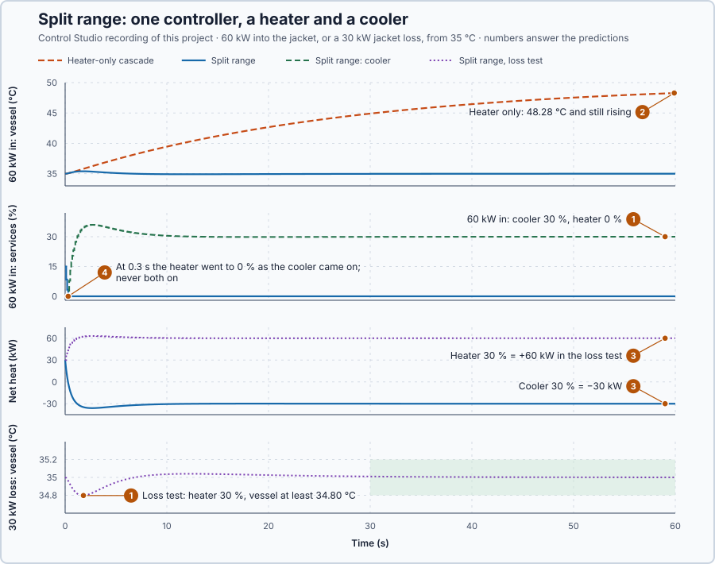

# 65. Split-range control

In this lesson, you will let one controller output drive both a heater and a cooler on the jacketed vessel, and test it when heat must be removed and when it must be added.

## The problem

Lesson 64's ratio control kept the additive within 0.005 of the ratio 0.1 from 0.9 s after a carrier step, because one controller's target was calculated from a measured flow. Back at the jacketed vessel, another process now delivers 60 kW into the jacket. At 35 °C the vessel loses only 30 kW, so 30 kW must be removed. The heater can only add heat: even at 0 % the vessel keeps rising. A cooler is fitted beside the heater, but the controller has a single output.

We will divide one controller output between the heater and the cooler.

## What we need

We need to:

1. let one controller ask for heat to be added or removed;
2. turn that request into a heater command and a cooler command, each at its own scale; and
3. never run the heater and the cooler at the same time.

## The new idea

**Split-range control** divides one controller output between two actuators: one part of the range heats, the other part cools. For the vessel, the controller's output is the net heat into the jacket, positive to heat and negative to cool.

**In words.** The controller asks for one thing only: how much heat the jacket should gain or lose. A small piece of program then decides which actuator delivers it:

1. **A positive request** goes to the heater, and the cooler stays off.
2. **A negative request** goes to the cooler, and the heater stays off.
3. **Each actuator converts at its own scale:** a heater point adds 2 kW, a cooler point removes 1 kW.

The heater and the cooler are never on together; both on would only waste energy fighting each other. In PLC terms this is the split-range output known from valves, where 0–50 % of one controller output opens a cooling valve and 50–100 % a heating valve. Here the request is kept in kilowatts, so that each half can use its own scale and the controller's output always means the same thing: heat.

**The formula.** The net heat is what the heater adds minus what the cooler removes:

$$
Q = 2u_h - u_c .
$$

Let:

- $Q$ be the net heat into the jacket, in kW;
- $u_h$ be the heater command, in %, worth 2 kW per point; and
- $u_c$ be the cooler command, in %, worth 1 kW per point.

The split works this formula backwards: for a positive request the heater supplies $u_h = Q/2$ and the cooler is off; for a negative request the cooler supplies $u_c = -Q$ and the heater is off, each within 0–100 %. The request can therefore range from −100 to +200 kW. Adding the two percentages would not give the net heat: 15 % heater and 30 % cooler are +30 kW and −30 kW.

The controller is the vessel's cascade, with the inner PI now requesting net heat in kW instead of heater power. The jacket obeys $5\dot T_j = Q - 10\,(T_j - T_v) - D_j$, so its gain is $K = 0.1$ °C/kW and its time constant $\tau = 0.5$ s. Lesson 19's rule with $\lambda = 0.5$ s gives $K_p = 0.5/(0.1 \times 0.5) = 10$ kW/°C and $K_i = 20$ kW/(°C·s): the heater-only gains, 5 %/°C and 10 %/(°C·s), times 2 kW per point. The inner PI's limits are the two capacities, −100 to +200 kW, so its limited output is exactly the net heat the two actuators can deliver, and its anti-windup tracks it.

**Example: the vessel at rest at 35 °C,** where the jacket passes 30 kW to the vessel. Follow the numbers:

1. At rest the jacket needs $Q = +30$ kW: heater $30/2 = 15$ %, cooler 0 %.
2. Another process sends 60 kW into the jacket: the jacket now needs $Q = 30 - 60 = -30$ kW, so the cooler runs at 30 % and the heater is off.
3. A 30 kW jacket loss instead: the jacket needs $Q = 30 + 30 = 60$ kW, so the heater runs at 30 % and the cooler is off.
4. The heater-only cascade with 60 kW coming in: its heater can go no lower than 0 %, which removes nothing, so the extra heat raises the vessel with nothing to stop it.

**The limitation.** The split changes over from heating to cooling at exactly $Q = 0$, so a request hovering around zero switches between the two actuators on every small change. A **neutral band**, a range of small requests that turns both off, would avoid those reversals, but it ignores small requests: a band of ±2 kW would leave up to 1 % of heater or 2 % of cooler unused. This rule has none. The mapping is also only as right as its scales: if a cooler point removed 1.2 kW instead of 1, a 30 % cooler command would remove 36 kW, and the PI would have to trim the request back from the resulting error.

The requirements, fixed before the run, each 60 s from rest at 35 °C: with 60 kW in, the vessel peaks at most at 36 °C and stays within 0.2 °C from 30 to 60 s; with the 30 kW loss, the vessel stays at or above 34 °C and within 0.2 °C from 30 to 60 s; heater and cooler are never on together.

## Prediction

Before running, answer these questions:

1. What do the heater and the cooler command at rest, with 60 kW entering, and with the 30 kW loss?
2. What can the heater-only cascade do against the incoming heat?
3. How much net heat do 15 % heater and 30 % cooler each deliver?
4. Will the heater and the cooler ever be on together?

| Case | Net heat request | Heater | Cooler |
| --- | ---: | ---: | ---: |
| At rest | +30 kW | 15 % | 0 % |
| 60 kW into the jacket | −30 kW | 0 % | 30 % |
| 30 kW jacket loss | +60 kW | 30 % | 0 % |

## Implementation

Open [`src/Main.st`](src/Main.st). The project holds three copies of the jacketed vessel with a cooler added. The function block `SplitCascade` holds the outer vessel PI and the inner net-heat PI, splits the request with `HeaterPct` and `CoolerPct` and reports `NetHeatKw`; `HeaterCascade` is the heater-only cascade. The project test sends 60 kW into the jackets of the heater-only vessel and of one split-range vessel, and removes 30 kW from the jacket of the other.

```st
HeaterPct := LIMIT(LREAL#0.0, MAX(RequestKw, LREAL#0.0) / LREAL#2.0, LREAL#100.0);
CoolerPct := LIMIT(LREAL#0.0, MAX(-RequestKw, LREAL#0.0), LREAL#100.0);
```

**Exercise.** By hand: a +40 kW request gives heater 20 % and cooler 0 %; −40 kW gives heater 0 % and cooler 40 %; 300 kW and −150 kW are limited to +200 and −100 kW of net heat. Open [`src/tests.st`](src/tests.st) and run its tests from the **Testing** view to check the same cases.

## Experiment in Control Studio

1. Open this lesson's project and start **Simulator**. The three vessels rest at 35 °C, the jackets at 38 °C, with the heater at 15 % and the cooler at 0 %. In the **truST** side bar, select **Control Studio**.
2. On **Identify**, choose **Project experiment** from **Method**. **Signals** already shows `P1.VesselSetpointC · Setpoint (°C)`, `P1.InflowVesselC · Process value (°C)` and `P1.InflowHeaterPct · Applied output (%)`, the split-range vessel with incoming heat; add `P1.HeaterOnlyVesselC · state (°C)`, `P1.InflowCoolerPct · state (%)`, `P1.HeaterOnlyHeaterPct · state (%)` and `P1.InflowNetKw · state (kW)`.
3. Answer the predictions before starting.
4. Select **Review project test** and check the declared **62.1 s** duration: 2 s at rest, then 60 s with the incoming heat and the jacket loss.
5. Select **Confirm and start**.
6. After the run, hover the first second, the split-range vessel's peak and 40 s. Then show the loss test, `P1.LossVesselC`, `P1.LossHeaterPct`, `P1.LossCoolerPct` and `P1.LossNetKw`, and hover its dip and 40 s. Control Studio shows **Project test completed. Outputs restored.**

Select **Abort test** to stop early. To repeat, stop and restart **Simulator** so the vessels start at rest again.

## Evidence and decision



The numbered marks answer the predictions with the same numbers. From Control Studio's recording, times from the start of the two disturbances:

| | Heater only, 60 kW in | Split range, 60 kW in | Split range, 30 kW loss |
| --- | ---: | ---: | ---: |
| Vessel peak or minimum | 48.28 °C at 60 s, still rising | 35.40 °C at 1.8 s | 34.80 °C at 1.8 s |
| Largest error, 30–60 s | 13.3 °C | 0.021 °C | 0.010 °C |
| Heater at 60 s | 0 % from 0.3 s | 0 % from 0.3 s | 30.0 % |
| Cooler at 60 s | none fitted | 30.0 % | 0 % |
| Net heat at 60 s | 0 kW | −30.0 kW | +60.0 kW |

1. At rest the heater held 15 %. With 60 kW in, the split range ended with the cooler at 30.0 % and the heater at 0 %; with the loss, the heater at 30.0 % and the cooler at 0 %, as calculated.
2. The heater-only cascade could only switch its heater off at 0.3 s; its outer loop asked for a jacket as cold as its 20 °C limit, and the vessel rose to 48.28 °C, still rising.
3. The cooler's 30 % delivered −30.0 kW and the heater's 30 % +60.0 kW: the unequal scales of the rule.
4. The split range changed from heating to cooling in one update at 0.3 s, and no sample shows both services on. The cooler peaked at 36 % before settling at 30 %.

The benefit is a controller that can both add and remove heat with one output; the cost is a mapping that must keep the two scales and the exclusion right. The split range meets both requirements; the heater-only cascade fails the incoming heat. Split range is accepted for this vessel. These are simulation results.

## Conclusion

Split-range control lets one controller drive two actuators that act in opposite directions: one part of its output heats, the other cools, each converted at its own scale, and the two are never on together.

For the vessel, the net-heat request settled at −30 kW with 60 kW coming in and at +60 kW with a 30 kW jacket loss, and the vessel stayed within 0.40 °C of 35 °C in both tests.

## Check yourself

1. **The inner PI requests −12 kW. What do the heater and the cooler command?**
   The request is negative, so the heater is off and the cooler runs at 12 %.
2. **Why would adding the heater and cooler percentages give the wrong net heat?**
   A heater point delivers 2 kW and a cooler point removes 1 kW, so equal percentages are unequal amounts of heat.
3. **Why did the heater-only cascade's vessel keep rising?**
   With 60 kW coming in and only 30 kW lost, it needed to remove heat, and a heater at 0 % removes none.

## Reason for the next lesson

Holding the vessel can ask for a jacket so hot that it breaks a separate limit on the jacket temperature, for example to protect the product near the wall. Normal control alone does not respect that limit.

[Override control](../55-override-control/README.md) lets a jacket-limiting controller take over whenever the limit would otherwise be broken.
