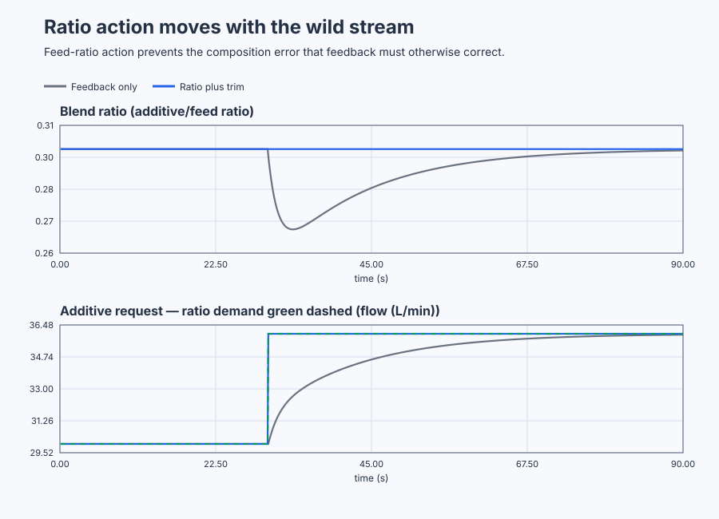

# Hold a two-stream blending ratio

Course position: Lesson 55 of 84. Prerequisite: jacketed-reactor cascade in Lesson
54. Every result here is **Simulation evidence** and does not authorize work on
a physical skid.

**Lesson objective:** Configure a blending ratio station, make additive demand follow a valid production-flow change immediately, use downstream composition feedback only as trim, and remove ratio authority safely when wild-flow data are invalid or below the controllable range.

## The problem

A liquid blending skid combines a base liquid with an additive. Base flow is
set elsewhere by the production schedule, so it is the **wild stream**. The
additive valve supplies the **controlled stream**. Both flows are measured in
litres per minute. A downstream analyser reports litres of additive per litre
of base liquid after mixing and analyser lag.

The normal point is 100 litres per minute of base liquid, 30 litres per minute
of additive, and a measured flow ratio of 0.30. The additive valve can request
0 through 60 litres per minute. Two equivalent local simulated plants compare
composition-feedback-only control with ratio demand plus identical feedback
trim. Both execute every 0.1 seconds.

Lesson 54 used cascade because a faster jacket variable sat inside the reactor
temperature path. A blender has no equivalent nested variable. Its quality
depends on two material flows remaining proportional while production changes
one of them independently.

A fixed additive setpoint becomes wrong as soon as base flow changes.
Composition feedback can eventually correct it, but only after the new mixture
reaches the analyser. Ratio control uses the measured base flow immediately,
before downstream ratio error appears.

## What we need

We need additive flow to follow valid production flow immediately while downstream composition feedback supplies only the slower trim. Ratio authority must be removed safely when the wild-flow measurement is invalid or below the controllable range.

## The new idea

### Material relationship

Measured base-liquid flow is the **measured wild-stream flow ($q_{\mathrm{w}}$)**, in litres
per minute. The calculated additive command is the **additive-flow request
($q_{\mathrm{a}}$)**, also in litres per minute. The desired additive-to-base proportion is
the **ratio setpoint ($R_{\mathrm{SP}}$)**. The analyser's proportion is the **measured blend
ratio ($R_{\mathrm{PV}}$)**. The difference between desired and measured proportion is the
**ratio error ($e_{R}$)**. The analyser controller contributes **feedback trim
($q_{\mathrm{trim}}$)** in litres per minute.

After those quantities are defined, the ratio station is:

$q_{\mathrm{a}},requested = R_{\mathrm{SP}} \cdot q_{\mathrm{w}} + q_{trim}$

$e_{R} = R_{\mathrm{SP}} - R_{\mathrm{PV}}$

For a ratio setpoint of 0.30 and wild flow of 100 L/min, untrimmed additive
demand is 30 L/min. At 120 L/min wild flow, it becomes 36 L/min in the same
controller scan.

This flow ratio is not the additive fraction of the final combined stream. If
the ratio is $R_{\mathrm{SP}}$, that fraction would be:

$additive fraction = R_{\mathrm{SP}} / (1 + R_{\mathrm{SP}})$

Confusing those two definitions changes product formulation. Engineering units,
meter zero, range, and scaling must therefore be checked before enabling the
ratio calculation.

### Why retain analyser feedback?

The multiplication is measured-disturbance feedforward. It assumes correct
meter scaling and a known material relationship, but does not measure actual
product quality. A downstream analyser PI supplies trim for modest meter bias,
concentration variation, and local-model error. It shares the valve limits and
anti-windup path with ratio demand.

The lesson keeps untrimmed demand, PI trim, total requested additive flow, and
applied additive flow separate. A large persistent trim is evidence of a meter,
formulation, or actuator problem; it must not be hidden as successful control.

### Low-flow singularity

Measured ratio requires division by wild flow. Near zero, small noise or offset
can create an arbitrarily large ratio. The required additive command can also
fall below the dosing valve's useful range. This **low-flow singularity** is a
physical validity problem, not a tuning problem.

The reviewed minimum wild flow is 10 L/min. Bad-quality, nonfinite, or stale
data, or measured flow outside 10..160 L/min, removes ratio authority. This
simulation then tracks additive demand to 0 L/min. No blend-quality claim is
made until valid flow and the operating state are restored.

### Local mixing model

Measured ratio minus 0.30 is the **blend-ratio deviation ($x_{R}$)**. Applied
additive flow minus 30 L/min is the **additive-flow deviation ($u_{\mathrm{a}}$)**. Actual
wild flow minus 100 L/min is the **wild-flow deviation ($u_{\mathrm{w}}$)**.

The analyser sees mixed product after a two-second lag. Linearising the
physical flow ratio near the operating point gives a 0.01 ratio change per
L/min of additive-flow change and a -0.003 ratio change per L/min of wild-flow
change. The simulator therefore uses:

$2 \cdot dx_{R}/dt = -x_{R} + 0.01 \cdot u_{\mathrm{a}} - 0.003 \cdot u_{\mathrm{w}}$

This is a local model for 80 through 130 L/min production flow. It is not valid
near zero flow, so the low-flow run proves authority fallback only and must not
be presented as composition performance.

## Prediction

For the nominal production step from 100 to 120 L/min, calculate additive
demand before running:

$q_{\mathrm{a}},requested = 0.30 \cdot 120 L/min = 36 L/min$

Feedback-only remains near 30 L/min until the analyser moves. The local model
predicts its ratio will head toward 0.24. Ratio demand changes from 30 to 36
L/min immediately, cancelling the two model-input deviations and predicting a
ratio of 0.30.

In a separate run, actual wild flow remains 120 L/min while the meter reads
125 L/min, a +5 L/min bias. Untrimmed demand becomes 37.5 L/min. Predict that
analyser feedback trim approaches -1.5 L/min so applied demand returns near 36
L/min. For invalid quality or 5 L/min measured wild flow, predict loss of ratio
authority and a tracked zero additive request.

## Implementation

The shipped program contains two real `Control.PID` controllers with identical
PI trim tuning. The only nominal difference is feedforward:

```st
RatioDemand := RatioSetpoint * MeasuredWildFlow;
RatioInput.Setpoint := RatioSetpoint;
RatioInput.ProcessValue := RatioControlledRatio;
RatioInput.FeedForward := RatioDemand;
RatioAdditiveRequest := RatioController.Update(Input := RatioInput);
RatioTrim := RatioAdditiveRequest - RatioDemand;
```

When authority is unavailable, the ratio controller uses Track mode with a
zero safe request. The program contains no timed production event, calculated
performance metric, or preferred-controller flag.

## Experiment in Control Studio

This procedure tests one declared lesson change under controlled conditions. Add valid measured-wild-flow ratio demand ahead of the same PI trim, then separately introduce meter bias, invalid quality and below-minimum flow. The declared event lasts 90 seconds. It restores Actual wild-stream flow to 100 L/min afterward. The deterministic Simulation seed is 20260829.

### Control Studio actions

1. **Monitor** — Start the **Simulator**, then open **truST sidebar → Control Studio → Monitor → Response**.
   - **Baseline check:** Wait until the header shows **Simulation**, **Running**, and current data. Confirm Blend-ratio setpoint (SP, dimensionless); Feedback-only blend ratio (PV, dimensionless); Feedback-only additive request (MV, L/min), including units, limits, mode, and quality. The initial operating point is Blend-ratio setpoint = 0.3 (dimensionless), Actual wild-stream flow = 100 L/min, Measured wild-stream flow = 100 L/min, Untrimmed ratio demand = 30 L/min, Composition feedback trim = 0 L/min, Feedback-only blend ratio = 0.3 (dimensionless), Ratio-controlled blend ratio = 0.3 (dimensionless), Feedback-only additive request = 30 L/min. The unresolved baseline problem is: Downstream composition feedback cannot move additive flow until mixing lag has produced a measured ratio error. In Control Studio Monitor retain the normal-flow boundary at 30.0 s and the restored boundary at 90.0 s.
   - **Decision before action:** Read **Prediction** above, then state what should move first and in which direction. Use this decision rule: Use ratio authority only with valid scaled wild-flow data above the reviewed minimum, and retain analyser PI as bounded trim rather than a substitute for meter validity.
   - **Successful evidence:** The Response plot advances, the displayed values are finite and current, and **Start recording** is enabled. Select **Start recording** only after those conditions are visible.
   - **Recovery:** If recording is disabled or the plot reports unavailable or stale samples, stop the Simulator, correct the displayed runtime or binding problem, restart it, and repeat the baseline check.
   - **Record:** Write down the initial SP, PV, requested/applied MV where available, controller mode, and your predicted response before opening Test.

2. **Test** — Open **truST sidebar → Control Studio → Test**.
   - **Baseline check:** Set **Experiment** = **Load disturbance step**, **Amplitude** = **20 L/min**, and **Maximum duration (s)** = **90**. The affected signal is **Actual wild-stream flow**; it starts at 100 L/min and must restore to 100 L/min.
   - **Decision before action:** Before selecting **Review test**, predict the response direction and confirm the requested change remains inside Feedback-only additive request 0 L/min to 60 L/min; Ratio-controlled additive request 0 L/min to 60 L/min; Feedback-only blend ratio 0.1 (dimensionless) to 0.5 (dimensionless); Ratio-controlled blend ratio 0.1 (dimensionless) to 0.5 (dimensionless).
   - **Successful evidence:** Select **Review test**, verify the signal, requested bound, duration, restoration, and stop conditions, then select **Confirm and start**. The state changes to **Running**, **Abort test** remains available, and the terminal state confirms completion and restoration while Response shows the measured SP/PV/MV sequence.
   - **Recovery:** For a rejected, stale, unsafe, unavailable, failed, or aborted state, read the displayed reason, restore Actual wild-stream flow to 100 L/min, wait for current data, and review a new test.
   - **Record:** Compare the response with your prediction and retain the terminal state, restoration result, and deterministic seed **20260829**.

3. **Identify** — After **Stop recording**, open **truST sidebar → Control Studio → Identify**.
   - **Baseline check:** Use **Qualify recording** to inspect sample count, duration, timing, excitation, and clipping. **Model selection**, **Fit estimation run**, and **Accept model for design** are the shared low-order model workflow; they do not replace the project-owned **Wild-stream ratio station with analyser PI trim and low-flow authority** model and must not be accepted as this lesson's design authority.
   - **Decision before action:** Decide whether the recording contains the input/output change needed for **Wild-stream ratio station with analyser PI trim and low-flow authority** before fitting anything.
   - **Successful evidence:** A qualified recording has current, finite, sufficiently excited data. Use the project-owned model described under **Implementation** and **Evidence and decision**, and record its assumptions, units, validity range, and rejection rule.
   - **Recovery:** If qualification reports stale, clipped, poorly excited, or insufficient data, return to Test and repeat the bounded experiment; never force or relabel a rejected fit.
   - **Record:** State which model is retained or rejected and why, explicitly identifying the runnable project as the model authority.

4. **Tune / Design** — Open **truST sidebar → Control Studio → Tune**.
   - **Baseline check:** **Design method** and **Generate candidate** are disabled because **Wild-stream ratio station with analyser PI trim and low-flow authority** is designed by the runnable project; shared Control.PID tuning is unavailable. Do not select an unrelated PID method.
   - **Decision before action:** Apply the equations and choices under **Implementation**, then compare the declared alternatives under **Evidence and decision** before accepting **Wild-stream ratio station with analyser PI trim and low-flow authority**.
   - **Successful evidence:** Use **Monitor → Signals** to correlate the implemented project-owned design with its named live states and outputs. A disabled shared designer is only a visible ownership boundary, not successful design evidence.
   - **Recovery:** If the project-owned prerequisites or qualification flags are false, return to Test or Identify as directed by the lesson and do not bypass them with a generic PID candidate.
   - **Record:** State why the project-owned design is eligible, conditional, or rejected, including the decisive trade-off.

5. **Validate** — Open **truST sidebar → Control Studio → Validate**.
   - **Baseline check:** **Run required validation** is disabled because no shared Control.PID candidate exists. **Requirement details** and **Save result** cannot be used to claim a shared result; project-owned validation is executed by the runnable project's declared oracle.
   - **Decision before action:** Use the predeclared comparisons: first_scan_ratio_demand == 36 L/min (tolerance 0.05 L/min); nominal_ratio_event_iae_ratio < 0.35 (dimensionless) (tolerance 0.01 (dimensionless)); biased_final_mean_absolute_error < 0.002 (dimensionless) (tolerance 0.0001 (dimensionless)); biased_final_trim == -1.5 L/min (tolerance 0.2 L/min).
   - **Successful evidence:** Correlate the unrounded project-owned results with the named live signals and events in Monitor. Each applicable requirement must have a value, unit, limit, tolerance, evidence class, and Pass, Conditional pass, Fail, or Inconclusive disposition.
   - **Recovery:** If the project run aborts, becomes stale, fails, or violates restoration, discard that run and repeat the declared Test. Never present a disabled button or retained README table as newly executed evidence.
   - **Record:** State the validation disposition and name every failed or inconclusive requirement before continuing.

## Evidence and decision

### Measures and comparison

For feedback-only and ratio-plus-trim, hold plant equations, initial state, PI
tuning, physical flow event, sample time, duration, limits, seed, and measure
windows equal. For meter bias and fallback, restore first and change only the
declared measurement property.

Define the measures before viewing results:

- **Event-window blend-ratio integral absolute error** adds absolute ratio error
  multiplied by 0.1 seconds from 30 through 60 s. Because ratio is
  dimensionless, the unit is seconds. Lower is better.
- **Peak ratio deviation** is the largest absolute departure from 0.30 over the
  same event window. Lower is better.
- **Cumulative applied-additive-flow movement** is total variation: the sum of
  absolute changes between consecutive applied-flow samples. Its unit is
  L/min of accumulated movement, not an instantaneous valve command.
- **Final-window mean absolute ratio error** is the mean absolute error from 80
  through 90 seconds. It is eligible only when ratio span is at most 0.001 and
  applied-flow span at most 0.02 L/min over that window.

Also retain the first-scan ratio demand, final PI trim, saturation duration,
quality and low-flow classification, authority, abort, and restoration state.

### Validation

Classify validity before ranking performance. Report `Not settled` instead of a
final-window value when its span rules fail. Report `Invalid` for low-flow or
bad-quality composition evidence.

For the nominal event, require a 36 L/min ratio demand in the first scan, event
error below 35 percent of feedback-only, lower peak deviation, and every
additive request within 0 through 60 L/min. Under +5 L/min meter bias, require
final mean absolute ratio error below 0.002 and trim near -1.5 L/min without
saturation. Invalid or below-minimum wild flow must remove ratio authority and
track additive request to zero.

### Retained evidence

The plot is generated by the executable blending experiment. Compare how quickly feedback-only and ratio-plus-trim control respond when the wild-stream flow changes.



[Complete trace](figures/blending-ratio-evidence-trace.csv) · [Decision summary](figures/blending-ratio-evidence-summary.csv)

## Conclusion

Ratio demand acts immediately because the material relationship changes as
soon as measured production flow changes. Feedback-only waits for the changed
mixture to traverse the blender and analyser. PI trim removes modest residual
error, including meter bias, but cannot make missing or badly scaled flow data
trustworthy.

A multiplication can remain numerically finite at low flow while the physical
ratio measurement and dosing range are unusable. That is why minimum-flow
authority is explicit rather than left for PI tuning to handle.

The conclusion applies when the wild stream is valid, correctly scaled, and
independently establishes production rate. It does not apply when both streams
must be optimized together or when the desired quantity is a different mass or
molar fraction without the required density or concentration compensation.

## Reason for the next lesson

You can now configure and qualify ratio control without confusing feedforward,
feedback trim, or meter validity. Lesson 56 addresses a different problem:
temperature must cross an operating point where one controller coordinates
heating and cooling final elements rather than proportional material streams.
