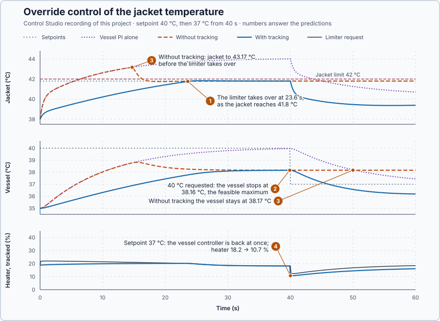

# 66. Override control

In this lesson, you will let a jacket-limiting controller take over from the vessel controller whenever the jacket would become too hot, and see why the controller that is not in charge must track the applied command.

## The problem

Lesson 65's split range let one controller both heat and cool the jacketed vessel: with 60 kW coming into the jacket, the cooler settled at 30 % and the vessel stayed within 0.40 °C of 35 °C. Meeting the vessel's heat demand can, however, break a separate limit. Here the jacket must stay at or below 42 °C to protect the product near the wall, and a vessel setpoint of 40 °C would need a 44 °C jacket. The vessel controller knows nothing about the jacket's limit, yet the limit must win over normal control.

We will add a controller that holds the jacket below its limit, and let it take over whenever the limit would otherwise be broken.

## What we need

We need to:

1. hold the jacket below its limit with a second controller;
2. give that controller authority whenever the limit would be broken, and hand back when it would not; and
3. make both hand-overs without a bump in the heater command.

## The new idea

**Override control** lets a limiting controller take over from the normal one whenever a limit would otherwise be broken. The smaller request wins. For the vessel, the jacket must stay at or below 42 °C, and a second controller guards that limit.

**In words.** Two controllers run side by side, and both ask for a heater command:

1. **The normal controller** asks for whatever holds the vessel at its setpoint.
2. **The limiting controller** asks for whatever holds the jacket just below its limit.

A **selector** passes on only one of the two requests. More heat raises both temperatures, so the request that keeps the jacket safe is always the smaller one. While the jacket is well below its limit, the limiter asks for more heat than the vessel needs, and the normal controller is in charge. As the jacket approaches its limit, the limiter's request falls below the other, and it takes over. When the vessel later needs less heat, its controller's request drops below the limiter's, and it is back in charge. Nobody switches anything: the selection follows from the two requests at every update.

In PLC terms the selector is a single MIN instruction. The difficult part is the controller that is not selected. It still sees its own error, and its integral keeps adding it up, so its request drifts away from the command actually applied: it then takes over late, or blocks the other controller when it should give way. Tracking, from Lesson 27, prevents this: the controller that is not selected runs in the Track mode of `Control.PID`, which restarts each update from the applied heater command and adds only its own current change.

**The formula.** The selector applies the smaller request:

$$
u_r = \min(u_{normal},\ u_{limit}) .
$$

Let:

- $u_r$ be the applied heater request, in %;
- $u_{normal}$ be the vessel controller's request, in %; and
- $u_{limit}$ be the jacket-limiting controller's request, in %.

The direction depends on the limit: a minimum temperature, or a limit that more output relieves, would need the larger request instead, a $\max$.

The limit also caps what the vessel can reach. At rest the vessel loses $2(T_v - 20)$ kW, which the jacket passes on at 10 kW per °C of difference, so the jacket must be $0.2(T_v - 20)$ warmer than the vessel:

$$
T_j = T_v + 0.2\,(T_v - 20) = 1.2\,T_v - 4 ,
$$

with $T_j$ and $T_v$ the jacket and vessel temperatures, in °C.

**Example: the vessel asked for 40 °C.** The vessel PI uses $K_p = 2.5$ %/°C and $K_i = 0.1$ %/(°C·s), Lesson 63's single loop. The jacket-limit PI uses $K_p = 5$ %/°C and $K_i = 10$ %/(°C·s), Lesson 19's rule for the jacket alone, 0.2 °C/% and 0.5 s, with λ = 0.5 s. The limiter's setpoint is 41.8 °C, 0.2 °C below the limit to leave room for the hand-over, a teaching choice. Follow the numbers:

1. Requests of 60 % and 40 % produce 40 %: the smaller request is applied, whichever controller makes it.
2. A 37 °C vessel needs a jacket of $1.2 \times 37 - 4 = 40.4$ °C, which is allowed; a 40 °C vessel needs 44 °C, which is not.
3. With the jacket held at 41.8 °C, the vessel reaches at most $(41.8 + 4)/1.2 = 38.17$ °C, and 38.33 °C at the 42 °C limit itself. No tuning can reach 40 °C within the limit: the controller must hold the limit and leave the shortfall visible.
4. At the start the jacket is at 38 °C, below 41.8 °C, so the limiter's error is positive and it asks for more heat than the vessel PI: the vessel PI is in charge.
5. As the jacket approaches 41.8 °C, the limiter's request falls below the vessel PI's, and the limiter takes over, holding the vessel near 38.17 °C.
6. When the setpoint later falls to 37 °C, the vessel PI's request drops below the limiter's, and the vessel PI is back in charge.

**The limitation.** Override works only if the controller that is not selected tracks. Without tracking, the limiter's error at the start, $41.8 - 38 = 3.8$ °C, adds $10 \times 3.8 = 38$ points per second to its request. Within seconds its request stands far above the applied command, and it can take over only after its integral has run back down, which needs the jacket above its setpoint. The vessel PI winds up the same way on the unreachable 40 °C, which delays the hand-back. Override also protects only the limit it watches: another limit needs another limiting controller in the selector.

The requirements, fixed before the run: the jacket stays at or below 42 °C throughout; with 40 °C requested, the vessel holds the feasible 38.17 °C; when the setpoint falls to 37 °C, the vessel controller takes over again without delay.

## Prediction

Before running, answer these questions:

1. Which controller is in charge first, and when does the limiter take over?
2. Where does the vessel settle while 40 °C is requested?
3. What happens without tracking, to the jacket and after the setpoint falls to 37 °C?
4. With tracking, what happens to the heater command at the moment the setpoint falls to 37 °C?

| Quantity | Predicted |
| --- | ---: |
| Jacket needed for a 37 °C vessel | 40.4 °C |
| Jacket needed for a 40 °C vessel | 44 °C, not allowed |
| Warmest vessel with the jacket at 41.8 °C | 38.17 °C |
| Selected request from 60 % and 40 % | 40 % |

## Implementation

Open [`src/Main.st`](src/Main.st). The project holds three copies of the heater-only jacketed vessel, all with the same setpoint: 40 °C when the project test starts, and 37 °C from 40 s. The first runs the vessel PI alone. The second runs the function block `OverrideLoop` with tracking: two `Control.PID` instances, the low select and Track mode for the controller not selected. The third runs `OverrideLoop` without tracking.

```st
LowSelect := MIN(NormalPct, LimitPct);
HoldingJacketC := VesselC + LREAL#0.2 * (VesselC - LREAL#20.0);
MaximumVesselC := (JacketLimitC + LREAL#4.0) / LREAL#1.2;
```

**Exercise.** By hand, `LowSelect` gives 40 % for 60 % and 40 % in either order, `HoldingJacketC` gives 40.4 °C for 37 °C and 44 °C for 40 °C, and `MaximumVesselC` gives 38.33 °C at 42 °C and 38.17 °C at 41.8 °C. Open [`src/tests.st`](src/tests.st) and run its tests from the **Testing** view.

## Experiment in Control Studio

1. Open this lesson's project and start **Simulator**. The three vessels rest at 35 °C, their jackets at 38 °C, with 15 %. In the **truST** side bar, select **Control Studio**.
2. On **Identify**, choose **Project experiment** from **Method**. **Signals** already shows `P1.VesselSetpointC · Setpoint (°C)`, `P1.TrackedVesselC · Process value (°C)` and `P1.TrackedHeaterPct · Applied output (%)`, the override with tracking; add `P1.TrackedJacketC · state (°C)`, `P1.JacketLimitSetpointC · state (°C)`, `P1.TrackedVesselRequestPct · state (%)`, `P1.TrackedJacketRequestPct · state (%)` and `P1.TrackedJacketSelected · state (1)`.
3. Answer the predictions before starting.
4. Select **Review project test** and check the declared **62.1 s** duration: 2 s at rest, 40 s with 40 °C requested, then 20 s with 37 °C.
5. Select **Confirm and start**.
6. After the run, hover the hand-over and the setpoint change. Then show the three jackets, `P1.AloneJacketC` and `P1.UntrackedJacketC` with the limit setpoint, and hover the peaks; finally the three vessels, adding `P1.AloneVesselC` and `P1.UntrackedVesselC`, and hover before and after the change. Control Studio shows **Project test completed. Outputs restored.**

Select **Abort test** to stop early. To repeat, stop and restart **Simulator** so the vessels start at rest again.

## Evidence and decision



The numbered marks answer the predictions with the same numbers. From Control Studio's recording, times from the start of the test:

| | Vessel PI alone | Override with tracking | Override without tracking |
| --- | ---: | ---: | ---: |
| Jacket peak | **44.00 °C** | 41.83 °C | **43.17 °C** at 14.7 s |
| Vessel at 39.9 s, 40 °C requested | 39.96 °C | 38.16 °C | 38.17 °C |
| Jacket controller in charge | never | 23.6–40.0 s | 14.7–59.8 s |
| Vessel 10 s after the change to 37 °C | 38.20 °C | 36.57 °C | 38.17 °C |

1. Apart from the very first update, the vessel PI was in charge until 23.6 s; then the limiter took over as the jacket reached 41.8 °C, and held it with a peak of 41.83 °C.
2. With 40 °C requested, the vessel stopped at 38.16 °C, the feasible maximum, and the shortfall stayed visible.
3. Without tracking, the limiter added up its 3.8 °C error while it was not selected; its request stood up to 75 points above the heater command, and it took over only at 14.7 s, after the jacket had reached 43.17 °C. After the setpoint fell, the vessel PI's integral, wound up on the unreachable 40 °C, kept its request above the limiter's for 19.8 s more, and the vessel stayed at 38.17 °C.
4. With tracking, the vessel PI was selected again in the same update as the setpoint change; the heater dropped from 18.2 % to 10.7 %, the vessel PI's ordinary proportional step, and the vessel then dipped to 36.2 °C by 60 s.

The vessel PI alone broke the limit with a 44.00 °C jacket. The benefit of override is a limit that holds whatever the setpoint asks; the cost is a second controller and tracking that must be right, or the override exists and the limit is still broken. Only the tracked override meets the requirements, and it is accepted for this vessel. These are simulation results.

## Conclusion

Override control selects, at every update, the request that respects the limit: here the smaller heater request. The controller that is not selected must track the applied command, or its stored demand delays the hand-over in both directions.

For the vessel, the tracked override held the jacket at 41.83 °C, left the vessel at the feasible 38.16 °C, and handed back to the vessel controller in the same update as the setpoint change.

## Check yourself

1. **The vessel controller requests 32 % and the limiter 25 %. Which request is applied, and who is in charge?**
   25 %, the smaller request, so the limiter is in charge.
2. **Why can no tuning bring the vessel to 40 °C within the jacket limit?**
   A 40 °C vessel needs a 44 °C jacket; with the jacket held at 41.8 °C, the vessel reaches at most 38.17 °C.
3. **Why did the untracked override let the jacket reach 43.17 °C?**
   Its limiter kept adding up its own error while not selected and asked for far more than the applied command, so
   its request fell below the vessel's only after the jacket was already too hot.

## Reason for the next lesson

The vessel's heater acts on its jacket at once. When a heater's power arrives only after a long delivery delay, every correction arrives too late: a controller fast enough to correct quickly loses its stability margin to the delay, so feedback on the delayed measurement must stay slow.

[Smith prediction](../57-smith-predictor/README.md) lets the controller act on a model's prediction of the temperature without the delay.
