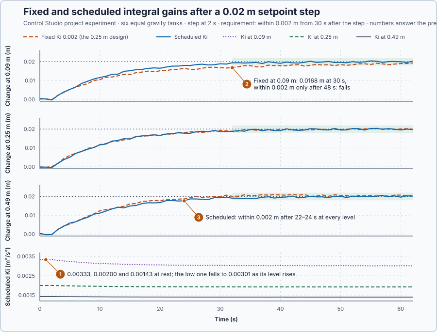

# 47. Gain scheduling

In this lesson, you will calculate PI gains for the gravity tank from its local model, schedule the integral gain with the measured level, and compare fixed and scheduled gains at a low, a middle and a high level.

## The problem

In Lesson 46 the tangent at 0.25 m gave the tank a gain of 50 s/m² and a time constant of 25 s, but at 0.5625 m the same tank has 75 s/m² and 37.5 s. Gains tuned from the line at one level meet a different tank at another.

The tank has to work from 0.09 to 0.49 m. Fixed gains do not fit every level, and retuning by hand at each level is no answer. We will set the gains from the level the tank is at.

## What we need

We need to:

1. calculate the PI gains from the local model at any level;
2. change them with the measured level while the controller runs; and
3. check whether the fixed gains really fail somewhere in the working range.

## The new idea

**Gain scheduling** changes the controller's settings with the operating level, using what we know about how the tank's behaviour changes with level.

**In words.** Lesson 46 showed that the tank is a different first-order process at every level. At a higher level another centimetre adds less drainage, so the same inflow change moves the level further and more slowly. A controller tuned at one level therefore meets a tank that is more sensitive and slower, or less sensitive and faster, somewhere else. Gain scheduling answers this in three steps:

1. **Keep the aim, not the settings.** The design aim stays the same at every level: the level should follow a change with the same response time. The settings are whatever achieves that aim at the present level.
2. **Calculate the settings from the local model.** The local model gives the tank's gain and time constant at any level, and Lesson 19's model-based rule turns them into PI gains. Done for the measured level at every update, the gains follow the tank as its level moves.
3. **Change the gains without a bump.** A gain that changes while the controller runs must not make the inflow jump. `Control.PID` runs the incremental form of Lesson 39, so a new gain scales only the changes that follow.

Many PLC programs already switch parameter sets with the operating range, for example a set per product or per speed band. Gain scheduling does the same smoothly, with the settings calculated from a model instead of chosen from a table.

For this lesson's tank, which must work from 0.09 to 0.49 m, the calculation will show that only one of the two gains has to change.

**The formula.** Lesson 19's rule for a first-order process without delay sets

$$
K_p = \frac{\tau}{K\lambda}, \qquad K_i = \frac{1}{K\lambda} .
$$

With Lesson 46's local model, $K = 1/g$ and $\tau = A/g$, where $g = c/(2\sqrt h)$:

$$
K_p = \frac{A/g}{\lambda/g} = \frac{A}{\lambda}, \qquad K_i(h) = \frac{g(h)}{\lambda} = \frac{c}{2\lambda\sqrt h} .
$$

The slope cancels in $K_p$, so the proportional gain is the same at every level; only the integral gain has to follow the level.

- $A$ is the tank's floor area, 0.5 m², and $c$ the outlet coefficient, 0.020 m$^{5/2}$/s;
- $h$ is the measured level, in m;
- $g(h)$ is the outflow curve's slope at that level, in m²/s;
- $K$ and $\tau$ are the local gain, in s/m², and time constant, in s;
- $\lambda$ is the chosen response time, in s; and
- $K_p$ is the proportional gain, in m²/s (inflow in m³/s per metre of error), and $K_i$ the integral gain, in m²/s².

**Example: the tank at 0.16 m and at 1.0 m.** With $\lambda = 10$ s, follow the numbers:

1. **The proportional gain.** $K_p = 0.5/10 = 0.05$ m²/s at every level: each centimetre of error adds 0.0005 m³/s of inflow at once.
2. **The local model at 0.16 m.** $g = 0.020/(2 \times 0.4) = 0.025$ m²/s, so $K = 40$ s/m² and $\tau = 0.5/0.025 = 20$ s. The rule gives $K_p = 20/(40 \times 10) = 0.05$ m²/s, as in step 1, and $K_i = 1/(40 \times 10) = 0.0025$ m²/s², which is $g/\lambda = 0.025/10$.
3. **The local model at 1.0 m,** above this lesson's range but where Lesson 45 ran the tank. $g = 0.020/(2 \times 1) = 0.010$ m²/s, so $K = 100$ s/m² and $\tau = 50$ s. Again $K_p = 50/(100 \times 10) = 0.05$ m²/s, but $K_i = 0.010/10 = 0.001$ m²/s².
4. **Why only $K_i$ changes.** From 0.16 to 1.0 m the tank becomes 2.5 times as sensitive and 2.5 times as slow. The two effects cancel in $K_p$, and $K_i$ falls by the same factor 2.5, from 0.0025 to 0.001 m²/s².
5. **During a step.** A 0.02 m setpoint step at 0.16 m raises the level towards 0.18 m. The program recalculates $K_i$ from the measured level at every update, and at 0.18 m it is $0.020/(2 \times 10 \times \sqrt{0.18}) = 0.00236$ m²/s². The incremental form takes each new value smoothly.

**Teaching choices:** six equal tanks, a fixed and a scheduled controller at each of 0.09, 0.25 and 0.49 m, all stepped together; the fixed controller uses the 0.25 m design, $K_i = 0.002$ m²/s².

**The limitation.** A schedule is only as good as the model behind it, and it costs a calculation and a test at every level. Where the tank stays near the design level the gain hardly moves: at 0.27 m the schedule gives $0.020/(2 \times 10 \times \sqrt{0.27}) = 0.00193$ m²/s², less than 4 % from 0.002. Scheduling on a measurement also passes its noise into the gain: ±0.0005 m at 0.09 m moves $K_i$ by about $\tfrac12 \times 0.0005/0.09 = 0.3$ %, small here but worth checking for a noisier signal.

## Prediction

At each level the setpoint rises by 0.02 m, and the level must be within 0.002 m of the new setpoint 30 s after the step, three response times, and stay there. Before running, answer these questions:

1. What are $K_p$ and $K_i$ at 0.09, 0.25 and 0.49 m?
2. The fixed controller uses the 0.25 m value everywhere. At which level is it too slow, and why?
3. What should the scheduled responses look like at the three levels?

| Level | $g = c/(2\sqrt h)$ | $K_i = g/\lambda$ |
| --- | ---: | ---: |
| 0.09 m | 0.0333 m²/s | 0.00333 m²/s² |
| 0.25 m | 0.0200 m²/s | 0.00200 m²/s² |
| 0.49 m | 0.0143 m²/s | 0.00143 m²/s² |
| every level | $K_p = A/\lambda$ | 0.05 m²/s |

## Implementation

Open [`src/Main.st`](src/Main.st). The function `OutflowSlope` is $g = c/(2\sqrt h)$. The function block `LevelController` is one tank's level loop: `Control.PID` as PI with $K_p = A/\lambda$, and $K_i$ either fixed at the 0.25 m design or scheduled from the measured level at every update:

```st
Parameters.IntegralGain := OutflowSlope(Coefficient := OutletCoefficient, Level := LevelM) / ResponseTimeS;
```

The simulated rig has six equal gravity tanks, each starting at rest with its holding inflow $c\sqrt{h_0}$: 0.006, 0.010 and 0.014 m³/s. Each level sensor reads within ±0.0005 m. When Control Studio starts the project experiment, every setpoint rises by 0.02 m.

**ST practice.** Use `OutflowSlope` to check $K_i$ at the three levels, then calculate it at 0.36 m. Then open [`src/tests.st`](src/tests.st) and run its tests from the **Testing** view: they check $K_p$, $K_i$ at 0.16, 0.25 and 0.36 m and at the three experiment levels, and the holding flows.

## Experiment in Control Studio

1. Open this lesson's project and start **Simulator**; the six tanks rest at their levels. In the **truST** side bar, select **Control Studio**.
2. On **Identify**, choose **Project experiment** from **Method**. In **Signals**, select the six level changes, from `P1.LowFixedChangeM · state (m)` to `P1.HighScheduledChangeM · state (m)`.
3. Answer the predictions. Select **Review project test**, check the declared **62.1 s** duration and select **Confirm and start**; the step comes 2 s later.
4. After the run, hover the curves at 32 s, 30 s after the step.
5. At completion, Control Studio shows **Project test completed. Outputs restored.**

Select **Abort test** to stop early. To repeat, stop and restart **Simulator**.

## Evidence and decision



The numbered marks answer the predictions with the same numbers. From the recording, the level change after the 0.02 m step:

| Level | Fixed $K_i$ = 0.002 | Scheduled $K_i$ |
| --- | --- | --- |
| 0.09 m | 0.0168 m at 30 s; within 0.002 m only after 48 s: **fails** | $K_i$ 0.00334 → 0.00301; within 0.002 m after 24 s |
| 0.25 m | within 0.002 m after 21 s | $K_i$ 0.00200 → 0.00193; after 24 s |
| 0.49 m | within 0.002 m after 19 s; 0.001 m overshoot | $K_i$ 0.00143 → 0.00140; after 23 s |

1. At rest the scheduled controllers used 0.00334, 0.00200 and 0.00143 m²/s², the predicted values, all with $K_p = 0.05$ m²/s.
2. The fixed controller was too slow at 0.09 m: still 0.0032 m short after 30 s, and within 0.002 m only after 48 s. There the tank drains faster than the 0.25 m design assumes, so the integral is too small. At 0.49 m the fixed integral is too large, and the level overshot by 0.001 m.
3. The scheduled responses looked alike at all three levels: within 0.002 m after 23–24 s. Its gain followed the measured level through the step without a jump in the inflow.

Scheduling costs one square root per update and a test at every level; the fixed design fails at the low end of the range, so we adopt the scheduled controller for 0.09 to 0.49 m. These are simulation results, not a physical qualification.

## Conclusion

The local model gives the gains for every level: $K_p = A/\lambda$ stays, and $K_i = c/(2\lambda\sqrt h)$ follows the measured level. Because `Control.PID` runs the incremental form, the gain can change while the controller runs.

For this tank, the fixed 0.25 m design failed at 0.09 m, and the scheduled gains met the requirement at all three levels within 24 s.

## Check yourself

1. **With $\lambda = 10$ s, what integral gain does the schedule give at 0.64 m?**
   $K_i = 0.020/(2 \times 10 \times 0.8) = 0.00125$ m²/s².
2. **Why does the fixed controller respond too slowly at 0.09 m?**
   The tank drains faster there, so it needs a larger integral gain than the 0.25 m design's 0.002 m²/s².
3. **Why does $K_p$ not need scheduling?**
   $K_p = \tau/(K\lambda) = (A/g)/(\lambda/g) = A/\lambda$: the slope cancels, so it is the same at every level.

## Reason for the next lesson

Every new plant and controller in this course has meant deriving and solving differential equations again, and that is becoming cumbersome as more parts are connected.

[Laplace transforms](../../01-feedback-foundations-and-temperature-control/18-transfer-function-from-physics/README.md) turn those differential equations into algebra.
