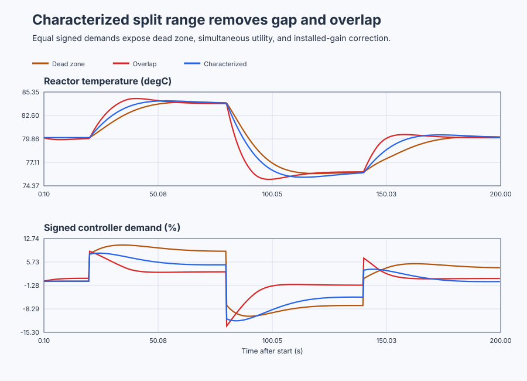

# Coordinate reactor heating and cooling

Course position: Lesson 56 of 84. Prerequisite: blending ratio control in Lesson 55.
Every result is **Simulation evidence** and does not authorize operation of a
physical reactor.

**Lesson objective:** Convert one signed reactor-temperature controller demand into heating and cooling valve requests.

## The problem

An exothermic batch reactor uses a hot-water valve to add heat and a cooling-
water valve to remove heat. These are opposing final elements. Each physical
valve is one-sided from 0 through 100 percent even though the temperature
controller calculates a signed demand from -100 through +100 percent.

The operating point is 80 degrees Celsius. Locally, one percent heating changes
temperature rate by +0.04 degrees Celsius per second, while one percent cooling
changes it by -0.06 degrees Celsius per second. Three equivalent reactors use
identical signed PI tuning and differ only in their split-range mapper: a
four-point dead zone, four-point overlap, or mutually exclusive installed-gain
characterization. Every controller executes at 0.1 seconds.

Lesson 55 used ratio control because both material flows were simultaneously
useful and had to remain proportional. Heating and cooling are different: they
oppose one another. Opening both wastes utility and can create an unintended
net temperature change.

One signed controller output cannot be connected directly to two valves that
accept only positive commands. A split-range mapper must decide which final
element owns each part of the demand range and what happens at the change of
authority.

## What we need

We need one signed reactor-temperature demand to command heating on one side of neutral and cooling on the other without wasting opposing utilities. Crossover dead zone, overlap, and installed valve gain must be compared on equivalent evidence.

## The new idea

### One controller, two final elements

Desired temperature is the **setpoint ($SP$)** and measured reactor temperature
is the **process value ($PV$)**, both in degrees Celsius. Desired minus measured
temperature is the **temperature error ($e$)**. The PI controller's output is the
**signed controller demand ($D$)** in percent.

The mapper calculates the **heating-valve request ($H_{\mathrm{requested}}$)** and
**cooling-valve request ($C_{\mathrm{requested}}$)** in percent. The separately observed
physical positions are **$H_{\mathrm{applied}}$** and **$C_{\mathrm{applied}}$**. They equal their requests
in this ideal simulation, but real valves may rate-limit, stick, saturate, or be
blocked by interlocks.

After those quantities are defined, the ideal mapping is:

$e = SP - PV$

$D = TemperaturePI(e)$

$H_{\mathrm{requested}} = \max\left(D, 0\right)$

$C_{\mathrm{requested}} = \max\left(-D, 0\right)$

The `max` operations are not arbitrary clamps. Heating cannot accept a
negative opening, so the first expression passes positive demand and replaces
negative demand with zero. Cooling must act for negative demand, so the second
expression first reverses the sign and then applies the same one-sided rule.

The **split point** is $D = 0 percent$. At +30 percent demand, heating is 30
percent and cooling is zero. At -20 percent demand, heating is zero and cooling
is 20 percent. At zero, both close. The PI owns temperature feedback; the
mapper owns actuator selection. Two independent PIs fighting through opposing
valves are not this structure.

### Dead zone

A **dead zone** is a demand interval in which neither valve responds. With a
four-point half-width called $g$, this lesson uses:

$H = \max\left(D - g, 0\right)$

$C = \max\left(-D - g, 0\right)$

When demand is inside -4 through +4 percent, both valves close. That prevents
simultaneous utility use but removes authority: integral demand must cross the
gap before the reactor responds. A physical dead zone might accommodate valve
seat behavior, but it must be measured and justified.

### Overlap

An **overlap** deliberately opens both valves near neutral. With overlap
half-width $o$, this lesson uses:

$H = \max\left(D + o, 0\right)$

$C = \max\left(o - D, 0\right)$

At zero demand and $o = 4$, both valves are 4 percent open. Because the cooling
installed gain is larger, they do not cancel. Heating contributes
$0.04(4)=+0.16$ degrees Celsius per second and cooling contributes
$-0.06(4)=-0.24$ degrees Celsius per second. Their sum is
$0.16-0.24=-0.08$ degrees Celsius per second, so temperature initially falls.
Overlap can bridge measured mechanical
deadband, but it also creates an energy conflict and must never be introduced
only to make a trace look smoother.

### Installed gain

The local temperature-rate change per percent heating is the **installed
heating gain ($K_{H}$)**. Its cooling counterpart is the **installed cooling gain
($K_{C}$)**. Here $K_{H}$ is 0.04 and $K_{C}$ is 0.06 degrees Celsius per second per valve
percent.

For equal signed demands to have equal thermal authority, positive demand maps
directly to heating while negative demand scales cooling:

$C_{\mathrm{requested}} = (-D) \cdot K_{H} / K_{C} = (-D) \cdot 2/3$

This scale follows by equating the magnitudes of the two initial thermal rates:
$K_C C=K_H(-D)$. Dividing both sides by $K_C$ gives
$C=(-D)K_H/K_C$, and the measured ratio is $0.04/0.06=2/3$.

Thus $D = -20 percent$ becomes 13.33 percent cooling, with the same initial
thermal magnitude as +20 percent heating. This is a local characterization; it
does not compensate stiction, utility-pressure changes, or a nonlinear valve
curve.

### Local reactor model

Reactor temperature minus 80 degrees Celsius is the **reactor-temperature
deviation ($x_{T}$)**. Applied heating and cooling percentages are the **heating
input ($u_{H}$)** and **cooling input ($u_{C}$)**. Ambient heat loss returns the unforced
local plant toward 80 degrees Celsius, while the valves act oppositely:

$dx_{T}/dt = -0.05 \cdot x_{T} + 0.04 \cdot u_{H} - 0.06 \cdot u_{C}$

Each term is a temperature rate. The first term removes five percent of the
current deviation each second, the second adds the measured heating rate, and
the third subtracts the measured cooling rate. At a constant operating point
the left side is zero, so the equilibrium deviation is
$x_{T,eq}=(0.04u_H-0.06u_C)/0.05$. This makes clear why opening unequal valves
together shifts temperature even when controller demand is zero.

The model and constant gains apply only from 72 through 88 degrees Celsius.

Selection and characterization occur after the signed PI output. Each valve is
then limited separately, and the inactive valve is explicitly closed. Loss of
automatic authority tracks signed demand to zero while aligning controller
setpoint with current temperature; all valve requests close before authority
may return.

Initialization preserves the externally supplied authority state, so an
unavailable signal on the first scan cannot be replaced by the normal default.

## Prediction

Before running, map $D = +30 percent$, $D = 0 percent$, and $D = -20 percent$
through all three candidates.

- Dead zone maps +30 to 26 percent heating and -20 to 16 percent cooling. It
  closes both valves inside the four-point gap.
- Overlap maps zero to 4 percent heating and 4 percent cooling. Predict
  simultaneous utility use and the 0.08-degree-Celsius-per-second cooling
  disturbance caused by unequal gains.
- Characterized mapping sends +30 to 30 percent heating, zero to both closed,
  and -20 to 13.33 percent cooling.

Write which candidate should accumulate dead-zone time, simultaneous-utility
time, and excessive utility throughput before seeing the plots.

## Implementation

The project uses three real `Control.PID` instances with identical signed PI
tuning. The mapping happens afterward:

```st
CharacterizedDemand := CharacterizedController.Update(Input := CharacterizedInput);
CharacterizedHeatingRequest := MAX(CharacterizedDemand, LREAL#0.0);
CharacterizedCoolingRequest := MAX(
    -CharacterizedDemand * LREAL#0.6666666666666667,
    LREAL#0.0
);
```

The program exposes all three signed demands and six valve requests. It has no
timed setpoint event, performance score, or preferred-mapping flag.

## Experiment in Control Studio

This procedure observes the project's complete declared comparison under
controlled conditions. The project, not Control Studio, owns the setpoint
sequence, the installed-gain mapping, and restoration to 80 degrees Celsius.
Control Studio writes only one Boolean authority signal. The deterministic
Simulation seed is 20260829.

### Control Studio actions

1. **Monitor** — Start the **Simulator**, then open **truST sidebar → Control Studio → Monitor → Response**.
   - **Baseline check:** Wait until the header shows **Simulation**, **Running**, and current data. Confirm Reactor-temperature setpoint (SP, degC); Dead-zone reactor temperature (PV, degC); Dead-zone heating request (MV, %), including units, limits, mode, and quality. The initial operating point is Reactor-temperature setpoint = 80 degC, Dead-zone signed demand = 0 %, Overlap signed demand = 0 %, Characterized signed demand = 0 %, Dead-zone reactor temperature = 80 degC, Overlap reactor temperature = 80 degC, Characterized reactor temperature = 80 degC, Dead-zone heating request = 0 %. The unresolved baseline problem is: A dead zone removes authority near neutral while overlap consumes opposing utilities and drifts when their installed gains differ. In Control Studio Monitor retain the actuator-map boundaries at 20.0 s, 80.0 s, 140.0 s, and 200.0 s.
   - **Decision before action:** Read **Prediction** above, then state what should move first and in which direction. Use this decision rule: Accept the mutually exclusive mapping only when installed-gain scaling balances local authority, zero demand closes both valves, and crossover and authority-loss evidence are bounded.
   - **Successful evidence:** The Response plot advances, the displayed values are finite and current, and **Start recording** is enabled. Select **Start recording** only after those conditions are visible.
   - **Recovery:** If recording is disabled or the plot reports unavailable or stale samples, stop the Simulator, correct the displayed runtime or binding problem, restart it, and repeat the baseline check.
   - **Record:** Write down the initial SP, PV, requested/applied MV where available, controller mode, and your predicted response before opening Test.

2. **Test** — Open **truST sidebar → Control Studio → Test**.
   - **Baseline check:** Set **Experiment** = **Observe without excitation**, **Amplitude** = **0**, and **Maximum duration (s)** = **200.1**. Confirm the only writable signal is **Experiment authority** (`P1.ExperimentEnabled`, `%MX88.5`). The project will hold 80 degrees Celsius to 20 seconds, command 84 to 80 seconds, command 76 to 140 seconds, then restore 80 degrees Celsius.
   - **Decision before action:** Before selecting **Review test**, predict which valve each signed demand should select and confirm all three temperatures can remain inside 72 through 88 degrees Celsius and all valve requests inside 0 through 100 percent.
   - **Successful evidence:** Select **Review test**, verify zero external excitation, authority, duration, restoration, and stop conditions, then select **Confirm and start**. The state changes to **Running**, **Abort test** remains available, and Response shows the complete project-owned sequence. At termination the authority bit clears and the setpoint is 80 degrees Celsius.
   - **Recovery:** For a rejected, stale, unsafe, unavailable, failed, or aborted state, read the displayed reason, confirm the authority bit is false and the setpoint has restored to 80 degrees Celsius, wait for current data, and review a new observation.
   - **Record:** Compare each mapping with your prediction and retain the terminal state, restoration result, and deterministic seed **20260829**. Use the native lesson test for the declared numeric verdicts; this observation does not create a generic identification, tuning, or validation result.

## Evidence and decision

### Measures and comparison

Hold the plant equations, initial state, PI tuning, setpoint sequence, sample
schedule, duration, limits, and seed equal. Change only the mapping. Do not
retune the dead-zone or overlap case to hide the behavior under study.

Define the measures before showing results:

- **Setpoint-event integral absolute temperature error** adds absolute error
  multiplied by 0.1 seconds over 20..80, 80..140, and 140..200 seconds. Its unit
  is degree-Celsius seconds; lower is better.
- **Simultaneous-utility exposure** is the time both applied valves exceed 0.1
  percent.
- **Utility throughput** integrates $H_{\mathrm{applied}}$ plus $C_{\mathrm{applied}}$ over time. Its unit
  is percent-seconds and exposes opposing utility use even when net heat is
  small.
- **Dead-zone exposure** is time with absolute signed demand at least 0.25
  percent while both applied valves are at most 0.1 percent.
- **Cumulative valve movement** is total variation of each applied valve in
  percentage points.
- **Crossover bump** is the largest adjacent-sample change in net thermal input,
  `K_H * H_applied - K_C * C_applied`, across a demand-sign change. Its unit is
  degrees Celsius per second.

Also retain peak deviation, two-percent settling time, saturation, authority,
abort, and restoration state. A final-window error is eligible only after the
declared temperature and valve-span settling conditions pass.

### Validation

Classify each result before ranking it. Report `Not settled`, `Saturated`,
`Invalid`, or `Aborted` when applicable.

Every value must be finite and bounded. The characterized candidate must have
zero simultaneous-utility exposure, zero unjustified dead-zone exposure, both
valves closed at zero demand, correct two-thirds cooling scaling, and closed
valves during loss of authority. The dead-zone run must expose its lost-
authority time. The overlap run must expose simultaneous duration and greater
utility throughput instead of being selected merely for a smooth transition.
The accepted mapping must also meet the declared crossover-bump tolerance.

### Retained evidence

The plot is generated by the executable reactor comparison. It exposes the dead zone, wasteful overlap, and the smoother characterized transition between heating and cooling.



[Complete trace](figures/reactor-split-range-evidence-trace.csv) · [Decision summary](figures/reactor-split-range-evidence-summary.csv)

## Conclusion

Dead-zone delay comes from missing actuator authority near neutral. Overlap
uses opposing utilities continuously and unequal installed gains make zero
controller demand a nonzero plant disturbance. Characterization restores
comparable local heating and cooling authority without opening both valves.

The mapper is part of loop dynamics. Changing gap, overlap, sequencing, or gain
scaling changes the effective plant seen by the PI, so tuning and validation
must be repeated. Requested-versus-applied evidence remains necessary on real
valves.

## Reason for the next lesson

You can now design split range from physical final-element behavior instead of
adding an arbitrary clamp. Lesson 57 introduces a higher-priority equipment
constraint whose protection controller must override ordinary production
control and later return authority without windup or a bump.
