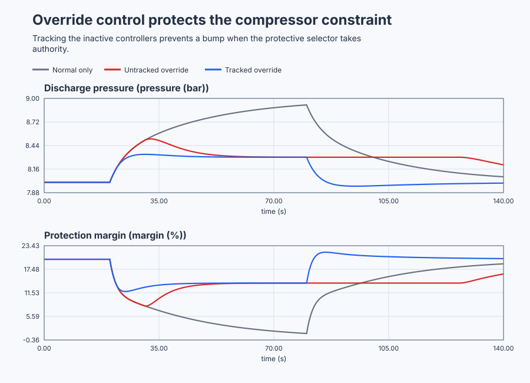

# Protect compressor flow margin with tracked override

Course position: Lesson 57 of 84. Prerequisite: reactor split-range control in Lesson
56. Every result is **Simulation evidence**. It is not anti-surge or machinery-
protection evidence and does not authorize operation of a physical compressor.

**Lesson objective:** Configure a recycle-valve high selector that gives minimum-flow margin priority over discharge-pressure production demand.

## The problem

A centrifugal compressor uses one recycle valve from 0 through 100 percent.
Opening the valve raises protected flow margin but reduces discharge pressure.
Closing it improves pressure while consuming margin. The operating point is 8
bar pressure, 20 percent margin, and 30 percent recycle.

Three equivalent simulated compressors compare normal pressure control alone,
override with both controllers always integrating, and override with the
inactive controller tracking the selected valve. Every controller executes at
0.1 seconds.

Lesson 56 mapped one controller demand across heating and cooling final
elements. Here two objectives compete for the same final element. Production
wants discharge pressure, while minimum safe flow has higher priority.

A valve mapping cannot resolve two complete controller demands. A selector must
give the constraint controller authority before margin is lost, then return the
valve to pressure control without releasing stored integral action.

## What we need

We need minimum-flow protection to take valve authority whenever the production controller would drive the compressor toward surge, then return authority without a bump or chatter. Inactive controllers must track the applied valve position throughout the takeover.

## The new idea

### Candidate requests and selector direction

Desired discharge pressure is the **discharge-pressure setpoint ($SP_{p}$)**,
measured pressure is the **discharge-pressure process value ($PV_{p}$)**, and their
difference is **pressure error ($e_{p}$)**, all in bar.

Desired minimum-flow margin is the **minimum-flow-margin setpoint ($SP_{m}$)**,
measured margin is the **minimum-flow-margin process value ($PV_{m}$)**, and their
difference is **margin error ($\mathbf{e}_{m}$)**, in percentage points.

Pressure control calculates the **normal recycle request ($MV_{\mathrm{normal}}$)** and
margin control calculates the **protective recycle request ($MV_{\mathrm{protect}}$)**. The
selector produces the **selected request ($MV_{\mathrm{selected}}$)**. The separately
observed valve is the **applied recycle position ($MV_{\mathrm{applied}}$)**. All four use
percent.

Only after direction and units are established do we write:

$e_{p} = SP_{p} - PV_{p}$

$e_{m} = SP_{m} - PV_{m}$

$MV_{\mathrm{selected}} = \max\left(MV_{\mathrm{normal}}, MV_{\mathrm{protect}}\right)$

A larger recycle opening is safer for margin, so this plant needs a high or MAX
selector. A MIN selector is correct only where actuator direction and process
sign make the smaller common-unit request safer.

### Authority and priority

**Authority** is permission for one candidate to determine the applied valve.
Pressure control normally owns authority. When measured margin falls to the
14-percent takeover threshold, protection latches active and a larger
protective request wins. Pressure error is then accepted deliberately because
equipment margin has priority.

This regulatory override is not a trip, safety-instrumented function, or
compressor-map surge controller. Actual machinery protection remains
independently engineered.

### Inactive windup and external tracking

An unselected integral controller still sees error. If it does not know the
applied output, its internal request can move far from the selector. When it
later receives authority, the stale request causes delayed protection or a
valve bump.

**External tracking** aligns the inactive integral controller with the selected
and applied output. In truST, Track mode first establishes actuator-facing
state and then evaluates current incremental terms. The first post-selection
request must therefore be measured; the mode label alone does not prove exact
tracking.

The untracked comparison intentionally leaves both controllers in Auto. In the
tracked comparison, pressure PI is Auto while normal authority is active and
margin PI tracks $MV_{\mathrm{applied}}$. Their modes exchange when protection is active.

### Takeover and release hysteresis

The **takeover threshold ($M_{\mathrm{on}}$)** is 14 percent margin. The **release threshold
($M_{\mathrm{off}}$)** is 16 percent. Protection latches when $PV_{m}$ is at or below $M_{\mathrm{on}}$. It
can release only after $PV_{m}$ reaches $M_{\mathrm{off}}$ and normal demand is high enough that
transfer will not close the valve.

This two-percentage-point **release hysteresis** prevents chatter around one
threshold. It does not redefine the protected physical minimum, which remains
12 percent.

### Local compressor model

Discharge pressure minus 8 bar is the **pressure deviation ($x_{p}$)**. Flow margin
minus 20 percent is the **margin deviation ($\mathbf{x}_{m}$)**. Applied recycle position
minus 30 percent is the **recycle deviation ($u_{r}$)**.

Pressure responds in about five seconds and falls as recycle opens. Margin
responds in about two seconds and rises as recycle opens:

$dx_{p}/dt = -0.20 \cdot x_{p} - 0.01 \cdot u_{r}$

$dx_{m}/dt = -0.50 \cdot x_{m} + 0.50 \cdot u_{r}$

The steady gains are -0.05 bar per recycle percent and +1 margin percentage
point per recycle percent. Closing recycle from 30 to 10 percent predicts 9 bar
pressure and 0 percent margin. Holding the protected 12-percent minimum needs
at least 22 percent recycle, limiting pressure to about 8.4 bar.

Those values come directly from setting both derivatives to zero. The pressure
equation becomes $x_p=-0.01u_r/0.20=-0.05u_r$, and the margin equation becomes
$x_m=0.50u_r/0.50=u_r$. Closing from 30 to 10 percent means $u_r=-20$, so
$x_p=+1$ bar and $x_m=-20$ points: 9 bar and 0 percent margin. The protected
minimum is $x_m=12-20=-8$ points, which requires $u_r\geq-8$, or at least
$30-8=22$ percent recycle. That same valve position gives
$x_p=-0.05(-8)=+0.4$ bar, hence about 8.4 bar rather than the requested 9 bar.

These are local educational dynamics, not a compressor map.

## Prediction

At 20.0 seconds, pressure setpoint rises from 8 to 9 bar. Predict that normal-
only control drives recycle toward 10 percent and crosses the 12-percent
margin. The untracked protection PI has integrated downward while margin was
high, so it should take over late or produce a larger transition.

External tracking should keep the inactive protective request next to the
applied valve, allowing action near the 14-percent threshold. At 80.0 seconds,
pressure setpoint returns to 8 bar. Normal demand should rise, margin should
recover through 16 percent, and tracked authority should return with a smaller
valve step.

Write those predictions before opening the traces.

## Implementation

The shipped program contains five real `Control.PID` instances: normal-only,
an untracked normal/protection pair, and a tracked normal/protection pair. The
tracked authority exchange is explicit:

```st
IF TrackedProtectionActive THEN
    TrackedNormalInput.Mode := PIDMode#Track;
    TrackedNormalInput.TrackingOutput := TrackedValveRequest;
    TrackedProtectInput.Mode := PIDMode#Auto;
ELSE
    TrackedNormalInput.Mode := PIDMode#Auto;
    TrackedProtectInput.Mode := PIDMode#Track;
    TrackedProtectInput.TrackingOutput := TrackedValveRequest;
END_IF;
```

The code exposes both candidates, selected request, authority, availability,
pressure, margin, and applied valve. It contains no timed experiment, result
metric, or machinery-protection claim.

## Experiment in Control Studio

This procedure observes the complete project-owned pressure-demand cycle under
controlled conditions. The project owns the setpoint changes, selector logic,
tracking, and restoration to 8 bar; Control Studio writes only one Boolean
authority signal. The deterministic Simulation seed is 20260829.

### Control Studio actions

1. **Monitor** — Start the **Simulator**, then open **truST sidebar → Control Studio → Monitor → Response**.
   - **Baseline check:** Wait until the header shows **Simulation**, **Running**, and current data. Confirm Discharge-pressure setpoint (SP, bar); Normal-only discharge pressure (PV, bar); Normal-only recycle request (MV, %), including units, limits, mode, and quality. The initial operating point is Discharge-pressure setpoint = 8 bar, Tracked normal recycle demand = 30 %, Tracked protective recycle demand = 30 %, Normal-only discharge pressure = 8 bar, Normal-only flow margin = 20 %, Untracked discharge pressure = 8 bar, Untracked flow margin = 20 %, Tracked discharge pressure = 8 bar. The unresolved baseline problem is: Normal pressure control violates margin, while an untracked inactive protection integral may take over late or return with a bump. In Control Studio Monitor retain the production, override, and restored authority boundaries at 20.0 s, 80.0 s, and 140.0 s.
   - **Decision before action:** Read **Prediction** above, then state what should move first and in which direction. Use this decision rule: Accept override only when common-unit direction, quality, tracked inactive state, one takeover, one release and transition-step limits are all proven.
   - **Successful evidence:** The Response plot advances, the displayed values are finite and current, and **Start recording** is enabled. Select **Start recording** only after those conditions are visible.
   - **Recovery:** If recording is disabled or the plot reports unavailable or stale samples, stop the Simulator, correct the displayed runtime or binding problem, restart it, and repeat the baseline check.
   - **Record:** Write down the initial SP, PV, requested/applied MV where available, controller mode, and your predicted response before opening Test.

2. **Test** — Open **truST sidebar → Control Studio → Test**.
   - **Baseline check:** Set **Experiment** = **Observe without excitation**, **Amplitude** = **0**, and **Maximum duration (s)** = **140.1**. Confirm the only writable signal is **Experiment authority** (`P1.ExperimentEnabled`, `%MX89.1`). The project holds 8 bar to 20 seconds, commands 9 bar to 80 seconds, then restores 8 bar.
   - **Decision before action:** Before selecting **Review test**, predict the recycle direction, margin sacrifice, takeover, and release. Confirm pressure can remain within 7 through 10 bar, margin within 0 through 40 percent, and recycle within 0 through 100 percent.
   - **Successful evidence:** Select **Review test**, verify zero external excitation, authority, duration, restoration, and stop conditions, then select **Confirm and start**. Response must show the whole project-owned cycle and retain full-resolution samples around takeover and release. At termination the authority bit clears and pressure setpoint is 8 bar.
   - **Recovery:** For a rejected, stale, unsafe, unavailable, failed, or aborted state, read the displayed reason, confirm authority is false and the setpoint restored to 8 bar, wait for current data, and review a new observation.
   - **Record:** Compare the three cases with your prediction and retain the terminal state, restoration result, and seed **20260829**. The native lesson test owns the numeric selector verdict and invalid-quality case; this observation does not create generic Identify, Tune, or Validate evidence.

## Evidence and decision

### Measures and comparison

Hold plant equations, initial state, normal and protective tuning, setpoint
cycle, thresholds, sample schedule, duration, limits, and seed equal. Change
only absence of override, absence of tracking, or tracked hysteretic override.
Do not retune the untracked case to hide inactive-state behavior.

Define measures before revealing results:

- **Minimum margin** is the smallest measured margin from 20 through 80 seconds.
- **Time below protected minimum** is accumulated time below 12 percent margin.
- **Pressure event integral absolute error** sums absolute pressure error times
  0.1 seconds, in bar-seconds.
- **Takeover delay** is time from the first sample at or below 14 percent margin
  to the first protection-authority sample.
- **Release delay** is time from the first eligible sample at or above 16
  percent margin to normal authority.
- **Authority transition count** counts every change between normal and
  protection.
- **Transition valve step** is the adjacent applied-valve change at takeover or
  release, in percentage points.
- **Inactive tracking error** is inactive candidate request minus selected
  applied valve, in percentage points.
- **Cumulative applied-valve movement** is total variation in percentage points.

Final-window pressure and margin error from 130 through 140 seconds are eligible
only after declared pressure, margin, and valve spans show settling.

### Validation

Normal-only control must cross 12 percent and prove the conflict. The untracked
selector must retain its late takeover or larger bump; eventual recovery does
not make it acceptable.

Tracked override must hold minimum margin at or above 11.5 percent within
numerical tolerance, make exactly one takeover and one release, and keep each
authority-transition valve step within 1.0 percentage point. It must not chatter.
Pressure sacrifice must remain visible. Invalid margin quality makes protection
evidence invalid even if the fallback happens to look safe.

Classify results as `Unprotected`, `Late takeover`, `Chattering`, `Not settled`,
`Invalid`, or `Aborted` before comparing eligible metrics.

### Retained evidence

The plot is generated by the executable compressor experiment. It shows why the protective controller must take authority and why inactive-controller tracking matters at takeover and release.



[Complete trace](figures/compressor-override-evidence-trace.csv) · [Decision summary](figures/compressor-override-evidence-summary.csv)

## Conclusion

Normal pressure action closes recycle because that physically raises pressure;
the same correct action consumes margin. Untracked protection responds late or
bumps because its inactive integral state no longer matches the valve.

Tracked candidates stay aligned in common recycle-valve units. Hysteresis
separates takeover from release, preventing repeated authority changes. The
selector intentionally sacrifices pressure while margin owns priority.

Maintaining margin in this local simulation is control evidence only. It does
not establish sensor independence, valve capacity, trip integrity, a safe
compressor map, or certified anti-surge performance.

## Reason for the next lesson

You can now design override control when competing controllers share one
actuator and one constraint has priority. Lesson 58 addresses a different
failure: gravity-tank dynamics change with operating point, so one fixed PI
tuning cannot behave consistently across the level range.
