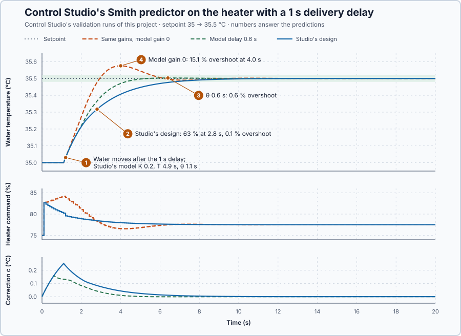

# 67. Smith prediction

In this lesson, you will let Control Studio identify the heater's delivery delay and design a Smith predictor around `Control.PID`, and test what a wrong model delay and no model at all do to the same controller.

## The problem

Lesson 66's override held the vessel's jacket at its 42 °C limit and handed back to the vessel controller in the same update as the setpoint change; the vessel's heater acts on its jacket at once. Many heaters do not. To study a delivery delay on its own, we return to the water heater, now with its command taking 1 s to arrive. The delay is known, yet it slows the feedback: a PI tuned fast loses its stability margin to the delay, and a PI tuned safely is slow.

We will let the controller act on a model's prediction of the temperature without the delay.

## What we need

We need to:

1. feed back a signal that does not contain the delay, so the controller can be fast without losing its margin;
2. keep correcting from the real measurement; and
3. know what a wrong model delay does.

## The new idea

A **Smith predictor** lets the controller act on a model's prediction of the temperature without the delay, and corrects that prediction with what is really measured. For the heater, the controller sees what the water would do if the heater's power arrived at once.

**In words.** The delay is the whole difficulty: whatever the controller does, it sees the result only 1 s later. A strong controller keeps pushing during that second, because it sees no effect yet, and overshoots; so ordinary feedback on a delayed process must stay gentle. The Smith predictor runs a model of the heater inside the program, twice:

1. **A model without the delay** shows at once what the commands will do to the water.
2. **A model with the delay** shows what the sensor should be reading now.

The controller reads the measurement plus the difference between the two models. If the model is right, the delayed model and the measurement agree, the two cancel, and the controller in effect reads the undelayed model: it can be tuned as if there were no delay. Whatever the model does not know, such as a load or a model error, still shows in the measurement and so still reaches the controller. The delayed model needs the commands of the last second; the program keeps them in a history, as a shift register keeps track of parts moving along a conveyor.

**The formula.** The controller reads the measurement corrected by the two models:

$$
y_{pred} = y_{m,0} + (y - y_{m,L}) = y + c .
$$

Let:

- $y$ be the measured water temperature, in °C;
- $y_{m,0}$ and $y_{m,L}$ be the model's temperature without and with the delay, in °C;
- $c = y_{m,0} - y_{m,L}$ be their difference, the **correction**, in °C; and
- $y_{pred}$ be the predicted temperature the controller reads, in °C.

Both models are the heater as a first-order lag, $K/(Ts + 1)$, with gain $K$ in °C/% and time constant $T$ in s. One is driven by the applied command $u$, the other by $u_\theta$, the command $\theta$ seconds earlier, both in %. Subtracting the two models gives $T\dot c = K(u - u_\theta) - c$, and over one 0.1 s update with both commands held:

$$
c_{next} = c\,e^{-0.1/T} + K(u - u_\theta)\left(1 - e^{-0.1/T}\right).
$$

The first term is the old correction fading with the model's lag; the second adds the effect of the commands given within the last $\theta$ seconds, which the delayed model has not seen yet.

**Example: the water heater with a 1 s delay.** From the heat balance, $K = 2/10 = 0.2$ °C/%, $T = 50/10 = 5$ s and $\theta = 1$ s. Follow the numbers:

1. Why ordinary feedback must stay gentle: with a PI whose integral time equals the heater's time constant, the loop is $L = e^{-\theta s}/(\lambda s)$, where $\lambda$ is the response time. It crosses over at $1/\lambda$ rad/s, where the delay takes $\theta/\lambda$ radians of phase. For $\theta = 1$ s and $\lambda = 1.63$ s, the delay takes $1/1.63 = 0.613$ rad = 35.1°, and the phase margin falls from 90° to 54.9°.
2. A prediction: for $y_{m,0} = 36$, $y_{m,L} = 35.4$ and $y = 35.2$ °C, $c = 0.6$ and $y_{pred} = 35.8$ °C. The controller acts as if the water were already 35.8 °C, because 0.6 °C of the heating it has commanded is still on its way.
3. One update of the correction: with the command 10 points above $u_\theta$, $c$ grows from 0 to $0.2 \times 10 \times (1 - e^{-0.1/5}) = 0.0396$ °C.
4. With a matching model, the correction cancels the delayed part of the measurement, and the controller sees the loop $L = 1/(\lambda s)$, without delay: phase margin 90°.
5. The water repeats the delay-free response $\theta$ later: it reaches 63 % of a step after $\theta + \lambda = 1 + 1.63 = 2.6$ s.

Control Studio measures $K$, $T$ and $\theta$ itself: in Manual it steps the heater by 10 points and fits a first-order model with delay. It then designs the PI for the delay-free model: the integral time $K_p/K_i = T$ cancels the model's lag, and $\lambda = T/(K K_p)$ sets the response.

**The limitation.** The predictor is only as good as its model, above all its delay. A model delay of 0.6 s on the 1 s heater leaves about 0.4 s in the loop, $0.4/1.63 = 0.245$ rad = 14° at the crossover. Without a model, $K = 0$, the correction stays 0 and the same gains act on the measurement with the whole delay: 54.9°. And the predictor corrects an unmeasured load no faster: the load acts on the water, not on the models, so it reaches the controller only through the measurement, and the heat sent against it still takes 1 s to arrive.

## Prediction

Before running, answer these questions for a 35 → 35.5 °C step:

1. Which model should Control Studio's step test find?
2. With Studio's predictor, when does the water reach 63 % of the step, and does it overshoot?
3. What does a model delay of 0.6 s do to the same design?
4. What do the same gains do with model gain 0, on the measured temperature?

| Quantity | Predicted |
| --- | ---: |
| Model from the heat balance | K 0.2 °C/%, T 5 s, θ 1 s |
| Time to 63 % with the predictor | θ + λ ≈ 1 + 1.6 = 2.6 s |
| Delay left with θ = 0.6 s | about 0.4 s, 14° |
| Margin with model gain 0 | 54.9°: it overshoots |

## Implementation

Open [`src/Main.st`](src/Main.st). The project holds one heater with the 1 s delay and one `Control.PID`, fed the predicted temperature. Control Studio's Smith setup binds its parameters, its Auto/Manual switch and manual output, and the model: `ModelGain`, `ModelTimeConstantS`, `ModelDelayS` and the correction `CorrectionC`. Until a design is applied the controller is in Manual at 75 %, with the slow PI of Lesson 19 and no model.

```st
PredictedTemperatureC := MeasuredC + CorrectionC;
NextCorrectionC := CorrectionC * Decay + ModelGain * (CommandPct - EarlierPct) * (LREAL#1.0 - Decay);
```

`Decay` is $e^{-0.1/T}$, and `EarlierPct` is the command `ModelDelayS` earlier, kept in a 100-update history.

**Exercise.** By hand: `PredictedTemperatureC` gives 35.8 °C for the example above; `NextCorrectionC` gives 0.0396027 °C from 0 with $u - u_\theta = 10$ points, 0.4900993 °C from 0.5 °C with $u = u_\theta$, and 0 with $K = 0$. Open [`src/tests.st`](src/tests.st) and run its tests from the **Testing** view.

## Experiment in Control Studio

1. Open this lesson's project and start **Simulator**. In the **truST** side bar, select **Control Studio**; the project has no loop yet, so select **Configure control loop**.
2. In **Set up control loop**, enter **Loop name** `Water temperature` and choose **Structure** **Smith predictor: the PID reads the measurement plus the program's predicted correction**. Check the filled-in **Controller** `P1.Loop`, **Parameter record**, **Output** `P1.HeaterPct`, **Setpoint** and **Manual output**; choose **Measurement** `P1.WaterC` (degC, 0–80), **Auto/Manual signal** `P1.Auto`, **Model gain** `P1.ModelGain`, **Model time constant (s)** `P1.ModelTimeConstantS`, **Model delay (s)** `P1.ModelDelayS`, **Correction the program keeps** `P1.CorrectionC` and **Startup-done flag** `P1.Initialized`; enter **Identification step** 10 and **Identification duration (s)** 60. Select **Save loop**.
3. Answer the predictions before going on.
4. On **Identify**, keep **Method** **Automatic** and select **Identify plant**.
5. On **Tune**, check **Controller** **P1.Loop · Smith predictor**. Select **Requirements…** and enter **Setpoint change (°C)** 0.5, **Maximum steady-state error (°C)** 0.05, **Maximum settling time (s)** 8, **Settling band (±°C)** 0.02 and **Validation duration (s)** 30; select **Done**, then **Tune controller**.
6. On **Validate**, select **Validate controller**, then **Apply**. Studio shows **Applied**, and **Apply** becomes **Restore previous settings**.
7. Test a wrong delay: on **Tune**, choose **Manual** from **Tuning method**, enter 0.6 in **Model delay θ**, select **Tune controller**, and on **Validate** select **Validate controller**. Then enter 0 in **Model gain K** instead and validate again.

To start again, select **Restore previous settings** on **Validate**: the controller returns to Manual with its previous settings.

## Evidence and decision



The numbered marks answer the predictions with the same numbers. Control Studio identified $G(s) = 0.2/(4.9s + 1)\cdot e^{-1.1s}$ and designed $K_p = 15$ %/°C and $K_i = 3.06$ %/(°C·s) with $K = 0.2$ °C/%, $T = 4.9$ s and $\theta = 1.1$ s. From its validation runs:

| Validation, 0.5 °C step | Studio's design | Model delay θ 0.6 s | Model gain K 0 |
| --- | ---: | ---: | ---: |
| Maximum settling time, ≤ 8 s | 5.1 s, Pass | 3.7 s, Pass | 4.9 s, Pass |
| Maximum steady-state error, ≤ 0.05 °C | 0.008753 °C, Pass | 0.001943 °C, Pass | 0.007309 °C, Pass |
| Model agreement, ≤ 15 % | 0.2899 %, Pass | 0.2899 %, Pass | 0.2899 %, Pass |
| Time to 63 % of the step | 2.8 s | 2.5 s | 2.2 s |
| Overshoot | 0.1 % | 0.6 % | **15.1 %** at 4.0 s |

1. Studio's model is the heat balance's, with the delay measured 0.1 s long and the time constant 0.1 s short.
2. Its PI has integral time 15/3.06 = 4.9 s = $T$ and $\lambda$ = 4.9/(0.2 × 15) = 1.63 s; the water first moved at 1.2 s and reached 63 % at 2.8 s, $\theta + \lambda$, with 0.1 % overshoot.
3. With θ = 0.6 s the correction peaked at 0.159 °C after 0.6 s instead of 0.252 °C after 1.1 s, so the controller saw part of the delay: at 1 s it still held 81.67 % instead of 80.39 %, and the water overshot by 0.6 %.
4. With model gain 0 the same gains acted on the measured temperature and overshot by 15.1 %, as the 54.9° margin suggests.

All three passed Studio's requirements; our added limit, overshoot at most 4 % (0.02 °C), passes the design and the 0.6 s delay but fails the controller without a model. The predictor buys a fast, well-damped step for the price of a model whose delay must be close; here a delay 0.5 s short costs 0.6 %. Studio's design is accepted and applied for this heater's setpoint changes. These are simulation results.

## Conclusion

A Smith predictor feeds back the measured temperature plus the correction $c = y_{m,0} - y_{m,L}$, so the controller works on a loop without the delay. It cannot make the heat arrive sooner or correct unmeasured loads faster, and a wrong delay returns the uncorrected part to the loop.

For the heater, Control Studio identified the 1 s delay from one step and designed a predictor that reached 63 % in 2.8 s with 0.1 % overshoot; the same gains without the model overshot by 15.1 %.

## Check yourself

1. **The delay-free model reads 35.6 °C, the delayed model 35.3 °C and the water 35.2 °C. What does the controller see?**
   35.2 + (35.6 − 35.3) = 35.5 °C.
2. **Why did the 0.6 s model delay cost so little?**
   Only about 0.4 s of the 1 s delay stayed in the loop, which takes 14° of phase at Studio's 0.61 rad/s crossover.
3. **With λ = 2 s and the 1 s delay, what phase margin does ordinary feedback have?**
   The crossover is 0.5 rad/s, where the delay takes 0.5 rad = 28.6°, so the margin is 90° − 28.6° = 61.4°.

## Reason for the next lesson

Cascade, split range, override and prediction each work on their own. Which combination meets the jacketed vessel's requirements, including startup, the switch to Auto and a failed sensor?

[Vessel commissioning](../../14-integrated-capstones/83-reactor-control/README.md) chooses the combination the jacketed vessel needs and tests it against its requirements.
