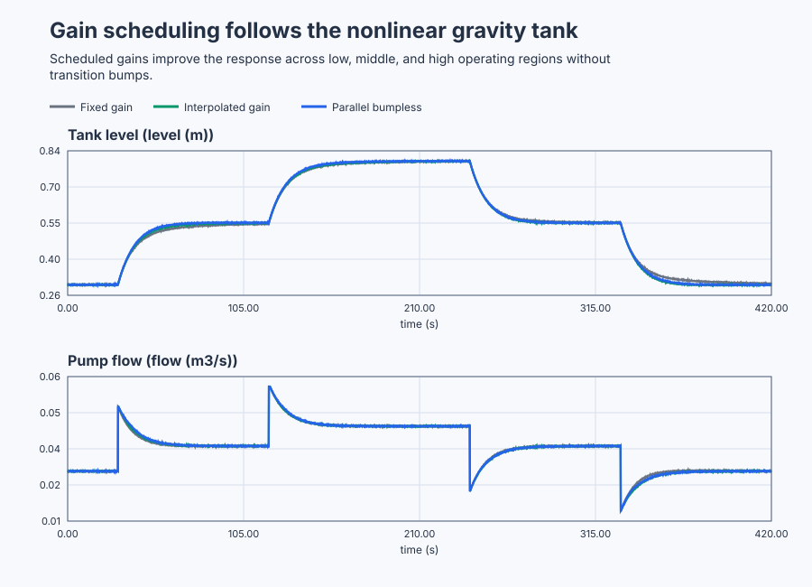

# Schedule PI control across a gravity tank's operating range

Course position: Lesson 58 of 84. Prerequisite: compressor override control in Lesson
57. Every result is **Simulation evidence**. It is not evidence from a physical
tank and does not authorize operation of a pump.

**Lesson objective:** Derive and validate local models of a gravity-drained tank, then decide whether one fixed proportional-integral controller or either of two gain-scheduling architectures gives consistent control over the full operating range without creating output bumps or boundary chatter.

## The problem

A vented water tank has a constant cross-sectional area of 1.0 square metre. A
variable-speed inlet pump supplies between 0 and 0.060 cubic metres per second.
Water leaves through a fixed outlet under gravity. The controlled quantity is
liquid level, measured in metres. The manipulated quantity is pump flow,
measured in cubic metres per second.

Three equivalent simulated tanks compare a conservative fixed controller, one
controller whose parameters are interpolated, and three parallel local
controllers. The usable level range is 0.30 through 0.80 metres. The controller
runs every 0.1 seconds and the simulated sensor includes deterministic noise
with a 0.0005-metre standard deviation.

Lesson 57 changed control priority because equipment protection took authority
from production. Here authority remains level control, but the plant dynamics
change with level. Gravity makes outlet flow increase nonlinearly as the tank
fills. A fixed controller chosen for slow high-level behavior is unnecessarily
slow low in the tank. A more aggressive low-level tuning can become unsuitable
higher in the tank. A selector cannot fix this; controller parameters must
follow qualified changes in plant dynamics.

## What we need

We need controller settings that remain appropriate as gravity outflow changes across the tank's operating range. Any change between local settings must preserve output continuity and avoid boundary chatter, and its added complexity must outperform one fixed setting.

## The new idea

### Nonlinear tank balance

The **liquid level ($h$)** is water height in metres. The **inlet pump flow
($q_{\mathrm{in}}$)** is volume entering each second, in cubic metres per second. The
**outlet flow ($q_{\mathrm{out}}$)** is volume leaving each second in the same unit. The
**tank area ($A$)** is 1.0 square metre. The **outlet coefficient ($c$)** describes
the fixed gravity outlet and is 0.050 square metres times square-root metre per
second.

Gravity outlet flow grows with the square root of level. Stored volume changes
by inlet flow minus outlet flow. Only after those physical quantities are
defined do we write:

$q_{\mathrm{out}} = c\sqrt{h}$

$A\frac{dh}{dt} = q_{\mathrm{in}} - q_{\mathrm{out}}$

At a steady operating level, inflow equals outflow. The required pump flows at
0.30, 0.55, and 0.80 metres are therefore 0.02739, 0.03708, and 0.04472 cubic
metres per second. These are operating-point flows, not controller gains.

For example, at 0.30 metre the steady balance gives
$q_{in,eq}=0.050\sqrt{0.30}=0.02739$ cubic metres per second. Repeating the same
substitution at 0.55 and 0.80 metre gives the other two flows.

### Local models

The **equilibrium level ($h_{\mathrm{eq}}$)** is the steady level around which one small
experiment is performed. The **level deviation ($\Delta h$)** is measured level
minus equilibrium, in metres. The **pump-flow deviation ($\Delta q$)** is applied
pump flow minus its equilibrium value, in cubic metres per second.

For small deviations around one equilibrium, the nonlinear tank behaves
approximately like a first-order process. The **local steady gain ($K_{\mathrm{h}}$)** says
how much eventual level deviation results from one unit of pump-flow deviation.
The **local time constant ($T_{\mathrm{h}}$)** is the time in seconds for about 63 percent of
that eventual level change to appear.

$K_h = \frac{2\sqrt{h_{\mathrm{eq}}}}{c}$

$T_h = \frac{2A\sqrt{h_{\mathrm{eq}}}}{c}$

These expressions come from the tangent to the square-root outlet curve. For a
small deviation, $\sqrt{h_{eq}+\Delta h}\approx\sqrt{h_{eq}}+
\Delta h/(2\sqrt{h_{eq}})$. Subtracting the equilibrium balance leaves
$A\,d\Delta h/dt=\Delta q-c\Delta h/(2\sqrt{h_{eq}})$. Multiplying by
$2\sqrt{h_{eq}}/c$ puts it in the standard first-order form
$T_h\,d\Delta h/dt+\Delta h=K_h\Delta q$, which identifies the two expressions
above.

At the three operating levels, the local gains are 21.91, 29.66, and 35.78
metres per cubic metre per second. The local time constants are 21.91, 29.66,
and 35.78 seconds. Each model is valid only near the equilibrium where it was
derived and tested. It is not a global replacement for the nonlinear tank.

### Local PI tuning

The **proportional gain ($K_p$)** states how much pump-flow request is produced per
metre of present level error. Its unit is cubic metres per second per metre.
The **integral gain ($K_i$)** states how quickly accumulated level error changes
the pump request. Its unit is cubic metres per second per metre-second.

For a declared 10-second closed-loop design time, the three qualified local
tunings use $K_p$ = 0.100. Their $K_i$ values are 0.00456, 0.00337, and 0.00280 from
low to high level. The fixed baseline uses the conservative high-level value,
$K_i$ = 0.00280, everywhere. Scheduling only $K_i$ is still gain scheduling:
integral action must follow the changing plant time constant.

The tuning is also calculated, not guessed. For a first-order plant and design
time $\lambda=10$ seconds, $K_p=T_h/(K_h\lambda)$. Here $A=1$, so the derived
$T_h$ and $K_h$ have equal numerical values and $K_p=1/10=0.100$. Choosing the
integral time $T_i=T_h$ gives $K_i=K_p/T_i$. Thus at 0.30 metre,
$K_i=0.100/21.91=0.00456$; the same calculation gives 0.00337 and 0.00280 at
the middle and high points.

### Interpolated scheduling

The **scheduling variable ($\rho$)** is the requested operating level in metres.
It is bounded, available before a transition, and matches the variable used to
qualify the local models. It is not controller error.

Between adjacent qualified scheduling points, the **interpolation fraction
($\alpha$)** describes how far the scheduling variable ($\rho$) lies from the
lower point ($\rho_0$) toward the upper point ($\rho_1$). A controller parameter
at those points has the values ($\theta_0$) and ($\theta_1$).

$\alpha = \frac{\rho - \rho_0}{\rho_1 - \rho_0}$

$\theta(\rho) = \theta_0 + \alpha\left(\theta_1 - \theta_0\right)$

The scheduler filters $\rho$ with a 2-second time constant and clamps it to the
validated 0.30-through-0.80-metre envelope. It calculates $K_p$, $K_i$, limits,
anti-windup, and tracking settings as one record and applies that record
atomically between controller updates. No scan observes mixed old and new
parameters.

### Parallel scheduling

The alternative keeps low-, middle-, and high-level PIs as separate stateful
controllers. Nominal region boundaries are 0.425 and 0.675 metres. A 0.010 m
hysteresis half-band requires upward crossings above 0.435 or 0.685 metres and
downward crossings below 0.415 or 0.665 metres. Sensor noise inside the band
cannot change region.

Only one controller is automatic. Each inactive controller keeps the real
setpoint and measurement histories. Because this incremental PID still
evaluates current proportional and integral terms in Track mode, the program
subtracts those known increments from its external tracking reference. The
evaluated inactive request therefore equals the selected applied pump flow
without storing a false setpoint. Simply replacing the setpoint with current
level would create a proportional step when that controller receives authority.
A transition is bumpless when the first newly selected request differs from
preceding applied flow by no more than 0.0005 cubic metres per second.

## Prediction

Before running, calculate the three equilibrium flows, local gains, time
constants, and $K_i$ values. Predict that fixed high-level $K_i$ gives the slowest
low-level response and that interpolated $K_i$ moves smoothly. For the sequence
0.30 to 0.55 to 0.80 to 0.55 to 0.30 metres, predict exactly four region
transitions, no chatter, and pump steps no larger than 0.0005 cubic metres per
second.

## Implementation

The shipped program contains five real Control.PID instances and one real
Control.PIDGainScheduler. One PID is fixed, one receives an atomically
interpolated record, and three form the parallel schedule.

```st
Scheduled := GainScheduler.Update(
    OperatingPoint := LevelSetpoint,
    CycleTime := LREAL#0.1);
IF SchedulingAvailable AND Scheduled.Valid AND NOT Scheduled.Clamped THEN
    InterpolatedParameters := Scheduled.Parameters;
END_IF;
InterpolatedController.Configure(Parameters := InterpolatedParameters);
```

The program exposes requested level, measured levels, pump requests, filtered
scheduling level, interpolation fraction, active gains, parallel region, and
transition count. It contains no timed experiment or stored verdict.

## Experiment in Control Studio

This procedure observes the complete project-owned level sequence under
controlled conditions. The project owns all setpoint changes, scheduling, and
restoration to 0.30 metre; Control Studio writes only one Boolean authority
signal. The deterministic Simulation seed is 20260829.

### Control Studio actions

1. **Monitor** — Start the **Simulator**, then open **truST sidebar → Control Studio → Monitor → Response**.
   - **Baseline check:** Wait until the header shows **Simulation**, **Running**, and current data. Confirm Requested liquid level (SP, m); Fixed-PI liquid level (PV, m); Fixed-PI pump-flow request (MV, m3/s), including units, limits, mode, and quality. The initial operating point is Requested liquid level = 0.3 m, Fixed-PI liquid level = 0.3 m, Interpolated-PI liquid level = 0.3 m, Parallel-PI liquid level = 0.3 m, Fixed-PI pump-flow request = 0.027386127875 m3/s, Interpolated-PI pump-flow request = 0.027386127875 m3/s, Parallel-PI pump-flow request = 0.027386127875 m3/s. The unresolved baseline problem is: The conservative high-level integral gain is unnecessarily slow in the low-level region. Retain the schedule boundaries at 30 s, 120 s, 240 s, 330 s, and 420 s before opening Test.
   - **Decision before action:** Read **Prediction** above, then state what should move first and in which direction. Use this decision rule: Accept scheduling only when every local model is qualified, constraints remain common, regional performance improves, and both transition architectures are bumpless.
   - **Successful evidence:** The Response plot advances, the displayed values are finite and current, and **Start recording** is enabled. Select **Start recording** only after those conditions are visible.
   - **Recovery:** If recording is disabled or the plot reports unavailable or stale samples, stop the Simulator, correct the displayed runtime or binding problem, restart it, and repeat the baseline check.
   - **Record:** Write down the initial SP, PV, requested/applied MV where available, controller mode, and your predicted response before opening Test.

2. **Test** — Open **truST sidebar → Control Studio → Test**.
   - **Baseline check:** Confirm **Experiment** = **Observe without excitation**, **Amplitude** = **0** (disabled), and **Maximum duration (s)** = **420.1**. The reviewed authority is **Experiment authority** (`P1.ExperimentEnabled`). The project commands 0.30, 0.55, 0.80, 0.55, and 0.30 metre at 0, 30, 120, 240, and 330 seconds.
   - **Decision before action:** Before selecting **Review test**, predict the four region crossings and confirm every level can remain within 0.20 through 0.90 metre and every pump request within 0 through 0.060 cubic metre per second.
   - **Successful evidence:** Select **Review test**, verify zero external excitation, authority, duration, restoration, and stop conditions, then select **Confirm and start**. Response must show the complete project-owned sequence, continuous interpolated parameters, and exactly four parallel-region transitions. At termination authority clears and requested level is 0.30 metre. Keep **Abort test** visible.
   - **Recovery:** Select **Abort test** if the test is rejected, stale, unsafe, unavailable, failed, or aborted. Read the reason, confirm authority is false and requested level restored to 0.30 metre, wait for current data, and review a new observation.
   - **Record:** Compare all three architectures with your prediction and retain the terminal state, restoration result, and seed **20260829**. The native lesson test owns local-model qualification, boundary-noise, and numeric verdicts; this observation does not create generic Identify, Tune, or Validate evidence.

## Evidence and decision

### Measures and comparison

Hold nonlinear plant parameters, initial state, level sequence, local tuning,
common constraints, sample schedule, duration, and noise seed equal. Change
only fixed, interpolated, or parallel-tracked controller architecture.

Define measures before revealing results. **Regional integral absolute level
error** sums absolute level error times the 0.1-second interval in
metre-seconds. **Pump-flow total variation** sums consecutive absolute applied
pump-flow changes in cubic metres per second. **Region transition count**
counts changes among low, middle, and high regions. **Transition pump step** is
the adjacent applied-flow change at a transition. Settling time and
final-window error are reported only when declared level and pump spans prove
settling; otherwise report Not settled.

### Validation

First classify each run as Valid, Not settled, Saturated, Unqualified region,
Chattering, Invalid, or Aborted. Only eligible metrics may then be compared.

Both scheduled architectures must remain finite and within 0.20 through 0.90
metres and 0 through 0.060 cubic metres per second. Each must improve worst
regional integral absolute level error relative to fixed PI. The parallel path
must make exactly four region transitions with no chatter, and every transition
pump step must be no larger than 0.0005 cubic metres per second. Interpolated
changes must be atomic and must not create a pump step from mixed parameters.

The deterministic executable run produced:

| Controller architecture | Four regional errors (m·s) | Worst region (m·s) | Transfer result |
| --- | --- | ---: | --- |
| Fixed high-level PI | 3.2839, 3.2207, 2.6221, 3.2669 | 3.2839 | No scheduled transfer |
| Atomically interpolated PI | 2.6837, 3.0500, 2.3617, 2.3014 | 3.0500 | Continuous parameter record |
| Parallel tracked PIs | 2.4123, 2.8488, 2.4749, 2.4807 | 2.8488 | Four transitions; largest pump step 0.000284 m³/s |

Both scheduled architectures improve the fixed controller's worst region. The
parallel result is eligible because it makes exactly four transitions, does not
chatter, and remains below the predeclared 0.0005-cubic-metre-per-second bump
limit. These numbers belong to the declared deterministic Simulation run only.

### Retained evidence

The plot is generated by the executable gravity-tank experiment. It compares one fixed tuning with scheduled tunings as the nonlinear tank crosses its operating regions.



[Complete trace](figures/gravity-tank-scheduling-evidence-trace.csv) · [Decision summary](figures/gravity-tank-scheduling-evidence-summary.csv)

## Conclusion

The square-root outlet becomes less sensitive to level as the tank fills.
Consequently local gain and time constant increase with operating level. The
fixed high-level integral gain is conservative and sluggish at low level.
Interpolation moves one retained PID state smoothly through qualified
parameters. Parallel scheduling preserves separate local states, so external
tracking and hysteresis prevent bumps and chatter.

Neither result proves behavior beyond 0.30 through 0.80 metres. Scheduling is
not online identification or adaptation; it uses models qualified beforehand.

## Reason for the next lesson

You can now justify gain scheduling from measured or derived operating-point
dependence, choose an architecture, and validate its envelope and transitions.
Lesson 59 addresses another limitation: transport delay can consume stability
margin even when local plant dynamics do not vary greatly.

For a physical tank, independently review pump and outlet capacity, overflow
and low-level protection, sensor quality, actuator behavior, I/O topology,
abort limits, restoration, and approval immediately before any experiment.
Simulation evidence must never be presented as physical-plant evidence.
