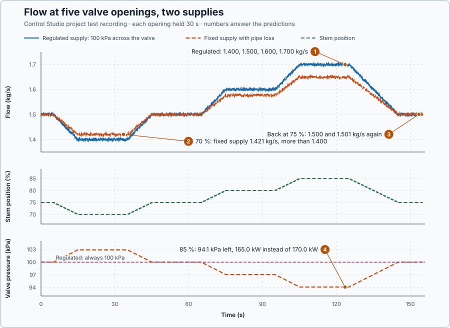

# 32. Valve characteristics

In this lesson, you will measure how much hot water the valve lets through at each opening, with two kinds of supply, and convert that flow into heating power. You will see that the installation, not only the valve, decides how the flow changes with the opening.

## The problem

Lesson 31 fed the measured stem position back into the controller: after the 35 → 37 °C step the request stayed within 2 points of the slow stem from 5 s, and the water peaked at 37.02 °C and settled from 29.5 s, while without tracking it overshot to 37.98 °C. That lesson assumed that each percent of stem position delivers 2 kW, as each percent of the electric heater's command did. But the stem position only says how far the valve is open. How much hot water flows also depends on the pressure across the valve, so the relation between opening and flow is unknown, and with it the heat that each percent delivers.

We will measure the flow at several openings with two kinds of supply, and turn it into heat.

## What we need

We need to:

1. measure the flow at several openings, only after the stem and the flow have settled;
2. see how the pressure across the valve changes the flow; and
3. turn the flow into the heat it delivers.

## The new idea

A **valve characteristic** tells how much flow each opening gives. In a real pipe the flow also depends on how much pressure is left for the valve, so equal steps in opening do not give equal steps in flow. For this heater's valve, it decides how much heat each percent of stem position really delivers.

**In words.** The physics is the same as in a garden hose: pressure pushes water through the opening. The pressure across the valve becomes speed of the water in the opening, and that speed grows with the square root of the pressure: four times the pressure gives twice the speed. A wider opening lets more of that water through. The flow therefore depends on two things: how far the valve is open, and how much pressure is left across it.

That gives two characteristics:

1. The **inherent characteristic** is the flow at each opening with a constant pressure across the valve. It belongs to the valve alone and is what its datasheet describes. Datasheets give the flow at 1 bar across the fully open valve as its Kvs value, in cubic metres per hour: for this valve 2 kg/s, about 7.2 m³/h.
2. The **installed characteristic** is the flow at each opening in the valve's own pipe. The pipe and its fittings take their share of the supply pressure, and that share grows with the flow. When the valve opens further and more water flows, less pressure is left across the valve, so the flow rises less than the valve alone suggests.

For this heater, the installed characteristic decides whether each percent of stem really adds the 2 kW that Lesson 31 assumed. With a regulated supply it does; with a fixed supply and a pipe that takes its share, the heat added per percent changes with the opening.

**The formula.** The supplied calibration of this valve, its inherent characteristic, is

$$
q = 2z\sqrt{\Delta p / 100\ \text{kPa}}\ \text{kg/s}, \qquad z = \frac{x}{100} .
$$

With the fixed supply, the pressure across the valve is what the pipe leaves of the supply: $\Delta p = 128.125 - 12.5\,q^2$ kPa. Squaring the calibration gives $q^2 = 0.04\,z^2\,\Delta p$; inserting $\Delta p$ and collecting $q^2$ gives $q^2\,(1 + 0.5z^2) = 5.125\,z^2$. So, installed in this pipe,

$$
q = 2z\sqrt{1.28125 / (1 + 0.5z^2)}\ \text{kg/s}.
$$

The heat follows from the flow, as in Lesson 31: $Q = c_p\,q\,(T_{in} - T)$.

- $q$ is the mass flow, in kilograms per second;
- $x$ is the stem position in percent, and $z = x/100$ the opening as a fraction;
- $\Delta p$ is the pressure across the valve, in kilopascals; 100 kPa is 1 bar;
- 128.125 kPa is the fixed supply's pressure, and $12.5\,q^2$ kPa is what the pipe loses at the flow $q$; and
- $Q$ is the heat, in kilowatts, $c_p = 4$ kJ/(kg·°C) the specific heat of water, and $T_{in}$ and $T$ the supply and water temperatures, in degrees Celsius.

**Example: the valve at 75 % and at 85 %.** Follow the numbers:

1. With the regulated supply, a pressure regulator holds 100 kPa across the valve whatever the flow, so $q = 2z$: 1.5 kg/s at 75 % and 1.6 kg/s at 80 %, 0.02 kg/s per point. Equal steps in opening give equal steps in flow.
2. With the fixed supply at 75 %, the pipe loses $12.5 \times 1.5^2 = 28.125$ kPa of the 128.125 kPa, so 100 kPa remain and the flow is again 1.5 kg/s: both supplies share this operating point.
3. With the fixed supply at 85 %, $q = 1.7 \times \sqrt{1.28125/1.36125} = 1.649$ kg/s instead of 1.7. The pipe now loses $12.5 \times 1.649^2 = 34.0$ kPa, so only 94.1 kPa remain across the valve.
4. The heat at 75 %, with 60 °C supply water and 35 °C water: $Q = 4 \times 1.5 \times 25 = 150$ kW. Each extra 0.02 kg/s adds $4 \times 0.02 \times 25 = 2$ kW: the 2 kW per point of Lesson 31, as long as 100 kPa stay across the valve.

A characteristic describes steady values, so a point counts only after the stem has reached its target and the flow has settled. Here each opening is held 30 s, and the point is the mean of its final 3 s, provided the stem is within 0.1 point of its target and each flow varied by at most 0.015 kg/s.

**The limitation.** A characteristic tells only where the flow settles at each opening, not how the stem and the flow get there, and the installed characteristic belongs to one installation: another pipe or supply gives another one. The pipe loss, the supply pressure and the steadiness thresholds are teaching values.

## Prediction

Before running, answer these questions:

1. What is the regulated flow at 70, 75, 80 and 85 %?
2. Is the fixed-supply flow higher or lower than the regulated flow at 70 % and at 85 %? Why?
3. Does the second visit to 75 % give the same flow as the first?
4. How much heat does each supply deliver at 85 %, with 60 °C supply water and 35 °C water?

| Stem | Regulated flow | Fixed-supply flow |
| ---: | ---: | ---: |
| 70 % | 1.400 kg/s | 1.421 kg/s |
| 75 % | 1.500 kg/s | 1.500 kg/s |
| 80 % | 1.600 kg/s | 1.576 kg/s |
| 85 % | 1.700 kg/s | 1.649 kg/s |

## Implementation

Open [`src/Main.st`](src/Main.st). While the project test enables `ExperimentEnabled`, the program holds the stem request at each of `Targets` = [70, 75, 80, 85, 75] % for 30 s and averages the final 3 s:

```st
IF Active THEN
    ValveRequestPct := Targets[StepIndex];
    HoldTimer(IN := TRUE, PT := T#30s);
    (* The final 3 s of each hold form the steady window. *)
    IF HoldTimer.ET >= T#27s THEN
        ...
    END_IF;
    IF HoldTimer.Q THEN
        SteadyStemPct[StepIndex] := StemSum / DINT_TO_LREAL(Samples);
        SteadyFlowRegulated[StepIndex] := RegulatedSum / DINT_TO_LREAL(Samples);
        SteadyFlowFixedSupply[StepIndex] := FixedSum / DINT_TO_LREAL(Samples);
        ...
        SteadyQualified[StepIndex] := ABS(SteadyStemPct[StepIndex] - Targets[StepIndex]) <= LREAL#0.1
            AND RegulatedMaximum - RegulatedMinimum <= SteadyRangeKgS
            AND FixedMaximum - FixedMinimum <= SteadyRangeKgS;
        ...
    END_IF;
END_IF;
```

One stem request drives both supplies, and `SteadyRangeKgS` is the 0.015 kg/s limit.

**Exercise.** Run the tests in [`src/tests.st`](src/tests.st) from the **Testing** view. They check 1.5 and 1.6 kg/s at 100 kPa, the doubled flow at four times the pressure, the 1.649 kg/s fixed-supply flow at 85 % and the 150 kW of heat. Then compute the fixed-supply flow at 80 % by hand: $1.6\sqrt{1.28125/1.32} = 1.576$ kg/s.

## Experiment in Control Studio

1. Open this lesson's project and start **Simulator**. The valve rests at 75 % with 1.5 kg/s with both supplies. In the **truST** side bar, select **Control Studio**.
2. On **Identify**, check **Plant inputs** `P1.ValveRequestPct (%)` and **Measured outputs** `P1.FlowRegulatedKgS (kg/s)`, and choose **Project experiment** in **Method**.
3. In **Signals**, show `P1.FlowRegulatedKgS · Process value (kg/s)`, `P1.StemPositionPct · Applied output (%)`, `P1.ValveRequestPct · Requested output (%)`, `P1.FlowFixedSupplyKgS · state (kg/s)`, `P1.PressureRegulatedKPa · state (kPa)` and `P1.PressureFixedSupplyKPa · state (kPa)`.
4. Select **Review project test**. The plan shows **Test signal** `P1.ExperimentEnabled · FALSE → TRUE`, **Duration** 155.1 s and the **Stop conditions**. Select **Confirm and start**.
5. When Control Studio shows **Project test completed. Outputs restored.**, read the steady values of each hold for both supplies.

## Evidence and decision



The numbered marks answer the predictions with the same numbers. Steady points from the recording, the mean of the final 3 s of each hold:

| Stem | Regulated flow | Fixed-supply flow | Fixed-supply valve pressure |
| ---: | ---: | ---: | ---: |
| 70 % | 1.400 kg/s | 1.421 kg/s | 102.9 kPa |
| 75 % | 1.500 kg/s | 1.500 kg/s | 100.0 kPa |
| 80 % | 1.600 kg/s | 1.577 kg/s | 97.1 kPa |
| 85 % | 1.700 kg/s | 1.650 kg/s | 94.1 kPa |
| 75 % | 1.500 kg/s | 1.501 kg/s | 100.0 kPa |

Every point qualifies: each stem arrived exactly and each flow varied by at most 0.010 kg/s in its final 3 s.

1. The regulated flow followed $q = 2z$: 1.400, 1.500, 1.600 and 1.700 kg/s.
2. The fixed supply gave more flow at 70 %, 1.421 kg/s, because less flow leaves more pressure across the valve, 102.9 kPa; and less at 85 %, 1.650 kg/s with 94.1 kPa left.
3. The second visit to 75 % gave 1.500 and 1.501 kg/s again: the steady characteristic has no hysteresis.
4. At 85 %, the regulated supply delivers $4 \times 1.700 \times 25 = 170.0$ kW and the fixed supply $4 \times 1.650 \times 25 = 165.0$ kW.

From 75 to 80 %, the slope falls from 0.0200 to 0.0153 kg/s per point, about a quarter less: one point of stem adds 2.0 kW with regulated pressure but only about 1.5 kW with the fixed supply. A controller tuned for 2 kW per point therefore acts about a quarter more weakly above 75 % with the fixed supply. We take the measured installed characteristic, not the valve calibration, as the relation between stem position and heat for this installation. These are simulation results for this valve, not a physical calibration.

## Conclusion

The flow through a valve depends on its opening and on the pressure across it, $q \propto z\sqrt{\Delta p}$. Where pipe losses take a flow-dependent share of the supply pressure, the installed characteristic flattens, and the same stem movement delivers less additional flow and heat than the valve alone suggests.

For this valve, the fixed supply delivered 165.0 kW instead of 170.0 kW at 85 %, and a quarter less heat per point above 75 %; only steady, measured stem, pressure and flow values showed it.

## Check yourself

1. **With the fixed supply, what flow and heat does the formula give at 90 %, with 60 °C supply water and 35 °C water?**
   $q = 1.8\sqrt{1.28125/1.405} = 1.719$ kg/s, so $Q = 4 \times 1.719 \times 25 = 171.9$ kW.
2. **Why does the fixed supply give more flow than the regulated supply at 70 %?**
   Less flow means less pipe loss, so more of the supply pressure, 102.9 kPa instead of 100 kPa, is left across
   the valve and pushes water through it.
3. **Why does a point count only after the stem has stopped and the flow has settled?**
   A characteristic relates steady flow to steady opening. A value taken while the stem is still moving, or the flow
   still changing, mixes in how fast they move.

## Reason for the next lesson

A smooth characteristic describes where the stem settles, not how it gets there. It cannot explain a valve that ignores small commands and then jumps: real valves can hold against friction, break away suddenly and stop short.

[Valve stiction](../59-valve-stiction/README.md) tells a deliberate command deadband from a sticking valve.
