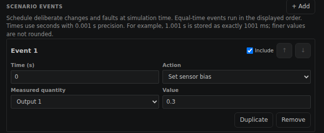
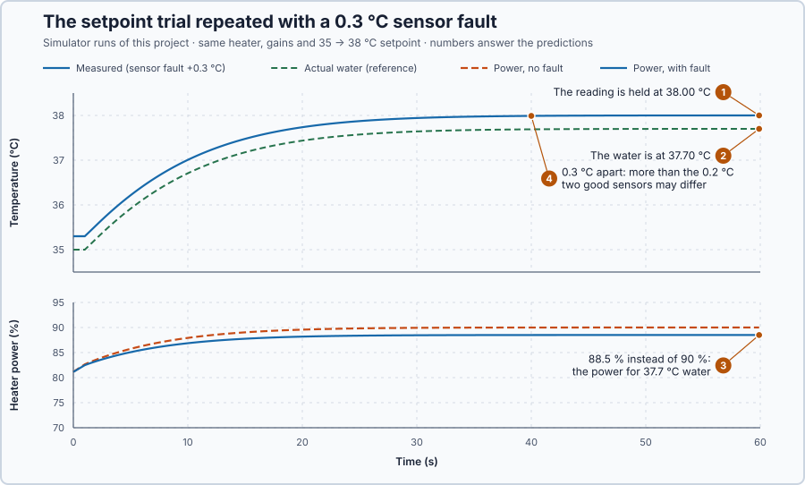

# 10. Loop diagnosis

In this lesson, you will find out why a requirement failed before changing any gain. You will check the measurement, the heater and its capacity, and see how a sensor that reads 0.3 °C too high fools the controller into holding the water too cold.

## The problem

Lesson 9's load trial failed: after colder water removed 30 kW more, the temperature fell to 33.32 °C and was still more than 0.2 °C from 35 °C at 30.4 s, 0.4 s too late. The result does not say why. The controller could be too slow. The measurement could be wrong, so the controller corrects the wrong temperature. The heater could fail to deliver what is commanded, or the load could need more power than the heater has. Changing the gains helps only in the first case.

We will check the measurement, the heater and the capacity in turn, and change a gain only if all three are in order.

## What we need

We need to:

1. check that the measured temperature is right;
2. check that the heater applies what the controller commands and that the water responds;
3. check that the heater has enough power for the load; and
4. only then decide whether the controller itself is the problem.

## The new idea

**Loop diagnosis** finds out why a loop performs badly before anyone touches the controller. Is the measurement right? Does the command reach the heater? Does the heater respond? Is the target reachable at all?

**In words.** A loop can perform badly for reasons no controller setting can fix: a wrong measurement, a command that does not reach the heater, a heater that does not respond, or a target beyond the heater's capacity. Diagnosis answers the four questions in order from cause to effect, and for this heater each has a check in the recorded data:

| Question | Check | Rules out |
| --- | --- | --- |
| Is the measurement right? | Compare the sensor with an independent reference of the same water temperature. | A wrong reading |
| Does the command reach the heater? | Compare the requested power with the applied power. | A limit or a blocked output |
| Does the heater respond? | Check that the temperature starts to change about 1 s after the power changes, the known delay. | A delivery fault |
| Is the target reachable? | Calculate the holding power and compare it with 100%. | Missing capacity |

In PLC terms, it is the loop check from commissioning: from the sensor through the input, the program and the output to the actuator, one stage at a time. A check is useful only if its result differs between the possible causes.

A sensor with a **bias** reads a fixed amount too high or too low. A bias is dangerous because the controller cannot see it: it drives the reading to the setpoint, so the water itself ends up off target by the bias. Two healthy sensors also disagree a little. If each is accurate to ±0.1 °C, one can read 0.1 °C high while the other reads 0.1 °C low, so they may differ by up to $0.1 - (-0.1) = 0.2$ °C. A larger disagreement shows that at least one is wrong, but not which one.

**The formula.** Two relations do the calculations. A sensor that reads $b$ too high makes the water settle at

$$
T_{water} = SP - b ,
$$

and holding the water at temperature $T$ needs the command

$$
u_{hold} = \frac{H\,(T - T_a) + D}{a}.
$$

- $b$ is the sensor bias, in °C, positive when the sensor reads too high;
- $H$ is the heat loss, 10 kW per degree Celsius above the surroundings;
- $T_a$ is the surroundings' temperature, 20 °C;
- $D$ is the extra heat loss, in kW;
- $a$ is the heater's power per command point, 2 kW per percentage point;
- $u_{hold}$ is the holding command, in percent; above 100 % the target is out of reach.

**Example.** For Lesson 9's load trial, $u_{hold} = (10 \times 15 + 30)/2 = 90\%$: below 100 %, so the heater has enough power. If the setpoint were also raised to 38 °C, $u_{hold} = (10 \times 18 + 30)/2 = 105\%$: impossible. No gain can create power the heater does not have.

The same relations predict what a 0.3 °C bias does in a 35 → 38 °C setpoint trial. The controller holds the reading at 38.00 °C, so the water settles at $38.00 - 0.3 = 37.70$ °C, and the holding power is $10 \times 17.7 / 2 = 88.5\%$ instead of 90 %.

## Prediction

You will run two tests. First, Lesson 9's load trial again, this time with the reference sensor recorded. Then a setpoint trial with a sensor that reads 0.3 °C too high, to see what a measurement fault looks like.

Before running, answer these questions for the setpoint trial with the faulty sensor:

1. Where will the reading settle?
2. Where will the water itself settle?
3. At what power will the heater settle?
4. Will the reading and the reference disagree by more than two healthy sensors may?

Then answer for Lesson 9's failed load trial:

5. Will the reading agree with the reference? Will the heater reach its 100% limit, and is the 30 kW load within its capacity?
6. If the measurement, the heater and the capacity are all in order, is a gain change justified?

## Implementation

Open [`src/Main.st`](src/Main.st). It runs Lesson 9's `Control.PID` unchanged, with `TrialKind` selecting the setpoint or the load trial. Besides the measured temperature `TemperatureC`, it reads `WaterTemperatureC`, a reference of the actual water temperature from the simulation, not a calibrated probe, and `AppliedPowerPct`, the power the heater applied one update later. `PairedRequestPct` is the request of that same update, so `UnavailableCommandPct`, the request minus the applied power, shows a real limit rather than one update of delay. `ReferenceDifferenceC` is the reading minus the reference. The sensor bias is not in the program: it is a fault of the simulated plant, which you add in the hardware canvas.

**Exercise.** The program's `PositiveError` and `AtUpperLimit` flags are kept separate. Check an error of 5 °C with request/applied 120/100% and with 90/90%. Both have a positive error; only the first has an unavailable command. Neither alone proves missing capacity: the heater also reaches its limit for a while after a large change.

## Experiment in Control Studio

1. Open this lesson's project, set `TrialKind := 1;` in `src/Main.st` (Lesson 9's load trial) and start **Simulator**. In the **truST** side bar, select **Control Studio**. On **Identify**, choose **Project experiment** from **Method**. **Signals** already shows `P1.SetpointC · Setpoint (°C)`, `P1.TemperatureC · Process value (°C)` and `P1.AppliedPowerPct · Applied output (%)`; add `P1.WaterTemperatureC · state (°C)` (the reference), `P1.PairedRequestPct · state (%)`, `P1.UnavailableCommandPct · state (%)` and `P1.DisturbanceKw · disturbance (kW)`.
2. Answer the predictions. Select **Review project test**, check the declared **60.1 s** duration and select **Confirm and start**; the 30 kW loss starts at once.
3. After the run, hover the lowest temperature and the end: compare the reading with the reference, and note the highest applied power and the unavailable command.
4. Now add the sensor fault. Stop the simulator, set `TrialKind := 0;` and start **Simulator** again. In the **truST** side bar, select **Devices & Connections** and select **heater-loop-diagnosis**; **Configure plant** opens. Its **Output 1** is the measured temperature and **Output 2** the reference. Under **OPTIONAL SETTINGS**, select **Edit** next to **Scenarios**. **SCENARIO EVENTS** shows **Event 1**: **Time (s)** 0, **Action** **Set sensor bias**, **Measured quantity** **Output 1**, **Value** 0. Set **Value** to 0.3 and select **Save**. The plant shows **Pending** until the simulator restarts, so stop and start **Simulator**.

   

5. In **Control Studio**, select **Review project test**, check the declared **60.1 s** duration and select **Confirm and start**; the setpoint steps to 38 °C.
6. After the run, hover the end: compare the reading with the reference, and the applied power with the 90% a healthy sensor gives.
7. At the end of each run, Control Studio shows **Project test completed. Outputs restored.** Finally, set **Value** back to 0 in **Scenarios**, select **Save** and restart **Simulator**, so later runs use a healthy sensor.

Select **Abort test** to stop early. A temperature outside 0–80 °C latches `SafetyAbort`, which removes heat until you restart the simulator.

## Evidence and decision

The numbered marks answer predictions 1–4. The dashed line is the same trial without the fault.

| Run | Reading at 60 s | Water at 60 s | Heater power at 60 s |
| --- | ---: | ---: | ---: |
| Healthy sensor | 38.00 °C | 38.00 °C | 90.0% |
| Sensor 0.3 °C too high | 38.00 °C | 37.70 °C | 88.5% |

1. The controller held the faulty reading at 38.00 °C, exactly on target.
2. The water settled at 37.70 °C, 0.3 °C too cold, as the bias predicts.
3. The heater settled at 88.5% instead of 90%: exactly the power that holds 37.7 °C water.
4. The reading and the reference were 0.3 °C apart, more than the 0.2 °C two healthy sensors may differ. Only that comparison revealed the fault; the controller's own signals all looked perfect. With the healthy sensor, the reading and the reference agree.

The healthy load trial repeated Lesson 9's run exactly: the same lowest temperature, 33.32 °C at 6.9 s. It answers the checks for Lesson 9's failure:

5. **Measurement.** The reading and the reference agreed at every sample, to 0.00 °C, so the controller saw the true water temperature. **Actuator and capacity.** The applied power rose to 90.0%, the calculated holding power, and never reached 100%; the unavailable command stayed at 0, so no limit blocked the controller, and the heater had enough power for the 30 kW load.
6. With a credible measurement, no active limit and enough capacity, the slow recovery is a problem of the controller's speed, so a careful gain change is justified. Two checks remain open because this simulation does not measure them: the power the heater actually delivers, and the age of each reading. These are simulation results.

## Conclusion

A failed requirement is a symptom, not a diagnosis. Checking the measurement, the command delivery and the capacity first shows whether changing a gain can help at all; a biased sensor shows why, because the controller holds its reading perfectly while the process is off target.

For this heater, the measurement, the heater and its capacity are in order, so Lesson 9's slow load recovery comes from the controller itself.

## Check yourself

1. **The water must be held at 36 °C while 40 kW extra is lost. What is the holding power, and is there enough capacity?**
   (10 × 16 + 40) / 2 = 100%. It is exactly at the limit, with nothing left to correct a further disturbance.
2. **Why did the controller not notice the sensor reading 0.3 °C too high?**
   It only sees the reading, and it held the reading on target. Only an independent reference of the same
   temperature reveals the bias.
3. **The heater shows 100% and the water is below the setpoint. Does this prove the heater lacks capacity?**
   No. The heater also runs at its limit for a while after a large change. Calculate the holding power and check
   whether the heater stays at the limit once the water has settled.

## Reason for the next lesson

The measurement is credible, the heater delivers what is commanded and the load is within its capacity, so the slow recovery in Lesson 9 comes from the PI settings. We still have no method for improving them.

[Manual PI tuning](../../06-pid-tuning-methods/28-manual-pi-tuning/README.md) changes one gain at a time, predicts the effect and keeps the change only if the unchanged requirements are met.
