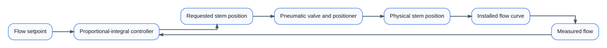
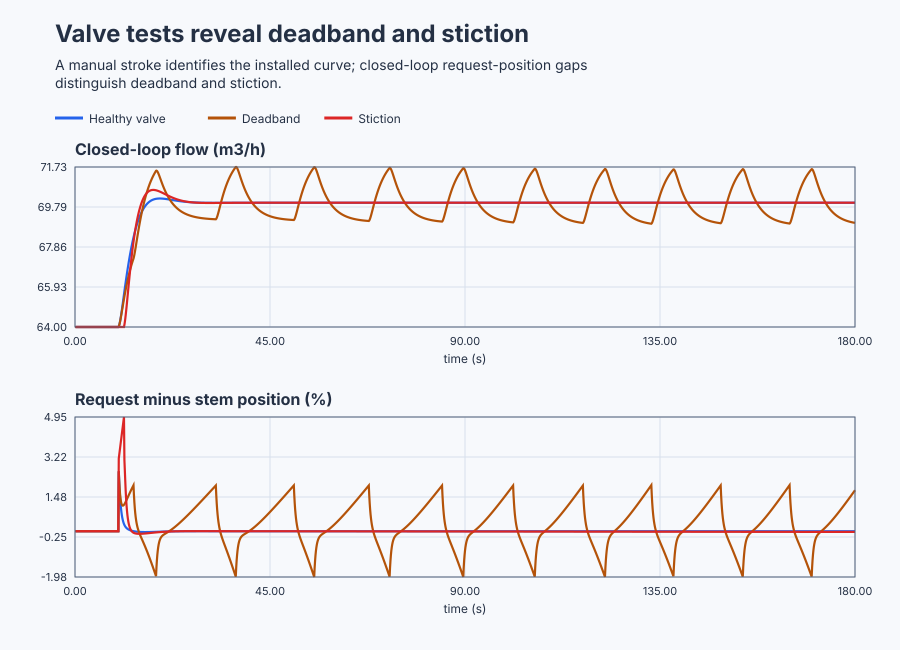

# Characterize a cooling-water valve and diagnose stiction

Course position: Lesson 60 of 84. Prerequisite: the conveyor-oven Smith-predictor lesson. Next lesson: distillation interaction and Relative Gain Array.

This project operates three simulated cooling-water flow benches. It does not operate or diagnose a physical valve.

**Lesson objective:** After this lesson, you can measure an installed valve curve, distinguish healthy motion, command deadband and mechanical stiction, and decide when valve maintenance is justified instead of changing controller tuning.

## The problem

A regulated cooling-water header supplies a test line through a pneumatically actuated globe valve. A flow transmitter measures cooling-water flow in cubic metres per hour. A digital positioner measures the physical stem position from 0 through 100 percent.

The controller requests stem position from 0 through 100 percent. The valve can only open or close within that range, moves no faster than 25 percentage points per second, and has a 0.4-second positioner lag. Its safe simulated state is closed. The normal operating point is 80 percent stem position and 64 cubic metres per hour. Measured flow responds to effective valve capacity with a three-second hydraulic time constant.

Three equivalent benches use the same installed flow curve, controller, initial state, timing and limits. Only valve condition changes: healthy, a two-percentage-point command deadband, or a five-percentage-point stiction band with a two-percentage-point slip jump.

Lesson 59 showed that a validated process model and deterministic fallback can make model-based compensation defensible. That does not help when the final control element itself fails to follow a sound request.

A sticking valve can make an otherwise reasonable proportional-integral controller oscillate. Increasing integral action may move the valve more often, but it can enlarge the breakaway cycle and accelerate wear. We must observe the actuator before blaming the tuning.

## What we need

We need evidence that separates controller demand, positioner behavior, physical stem motion, and installed flow so deadband and mechanical sticking are not mistaken for poor tuning. The resulting decision must identify when maintenance, rather than gain adjustment, is justified.

## The new idea

### The installed flow relationship

The **inherent valve characteristic** relates stem travel to flow capacity while pressure drop across the valve is held constant. The **installed characteristic** relates stem travel to actual process flow after the valve is connected to its pump and piping. They need not be the same because pressure drop changes with total system flow.

The valve stem position ($x$) is physical travel in percent. The rangeability ($R$) is the dimensionless ratio describing the useful span of an equal-percentage valve. The normalized flow capacity ($c$) is the fraction of maximum capacity, from zero through one. The measured flow ($q$) is cooling-water flow in cubic metres per hour.

An idealized equal-percentage reference is:

$c = (R^(x/100) - 1) / (R - 1)$

Equal stem increments therefore multiply inherent capacity by approximately the same factor; they do not add equal flow. That is the valve's inherent reference, not automatically its installed flow curve.

The normalization explains every part of the expression. $x/100$ converts
percent travel to a zero-to-one fraction. Raising $R$ to that fraction creates
the exponential shape. Subtracting one makes capacity zero at closed position,
and dividing by $R-1$ makes capacity exactly one at full travel.

The installed target flow ($q_{\mathrm{target}}$) is the flow this fixed-head piping approximation reaches after the hydraulics settle, in cubic metres per hour. The hydraulic response time ($T_{q}$) is three seconds. The simulator uses a square-law installed target and a first-order flow response:

$q_{\mathrm{target}} = 100 \cdot (x/100)^{2}$

$T_{q} \cdot dq/dt = q_{\mathrm{target}} - q$

This is a local installed-curve approximation under fixed header pressure. It omits the pump curve, changing piping loss, fluid-property changes and cavitation. A physical installed curve must be measured under its reviewed operating conditions.

### The signals that reveal the mechanism

The cooling-water flow setpoint ($SP$) is the desired flow in cubic metres per hour. The process value ($PV$) is flow measured by the transmitter in the same unit. The flow error ($e$) is desired flow minus measured flow.

$e = SP - PV$

The requested manipulated variable ($MV_{\mathrm{requested}}$) is the stem position demanded by the controller, in percent. The applied manipulated variable ($MV_{\mathrm{applied}}$) is the independently reported physical stem position, also in percent. In this project the installed-curve model receives that physical position and converts it into flow.


The diagram matters because a controller-output trace is not a valve-position measurement. The separate positioner signal lets us localize lost motion to the final control element.

### Deadband, backlash and stiction are different

**Command deadband** means that a small request change around the last accepted request is ignored. Once the request moves beyond the deadband, the positioner follows smoothly.

**Backlash** is direction-dependent mechanical play. After a reversal, motion first takes up clearance before the driven part follows. The same request can therefore correspond to a different position depending on whether the valve approached it while opening or closing. Lesson 24 executed this reversal-memory mechanism. This lesson recalls it but does not rename deadband or stiction as backlash.

**Stiction** means static friction holds the stem while the request-to-position difference grows. When the difference exceeds the breakaway band, the stem slips by a finite amount. The stiction bench is configured to hold through five percentage points and make an initial two-percentage-point slip jump.

Healthy motion begins following every resolvable request after ordinary lag. Deadband ignores small increments and then moves smoothly. Stiction shows a stationary stem, a growing request-to-position gap, and a discrete breakaway jump. Confirmed diagnosis requires this signature to repeat and requires the corresponding flow movement.

In automatic control, integral action continues accumulating flow error while a stuck stem leaves flow unchanged. Breakaway then changes flow abruptly, the error reverses, and the sequence can repeat as a limit cycle. Retuning can change its amplitude or period without repairing static friction.

## Prediction

### Predict the installed curve

Calculate the six table values before running the plant:

| Physical stem position | Predicted settled flow |
|---:|---:|
| 0 percent | 0.00 cubic metres per hour |
| 20 percent | 4.00 cubic metres per hour |
| 40 percent | 16.00 cubic metres per hour |
| 60 percent | 36.00 cubic metres per hour |
| 80 percent | 64.00 cubic metres per hour |
| 100 percent | 100.00 cubic metres per hour |

The average local flow gain is 0.20 cubic metres per hour per percentage point between 0 and 20 percent. It rises to 1.80 cubic metres per hour per percentage point between 80 and 100 percent. One constant valve gain cannot describe the complete travel range.

For example, at 40 percent the square-law prediction is
$100(40/100)^2=16$ cubic metres per hour. The low-travel secant gain is
$(4-0)/(20-0)=0.20$ cubic metres per hour per point; the high-travel value is
$(100-64)/(100-80)=1.80$. These slopes explain why the same stem increment has
a much larger process effect near the top of travel.

### Predict the reversal probe

Restore every stem to 70 percent. Increase their common request in 0.5-percentage-point increments.

- The healthy stem should begin moving after the first increment.
- The deadband stem should remain at 70 percent through a total two-percentage-point request change, then move smoothly on the first larger request.
- The stiction stem should remain at 70 percent through a total five-percentage-point request-to-position difference, then first move to approximately 72 percent because of the configured slip jump.

Write these predictions down before opening the traces. They were derived from the mechanisms, not chosen after seeing the result.

## Implementation

The project runs three real `Control.PID` instances. They share one parameter record, so the proportional gain, integral gain, 80 percent bias, limits and initialization are identical. Only simulator actuator condition differs.

The proportional gain requests 0.5 percentage points for each cubic metre per hour of present flow error. The integral gain adds 0.25 percentage points per second for each cubic metre per hour of persistent error. Derivative action is disabled.

This excerpt is from the shipped Structured Text:

```st
Parameters.ProportionalGain := LREAL#0.5;
Parameters.IntegralGain := LREAL#0.25;
Parameters.Bias := LREAL#80.0;
HealthyController.Configure(Parameters := Parameters);
DeadbandController.Configure(Parameters := Parameters);
StictionController.Configure(Parameters := Parameters);

HealthyInput.Setpoint := FlowSetpoint;
HealthyInput.ProcessValue := HealthyFlow;
HealthyRequest := HealthyController.Update(Input := HealthyInput);
```

Manual mode sends one common demand through all three controllers. Automatic mode gives each controller its own measured flow. Structured Text does not create fake position feedback, diagnosis labels, breakaway counts or a maintenance verdict. Those conclusions come from existing simulator status and retained run evidence.

## Experiment in Control Studio

This procedure observes the project's installed-curve sweep, reversal probe,
and closed-loop comparison. The project owns every demand, mode change, and
safe closure; Control Studio writes only one Boolean authority signal. The
native lesson test repeats the independently restored probe three times. The
deterministic Simulation seed is 20260829.

### Control Studio actions

1. **Monitor** — Start the **Simulator**, then open **truST sidebar → Control Studio → Monitor → Response**.
   - **Baseline check:** Wait until the header shows **Simulation**, **Running**, and current data. Confirm Cooling-water flow setpoint (SP, m3/h); Healthy measured flow (PV, m3/h) and Deadband measured flow (PV, m3/h); Common manual valve demand (MV, %) and Healthy requested valve position (MV, %), including units, limits, mode, and quality. The initial operating point is Cooling-water flow setpoint = 64 m3/h, Healthy measured flow = 64 m3/h, Deadband measured flow = 64 m3/h, Stiction measured flow = 64 m3/h, Common manual valve demand = 80 %. The unresolved baseline problem is: Flow and controller-request traces alone do not prove whether nonlinear response comes from the installed curve, command deadband, mechanical play, stiction, or process dynamics.
   - **Decision before action:** Read **Prediction** above, then state what should move first and in which direction. Use this decision rule: Classify stiction only from repeated request-to-position holds and breakaway jumps with corresponding flow response; otherwise retain the run as inconclusive.
   - **Successful evidence:** The Response plot advances, the displayed values are finite and current, and **Start recording** is enabled. Select **Start recording** only after those conditions are visible.
   - **Recovery:** If recording is disabled or the plot reports unavailable or stale samples, stop the Simulator, correct the displayed runtime or binding problem, restart it, and repeat the baseline check.
   - **Record:** Write down the initial SP, PV, requested/applied MV where available, controller mode, and your predicted response before opening Test.

2. **Test** — Open **truST sidebar → Control Studio → Test**.
   - **Baseline check:** Set **Experiment** = **Observe without excitation**, **Amplitude** = **0**, and **Maximum duration (s)** = **180.1**. Confirm the only writable signal is **Experiment authority** (`P1.ExperimentEnabled`, `%MX91.1`). The project owns the six-point curve sweep, the 0.5-point opening and closing probe about 70 percent, the bumpless Auto entry at 110 seconds, the 70-cubic-metre-per-hour flow request, and safe closure.
   - **Decision before action:** Before selecting **Review test**, predict the healthy, deadband, and stiction position signatures and confirm every demand/position can remain within 0 through 100 percent and every flow within 0 through 105 cubic metres per hour.
   - **Successful evidence:** Select **Review test**, verify zero external excitation, authority, duration, restoration, and stop conditions, then select **Confirm and start**. Response must show controller request, independent physical position, and flow for all three benches. At termination authority clears, controllers return to Manual, and manual demand is zero.
   - **Recovery:** For a rejected, stale, unsafe, unavailable, failed, or aborted state, read the reason, confirm authority is false and all valve requests are restoring closed, wait for current data, and review a new observation.
   - **Record:** Compare each position signature with your prediction and retain terminal state, restoration, and seed **20260829**. The native lesson test owns the three independently restored probes and numeric diagnosis; this observation does not create generic Identify, Tune, or Validate evidence. Physical diagnosis still requires real installed position and flow evidence.

## Evidence and decision

### Measures and comparison

Hold the installed curve, controller, initial position, request sequence, sample schedule, duration, limits, seed and metric windows equal. Change only valve condition.

Define each decision measure before reading its result:

- **Installed-curve error** is measured settled flow minus predicted flow at each table position, in cubic metres per hour.
- **Request-to-position gap** is the absolute difference between requested and measured stem position, in percentage points.
- **Stationary-position time** is accumulated time while request changes but measured position changes by no more than 0.02 percentage points, in seconds.
- **Breakaway size** is the first measured position change after a stationary interval, in percentage points.
- **Reversal lost motion** is request travel after a direction reversal before position moves more than 0.02 percentage points, in percentage points.
- **Process-flow excursion** is maximum flow minus minimum flow over the declared closed-loop window, in cubic metres per hour.
- **Cumulative applied-position movement** is the sum of absolute successive physical-position changes, in percentage points. It may exceed 100 because it measures total travel, not instantaneous position.

An isolated jump is not enough. A diagnosis is `Inconclusive` unless the hold and breakaway signature repeats under equivalent probes.

### Validation

Accept the installed characterization only when every healthy settled point is within 0.05 cubic metres per hour of its prediction.

Classify the reversal cases before ranking performance:

- Healthy: position responds to every resolvable request after ordinary lag.
- Deadband: position holds through two percentage points, then moves without the configured two-percentage-point stiction slip jump.
- Stiction: position holds through five percentage points, then makes the predicted two-percentage-point breakaway movement.

At least three independently restored probes must repeat the stiction hold/breakaway signature before this simulated fault is classified. The automatic run may show a cycle, an offset, or a single transition depending on plant dynamics and operating point; none may replace the repeated position probe. The healthy and deadband benches must not be labelled stiction merely because the installed curve is nonlinear. If position feedback is absent, stale or invalid, keep the request and flow evidence but mark the mechanical diagnosis `Unconfirmed`.

All three gains remain unchanged. A smoother trace after retuning would not replace the physical-position evidence.

### Executable reference result

The native lesson test produced the following values from the shipped Structured Text and simulator. Display precision is limited to what is useful for this diagnosis; the assertions retain tighter tolerances.

| Evidence | Healthy valve | Deadband valve | Stiction valve |
|---|---:|---:|---:|
| Peak request-to-position gap | 2.60 percentage points | 2.60 percentage points | 4.95 percentage points |
| Flow excursion over the final 120 seconds | 0.00 cubic metres per hour | 2.69 cubic metres per hour | 0.00 cubic metres per hour |

The healthy installed-curve measurements at 0, 20, 40, 60, 80 and 100 percent position were 0.03, 4.00, 16.00, 36.00, 64.00 and 100.00 cubic metres per hour. Every point met the declared 0.05-cubic-metres-per-hour tolerance. At a 72-percent request the deadband stem still measured 70.00 percent; at 72.5 percent it began moving and measured 70.55 percent. At a 75-percent request the stiction stem still measured 70.00 percent; at 75.5 percent it broke away to 72.00 percent. The same restored stiction probe qualified three times.

The automatic setpoint run produced one stiction breakaway and a peak 1.63-cubic-metres-per-hour difference between the healthy and stiction flows. The stiction case then remained at a displaced equilibrium, while the deadband case continued moving in its final window. This result is deliberately not described as a universal stiction limit cycle. The repeated manual position probe, not the appearance of the automatic flow trace, establishes the simulated mechanical diagnosis.

### Retained evidence

The plot is generated by the executable valve bench. It connects the manual stroke test to the closed-loop flow and to the gap between requested and actual stem position.



[Complete trace](figures/valve-stiction-evidence-trace.csv) · [Decision summary](figures/valve-stiction-evidence-summary.csv)

## Conclusion

The characterization table proves that equal stem increments do not produce equal flow increments on this installed curve. That changing gain is normal configured behavior, not evidence of damage.

The deadband trace remains tied to the last accepted request. The stiction trace instead stores request-to-position difference until simulated pneumatic force overcomes static friction, then releases a finite slip. In closed loop, integral action creates the growing request during the hold and the flow jump creates the reversal. This mechanism explains why controller changes can disguise or worsen the symptom without repairing the valve.

## Reason for the next lesson

Use installed characterization when valve gain is unknown. Diagnose stiction only from repeatable requested position, independent physical stem position and process-response evidence. Backlash requires its own opening-versus-closing reversal test.

An injected Simulation fault demonstrates a recognizable signature; it does not certify a physical valve diagnosis. A physical test requires reviewed I/O topology, positioner calibration, differential pressure and hydraulic limits, safe state, abort and restoration procedure, and explicit approval immediately before operation.

When the evidence confirms a sticking final element, inspection or maintenance is the appropriate action. Retuning alone is not a repair. Lesson 61 moves to a different source of misleading single-loop behavior: two manipulated variables physically affect two controlled compositions in a distillation column.
