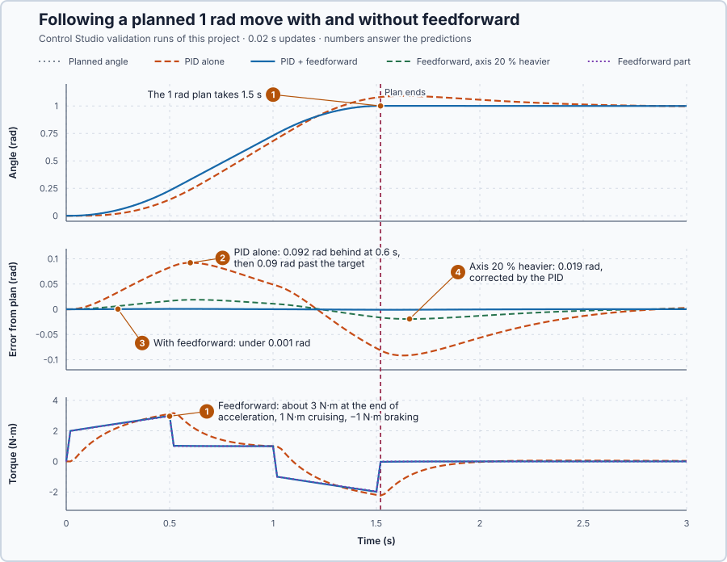

# 61. Trajectory feedforward

In this lesson, you will plan a 1 rad move of the drum axis as a motion profile, add the torque the plan needs to the PID, and compare how closely the axis follows its plan with feedback alone and with the feedforward Control Studio designs from the model.

## The problem

Lesson 60 showed that the drum axis's position loop is stable at 0.02 s updates, with every pole inside the unit circle (the largest at |z| = 0.938), and unstable at 0.6 s. Correct timing does not change how feedback works, though: the controller produces torque only from an error that has already appeared.

A move is planned before it starts: when to speed up, how fast to turn, when to brake. With feedback alone, the PID supplies each part's torque only after the axis has fallen behind the plan; that lag is the **following error**.

We will calculate the torque the plan needs from the model and give it to the axis at once.

## What we need

We need to:

1. describe the planned move: its angle, rate and acceleration at every moment;
2. calculate from the model the torque the axis needs to follow that plan exactly; and
3. add that torque to the PID's output, so feedback corrects only the model's errors.

## The new idea

**Trajectory feedforward** calculates, from the planned motion, the torque the axis will need to accelerate and to overcome friction, and gives it right away. The PID corrects only the small remainder. The plan it calculates from is the move's **motion profile**: the planned angle at every moment, together with its rate, the speed at which the angle changes, and its acceleration, how fast the rate changes.

**In words.** Feedback works from an error: the axis must first fall behind its plan before the PID makes any torque. A planned move, though, is known before it starts. The plan says when the drum speeds up, how fast it turns and when it brakes, and the axis model says how much torque each of these takes. So the torque can be calculated in advance and sent together with the plan, the way a sequence step drives a valve straight to its known position instead of waiting for a controller to find it. The torque has two jobs:

1. **Accelerating the drum.** Changing the drum's speed takes torque in proportion to the acceleration: positive while it speeds up, none while it cruises, negative while it brakes.
2. **Overcoming friction.** Keeping the drum turning takes torque in proportion to its speed: none at rest, the most while cruising.

That is also why the move is planned as a profile and not as a jump: a setpoint that jumped from 0 to 1 rad would ask for an infinite acceleration, which no torque can give. The PID keeps running and corrects only what the calculation gets wrong. The feedforward does not use the measured angle, so it adds nothing to the feedback loop: the PID keeps its gains and its margins.

**The formula.** The axis obeys $J\ddot\theta + B\dot\theta = u$: the torque accelerates the inertia and overcomes the friction. If the axis follows the plan exactly, $\theta = r$, so the torque it needs is

$$
u_{ff} = J\,\ddot r + B\,\dot r .
$$

This is the model run backwards, from the motion we want to the torque that produces it. Let:

- $u$ be the torque applied to the axis and $u_{ff}$ the feedforward torque, in N·m;
- $\theta$ be the measured angle, in rad, with $\dot\theta$ and $\ddot\theta$ its rate and acceleration;
- $r$, $\dot r$ and $\ddot r$ be the planned angle, rate and acceleration, in rad, rad/s and rad/s²;
- $J$ be the inertia, in kg·m²: the torque needed per rad/s² of acceleration; and
- $B$ be the friction, in N·m·s/rad: the torque needed per rad/s of steady rate.

The plan used here is a **trapezoidal profile**: it speeds up with a fixed acceleration to a maximum rate, cruises, and brakes with the same acceleration; plotted over time, its rate is a trapezoid. A move long enough to reach its maximum rate takes

$$
T = \frac{D}{V} + \frac{V}{A} ,
$$

where:

- $D$ is the move's distance, in rad;
- $V$ is its maximum rate, in rad/s;
- $A$ is its acceleration while speeding up and braking, in rad/s²; and
- $T$ is its duration, in s.

Speeding up and braking each take $V/A$ seconds at an average rate of $V/2$, so together they cover the same distance as $V/A$ seconds at full rate. The whole move therefore takes as long as covering $D$ at $V$, plus $V/A$. It reaches $V$ only if $D \ge V^2/A$; a shorter move turns from speeding up straight into braking and takes $2\sqrt{D/A}$.

**Example: a 1 rad move of the drum axis.** The axis has $J$ = 1 kg·m², so 1 N·m accelerates it at 1 rad/s², and $B$ = 1 N·m·s/rad, so 1 N·m holds a steady 1 rad/s. The move is $D$ = 1 rad with $V$ = 1 rad/s and $A$ = 2 rad/s²; these limits are a teaching choice, far inside the drive's ±20 N·m. Follow the numbers:

1. Duration: $1 \ge 1^2/2$, so the move reaches its maximum rate, and $T = 1/1 + 1/2 = 1.5$ s. Speeding up takes $V/A$ = 0.5 s and covers 0.25 rad, braking the same, and the remaining 0.5 rad at 1 rad/s takes 0.5 s.
2. Acceleration starts: $\dot r = 0$ and $\ddot r = 2$, so $u_{ff} = 1 \times 2 + 1 \times 0 = 2$ N·m. All of it accelerates the drum; at rest there is no friction to overcome.
3. Acceleration ends, at 0.5 s: $\dot r = 1$, so $u_{ff} = 2 + 1 = 3$ N·m, the largest torque of the move.
4. Cruising, from 0.5 to 1.0 s: $\ddot r = 0$, so $u_{ff} = 1$ N·m, the friction alone.
5. Braking starts, at 1.0 s: $\ddot r = -2$, so $u_{ff} = -2 + 1 = -1$ N·m, and it reaches −2 N·m as the axis stops at 1.5 s. Friction helps to brake, so less torque is needed to stop than to start.

Control Studio calculates the same torques from the model. It writes the axis model $1/(s(Js + B))$ as $n/(as^2 + bs)$ and sets the **rate feedforward** $K_v = b/n = B$, the torque per rad/s of planned rate, and the **acceleration feedforward** $K_a = a/n = J$, the torque per rad/s² of planned acceleration: here $K_v = 1$ and $K_a = 1$.

**The limitation.** The feedforward is only as good as the model. On an axis with 20 % more inertia and friction, the end of the acceleration needs $1.2 \times 3 = 3.6$ N·m, but the feedforward still gives 3 N·m. The PID must supply the missing 0.6 N·m, and it can only do that from a following error.

## Prediction

Before running, answer these questions:

1. How long does the 1 rad move take, and what torque does the feedforward give at the end of the acceleration, while cruising and when braking starts?
2. Where in the move does the PID alone fall furthest behind the plan?
3. How close to the plan does the axis stay with the feedforward?
4. On an axis with 20 % more inertia and friction, how large does the following error become with the feedforward, and what corrects the rest?

| Part of the move | $\dot r$ (rad/s) | $\ddot r$ (rad/s²) | $u_{ff}$ (N·m) |
| --- | ---: | ---: | ---: |
| Acceleration starts | 0 | 2 | 2 |
| Acceleration ends | 1 | 2 | 3 |
| Cruising | 1 | 0 | 1 |
| Braking starts | 1 | −2 | −1 |

## Implementation

Open [`src/Main.st`](src/Main.st). The program plans each move with a trapezoidal profile from the planned angle to the new setpoint, at most 1 rad/s and 2 rad/s², and gives `Control.PID` the planned angle as its setpoint and $K_v\dot r + K_a\ddot r$ as its `FeedForward` input. The PID is the one designed for this axis earlier, $K_p$ = 18.77 N·m/rad, $K_i$ = 17.46 N·m/(rad·s) and $K_d$ = 7.27 N·m·s/rad. The plan has no jumps, so its **derivative setpoint weight**, the share of the setpoint the derivative sees, is 1: D acts on $r - \theta$ instead of braking every move. Two functions do this lesson's calculations:

```st
FeedforwardTorque := Inertia * AccelerationRadS2 + Friction * VelocityRadS;
IF DistanceRad >= MaxVelocityRadS * MaxVelocityRadS / AccelerationRadS2 THEN
    MoveDurationS := DistanceRad / MaxVelocityRadS + MaxVelocityRadS / AccelerationRadS2;
ELSE
    MoveDurationS := LREAL#2.0 * SQRT(DistanceRad / AccelerationRadS2);
END_IF;
```

**Exercise.** Check the functions against the table: `FeedforwardTorque` gives 3, 1 and −1 N·m for the end of the acceleration, cruising and the start of braking; `MoveDurationS` gives 1.5 s for 1 rad and $2\sqrt{0.2/2} = 0.632$ s for 0.2 rad, a move too short to reach $V$. Then open [`src/tests.st`](src/tests.st) and run its tests from the **Testing** view.

`control-loop.json` names the five gains for Control Studio and declares two validation scenarios, the 1 rad move on the model's axis and on an axis 20 % heavier, each allowed 0.03 rad of following error for 2 s.

## Experiment in Control Studio

1. Open this lesson's project and start **Simulator**. The axis rests at 0 rad with zero torque. In the **truST** side bar, select **Control Studio**.
2. On **Identify**, choose **Supplied plant model** from **Method**, select **Open model…** and open `shaft-model.json`.
3. On **Tune**, choose **P1 · PID** in **Controller** and **Manual** in **Tuning method**. Enter **Proportional gain (Kp)** 18.77, **Integral gain (Ki)** 17.46 and **Derivative gain (Kd)** 7.27, and 0 for **Rate feedforward (Kv)** and **Acceleration feedforward (Ka)**: the PID alone.
4. Select **Requirements…**. In **Control requirements**, enter **Setpoint change (rad)** 1, **Maximum steady-state error (rad)** 0.02, **Maximum settling time (s)** 4, **Settling band (±rad)** 0.01 and **Validation duration (s)** 8. Select **Done**, then **Tune controller**.
5. On **Validate**, select **Validate controller**. Read the rows **Maximum error from planned angle · P1.AngleRad · planned move** and **… · heavier axis**.
6. On **Tune**, choose **Automatic** in **Tuning method** and select **Tune controller**. Read the five values and the margins below them.
7. On **Validate**, select **Validate controller** again. When every row passes, select **Apply**; Control Studio shows **Applied**.

To repeat, stop and restart **Simulator** and open Control Studio again.

## Evidence and decision



The numbered marks answer the predictions with the same numbers.

| | PID alone, $K_v = K_a = 0$ | With the feedforward |
| --- | --- | --- |
| Tune | Manual PID | Automatic: the same PID, $K_v$ = 1, $K_a$ = 1; phase margin 77.55°, delay margin 0.1844 s |
| Largest error from the planned angle, model's axis, 0–2 s | 0.0922 rad, **Fail** | 9.90·10⁻⁴ rad, Pass |
| The same, axis 20 % heavier | 0.1099 rad, **Fail** | 0.0193 rad, Pass |
| Maximum settling time | 2.4 s | 1.38 s |
| Apply | not tried | **Applied** |

1. The plan reached 1 rad 1.5 s after it started. The feedforward followed the table: 2 N·m as the acceleration started, 2.96 N·m at the last update before it ended, 1 N·m cruising and −1 N·m as braking started.
2. The PID alone fell furthest behind just after the acceleration, 0.0922 rad at 0.6 s, because it made torque only from the growing lag; when the plan stopped, the axis overshot to 1.092 rad.
3. With the feedforward, the axis stayed within 9.90·10⁻⁴ rad of the plan.
4. On the heavier axis the feedforward supplied only 1/1.2 of the torque needed; the PID made up the rest from a following error of 0.0193 rad, inside the 0.03 rad limit.

The following error became 93 times smaller on the model's axis and 5.7 times smaller on the heavier one, at the cost of depending on the model and a smooth plan; the margins stayed those of the PID. Trajectory feedforward is accepted and applied for this axis. These are simulation results.

## Conclusion

A planned move tells in advance which torque the axis needs. Trajectory feedforward supplies $J\ddot r + B\dot r$ from the model, so the axis follows the plan instead of reacting to its lag, and the feedback corrects only the model's errors.

For the drum axis, Control Studio set $K_v = B$ and $K_a = J$ from the model, and the following error fell from 0.0922 to 0.00099 rad without changing the PID or its margins.

## Check yourself

1. **How long does a 2 rad move take at V = 1 rad/s and A = 2 rad/s²?**
   T = 2/1 + 1/2 = 2.5 s; the move is long enough to cruise, because 2 rad ≥ V²/A = 0.5 rad.
2. **Why does adding the feedforward not change the loop's margins?**
   The feedforward is calculated from the plan, not from the measurement, so it adds nothing to the loop from
   measured angle to torque.
3. **While the axis cruises at 1 rad/s, why is the feedforward 1 N·m and not zero?**
   The acceleration is zero, but friction still takes B × ṙ = 1 × 1 = 1 N·m to keep the axis turning.

## Reason for the next lesson

A planned move is known in advance, but many disturbances are not planned. Colder inlet water draws heat from the water heater the moment it arrives; it can be measured, yet feedback still acts only after the temperature has fallen.

[Feedforward control](../51-feedforward/README.md) measures that disturbance and gives the heater the power it needs at once.
