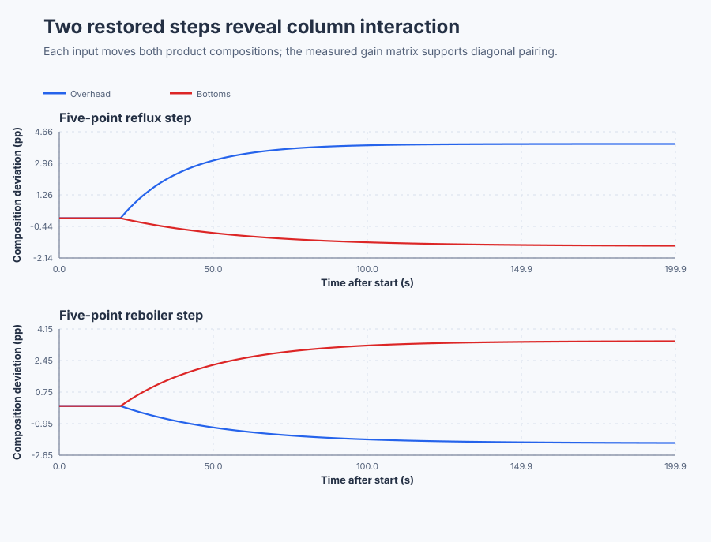

# Measure distillation interaction and select an RGA pairing

**Equipment:** Continuous binary distillation column.

Course position: Lesson 61 of 84. Prerequisite: valve characterization and stiction diagnosis. Next lesson: decentralized proportional-integral control and decoupling on the same column.

This project operates a simulated column. It does not operate a physical distillation plant.

**Lesson objective:** Measure all four local input-output gains, calculate the Relative Gain Array, and select a defensible decentralized pairing before designing controllers.

## The problem

A continuous binary distillation column separates a feed into overhead and bottoms products near one qualified production operating point. Reflux returns condensed liquid at the top. Reboiler steam supplies heat at the bottom.

The overhead light-product purity deviation ($y_{1}$) is the difference between overhead purity and its normal target, in composition percentage points. The bottoms heavy-product purity deviation ($y_{2}$) is the corresponding difference for the bottoms product. The reflux-valve change ($u_{1}$) is a requested change from its normal position, in valve percentage points. The reboiler-steam-valve change ($u_{2}$) uses the same unit.

Both requested changes are limited to -10 through +10 percentage points. The experiment uses +5 percentage points. The outputs must remain between -6 and +6 composition percentage points. These are local simulation limits, not permission to test a physical column.

Lesson 60 showed how independent position feedback localizes a problem in a final control element. In this lesson both final elements are healthy, yet reflux and reboiler steam each affect both product compositions. Tag names and the largest direct response do not reveal how one path changes after the other output is held by feedback. We must measure interaction before choosing loop pairings.

## What we need

We need to measure how each distillation input affects both product purities and use those four gains to choose which input should control which output. The calculated pairing must agree with the observed interaction before any loop is designed.

## The new idea

### Four paths form one gain matrix

The steady-state gain from input j to output i is the settled output change divided by an independently applied input change while the other input remains fixed. It is written gij only after those physical changes have been defined. Its unit here is composition percentage points per valve percentage point.

The first index identifies the output row. The second index identifies the input column. The four gains form the steady-state gain matrix ($G$):

$\mathbf{G}=\begin{bmatrix}g_{11}&g_{12}\\g_{21}&g_{22}\end{bmatrix}$

For example, the gain from reflux-valve change to overhead purity deviation is g11. The gain from reboiler-steam-valve change to overhead purity deviation is g12.

### Why open-loop gains are not enough

Loop interaction means that one controller's action changes the plant seen by the other controller. An open-loop gain is measured while the other input is fixed. After the other output is regulated, its controller moves that input and changes the first path's effective gain. In a strongly interacting plant, the effective gain can become much larger or even reverse sign.

The Relative Gain Array ($\boldsymbol{\Lambda}$) compares the open-loop gains with their closed-loop effective gains when the other output is held by ideal feedback. First invert the gain matrix. Then transpose that inverse by exchanging its rows and columns. Finally use element-by-element multiplication, rather than ordinary matrix multiplication:

$\boldsymbol{\Lambda}=\mathbf{G}\circ\left(\mathbf{G}^{-1}\right)^{T}$

For a two-by-two matrix, the determinant is
$\det(G)=g_{11}g_{22}-g_{12}g_{21}$. Its inverse is
$G^{-1}=\det(G)^{-1}\begin{bmatrix}g_{22}&-g_{12}\\-g_{21}&g_{11}\end{bmatrix}$.
The determinant must be nonzero because division by zero would mean the two
input directions cannot be separated by a unique inverse.

Each row and column should sum to one. A relative gain near +1 usually indicates a pairing that changes little when the other loop closes. Large magnitudes indicate strong interaction. A negative relative gain warns that the effective feedback direction reverses. The calculation is invalid for a singular matrix and untrustworthy when a path is unsettled, poorly excited, missing, or measured at another operating point.

## Prediction

In words, the overhead response to reflux takes 20 seconds to reach about 63.2 percent of its settled change. The overhead response to reboiler steam takes 35 seconds. The bottoms response to reflux takes 40 seconds, and the bottoms response to reboiler steam takes 30 seconds. More reflux improves overhead light-product purity but reduces bottoms heavy-product purity. More reboiler steam improves bottoms heavy-product purity but reduces overhead light-product purity in this declared local model.

Lesson 61 uses the final settled changes for pairing. It still retains these unequal transient paths because Lesson 62 will test whether a steady decoupler is sufficient or whether measured dynamic compensation is justified.

The predicted settled gain matrix is:

$\mathbf{G}=\begin{bmatrix}0.8&-0.4\\-0.3&0.7\end{bmatrix}$

A +5-percentage-point reflux move should change overhead and bottoms purity by +4.00 and -1.50 composition-percentage-point respectively. In a separately restored run, a +5-percentage-point reboiler move should change them by -2.00 and +3.50 composition-percentage-point.

The determinant is 0.44, so the matrix can be inverted. The predicted Relative Gain Array is:

$\boldsymbol{\Lambda}=\begin{bmatrix}1.2727&-0.2727\\-0.2727&1.2727\end{bmatrix}$

Here $\det(G)=0.8(0.7)-(-0.4)(-0.3)=0.44$. Therefore
$G^{-1}=0.44^{-1}\begin{bmatrix}0.7&0.4\\0.3&0.8\end{bmatrix}$.
After transposing, elementwise multiplication gives
$\lambda_{11}=0.8(0.7)/0.44=1.2727$ and
$\lambda_{12}=(-0.4)(0.3)/0.44=-0.2727$; symmetry gives the second row.

Record the prediction before testing. The diagonal pairing—overhead purity with reflux and bottoms purity with reboiler steam—is expected to be eligible but still interacting. The cross pairing is expected to be rejected because both relative gains are negative.

## Implementation

This is an open-loop interaction-identification lesson and shall not hide a centralized controller in the experiment. The shipped Structured Text keeps Manual authority while automatic mode is false, accepts independent requests, exposes the limited applied inputs, and returns both inputs to zero if automatic mode is selected:

```st
IF NOT AutoMode THEN
    RefluxApplied := LIMIT(LREAL#-10.0, RefluxRequested, LREAL#10.0);
    ReboilerApplied := LIMIT(LREAL#-10.0, ReboilerRequested, LREAL#10.0);
ELSE
    RefluxApplied := LREAL#0.0;
    ReboilerApplied := LREAL#0.0;
END_IF;
```

The Structured Text does not contain the gain matrix, Relative Gain Array, determinant, or pairing verdict. Control Studio calculates them from the two retained experiments.

## Experiment in Control Studio

This procedure observes both independently excited input windows under project
control. The project owns the zero baselines, the reflux step, the restored
separation, the reboiler step, and zero restoration. Control Studio writes only
one Boolean authority signal. The complete observation lasts 400.1 seconds and
uses deterministic Simulation seed 20260829.

### Control Studio actions

1. **Monitor** — Start the **Simulator**, then open **truST sidebar → Control Studio → Monitor → Response**.
   - **Baseline check:** Wait until the header shows **Simulation**, **Running**, and current data. Confirm both purity deviations and both requested/applied input changes, including units, limits, Manual mode, quality, and the 0.1-second interval. The initial point is zero for all four quantities. Retain a 20-second zero baseline, the 20-to-200-second reflux-only window, the 200-to-220-second restored window, and the 220-to-400-second reboiler-only window. Use a final 10-second mean only when each composition varies by no more than 0.02 percentage points. If a path is missing or invalid, report the matrix and pairing as Unconfirmed.
   - **Decision before action:** Read **Prediction** above, then state what should move first and in which direction. Use this decision rule: Accept the diagonal overhead-to-reflux and bottoms-to-reboiler pairing only from four valid measured gains and reject the negative-relative-gain cross pairing.
   - **Successful evidence:** The Response plot advances, the displayed values are finite and current, and **Start recording** is enabled. Select **Start recording** only after those conditions are visible.
   - **Recovery:** If recording is disabled or the plot reports unavailable or stale samples, stop the Simulator, correct the displayed runtime or binding problem, restart it, and repeat the baseline check.
   - **Record:** Write down the initial SP, PV, requested/applied MV where available, controller mode, and your predicted response before opening Test.

2. **Test** — Open **truST sidebar → Control Studio → Test**.
   - **Baseline check:** Confirm **Experiment** = **Observe without excitation**, **Amplitude** = **0** (disabled), and **Maximum duration (s)** = **400.1**. The reviewed authority is **Experiment authority** (`P1.ExperimentEnabled`). The project excites only reflux from 20 to 200 seconds, restores both inputs for 20 seconds, then excites only reboiler steam from 220 to 400 seconds.
   - **Decision before action:** Before selecting **Review test**, predict all four response signs and confirm inputs can remain within -10 through +10 percentage points and purity deviations within -6 through +6 points.
   - **Successful evidence:** Select **Review test**, verify zero external excitation, authority, duration, restoration, and stop conditions, then select **Confirm and start**. Response must show that the non-excited input remains zero in each window. At termination authority clears and both requested inputs return to zero. Keep **Abort test** visible.
   - **Recovery:** Select **Abort test** if the test is rejected, stale, unsafe, unavailable, failed, or aborted. Read the reason, confirm authority is false and both inputs restored to zero, wait for current data, and review a new observation.
   - **Record:** Calculate each settled change and compare it with your prediction. Retain terminal state, restoration, and seed **20260829**. The native lesson test owns the qualified gain matrix and RGA verdict; this observation does not create generic Identify, Tune, or Validate evidence.

## Evidence and decision

### Measures and comparison

Define every measure before reading the result:

- **Input change** is final-window applied-input mean minus baseline-window applied-input mean, in valve percentage points.
- **Output change** is final-window composition mean minus baseline-window composition mean, in composition percentage points.
- **Steady-state gain** is output change divided by the independently excited input change, in composition percentage points per valve percentage point. Reject the calculation when the absolute input change is below 4.95 percentage points.
- **Determinant** is the signed scalar calculated from the four measured gains. A value too close to zero rejects matrix inversion.
- **Relative gain** is one element of the Relative Gain Array calculated from the qualified measured matrix. Retain four elements and every row and column sum.

Classify settling, excitation, signal quality, limits, completeness, and restoration before comparing pairings.

### Validation

The executable reference test must identify all four gains within 0.01 composition percentage points per valve percentage point of the prediction. Each 63.2-percent response time must be within 1.0 second of its prediction; this tolerance accounts for estimating settled change from the finite 180-second record rather than an infinite-time asymptote. Each non-excited input must remain fixed. Every Relative Gain Array row and column must sum to one within 0.001.

Accept the diagonal pairing only if both diagonal relative gains are positive, both cross relative gains are negative, the determinant remains separated from zero, and all four paths come from valid settled records. If any path is missing or invalid, report the pairing as `Unconfirmed`; never fill a missing measurement from configured simulator coefficients.

### Executable reference result

The native lesson test compiled the shipped Structured Text, ran both independently restored steps, and obtained this measured matrix:

$\mathbf{G}_{\mathrm{measured}} =\begin{bmatrix}0.7999&-0.3973\\-0.2962&0.6979\end{bmatrix}$

Its determinant was 0.4406. The Relative Gain Array calculated independently from those measured values was:

$\boldsymbol{\Lambda}_{\mathrm{measured}} =\begin{bmatrix}1.2671&-0.2671\\-0.2671&1.2671\end{bmatrix}$

Both records met the settling rule, each non-excited input remained fixed, and every gain stayed within the declared 0.01 tolerance. The measured 63.2-percent response times were 20.0, 34.6, 39.2 and 29.9 seconds, all inside the finite-record tolerance. Control Studio should display the gains as 0.80, -0.40, -0.30 and 0.70 and the relative gains as 1.27 and -0.27; the retained calculation keeps the additional digits shown above. The diagonal pairing qualified and the cross pairing was rejected.

### Retained evidence

The two plots show the independently restored input steps. Each manipulated
input moves both product compositions, so the pairing decision comes from the
measured four-path response rather than from loop names.



[Complete trace](figures/distillation-rga-evidence-trace.csv) ·
[Decision summary](figures/distillation-rga-evidence-summary.csv)

## Conclusion

The signs follow the declared local material and energy response: each manipulated input improves its nearby product quality while changing the other product in the opposite direction. When one product is held by feedback, that controller moves its input and changes the gain available to the other loop.

The positive diagonal relative gains support the diagonal pairing, but their value above one shows meaningful interaction. The negative cross values warn that closing the companion loop reverses the cross pairing's effective direction. The Relative Gain Array selects a pairing; it does not remove interaction, specify controller gains, represent dynamics, or prove robust stability.

## Reason for the next lesson

Input-output pairing is an engineering decision based on qualified multivariable evidence, not a naming convention. Repeat all four path measurements when operating point, feed, product targets, pressure, inventory, analyzers, or actuators change materially.

This evidence is simulation only. Physical-column tests require an independently reviewed topology, production and safety limits, perturbation and dwell, product disposition, abort and restoration procedures, and explicit approval immediately before action.

The accepted diagonal pairing still interacts. Lesson 62 therefore introduces decentralized proportional-integral control and tests whether static or dynamic decoupling is justified under equal events and model mismatch.
