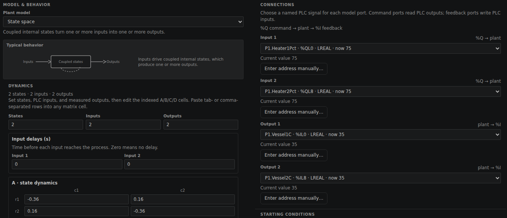
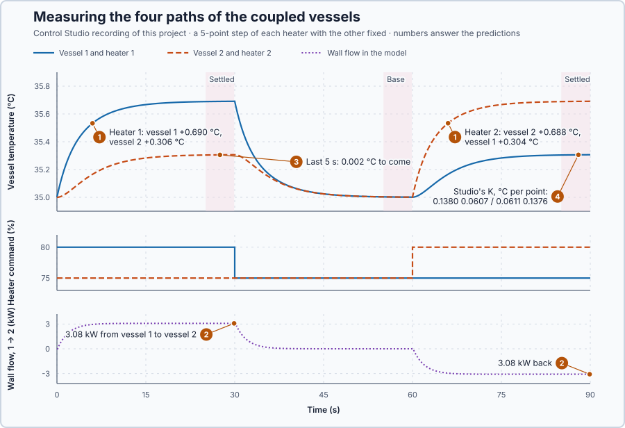

# 69. Multivariable process paths

In this lesson, you will measure how strongly each heater of two coupled vessels moves each vessel temperature, collect the four effects in a gain matrix, and compare it with the matrix calculated from the heat balance.

## The problem

Lesson 68's commissioning chose the cascade for the jacketed vessel: under a 30 kW jacket loss it held the vessel at 34.91 °C, where the single loop fell to 31.74 °C. That vessel had one heater for one temperature. The next process has two vessels that share a conducting wall, each with its own heater and sensor. Heat from either heater crosses the wall, so the two actuators each affect both temperatures, and it is unclear which heater should control which temperature.

We will measure how strongly each heater moves each vessel, and collect the four effects in one table.

## What we need

We need to:

1. describe the two vessels with one heat balance each, including the wall;
2. calculate how far each heater moves each vessel at steady state; and
3. measure the four effects in Control Studio and compare them with the calculation.

## The new idea

A **multivariable process** has several inputs and outputs, and each input moves several outputs. The **gain matrix** lists, for every input, how much it moves every output. Here the inputs are the two heater commands and the outputs the two vessel temperatures.

**In words.** Until now every loop had one actuator and one measurement, and the actuator moved only that measurement. In the coupled vessels, heater 1 warms vessel 1, and part of that heat crosses the wall and warms vessel 2 as well; heater 2 does the same the other way. Every heater therefore has two effects:

1. **Its own path:** how far it moves its own vessel.
2. **Its path across the wall:** how far it moves the other vessel.

The gain matrix is a table with one column per heater and one row per vessel. The entry in row $i$ and column $j$ says how many degrees vessel $i$ settles higher for each extra point on heater $j$. PLC engineers meet this in multi-zone heating, such as the zones of an extruder barrel: turning up one zone also warms its neighbours. The gain matrix writes down by how much, for every pair.

> **Math you need: vectors and matrices.** A **vector** is a column of numbers, such as the two deviations $x = [x_1, x_2]^T$ (T turns the row into a column). A **matrix** is a table of numbers. A matrix times a vector gives one weighted sum per row: $\begin{bmatrix}9&4\\4&9\end{bmatrix}\begin{bmatrix}5\\0\end{bmatrix} = \begin{bmatrix}45\\20\end{bmatrix}$, since $9 \cdot 5 + 4 \cdot 0 = 45$ and $4 \cdot 5 + 9 \cdot 0 = 20$.

**The formula.** Near the rest point, each vessel's settled change is a weighted sum of the two heater changes, with one weight per path:

$$
x = Kv, \qquad \begin{bmatrix}x_1\\ x_2\end{bmatrix} = \begin{bmatrix}K_{11} & K_{12}\\ K_{21} & K_{22}\end{bmatrix}\begin{bmatrix}v_1\\ v_2\end{bmatrix}.
$$

Let:

- $x_i$ be the settled change of vessel $i$'s temperature, in °C;
- $v_j$ be the change of heater $j$'s command, in percentage points; and
- $K_{ij}$ be the gain from heater $j$ to vessel $i$, in °C per point: $K_{11}$ and $K_{22}$ are the own gains, and $K_{12}$ and $K_{21}$ the **cross gains**.

The gain matrix tells where the temperatures settle, not how fast they get there.

**Example: the coupled vessels.** Each vessel stores 50 kJ per °C, loses 10 kW per °C above the 20 °C surroundings, and its heater gives 2 kW per command point. The wall passes 8 kW per °C of difference from the warmer vessel to the cooler one. Let:

- $T_1$ and $T_2$ be the vessel temperatures, in °C;
- $u_1$ and $u_2$ be the heater commands, in %; and
- $x_i = T_i - 35$ and $v_i = u_i - 75$ be the deviations from the rest point, 35 °C at 75 %.

$$
50\dot T_1 = 2u_1 - 10(T_1 - 20) - 8(T_1 - T_2), \qquad 50\dot T_2 = 2u_2 - 10(T_2 - 20) + 8(T_1 - T_2).
$$

The wall term leaves vessel 1 and enters vessel 2, so it appears with opposite signs. Follow the numbers:

1. At rest both vessels are at 35 °C: each heater gives $2 \times 75 = 150$ kW, each vessel loses $10 \times 15 = 150$ kW, and no heat crosses the wall.
2. At steady state the derivatives are zero, and in deviations the balances become $18x_1 - 8x_2 = 2v_1$ and $-8x_1 + 18x_2 = 2v_2$: each vessel's 10 kW per °C loss plus the wall's 8.
3. A 5-point step of heater 1, $v_1 = 5$ and $v_2 = 0$: the second equation gives $x_2 = (4/9)x_1$, and the first then $x_1 = 0.6923$ °C and $x_2 = 0.3077$ °C. Vessel 2 rises almost half as much as vessel 1, although its own heater has not moved.
4. At the end of that step the wall carries $8 \times (0.6923 - 0.3077) = 3.08$ kW from vessel 1 to vessel 2.

Solving both equations for every $v$ gives the gain matrix:

$$
K = \begin{bmatrix}9/65 & 4/65\\ 4/65 & 9/65\end{bmatrix} = \begin{bmatrix}0.1385 & 0.0615\\ 0.0615 & 0.1385\end{bmatrix}\ \text{°C per point}.
$$

With $v = [5, 0]^T$ its first row gives $x_1 = 45/65 = 0.6923$ °C, as in step 3. The cross gains are 4/9 of the own gains. Each column is measured with one step:

1. Hold heater 2 at 75 % and step heater 1 by 5 points.
2. Wait until both vessels settle, and average each over a settled window.
3. Subtract the averages before the step and divide by 5: the first column of $K$.
4. Return heater 1 to 75 %, wait, and step heater 2 for the second column.

**The limitation.** A step test can only wait so long, and a finite wait leaves a small error. Adding the two balances cancels the wall: the mean $m = (x_1 + x_2)/2$ obeys $50\dot m + 10m = v_1 + v_2$, time constant 5 s. Subtracting them doubles the wall: the difference $d = x_1 - x_2$ obeys $50\dot d + 26d = 2(v_1 - v_2)$, time constant 1.92 s. A 30 s hold is six slow time constants, a teaching choice. Averaged over its last 5 s, the mean still has $e^{-5} - e^{-6} = 0.43$ % of its 0.5 °C rise to come: each measured rise reads about 0.002 °C low. Each column is also measured with the other heater fixed, which is not how the heaters will run once both vessels are controlled.

## Prediction

Before running, answer these questions:

1. How far does each vessel rise for a 5-point step of each heater?
2. How much heat crosses the wall at the end of each step, and which way?
3. How much of each rise is still to come in the last 5 s of a 30 s hold?
4. Which gain matrix should Control Studio calculate from the two steps?

| Quantity | Predicted |
| --- | ---: |
| Own vessel, 5 points | 0.6923 °C |
| Other vessel, 5 points | 0.3077 °C |
| Wall flow at the end of a step | 8 × (0.6923 − 0.3077) = 3.08 kW |
| Still to come in the last 5 s | 0.002 °C |
| Gain matrix | [0.1385 0.0615; 0.0615 0.1385] °C per point |

## Implementation

Open [`src/Main.st`](src/Main.st). The project holds one pair of coupled vessels and no controller. When the project test starts, heater 1 goes to 80 % for 30 s and returns to 75 % for 30 s; heater 2 then goes to 80 %. `CoupledVesselModel` runs the balances above beside the plant from the applied commands; `SteadyRise1C` and `SteadyRise2C` are the two rows of $K$.

```st
SteadyRise1C := (LREAL#9.0 * V1Pct + LREAL#4.0 * V2Pct) / LREAL#65.0;
SteadyRise2C := (LREAL#4.0 * V1Pct + LREAL#9.0 * V2Pct) / LREAL#65.0;
TransferKw := LREAL#8.0 * (Vessel1C - Vessel2C);
```

**Exercise.** By hand, `SteadyRise1C` and `SteadyRise2C` give 0.6923 and 0.3077 °C for a 5-point step of heater 1, and the reverse for heater 2. With heater 1 at 80 %, the model's first 0.1 s step from rest gives 35.02 and 35.0 °C. Open [`src/tests.st`](src/tests.st) and run its tests from the **Testing** view.

## Experiment in Control Studio

1. Open this lesson's project and start **Simulator**. First look at the new plant. In the **truST** side bar, select **Devices & Connections**: inside **Simulator**, a box marked **SIMULATED PLANT** holds the two vessels. Select **coupled-vessels**; **Configure plant** opens. Under **CONNECTIONS**:
   - **Input 1** is `P1.Heater1Pct` (%QL0) and **Input 2** is `P1.Heater2Pct` (%QL8), the heater commands, both 75 %; and
   - **Output 1** is `P1.Vessel1C` (%IL0) and **Output 2** is `P1.Vessel2C` (%IL8), the temperatures, both 35 °C.

   **MODEL & BEHAVIOR** shows 2 states, 2 inputs and 2 outputs. Close the panel with **Cancel**.

   

2. In the **truST** side bar, select **Control Studio**. On **Identify**, choose **Project experiment** from **Method**. **Signals** already shows `P1.Vessel1C · Process value (°C)` and `P1.Heater1Pct · Applied output (%)`; add `P1.Vessel2C · state (°C)`, `P1.Heater2Pct · MV (%)`, `P1.Model1C · state (°C)` and `P1.Model2C · state (°C)`.
3. Answer the predictions before starting.
4. Select **Review project test** and check the declared **92.1 s** duration.
5. Select **Confirm and start**.
6. After the run, hover the end of each step. Add `P1.TransferKw · state (kW)`. Control Studio shows **Project test completed. Outputs restored.**
7. On **Tune**, choose **Measured MIMO paths** from **Tuning method**. Under **Settled windows · seconds**, enter recording times, which include the 2 s at rest: for **heater-1**, base 0 to 1.9 s and settled 27.1 to 31.9 s; for **heater-2**, base 57.1 to 61.9 s and settled 87.1 to 92 s. Enter 0.001 in **Drift tolerance (optional)** and select **Calculate measured paths**.

Select **Abort test** to stop early. To repeat, stop and restart **Simulator** so the vessels start at rest again.

## Evidence and decision



The numbered marks answer the predictions with the same numbers. From Control Studio's recording and **Measured MIMO paths**, which used 670 good samples from 2 independent input steps:

| Path | Predicted rise, 5 points | Measured rise | Measured gain |
| --- | ---: | ---: | ---: |
| Heater 1 → vessel 1 | 0.6923 °C | 0.6902 °C | 0.1380 °C/point |
| Heater 1 → vessel 2 | 0.3077 °C | 0.3056 °C | 0.0611 °C/point |
| Heater 2 → vessel 1 | 0.3077 °C | 0.3035 °C | 0.0607 °C/point |
| Heater 2 → vessel 2 | 0.6923 °C | 0.6881 °C | 0.1376 °C/point |

1. Each heater raised its own vessel by 0.69 °C and the other by 0.30–0.31 °C: neither heater acts on its own vessel only.
2. At the end of each step the model's wall carried 3.08 kW, from vessel 1 to vessel 2 during the first step and back during the second. The model followed both vessels within 0.0034 °C throughout.
3. The heater-1 rises read 0.0021 °C low, the part still to come. The heater-2 rises read 0.0042 °C low: both vessels were still 0.0013 °C above 35 °C and cooling when heater 2 stepped.
4. Control Studio's measured gain matrix, [0.1380 0.0607; 0.0611 0.1376] °C per point, agrees with $K$ within 0.0009 °C per point.

Measuring costs one step and one 30 s wait per heater, and gives every cross effect in one table. The cross gains are 4/9 of the own gains, too large to ignore: the coupled vessels must be treated as one multivariable process. These are simulation results.

## Conclusion

A multivariable process is described by its gain matrix: one column per input, one row per output. For the coupled vessels, the wall gives every heater a positive effect on both temperatures, its own vessel more.

Control Studio measured it from one step per heater, within 0.0009 °C per point of the heat balance's matrix.

## Check yourself

1. **Heater 1 rises by 10 points and heater 2 falls by 5 points. How far does each vessel move at steady state?**
   $x_1 = (9 \cdot 10 - 4 \cdot 5)/65 = 1.08$ °C and $x_2 = (4 \cdot 10 - 9 \cdot 5)/65 = -0.08$ °C.
2. **Why are both cross gains positive?**
   Heat from the warmer vessel crosses the wall into the cooler one, so raising either heater warms both vessels.
3. **Why does each measured rise read about 0.002 °C low?**
   The mean of the two vessels settles with a 5 s time constant; in the last 5 s of a 30 s hold, about 0.4 % of its
   0.5 °C rise is still to come.

## Reason for the next lesson

Each column was measured with the other heater fixed. Once a second loop holds the other vessel, it moves the other heater, and the gain each heater sees changes.

[Relative gain array](../62-relative-gain-array/README.md) compares the two gains and chooses which heater controls which vessel.
