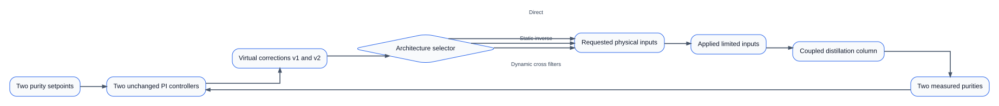
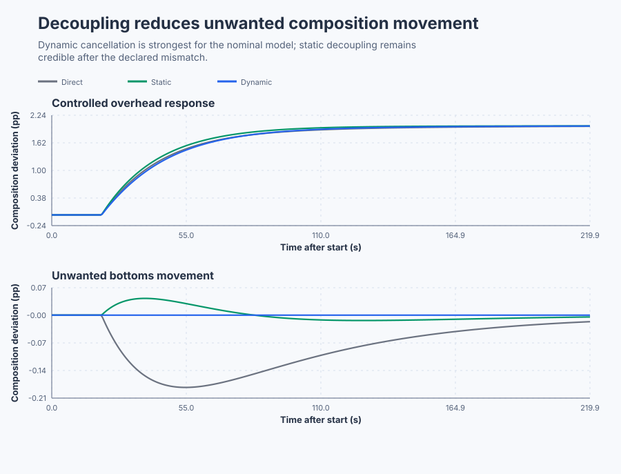

# Compare direct, static, and dynamic distillation control

**Equipment:** Continuous binary distillation column.

Course position: Lesson 62 of 84. Prerequisite: measured distillation interaction and Relative Gain Array pairing. Next lesson: multivariable robustness and architecture selection on the same column.

This project operates local nominal and perturbed simulations. It does not operate a physical distillation column.

**Lesson objective:** Commission the paired PI loops and select direct, static, or realizable dynamic decoupling from equivalent nominal and model-mismatch evidence.

## The problem

The equipment in this lesson is Continuous binary distillation column.

This is the same local binary distillation column measured in Lesson 61. Reflux and reboiler steam regulate overhead and bottoms product quality, but each actuator affects both products.

The overhead purity setpoint ($SP_{1}$) is the desired overhead light-product purity deviation, in composition percentage points. Its process value ($PV_{1}$) is the measured deviation in the same unit. The bottoms purity setpoint ($SP_{2}$) and its process value ($PV_{2}$) describe bottoms heavy-product purity deviation.

The virtual loop corrections (v1 and v2) are the two feedback controllers' requested actions before cross compensation. The requested reflux and reboiler changes are the physical commands calculated by the selected architecture, in valve percentage points. The applied changes are those commands after the -10 through +10 percentage-point actuator limits. Requested and applied values remain separate throughout the experiment.

Lesson 61 selected the diagonal pairing, but its relative gains were 1.2727 rather than one. It also measured unequal 20, 35, 40, and 30-second path response times. Correct pairing avoids the negative effective gains of the cross pairing; it does not remove interaction. We now have measured reasons to test decoupling rather than adding it because it sounds more advanced.

## What we need

We need to reduce cross-coupling between the two commissioned purity loops without creating a fragile or unrealizable correction. Direct, steady inverse, and dynamic alternatives must face the same nominal and model-mismatch events.

## The new idea

### Two decentralized feedback loops

Decentralized control uses two ordinary feedback controllers on the same coupled plant. The first controller compares SP1 with PV1. The second compares SP2 with PV2. The overhead error (e1) and bottoms error (e2) are, in words, desired purity deviation minus measured purity deviation:

$e_1=SP_1-PV_1$

$e_2=SP_2-PV_2$

Both are parallel, positional `Control.PID` instances with derivative action disabled, so they operate as proportional-integral controllers. They use a 0.1-second cycle interval, explicit initialization, finite virtual-output limits, rate limits, tracking time, and combined anti-windup. Their tuning never changes between architectures.

The overhead loop uses $K_p=T/(K\lambda)$, $T_i=T$, and
$K_i=K_p/T_i$ with $K=0.8$, $T=20$ seconds, and $\lambda=15$ seconds.
Thus $K_p=20/(0.8\cdot15)=1.6667$ and $K_i=1.6667/20=0.08333$.
For the bottoms loop, $K=0.7$, $T=30$ seconds, and $\lambda=20$ seconds
give $K_p=30/(0.7\cdot20)=2.142857$ and $K_i=0.0714286$.

### Static decoupling

A static decoupler is a steady linear map from the two virtual corrections to the two physical actuator changes. Divide each measured matrix row by its diagonal gain to preserve the direct loop gains. The normalized interaction matrix ($M$) is:

$\mathbf{M}=\begin{bmatrix}1&-0.5\\-0.428571&1\end{bmatrix}$

Each row of the measured $G$ matrix is divided by its direct gain: the first
becomes $[0.8/0.8,-0.4/0.8]=[1,-0.5]$, and the second becomes
$[-0.3/0.7,0.7/0.7]=[-0.428571,1]$.

The physical-input vector ($u$) contains reflux and reboiler changes. The virtual-correction vector ($v$) contains v1 and v2. The static mapping is:

$\mathbf{u}=\mathbf{M}^{-1}\mathbf{v}$

With the Lesson 61 steady gain matrix ($G$), the predicted product is:

$\mathbf{G}\mathbf{M}^{-1}=\begin{bmatrix}0.8&0\\0&0.7\end{bmatrix}$

Here $\det(M)=1-(-0.5)(-0.428571)=0.785714$ and
$M^{-1}=\det(M)^{-1}\begin{bmatrix}1&0.5\\0.428571&1\end{bmatrix}$.
Multiplying $G$ by this inverse makes both off-diagonal terms zero, which is
why the final cross effect cancels in the exact steady model.

The off-diagonal actuator command is feedforward from the other controller's demand. Feedback remains active to remove residual error. Matrix inversion is rejected when the measured matrix is missing, invalid, singular, or poorly conditioned.

### Why dynamic compensation may be needed

Static cancellation uses final gains. It can cancel the final cross effect while leaving a transient because direct and cross contributions arrive at different rates.

A dynamic decoupler shapes each cross command with a causal transfer function. The Laplace frequency variable ($s$) describes how the relationship changes with frequency; s is the Laplace frequency variable, not seconds. The measured path ratios require:

$D_{12}(s)=0.5\frac{20s+1}{35s+1}$

$D_{21}(s)=0.428571\frac{30s+1}{40s+1}$

Both ratios are proper and causal because the numerator order is no greater than the denominator order. Each is implemented as a direct part plus a first-order filtered part:

$D_{12}(s)=0.285714+\frac{0.214286}{35s+1}$

$D_{21}(s)=0.321429+\frac{0.107143}{40s+1}$

The ratios are $D_{12}=-G_{12}(s)/G_{11}(s)$ and
$D_{21}=-G_{21}(s)/G_{22}(s)$. A term $A(as+1)/(bs+1)$ separates as
$Aa/b+A(1-a/b)/(bs+1)$. Using $A=0.5,a=20,b=35$ gives 0.285714 and
0.214286; using $A=0.428571,a=30,b=40$ gives 0.321429 and 0.107143.

An inverse requiring prediction, an improper transfer function, uncertain unstable-zero cancellation, excessive high-frequency gain, or unavailable fresh signals is not eligible. Dynamic decoupling adds model, noise, and timing dependence.

The signal path is:


## Prediction

For an overhead-only setpoint increase, direct control should move bottoms purity through the reflux-to-bottoms path. Static decoupling should remove the final cross offset but retain a transient. Dynamic decoupling should reduce that nominal transient by matching the unequal path dynamics. The bottoms-only experiment should show the corresponding behavior in the other direction.

When the cross gains or response times change, model mismatch should make exact dynamic cancellation degrade. A more elaborate design is accepted only if that degradation remains within the declared requirements.

## Implementation

The shipped program contains two real `Control.PID` instances, one `Control.StaticDecoupler2x2`, and two stateful `Control.LowPass` instances. One architecture selector chooses direct, static, or dynamic mapping. It does not change the PI settings, plant event, timing, limits, or random seed.

The dynamic implementation is short enough to trace from the preceding equations:

```st
RefluxRequested := VirtualCommand.First
    + LREAL#0.285714285714286 * VirtualCommand.Second
    + LREAL#0.214285714285714 * FilteredBottomsCorrection;
ReboilerRequested := VirtualCommand.Second
    + LREAL#0.321428571428571 * VirtualCommand.First
    + LREAL#0.107142857142857 * FilteredOverheadCorrection;
```

The filters update continuously so a selected dynamic path does not begin with stale state. Structured Text does not contain cross-peak measurements, integral-error results, or a winning architecture.

## Experiment in Control Studio

This procedure observes the qualified nominal dynamic-decoupling case. The
project owns architecture selection, the setpoint event, and zero restoration;
Control Studio writes only one Boolean authority signal. The native lesson test
owns the separately restored direct, static, disturbance, and perturbed-model
comparisons. The deterministic Simulation seed is 20260829.

### Control Studio actions

1. **Monitor** — Start the **Simulator**, then open **truST sidebar → Control Studio → Monitor → Response**.
   - **Baseline check:** Wait until the header shows **Simulation**, **Running**, and current data. Confirm both SP/PV pairs, virtual corrections, requested/applied inputs, architecture, decoupler qualification, limits, Auto modes, and quality. All deviations and inputs begin at zero. Retain the 20-second baseline and the 20-to-220-second overhead-only dynamic response.
   - **Decision before action:** Read **Prediction** above, then state what should move first and in which direction. Use this decision rule: Use the simplest architecture whose nominal and perturbed executed evidence satisfies the declared cross-response, primary-loop, effort, limit, and restoration requirements.
   - **Successful evidence:** The Response plot advances, the displayed values are finite and current, and **Start recording** is enabled. Select **Start recording** only after those conditions are visible.
   - **Recovery:** If recording is disabled or the plot reports unavailable or stale samples, stop the Simulator, correct the displayed runtime or binding problem, restart it, and repeat the baseline check.
   - **Record:** Write down the initial SP, PV, requested/applied MV where available, controller mode, and your predicted response before opening Test.

2. **Test** — Open **truST sidebar → Control Studio → Test**.
   - **Baseline check:** Confirm **Experiment** = **Observe without excitation**, **Amplitude** = **0** (disabled), and **Maximum duration (s)** = **220.1**. The reviewed authority is **Experiment authority** (`P1.ExperimentEnabled`). The project selects qualified dynamic decoupling, holds zero for 20 seconds, then requests a +2-point overhead change while keeping the bottoms setpoint and feed disturbance at zero.
   - **Decision before action:** Before selecting **Review test**, predict the compensating reboiler direction and confirm both inputs can remain within -10 through +10 points and both product deviations within -6 through +6 points.
   - **Successful evidence:** Select **Review test**, verify zero external excitation, authority, duration, restoration, and stop conditions, then select **Confirm and start**. Response must expose virtual, requested, and applied commands separately. At termination authority clears, architecture returns to direct, and both setpoints and the disturbance return to zero. Keep **Abort test** visible.
   - **Recovery:** Select **Abort test** if the test is rejected, stale, unsafe, unavailable, failed, or aborted. Read the reason, confirm authority is false and every project-owned event signal restored to zero, wait for current data, and review a new observation.
   - **Record:** Compare the cross response with your prediction and retain terminal state, restoration, and seed **20260829**. The native lesson test owns the direct/static/dynamic, load, and mismatch verdicts; this observation does not create generic Identify, Tune, or Validate evidence.

## Evidence and decision

### Measures and comparison

Define the measures before inspecting results:

- **Primary-loop integral absolute error** is the sum of absolute setpoint-minus-process-value error over the event window, multiplied by the 0.1-second sample interval, in composition-percentage-point seconds.
- **Cross-output peak excursion** is the largest absolute unintended product deviation during a one-product setpoint test, in composition percentage points.
- **Final-window absolute error** is the mean combined absolute error over the final 10 seconds and is reported only for a valid settled record.
- **Requested and applied input total variation** is the sum of absolute changes between consecutive command samples, in valve percentage points. The two values are reported separately.
- **Saturation duration** is elapsed time at a physical input limit, in seconds.

For each servo record, cross peak must not exceed 0.05 composition percentage points, combined integral absolute error must not exceed 100 composition-percentage-point seconds, and combined applied travel must not exceed 6 valve percentage points. Feed-disturbance combined error must not exceed 40 composition-percentage-point seconds.

On the perturbed model, select dynamic decoupling only if it materially improves the result: it must lower cross peak by at least 20 percent relative to static, increase combined integral absolute error by no more than 5 percent, increase applied travel by no more than 25 percent, and remain otherwise eligible.

### Validation

The native executable produced these nominal results:

| Event and measure | Direct | Static | Dynamic |
|---|---:|---:|---:|
| Overhead step: cross peak | 0.185 | 0.043 | 0.00005 |
| Overhead step: combined error integral | 73.16 | 50.26 | 55.44 |
| Bottoms step: cross peak | 0.244 | 0.122 | 0.00016 |
| Bottoms step: combined error integral | 99.99 | 75.45 | 79.50 |
| Feed disturbance: combined error integral | 22.59 | 31.30 | 38.50 |

Cross peaks use composition percentage points. Error integrals use composition-percentage-point seconds. Dynamic compensation is the only nominal architecture meeting the 0.05 cross-peak requirement in both directions. It does not beat static on combined servo error, and direct control rejects this particular feed disturbance best. All three nevertheless meet the separate declared error and effort limits.

On the perturbed overhead test, direct, static, and dynamic cross peaks were 0.1568, 0.0678, and 0.0594 composition percentage points. Static therefore retained a substantial improvement over direct control. Static and dynamic combined error integrals were 54.77 and 64.00 composition-percentage-point seconds, and applied travel was 4.29 and 4.07 percentage points. Dynamic reduced cross peak by only 12.3 percent and increased combined error by 16.8 percent. It therefore failed the predeclared material-improvement rule. Static decoupling is the selected fallback for the declared uncertain model; the nominal dynamic result is retained as a qualified local result, not generalized.

### Retained evidence

The upper plot verifies that all three architectures control the requested
overhead change. The lower plot isolates the unwanted bottoms-composition
movement that decoupling is intended to reduce. The retained trace also keeps
the manipulated variables and the perturbed-model comparison.



[Complete trace](figures/distillation-decoupling-evidence-trace.csv) ·
[Decision summary](figures/distillation-decoupling-evidence-summary.csv)

## Conclusion

Direct control lets each controller correction travel through both physical paths. Static inversion adds an opposing command that cancels the final cross contribution, but unequal arrival times leave a transient. The dynamic direct-and-filtered terms align those nominal contributions and nearly remove the cross peak.

Model mismatch changes the gain and arrival time of the real cross path while the feedforward compensation remains nominal. The cancellation then becomes incomplete. Feedback eventually trims residual error, but it cannot make the inverse model correct. This is why excellent nominal dynamic cancellation does not by itself justify the more complex architecture.

## Reason for the next lesson

Use decoupling only when a qualified interaction model and common executed evidence show that it passes a requirement the simpler architecture misses. Static compensation addresses settled interaction. Eligible dynamic compensation can address transient interaction, but carries more model and timing risk.

This is simulation evidence. Physical-column application requires independently reviewed models, topology, product and safety limits, product disposition, abort and restoration procedures, and explicit approval immediately before action.

Lesson 63 asks why these successful single-loop and scenario checks still do not prove multivariable robustness for the coupled architecture.
