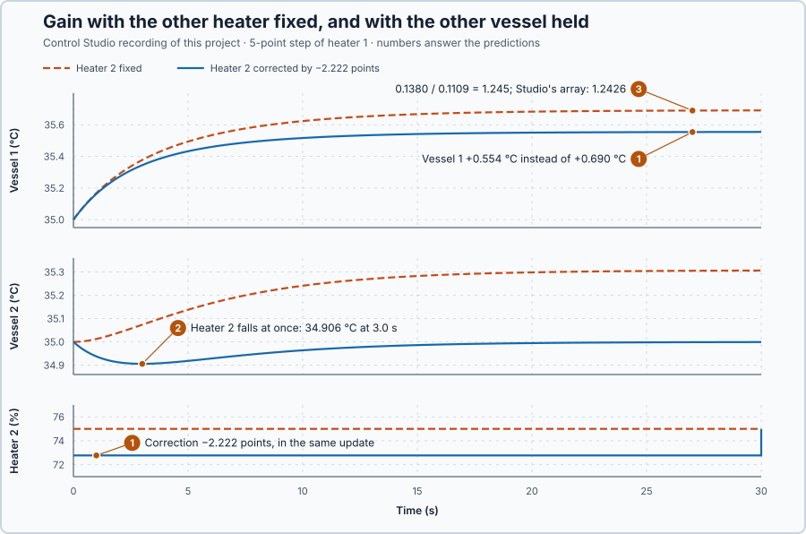

# 70. Relative gain array

In this lesson, you will compare each heater's gain with the other heater fixed and with the other vessel held, collect the ratios in the relative gain array, and choose which heater controls which vessel.

## The problem

Lesson 69's measured paths gave the gain matrix of the coupled vessels, [0.1380 0.0607; 0.0611 0.1376] °C per point, within 0.0009 of the calculated $K = \frac{1}{65}\begin{bmatrix}9&4\\4&9\end{bmatrix}$. Each column was measured with the other heater fixed. In operation, a second loop will hold the other vessel at its setpoint, and to do so it moves the other heater. The gain each heater then sees is not the gain we measured.

We will calculate both gains for every pairing, compare them, and choose the pairing.

## What we need

We need to:

1. calculate a heater's gain on a vessel while the other vessel is held;
2. compare it with the gain measured with the other heater fixed, for every pairing; and
3. choose the pairing whose gain changes least and never changes sign.

## The new idea

The **relative gain** compares how strongly an input moves its output with the other loop off, and with the other loop holding its output. Close to 1 means the pair barely disturbs each other: a good pairing. For the vessels it compares how far heater 1 moves vessel 1 with heater 2 fixed, and while heater 2 holds vessel 2.

**In words.** Lesson 69 measured each heater's effect with the other heater fixed. In operation the other heater will not be fixed: a second loop will hold the other vessel at its setpoint, and to do that it moves the other heater. That changes what the first heater appears to do:

1. **Other loop off.** Heater 1 warms vessel 1, vessel 2 warms too, and less heat leaks from vessel 1 through the wall.
2. **Other loop holding its vessel.** Loop 2 turns heater 2 down to keep vessel 2 at 35 °C, so the wall keeps draining vessel 1, and vessel 1 rises less.

The relative gain is the ratio of the two gains. Near 1, closing the other loop changes little, and each loop can be tuned on its own. Far above 1, closing the other loop weakens the pair a lot. Negative, closing it reverses the pair's direction, and a controller tuned with the other loop off would push the wrong way. The **relative gain array** collects the relative gains of every possible pairing in one table. It answers, before any PID block is put in Auto, whether each loop will still see the process it was tuned on once the other loop runs too.

> **Math you need: matrix inverse.** The **inverse** $K^{-1}$ of a square matrix undoes it: if $x = Kv$, then $v = K^{-1}x$. For a 2 × 2 matrix, $\begin{bmatrix}a&b\\c&d\end{bmatrix}^{-1} = \frac{1}{ad-bc}\begin{bmatrix}d&-b\\-c&a\end{bmatrix}$; the denominator $ad - bc$ is the **determinant**, and the inverse exists only when it is not zero. Example: $\begin{bmatrix}2&1\\1&1\end{bmatrix}^{-1} = \begin{bmatrix}1&-1\\-1&2\end{bmatrix}$, since the determinant is $2 - 1 = 1$; multiplying back, $2 \cdot 1 + 1 \cdot (-1) = 1$ and $2 \cdot (-1) + 1 \cdot 2 = 0$.

**The formula.** For the pairing of output 1 with input 1,

$$
\lambda_{11} = \frac{\text{gain with the other loop off}}{\text{gain with the other loop holding its output}} = K_{11}\,(K^{-1})_{11},
$$

and for every pairing at once

$$
\Lambda = K \circ (K^{-1})^T .
$$

Let:

- $\lambda_{ij}$ be the relative gain of pairing output $i$ with input $j$, a pure number;
- $\Lambda$ be the array of all of them, $K$ the gain matrix and $K^{-1}$ its inverse;
- $\circ$ multiply element by element, not as a matrix product; and
- T, the transpose, swap rows and columns.

The inverse appears because it answers the held question directly: the first row of $v = K^{-1}x$ says how far heater 1 must move to shift vessel 1 while vessel 2 stays where it is, so $(K^{-1})_{11}$ is the held gain turned upside down. Every row and every column of $\Lambda$ sums to 1.

**Example: the coupled vessels.** Use Lesson 69's $K = \frac{1}{65}\begin{bmatrix}9&4\\4&9\end{bmatrix}$ °C per point. Follow the numbers:

1. Holding vessel 2 while heater 1 rises by 5 points requires $x_2 = 0$ in the second row: $\frac{4}{65}\cdot 5 + \frac{9}{65}\,v_2 = 0$, so $v_2 = -\frac{4}{9}\cdot 5 = -2.222$ points. Heater 2 must be turned down by 2.222 points.
2. Then $x_1 = \frac{9}{65}\cdot 5 + \frac{4}{65}\cdot(-2.222) = 0.5556$ °C: a held-vessel gain of $0.5556/5 = 1/9 = 0.1111$ °C per point, against $9/65 = 0.1385$ with heater 2 fixed.
3. The relative gain is $\lambda_{11} = 0.1385/0.1111 = 81/65 = 1.246$, about 1.25: closing the other loop lowers the gain by a fifth.
4. The same through the inverse: the determinant of $K$ is $(81 - 16)/65^2 = 1/65$, so $K^{-1} = \begin{bmatrix}9 & -4\\ -4 & 9\end{bmatrix}$ points per °C. Its first row reads $v_1 = 9x_1 - 4x_2$: with $x_2$ held at 0, $v_1 = 9x_1$, the held-vessel gain 1/9 again.
5. All four: $\lambda_{11} = \lambda_{22} = \frac{9}{65}\cdot 9 = \frac{81}{65} = 1.246$ and $\lambda_{12} = \lambda_{21} = \frac{4}{65}\cdot(-4) = -0.246$. Each row sums to $1.246 - 0.246 = 1$.

To choose the pairing:

1. Pair each vessel with the heater whose relative gain is positive and closest to 1.
2. Heater 1 with vessel 1 and heater 2 with vessel 2: 1.246. Closing the other loop lowers each gain from 0.1385 to 0.1111 but keeps its sign.
3. The crossed pairing: −0.246. With the other loop closed its gain would change sign, and a controller tuned for one direction would push the wrong way.

**The limitation.** The array is a steady result: it says where the temperatures end, not what they do on the way. A correction applied in the same update as the step cuts heater 2 at once, while heater 1's heat reaches vessel 2 only through the wall. With Lesson 69's two time constants, vessel 2 follows $35 + 0.278\,(e^{-t/1.92} - e^{-t/5})$ °C: lowest, 34.906 °C, at 3.0 s, although it ends exactly where it started.

## Prediction

Before running, answer these questions:

1. What correction must heater 2 make to hold vessel 2 during a 5-point step of heater 1, and how far does vessel 1 then rise?
2. The correction is applied in the same update as the step. What does vessel 2 do before the wall flow has built up?
3. What relative gains do you calculate, and which pairing do they support?

| Quantity | Predicted |
| --- | ---: |
| Correction of heater 2 | −2.222 points |
| Vessel 1 with vessel 2 held | +0.5556 °C |
| Vessel 2 during the correction | lowest 34.906 °C at 3.0 s |
| Relative gains, own / crossed | 1.246 / −0.246 |

## Implementation

Open [`src/Main.st`](src/Main.st). The project holds two copies of Lesson 69's coupled vessels, without controllers. When the project test starts, the first pair repeats Lesson 69's steps with the other heater fixed. The second pair takes the same steps, and in the same update `CompensatingCommandPct` corrects its other heater by −2.222 points, so that the other vessel ends where it started. `HeldOutputGain`, `Determinant`, `RelativeGain11` and `RelativeGain12` calculate the held-vessel gain and the array from the four gains; each returns 0 where its denominator is zero, because there the gain or the array does not exist.

```st
CompensatingCommandPct := -C / D * V1Pct;
HeldOutputGain := A - B * C / D;
RelativeGain11 := A * (D / Determinant(A := A, B := B, C := C, D := D));
```

**Exercise.** By hand, with Lesson 69's $K$: the correction for 5 points is −2.222 points, the held-vessel gain 0.1111 °C per point, the determinant 1/65, and the relative gains 1.246 and −0.246. For $K = [2\ 1; 1\ 1]$, $\lambda_{11} = 2$. Open [`src/tests.st`](src/tests.st) and run its tests from the **Testing** view.

## Experiment in Control Studio

1. Open this lesson's project and start **Simulator**. The four vessels rest at 35 °C with all heaters at 75 %. In the **truST** side bar, select **Control Studio**.
2. On **Identify**, choose **Project experiment** from **Method**. **Signals** already shows `P1.Vessel1C · Process value (°C)` and `P1.Heater1Pct · Applied output (%)`, the first pair; add `P1.Vessel2C · state (°C)` and `P1.Heater2Pct · MV (%)`.
3. Answer the predictions before starting.
4. Select **Review project test** and check the declared **92.1 s** duration.
5. Select **Confirm and start**.
6. After the run, show the second pair, `P1.Vessel3C · state (°C)`, `P1.Vessel4C · state (°C)`, `P1.Heater3Pct · state (%)` and `P1.Heater4Pct · state (%)`, and hover 3 s after the first step and the end of each step. Control Studio shows **Project test completed. Outputs restored.**
7. On **Tune**, choose **Measured MIMO paths** from **Tuning method**, enter Lesson 69's windows and drift tolerance, and select **Calculate measured paths**. Open **Relative Gain Array** below **Measured gain matrix**.

Select **Abort test** to stop early. To repeat, stop and restart **Simulator** so the vessels start at rest again.

## Evidence and decision



The numbered marks answer the predictions with the same numbers. From Control Studio's recording, averages over the last 5 s of each hold:

| Heater 1 step, 5 points | Heater 2 fixed | Heater 2 corrected by −2.222 points |
| --- | ---: | ---: |
| Vessel 1 rise | 0.6902 °C | 0.5544 °C |
| Vessel 2 at the end | +0.3056 °C | −0.0012 °C |
| Gain on vessel 1 | 0.1380 °C/point | 0.1109 °C/point |

1. The correction held vessel 2 within 0.0012 °C at the end, and vessel 1 rose 0.5544 °C, 0.0012 °C below the predicted 0.5556 °C.
2. Before the wall flow built up, vessel 2 dipped to 34.906 °C at 3.0 s, as calculated, and stayed within 0.01 °C of 35 °C only from 16.6 s.
3. The ratio of the two gains is 0.1380/0.1109 = 1.245 for heater 1 and 1.244 for heater 2. Control Studio's **Relative Gain Array** gives 1.2426 on the diagonal and −0.2426 off it, against 81/65 = 1.246, and lists vessel-1 ← heater-1 and vessel-2 ← heater-2 as pairing candidates.

The benefit of the array is a pairing chosen before any loop is closed; its cost is that it says nothing about the transient, such as the 0.094 °C dip. Heater 1 is paired with vessel 1 and heater 2 with vessel 2: relative gain 1.24, positive and near 1. The crossed pairing, −0.24, is rejected. These are simulation results.

## Conclusion

The relative gain compares a gain with the other heater fixed against the same gain with the other vessel held; the array $\Lambda = K \circ (K^{-1})^T$ collects all four. A pairing is chosen where the relative gain is positive and near 1.

For the coupled vessels, the array is 1.246 on the diagonal by hand and 1.2426 from Control Studio, so each heater controls its own vessel.

## Check yourself

1. **For $K = [0.2\ 0.1; 0.1\ 0.2]$ °C per point, what is $\lambda_{11}$?**
   The determinant is 0.04 − 0.01 = 0.03, so $(K^{-1})_{11} = 0.2/0.03 = 6.67$ and $\lambda_{11} = 0.2 \times 6.67 = 1.33$.
2. **Why is the crossed pairing rejected?**
   Its relative gain is negative: with the other loop closed its gain would change sign, so a controller tuned with
   the other loop open would push the wrong way.
3. **Why did vessel 4 dip although the correction holds it at steady state?**
   Heater 4's cut acted at once, while heater 3's heat reached vessel 4 only through the wall, after vessel 3 had
   warmed.

## Reason for the next lesson

The array chose the pairing from steady gains, and the dip of vessel 4 showed what steady gains leave out. With two working loops, each will disturb the other's vessel during every change.

[Decentralized PI](../63-decentralized-pi/README.md) runs one PI per pair, both at once, and tests setpoint changes and loads on both vessels.
