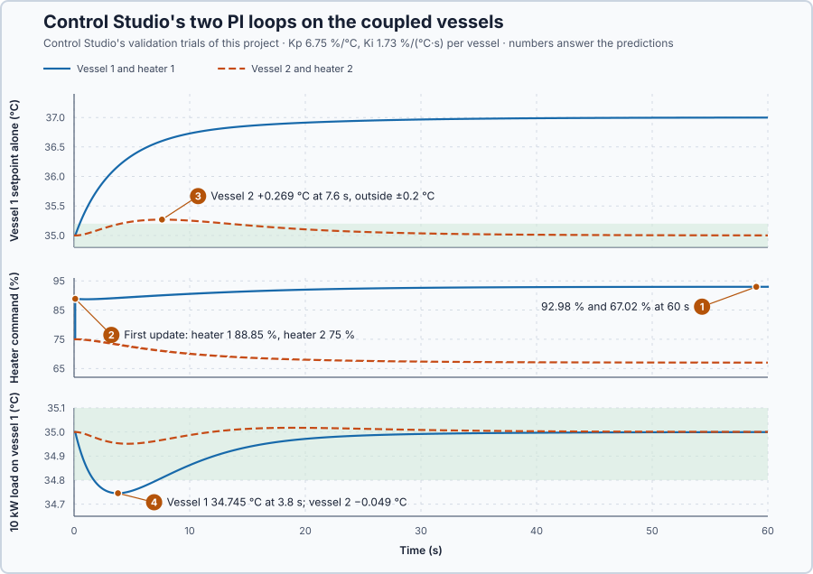

# 71. Decentralized PI

In this lesson, you will let Control Studio design one PI per vessel of the coupled vessels from their group model, run both at once, and test setpoint changes and loads against requirements for the changed and the unchanged vessel.

## The problem

Lesson 70's relative gain array, 1.246 by hand and 1.2426 from Control Studio, paired heater 1 with vessel 1 and heater 2 with vessel 2. The array is a steady result: in Lesson 70, a correction that held vessel 4 at steady state still let it dip to 34.906 °C during the change. The paired loops have not yet been run together. When vessel 1's setpoint rises, heater 1's extra heat crosses the wall, and vessel 2's controller notices it only once vessel 2 has warmed.

We will run one PI per pair, both at once, and test setpoint steps and loads on both vessels.

## What we need

We need to:

1. tune each PI on the gain it sees while the other loop is working;
2. fix requirements for the changed and the unchanged vessel before testing; and
3. test setpoint steps and loads with both loops running.

## The new idea

**Decentralized PI** uses one PI controller per chosen pair, each with its own memory, all running at the same time. Here PI 1 reads vessel 1 and drives heater 1, PI 2 reads vessel 2 and drives heater 2, and each keeps its own integral and limits.

**In words.** This is how most PLC programs handle interacting zones: one PID block per zone, each with its own integral, limits and Auto/Manual, and nothing in the program connecting them. The process connects them, through the wall. That has two consequences:

1. **Each PI must be tuned for the gain it has while the other loop is working.** In operation the other loop moves its heater to hold its vessel, so each heater moves its own vessel by Lesson 70's held-vessel gain, not by the gain measured with the other heater fixed.
2. **Each PI corrects the other's effect only after its own vessel has moved.** When vessel 1's setpoint rises, heater 1's extra heat crosses the wall, and PI 2 notices nothing until vessel 2 has warmed.

**The formula.** Each PI is tuned on its own path with the gain it has when the other loop is closed, the own gain divided by its relative gain:

$$
K_c = \frac{K_{11}}{\lambda_{11}} = \frac{9/65}{81/65} = \frac{1}{9}\ \text{°C per point}.
$$

The heater commands that hold any pair of temperatures follow from Lesson 69's balances:

$$
u_1 = 75 + \frac{18x_1 - 8x_2 + D_1}{2}, \qquad u_2 = 75 + \frac{-8x_1 + 18x_2 + D_2}{2}.
$$

Let:

- $K_c$ be the gain with the other loop closed, in °C per point;
- $K_{11}$ be the own gain and $\lambda_{11}$ the relative gain, from Lessons 69 and 70;
- $x_1$ and $x_2$ be the vessel temperatures' deviations from 35 °C, in °C;
- $u_1$ and $u_2$ be the heater commands, in %; and
- $D_1$ and $D_2$ be heat loads taken from each vessel, in kW.

$K_c$ is Lesson 70's held-vessel gain, $K_{11} - K_{12}K_{21}/K_{22}$, and it follows from the balance as well: with vessel 2 held, vessel 1 alone obeys $50\dot x_1 = 2v_1 - 18x_1$, a gain of $2/18 = 1/9$ °C per point.

**Example: a vessel-1 setpoint step from 35 to 37 °C.** Follow the numbers:

1. Where it ends: $x = [2, 0]^T$ gives $u_1 = 75 + 36/2 = 93$ % and $u_2 = 75 - 16/2 = 67$ %. Heater 2 must fall 8 points to hold vessel 2 against heater 1's extra heat.
2. The first update, with gains $K_p$ and $K_i$ and 0.1 s updates: PI 1 sees a 2 °C error and raises heater 1 by $2K_p + 0.2K_i$. PI 2 sees no error and keeps 75 %.
3. Heater 1's heat warms vessel 1 and, through the wall, vessel 2.
4. Only once vessel 2 has warmed does PI 2 cut heater 2.
5. A 10 kW load taken from vessel 1 instead needs $u_1 = 75 + 10/2 = 80$ % and $u_2 = 75$ %.

Control Studio designs both PIs as a PID group: it excites both heaters in turn, fits one model of both vessels, and lists for each member its own path, its relative gain and the gain with the other loops closed; it designs each PI for that last gain.

**The limitation.** Separate controllers do not separate the process, and the vessel that is not asked to change is hard to hold. Within ±0.2 °C of its setpoint, PI 2's proportional part can give at most $0.2K_p$ points and its integral can add at most $0.2K_i$ points per second, while the full rise of vessel 1 needs heater 2 eight points lower. Unless those numbers are large, vessel 2 has to move further before PI 2 has cut enough.

The requirements, fixed before the tests: a 2 °C setpoint step settles within ±0.2 °C in 30 s with a steady error of at most 0.3 °C, for each vessel; the unchanged vessel stays within ±0.2 °C throughout; a 10 kW load keeps the loaded vessel at or above 34 °C.

## Prediction

Before running, answer these questions:

1. Which heater commands hold vessel 1 at 37 °C with vessel 2 at 35 °C?
2. What do the heaters command on the first update after vessel 1's setpoint step?
3. Which requirement does the interaction break?
4. How far does a 10 kW load on vessel 1 move each vessel?

| Quantity | Predicted |
| --- | ---: |
| Heaters holding 37 °C and 35 °C | 93 % and 67 % |
| Heaters holding 35 °C with 10 kW on vessel 1 | 80 % and 75 % |
| Gain with the other loop closed | 1/9 = 0.111 °C per point |
| First update, heater 2 | 75 %, no error yet |

## Implementation

Open [`src/Main.st`](src/Main.st). The project holds the coupled vessels with a heat load on each and one `Control.PID` per vessel, each with its own parameters, memory and limits, and one Auto/Manual switch for both, so Control Studio commissions them as a PID group. Until a design is applied both are in Manual at 75 %.

```st
HoldingCommand1Pct := LREAL#75.0 + (LREAL#18.0 * X1C - LREAL#8.0 * X2C + D1Kw) / LREAL#2.0;
OtherLoopClosedGain := A - B * C / D;
```

**Exercise.** By hand: the holding commands are 93 % and 67 % for $x = [2, 0]^T$ and 80 % and 75 % with 10 kW on vessel 1; `OtherLoopClosedGain` with Lesson 69's $K$ gives 1/9 °C per point. Open [`src/tests.st`](src/tests.st) and run its tests from the **Testing** view.

## Experiment in Control Studio

1. Open this lesson's project and start **Simulator**. In the **truST** side bar, select **Control Studio**; the project has no loop yet, so select **Configure control loop**.
2. In **Set up control loop**, enter **Loop name** `Vessel temperatures` and choose **Structure** **PID group: interacting PIDs tuned together**. Tick `P1.Vessel1` and `P1.Vessel2`; for each, choose its **Parameter record**, **Measurement** (degC, 20–60), **Output**, **Setpoint** and **Manual output**, and enter **Identification step** 25. Choose **Shared Auto/Manual signal** `P1.VesselsAuto`, enter **Identification duration (s)** 160, leave the decoupler unticked, choose **Startup-done flag** `P1.Initialized` and select **Save loop**.
3. Answer the predictions before going on.
4. On **Identify**, choose **Multisine** from **Method** and select **Identify plant**.
5. On **Tune**, check **Controller** **P1.Vessel1 + P1.Vessel2 · Paired PI**. Select **Requirements…** and enter, for each vessel, **Setpoint change (°C)** 2, **Maximum steady-state error (°C)** 0.3, **Maximum settling time (s)** 30 and **Settling band (±°C)** 0.2, and **Validation duration (s)** 60; select **Done**, then **Tune controller**.
6. On **Validate**, select **Validate controller**. Besides both setpoints together, the table judges the trials **P1.Vessel1C setpoint alone** and **P1.Vessel2C setpoint alone**. Then select **Apply**; Studio shows **Applied**.
7. Test a load: on **Tune**, choose **Manual** from **Tuning method** (Studio's gains stay filled in), open **Requirements…**, enter −5 in **Input disturbance (%)**, 10 kW taken from vessel 1, and select **Done**, **Tune controller** and **Validate controller**; the table adds the **load rejection** trial.

**Restore previous settings** on **Validate** returns both PIs to Manual.

## Evidence and decision



The numbered marks answer the predictions with the same numbers. Control Studio's design table: each vessel's own path $K = 0.1385$ °C/%, $\tau = 3.9$ s, relative gain 1.25, gain with the other loops closed 0.1111 °C/%; each PI $K_p = 6.75$ %/°C, $K_i = 1.73$ %/(°C·s). The figure plots Studio's validation trials, which run the actual program; from them:

| Requirement | Result | Decision |
| --- | ---: | --- |
| Both setpoints 35 → 37 °C: settling time, ≤ 30 s | 5.8 s | Pass |
| One setpoint alone: own vessel's settling time | 9.4 s, both directions | Pass |
| Steady errors, ≤ 0.3 °C | at most 0.0358 °C | Pass |
| One setpoint alone: unchanged vessel within ±0.2 °C | **+0.269 °C at 7.6 s**, both directions | **Fails** |
| 10 kW on vessel 1: loaded vessel ≥ 34 °C | 34.745 °C at 3.8 s | Pass |
| Ranges, states and transfer | 103 checks | Pass |

1. The heaters headed for the balance: 92.98 % and 67.02 % at 60 s after vessel 1's step.
2. The first update raised heater 1 to 75 + 6.75 × 2 + 1.73 × 0.2 = 88.85 % and left heater 2 at 75 %.
3. Vessel 2 rose 0.269 °C at 7.6 s: inside its band, PI 2 can cut heater 2 by at most 1.35 points plus 0.35 points per second, not the 8 points that vessel 1's heat requires. Studio's table judges the unchanged vessel only by its settling and steady error, 0 s and 0.0358 °C, and passes; the trial's run breaks our ±0.2 °C limit, in both directions.
4. Under the load, vessel 1 fell to 34.745 °C and vessel 2 by 0.049 °C; heater 1 settled at 80.00 %. Studio's input disturbance acts on heater 1; the design is symmetric, as both setpoint trials show, so the mirror holds for vessel 2.

Decentralized PI is the simplest arrangement, two independent controllers each designed on its own path, and Studio's design meets every requirement on the vessel asked to move. That simplicity costs the unchanged-vessel requirement: decentralized PI does not qualify. These are simulation results.

## Conclusion

Decentralized PI runs one PI per pair, each with its own memory, tuned on the gain it has with the other loop closed, $K_{11}/\lambda_{11}$. Separate controllers do not separate the process: heat still crosses the wall, and each loop corrects the other's effect only after its own vessel has moved.

For the coupled vessels, Control Studio designed both PIs on 0.1111 °C per point; they met every requirement on the vessel asked to move, while the unchanged vessel rose 0.269 °C, outside its 0.2 °C limit.

## Check yourself

1. **Which heater commands hold vessel 1 at 35 °C and vessel 2 at 36 °C?**
   $x = [0, 1]^T$ gives $2v_1 = -8$ and $2v_2 = 18$: 71 % and 84 %.
2. **Why is each PI designed on 1/9 °C per point, not on 9/65?**
   In operation the other loop holds its vessel and moves its heater, which lowers each path's gain by its relative
   gain: 0.1385/1.246 = 0.111.
3. **What does PI 1 command on the first update after a 1 °C setpoint step?**
   75 + 6.75 × 1 + 1.73 × 1 × 0.1 = 81.92 %.

## Reason for the next lesson

The vessel that was not asked to change still deviated until its own loop caught up, although the gain matrix already says how much heat heater 1 sends through the wall.

[Static decoupling](../64-decoupling/README.md) coordinates the two heaters so that a request for one temperature does not move the other.
