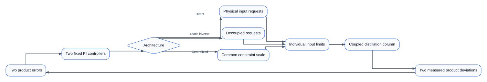
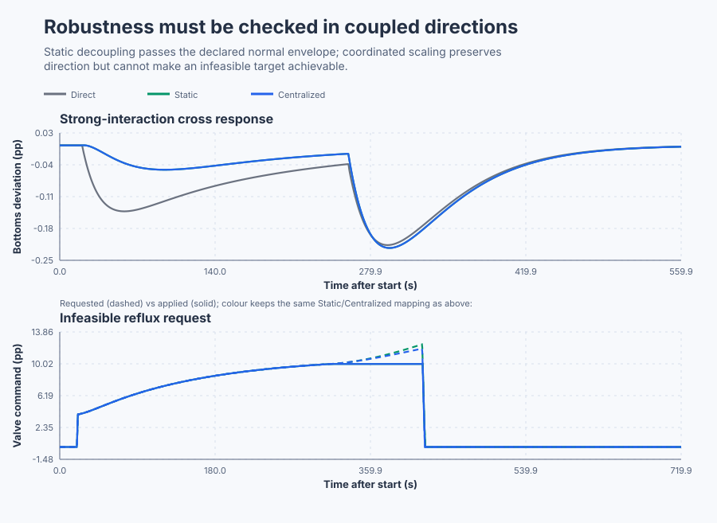

# Select a robust distillation control architecture

Course position: Lesson 63 of 84. Prerequisite:
`control-distillation-decoupling`. Next lesson: `control-two-tank-observability`.

**Equipment:** Continuous binary distillation column.

**Lesson objective:** Evaluate direct PI, static decoupling, and centralized direction-preserving constraint coordination against common nominal, interaction, and infeasibility evidence.

## The problem

This is the same continuous binary distillation column used in Lessons 61 and 62. Reflux and reboiler steam both affect the overhead and bottoms product compositions.

The overhead purity setpoint ($SP_{1}$) is the desired overhead composition deviation, in composition percentage points. The measured overhead purity deviation is the first process value ($PV_{1}$), in the same unit. The bottoms purity setpoint ($SP_{2}$) is the desired bottoms composition deviation. The measured bottoms purity deviation is the second process value ($PV_{2}$).

The reflux-valve change and reboiler-steam-valve change are the two manipulated inputs, in valve percentage points. Each applied change is limited from -10 through +10 percentage points. Each product deviation is limited from -6 through +6 composition percentage points. The controller and plant advance every 0.1 seconds.

The nominal model retains the four gains and response times measured in Lesson 61. A second qualified local model keeps the diagonal gains but has stronger and slower cross interaction. These two models are the complete uncertainty set for this lesson, not a claim about every operating condition of a physical column.


The diagram shows the only intentional change: the mapping between the same two PI controllers and the same two physical inputs.

Lesson 62 showed excellent nominal dynamic cancellation, then rejected it when cross-path mismatch made the extra complexity unjustified. Static decoupling remained the qualified fallback. That comparison still did not answer whether the complete coupled architecture is robust.

Two individual loops can each look stable while a combined reflux-and-reboiler direction is weak. The actuator effects then nearly cancel. Separate single-loop margins do not reveal that direction, and nominal cancellation does not prove behavior when interaction changes.

## What we need

We need both purity controllers to respect the shared physical direction and input limits when their separate requests cannot be achieved together. The architecture must remain defensible under interaction, uncertainty, and an explicitly infeasible production target.

## The new idea

### Directional gain

The input vector ($u$) contains the reflux and reboiler changes. The output vector ($y$) contains the overhead and bottoms composition deviations. A direction states the proportion between the two components independently of their overall size.

The Euclidean length is the combined magnitude of a vector. For the two physical input changes, square both components, add them, and take the square root. Only after that physical meaning is clear do we write its compact form as $\left\lVert u\right\rVert_2$. The output magnitude is written $\left\lVert y\right\rVert_2$ in the same way.

A two-input gain matrix does not have one gain for every direction. The largest singular value ($\sigma_{\mathrm{max}}$) is the largest output-vector magnitude produced by any unit-length input direction. The smallest singular value ($\sigma_{\mathrm{min}}$) is the smallest output-vector magnitude produced by any unit-length input direction. The associated input and output directions explain which physical combinations create those extremes.

For every input direction whose length is one:

$\sigma_{\mathrm{max}} = \max\left(\lVert M \cdot u \rVert_2\right)$

$\sigma_{min} = \min\left(\lVert M \cdot u \rVert_2\right)$

The normalized nominal gain matrix ($M_{0}$) removes the different diagonal engineering gains before comparing directions:

$\mathbf{M}_0=\begin{bmatrix}1&-0.5\\-0.428571&1\end{bmatrix}$

Its largest and smallest singular values are 1.4649 and 0.5364. Their ratio is the condition number ($\kappa$), which is 2.73. The largest steady inverse-command amplification is the reciprocal of the smallest singular value: $1 / \sigma_{min} = 1.86$.

The normalized stronger-interaction matrix ($M_{1}$) is:

$\mathbf{M}_1=\begin{bmatrix}1&-0.8\\-0.7&1\end{bmatrix}$

Its singular values are 1.7512 and 0.2512, its condition number is 6.97, and its inverse-command amplification is 3.98. The smaller minimum singular value means that one combined product direction needs much more coordinated actuator movement.

### Interaction uncertainty

The interaction uncertainty ($\Delta\mathbf{M}$) is the actual normalized matrix minus the nominal normalized matrix. Its largest singular value measures the worst directional size of the model difference.

$DeltaM = M_{1} - M_{0}$

The uncertainty size is 0.30. This is smaller than the nominal minimum singular value of 0.5364, so this bounded set is not predicted to lose invertibility. That test does not promise good conditioning or good closed-loop performance.

### Multivariable sensitivity

The loop-transfer matrix ($L$) combines the dynamic plant, controller, and selected input mapping. The identity matrix ($I$) leaves both vector components unchanged. The sensitivity matrix ($S$) maps an output-side disturbance to the error that remains with feedback closed. The frequency variable ($s$) represents sinusoidal frequency for this analysis.

$S(s) = \operatorname{inverse}\left(I + L(s)\right)$

At each frequency, the largest singular value of the sensitivity matrix is the worst disturbance amplification over every output direction. We therefore search over frequency and direction; the diagonal elements alone are insufficient.

### Three architectures

Direct decentralized PI sends each PI correction to its paired physical input. Static decoupling sends both corrections through the fixed nominal inverse and then limits each input independently.

The centralized constraint coordinator uses the same PI settings and nominal inverse. It observes both requested physical commands together. The largest requested magnitude ($u_{\mathrm{peak}}$) is the larger absolute command. The common scale factor ($\alpha$) is one while both requests fit, and the requested input direction is preserved when the common factor becomes smaller. When a request exceeds 10 percentage points, one scale reduces both commands together:

$\alpha = \min\left(1, 10 / u_{\mathrm{peak}}\right)$

$u_{\mathrm{applied}} = \alpha \cdot u_{\mathrm{requested}}$

This preserves the requested direction. It is not model predictive control: there is no prediction horizon, optimizer, future move sequence, or future constraint model.

The proportional gain ($K_p$) is the present-error contribution in output percentage points per composition percentage point. The integral gain ($K_i$) accumulates persistent error in output percentage points per composition-percentage-point second. Both architectures use exactly the Lesson 62 PI values; changing them would turn this into a tuning comparison.

## Prediction

Calculate both singular-value pairs, condition numbers, inverse amplifications, and the 0.30 uncertainty size before running a controller.

For a simultaneous +1/+1-composition-percentage-point target, the nominal plant needs about +2.50/+2.50 valve percentage points at equilibrium. The stronger-interaction plant needs about +5.44/+5.24, so the request is still feasible.

For a +2/+2 target, the stronger-interaction plant needs about +10.88/+10.47 valve percentage points. Both exceed the physical limit. Predict that no architecture can remove the resulting product error. Independent limits will distort the requested direction. A common scale will preserve direction but reduce its magnitude.

## Implementation

The shipped program runs these actual components:

```st
VirtualCommand.First := OverheadController.Update(Input := OverheadInput);
VirtualCommand.Second := BottomsController.Update(Input := BottomsInput);
CoupledCommand := StaticDecoupler.ToActuators(VirtualCommand := VirtualCommand);

RequestedPeak := MAX(ABS(RefluxRequested), ABS(ReboilerRequested));
CommonScale := MIN(LREAL#1.0, LREAL#10.0 / RequestedPeak);
RefluxApplied := CommonScale * RefluxRequested;
ReboilerApplied := CommonScale * ReboilerRequested;
```

The complete source guards division by zero, chooses direct, static, or centralized operation explicitly, and exposes requested and applied commands separately. It does not contain singular values, performance metrics, or a preselected winner.

## Experiment in Control Studio

This procedure tests one declared lesson change under controlled conditions. Insert the fixed nominal inverse, then add only joint direction-preserving scaling without changing the PI settings. The declared event lasts 720 seconds. It restores Overhead purity setpoint to 0 pp afterward. The deterministic Simulation seed is 20260829.

### Control Studio actions

1. **Monitor** — Start the **Simulator**, then open **truST sidebar → Control Studio → Monitor → Response**.
   - **Baseline check:** Wait until the header shows **Simulation**, **Running**, and current data. Confirm Overhead purity setpoint (SP, pp) and Bottoms purity setpoint (SP, pp); Overhead light-product purity deviation (PV, pp) and Bottoms heavy-product purity deviation (PV, pp); Requested reflux change (MV, pp) and Requested reboiler steam change (MV, pp), including units, limits, mode, and quality. The initial operating point is Overhead purity setpoint = 0 pp, Bottoms purity setpoint = 0 pp, Applied reflux change = 0 pp, Applied reboiler steam change = 0 pp, Applied feed-composition disturbance = 0 pp. The unresolved baseline problem is: Separate diagonal-loop behavior does not reveal weak combined directions, interaction uncertainty, or joint input feasibility. Control Studio Monitor must show Simulation mode with requested and applied input vectors visible together. Control Studio Monitor must show Simulation mode with requested and applied input vectors visible together. Retain overhead-only, bottoms-only, simultaneous, and feed-composition cases as separate comparisons.
   - **Decision before action:** Read **Prediction** above, then state what should move first and in which direction. Use this decision rule: Select the least coupled architecture that passes every normal-envelope record on both models; retain the +2/+2 record as Infeasible rather than ranking it.
   - **Successful evidence:** The Response plot advances, the displayed values are finite and current, and **Start recording** is enabled. Select **Start recording** only after those conditions are visible.
   - **Recovery:** If recording is disabled or the plot reports unavailable or stale samples, stop the Simulator, correct the displayed runtime or binding problem, restart it, and repeat the baseline check.
   - **Record:** Write down the initial SP, PV, requested/applied MV where available, controller mode, and your predicted response before opening Test.

2. **Test** — Open **truST sidebar → Control Studio → Test**.
   - **Baseline check:** Set **Experiment** = **Setpoint step**, **Amplitude** = **1 pp**, and **Maximum duration (s)** = **720**. The affected signal is **Overhead purity setpoint**; it starts at 0 pp and must restore to 0 pp.
   - **Decision before action:** Before selecting **Review test**, predict the response direction and confirm the requested change remains inside Overhead purity setpoint -4 pp to 4 pp; Bottoms purity setpoint -4 pp to 4 pp; Applied reflux change -10 pp to 10 pp; Applied reboiler steam change -10 pp to 10 pp; Overhead light-product purity deviation -6 pp to 6 pp; Bottoms heavy-product purity deviation -6 pp to 6 pp.
   - **Successful evidence:** Select **Review test**, verify the signal, requested bound, duration, restoration, and stop conditions, then select **Confirm and start**. The state changes to **Running**, **Abort test** remains available, and the terminal state confirms completion and restoration while Response shows the measured SP/PV/MV sequence.
   - **Recovery:** For a rejected, stale, unsafe, unavailable, failed, or aborted state, read the displayed reason, restore Overhead purity setpoint to 0 pp, wait for current data, and review a new test.
   - **Record:** Compare the response with your prediction and retain the terminal state, restoration result, and deterministic seed **20260829**.

3. **Identify** — After **Stop recording**, open **truST sidebar → Control Studio → Identify**.
   - **Baseline check:** Use **Qualify recording** to inspect sample count, duration, timing, excitation, and clipping. **Model selection**, **Fit estimation run**, and **Accept model for design** are the shared low-order model workflow; they do not replace the project-owned **Singular-direction robustness analysis and architecture selection** model and must not be accepted as this lesson's design authority.
   - **Decision before action:** Decide whether the recording contains the input/output change needed for **Singular-direction robustness analysis and architecture selection** before fitting anything.
   - **Successful evidence:** A qualified recording has current, finite, sufficiently excited data. Use the project-owned model described under **Implementation** and **Evidence and decision**, and record its assumptions, units, validity range, and rejection rule.
   - **Recovery:** If qualification reports stale, clipped, poorly excited, or insufficient data, return to Test and repeat the bounded experiment; never force or relabel a rejected fit.
   - **Record:** State which model is retained or rejected and why, explicitly identifying the runnable project as the model authority.

4. **Tune / Design** — Open **truST sidebar → Control Studio → Tune**.
   - **Baseline check:** **Design method** and **Generate candidate** are disabled because **Singular-direction robustness analysis and architecture selection** is designed by the runnable project; shared Control.PID tuning is unavailable. Do not select an unrelated PID method.
   - **Decision before action:** Apply the equations and choices under **Implementation**, then compare the declared alternatives under **Evidence and decision** before accepting **Singular-direction robustness analysis and architecture selection**.
   - **Successful evidence:** Use **Monitor → Signals** to correlate the implemented project-owned design with its named live states and outputs. A disabled shared designer is only a visible ownership boundary, not successful design evidence.
   - **Recovery:** If the project-owned prerequisites or qualification flags are false, return to Test or Identify as directed by the lesson and do not bypass them with a generic PID candidate.
   - **Record:** State why the project-owned design is eligible, conditional, or rejected, including the decisive trade-off.

5. **Validate** — Open **truST sidebar → Control Studio → Validate**.
   - **Baseline check:** **Run required validation** is disabled because no shared Control.PID candidate exists. **Requirement details** and **Save result** cannot be used to claim a shared result; project-owned validation is executed by the runnable project's declared oracle.
   - **Decision before action:** Use the predeclared comparisons: normal_final_window_combined_absolute_error <= 0.1 pp (tolerance 0.001 pp); normal_single_axis_cross_peak <= 0.2 pp (tolerance 0.001 pp); normal_input_limit_duration <= 0.5 s (tolerance 0.1 s); restoration_combined_absolute_error <= 0.02 pp (tolerance 0.001 pp).
   - **Successful evidence:** Correlate the unrounded project-owned results with the named live signals and events in Monitor. Each applicable requirement must have a value, unit, limit, tolerance, evidence class, and Pass, Conditional pass, Fail, or Inconclusive disposition.
   - **Recovery:** If the project run aborts, becomes stale, fails, or violates restoration, discard that run and repeat the declared Test. Never present a disabled button or retained README table as newly executed evidence.
   - **Record:** State the validation disposition and name every failed or inconclusive requirement before continuing.

## Evidence and decision

### Measures and comparison

Final-window combined absolute error is the mean of the two absolute setpoint-minus-process-value errors over the final 10 seconds, after both outputs qualify as settled. Its unit is composition percentage points and smaller is better.

Unintended cross peak is the largest absolute movement of the product whose setpoint was unchanged during a single-axis test. Its unit is composition percentage points and smaller is better.

Combined integral absolute error is the 0.1-second time sum of both absolute errors over the event. Its unit is composition-percentage-point seconds. Applied-input total variation is the sum of the absolute changes between consecutive samples of both applied inputs. Its unit is valve percentage points.

Also retain time at an input limit, minimum common scale, restoration error, matrix singular values, condition number, and the multivariable sensitivity peak over 0.002 through 2 radians per second.

A normal record passes only when combined final error is at most 0.10, single-axis cross peak is at most 0.20, input-limit time is at most 0.5 seconds, restoration error is at most 0.02, and sensitivity peak is at most 1.20. The simplest architecture wins. A more centralized candidate needs at least 20 percent improvement in eligible error or input travel, or it must turn a failed normal requirement into a pass without breaking another limit.

### Validation

The executable comparison retained every record, including failures. The most decision-relevant results are:

| Evidence case | Direct PI | Static decoupling | Centralized coordinator |
| --- | ---: | ---: | ---: |
| Nominal simultaneous final error | 0.0161 pp | 0.0041 pp | 0.0041 pp |
| Strong-interaction simultaneous final error | 0.1728 pp | 0.0767 pp | 0.0767 pp |
| Worst strong-interaction single-axis cross peak | 0.1891 pp | 0.0752 pp | 0.0752 pp |
| Strong-interaction sensitivity peak | 1.0067 | 1.0071 | 1.0071 |
| Infeasible +2/+2 final error | 1.0275 pp | 0.4174 pp | 0.2747 pp |

Every static and centralized normal-envelope record passed final error, cross peak, input-limit duration, sensitivity, and Manual restoration requirements. Direct PI failed the stronger-interaction simultaneous-error requirement. Because the common scale remained one throughout every feasible record, centralized behavior equalled static decoupling and produced no 20-percent material benefit. Static decoupling is therefore selected as the simplest architecture for the declared normal envelope.

In the +2/+2 challenge, requested commands exceed the physical range. Static decoupling clips independently and changes their direction. Centralized scaling reduces $\alpha$ to 0.8436 at its lowest point and preserves the requested ratio. All three architectures retain more than 0.10 composition percentage points of combined error, so the record is correctly classified `Infeasible` rather than settled. Its lower centralized residual does not make an impossible target eligible.

### Retained evidence



The figure keeps the architecture decision visible. The complete trace retains
the coupled outputs, requested and applied commands, and common constraint
scale. The decision summary records which architecture passed the normal
envelope and keeps the infeasible challenge separate from that ranking.

[Complete trace](figures/distillation-robustness-evidence-trace.csv) ·
[Decision summary](figures/distillation-robustness-evidence-summary.csv)

## Conclusion

The diagonal gains did not change, yet the minimum singular value fell from 0.5364 to 0.2512. Stronger opposing cross effects created a weak combined direction. An inverse must apply more input to create output in that direction and becomes more sensitive to model error.

Static decoupling remains the simplest candidate when it passes the complete normal uncertainty set. Centralized scaling matters only when a joint constraint becomes active. It can preserve an input direction, but it cannot create missing reflux or reboiler capacity. The correct response to an infeasible production target is to reject or reshape the target, not to rename the controller.

## Reason for the next lesson

Do not infer multivariable robustness from separate loop margins, nominal cancellation, or one favorable test direction. Declare the uncertainty set and requirements, test every candidate under equivalent conditions, reject ineligible records first, and then choose the simplest architecture that passes.

All evidence here is Simulation evidence. A Physical-column experiment requires independently reviewed models, topology, product and equipment limits, uncertainty cases, abort and restoration procedures, and explicit approval immediately before the physical action.

Lessons 64 through 68 next introduce state space, estimation, optimal control, and predictive control. They are needed when internal modes, sensor and actuator placement, or future coupled constraints cannot be handled honestly by this static two-loop architecture.
