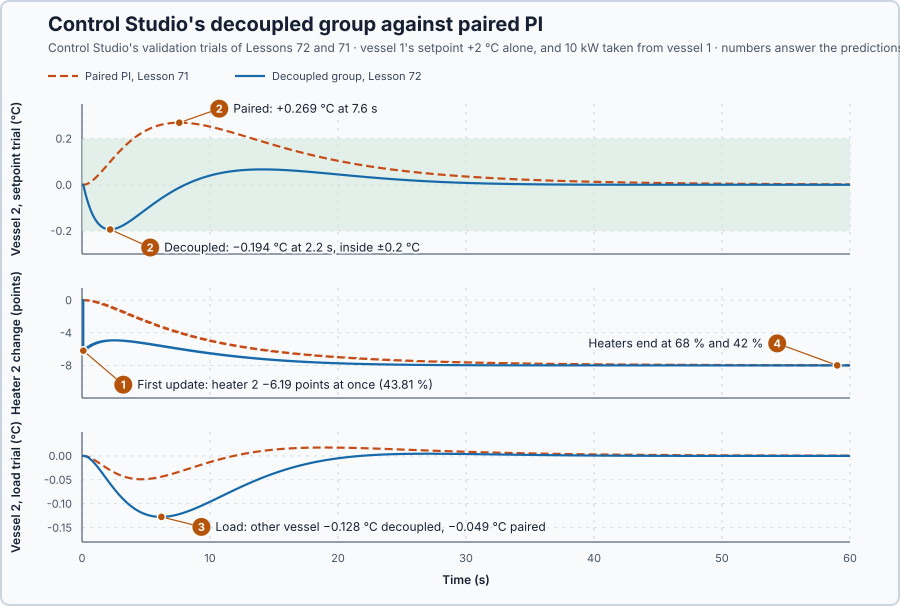

# 72. Static decoupling

In this lesson, you will let Control Studio design both PIs and a static decoupler for the coupled vessels as one group, so that a request for one vessel temperature does not move the other, and test it against Lesson 71's requirements.

## The problem

Lesson 71's decentralized PI, designed by Control Studio, met every requirement on the vessel it was asked to move, but when vessel 1's setpoint stepped alone, the unchanged vessel 2 rose 0.269 °C, outside its 0.2 °C limit. The loops still disturb each other: PI 2 corrected heater 1's heat only after vessel 2 had warmed, although the gain matrix already tells how much heat heater 1 sends through the wall.

We will turn heater 2 down together with heater 1, by the amount the gain matrix requires.

## What we need

We need to:

1. calculate from the gain matrix how both heaters must move for a request on one vessel;
2. place that calculation between the two PIs and the heaters, so that it starts without a bump; and
3. test it against Lesson 71's requirements.

## The new idea

**Static decoupling** coordinates the two heaters so that a request for one temperature does not move the other: when one heater goes up, the other is turned down by just enough to cancel the cross effect. Each PI now writes a **request** $v_i$, in %, instead of a heater command, and a small matrix turns both requests into the two heater commands.

**In words.** In Lesson 71, PI 2 corrected heater 1's heat only after vessel 2 had warmed, although the gain matrix already says how much heat heater 1 sends through the wall. A decoupler uses that knowledge at once:

1. **Each PI asks for its own vessel only.** PI 1's request means "move vessel 1", PI 2's "move vessel 2".
2. **The decoupler turns the requests into heater commands.** When request 1 rises, it raises heater 1 and, in the same update, lowers heater 2 by the amount that cancels the extra heat crossing the wall.
3. **At steady state each request moves only its own vessel**, so each PI sees one simple process instead of two coupled ones.

"Static" means it uses only the settled gains: it cancels where the temperatures end up, not the path they take there. In the PLC it is four multiplications and two additions between the PID outputs and the analog outputs.

**The formula.** The decoupler is a matrix $M$ between the requests and the heater commands, $u = Mv$. The same holds for changes, so a change $v$ of the requests moves the temperatures by $x = KMv$. Each request moves only its own vessel if $KM$ is zero outside its diagonal; choosing $KM = \frac{1}{9}I$ gives

$$
M = K^{-1}\,\tfrac{1}{9}I = \begin{bmatrix}1 & -4/9\\ -4/9 & 1\end{bmatrix}, \qquad KM = \tfrac{1}{9}I .
$$

Let:

- $v$ be the two requests and $u$ the two heater commands, in %, or their changes, in percentage points;
- $x$ be the two temperature changes, in °C;
- $K$ be Lesson 69's gain matrix and $K^{-1}$ its inverse from Lesson 70, $\begin{bmatrix}9 & -4\\ -4 & 9\end{bmatrix}$ points per °C;
- $I$ be the identity matrix, 1 on the diagonal and 0 elsewhere; and
- 1/9 °C per point be the gain each request then has, the gain Lesson 71's PIs saw with the other loop closed.

**Example: the coupled vessels.** Follow the numbers:

1. Request 1 rises by 5 points: $u = M[5, 0]^T = [5, -2.222]^T$. Heater 1 rises 5 points and heater 2 falls 2.222 points, Lesson 70's held-vessel correction. At steady state vessel 1 ends $5/9 = 0.556$ °C higher and vessel 2 where it was.
2. Control Studio uses the same directions with a different scale, $D = K^{-1}\,\mathrm{diag}(K) = \frac{81}{65}M$, where $\mathrm{diag}(K)$ keeps only $K$'s own gains on its diagonal. Then $KD = \frac{9}{65}I$: each loop keeps its own path's gain, 0.1385 °C per point, and Studio designs both PIs for it. Per point of request 1, heater 2 changes by $-\frac{81}{65}\cdot\frac{4}{9} = -36/65 = -0.554$ points.
3. On **Apply**, Studio writes the gains and $D$ together and starts each controller at $v = D^{-1}u$, so the heaters keep their present commands. Here $D^{-1} = \begin{bmatrix}1 & 4/9\\ 4/9 & 1\end{bmatrix}$, so with both heaters at $u$ the controllers start at $u(1 + 4/9)$. At Lessons 69–71's 75 % that is 108.3 %, outside the controllers' 0–100 %: Studio cannot start them there.
4. This lesson therefore holds the vessels at 30 °C, where the balance $2u = 10\,(T - 20)$ gives 50 %, and the controllers start at $50 \times 13/9 = 72.2$ %. The plant is linear, so $K$, $M$ and $D$ do not change.
5. After a vessel-1 setpoint step from 30 to 32 °C, $x = [2, 0]^T$ needs heater changes $K^{-1}x = [18, -8]^T$ points: heaters at 68 % and 42 %, and requests at $D^{-1}[68, 42]^T = [86.7, 72.2]^T$ %, inside 0–100 %.

Studio's group design follows three steps: it identifies both vessels and calculates $D$ from the measured gain matrix; it designs each PI on its own path behind $D$, where the relative gain is 1; and it validates the group before **Apply**.

**The limitation.** $D$ cancels the steady cross effect only. Heater 2 falls at once, while heater 1's heat reaches vessel 2 through the wall later, so during a change vessel 2 first dips. The decoupler is exact only for the modelled wall of 8 kW per °C. And its controllers need room to start at $D^{-1}u$: with both heaters above $100 \times 9/13 = 69.2$ %, the starting requests would leave the 0–100 % range. Holding the vessels at 30 °C and 50 % is the operating choice this lesson makes for that reason.

## Prediction

Before running, answer these questions:

1. Where do Studio's decoupled controllers start with the heaters at 75 % and at 50 %?
2. What do the heaters do on the first update after vessel 1's setpoint step?
3. Does the unchanged vessel stay within ±0.2 °C?
4. Does the decoupler help or cost under a 10 kW load on vessel 1?

| Quantity | Predicted |
| --- | ---: |
| Starting requests at 75 % / 50 % | 108.3 % / 72.2 % |
| Heaters holding 32 °C and 30 °C | 68 % and 42 % |
| Heater-2 change per point of request 1 | −36/65 = −0.554 |
| Gain of each request through $D$ | 9/65 = 0.1385 °C per point |

## Implementation

Open [`src/Main.st`](src/Main.st). The project holds the coupled vessels at 30 °C and 50 %, one `Control.PID` per vessel, one Auto/Manual switch and the decoupler variables `D11` to `D22`. In Auto the program writes each heater from both requests through $D$, limited to 0–100 %; in Manual each request goes straight to its heater. Until a design is applied, both PIs are in Manual with Lesson 71's gains and $D$ the identity.

```st
DecoupledHeaterPct := LIMIT(LREAL#0.0, OwnEntry * OwnRequestPct + CrossEntry * OtherRequestPct, LREAL#100.0);
StartingRequest1Pct := (D22 * Heater1Pct - D12 * Heater2Pct) / Determinant;
```

**Exercise.** By hand, with Studio's $D$: `StartingRequest1Pct` gives 108.33 % for heaters at 75 % and 72.22 % at 50 %, and `DecoupledHeaterPct` turns 72.22 % on both back into 50 %; with $M$, raising request 1 by 5 points raises heater 1 by 5 points and lowers heater 2 by 2.222. Open [`src/tests.st`](src/tests.st) and run its tests from the **Testing** view.

## Experiment in Control Studio

1. Open this lesson's project and start **Simulator**. In the **truST** side bar, select **Control Studio**; the project has no loop yet, so select **Configure control loop**.
2. In **Set up control loop**, enter **Loop name** `Vessel temperatures` and choose **Structure** **PID group: interacting PIDs tuned together**. Tick `P1.Vessel1` and `P1.Vessel2`; for each, choose its **Parameter record**, **Measurement** (degC, 20–60), **Output** `P1.Heater1Pct` or `P1.Heater2Pct`, the heater the program writes from $D$, **Setpoint** and **Manual output**, and enter **Identification step** 25. Choose **Shared Auto/Manual signal** `P1.VesselsAuto` and **Identification duration (s)** 160; tick **The program applies a static decoupler, u = D·v in Auto** and choose `P1.D11`, `P1.D12`, `P1.D21` and `P1.D22` for the four entries; choose **Startup-done flag** `P1.Initialized` and select **Save loop**.
3. Answer the predictions before going on.
4. On **Identify**, choose **Multisine** from **Method** and select **Identify plant**.
5. On **Tune**, check **Controller** **P1.Vessel1 + P1.Vessel2 · Decoupled PI**. Select **Requirements…** and enter, for each vessel, **Setpoint change (°C)** 2, **Maximum steady-state error (°C)** 0.3, **Maximum settling time (s)** 30 and **Settling band (±°C)** 0.2, and **Validation duration (s)** 60; select **Done**, then **Tune controller**.
6. On **Validate**, select **Validate controller**. As in Lesson 71, the table also judges **P1.Vessel1C setpoint alone** and **P1.Vessel2C setpoint alone**. Then select **Apply**; Studio shows **Applied**.
7. Test a load: on **Tune**, choose **Manual** from **Tuning method**, open **Requirements…**, enter −5 in **Input disturbance (%)** and select **Done**, **Tune controller** and **Validate controller**.

**Restore previous settings** on **Validate** undoes the change.

## Evidence and decision



The numbered marks answer the predictions with the same numbers. Control Studio's design: $D$ = [1.25 −0.5538; −0.5538 1.25], which is 81/65·M; each vessel's own path $K = 0.1385$ °C/% and $\tau = 3.11$ s, relative gain 1, gain with the other loops closed 0.1385 °C/%; each PI $K_p = 5.42$ %/°C and $K_i = 1.74$ %/(°C·s). Its validation passed: settling 8.3 s, steady errors at most 0.008287 °C, 119 range, state and transfer checks. From its trials, against Lesson 71's:

| Requirement | Paired PI, Lesson 71 | Decoupled group |
| --- | ---: | ---: |
| One setpoint alone: own vessel's settling time, ≤ 30 s | 9.4 s | 8.3 s |
| One setpoint alone: unchanged vessel within ±0.2 °C | **+0.269 °C**, fails | −0.194 °C at 2.2 s |
| 10 kW on vessel 1: loaded vessel | −0.255 °C | −0.270 °C |
| 10 kW on vessel 1: other vessel | −0.049 °C | −0.128 °C |

1. On the first update request 1 rose by 5.42 × 2 + 1.74 × 0.2 = 11.188 points; heater 1 went to 63.93 % and heater 2 fell at once by 6.19 points, to 43.81 %.
2. Vessel 2 dipped 0.194 °C at 2.2 s instead of rising 0.269 °C, inside its band by 0.006 °C: $D$ cancels the steady cross effect, not the transient.
3. Under the load the decoupler cost more: vessel 2 moved 0.128 °C against 0.049 °C, because request 1's correction also turned heater 2 down.
4. The heaters ended at the balance's 68 % and 42 %.

The decoupled group meets every requirement of Lesson 71 with the heaters inside their range, so it qualifies where paired PI failed. Its costs: a lower operating point, so that the controllers can start at $D^{-1}u$; more deviation under loads; a margin of 0.006 °C; and a matrix that is right only for the modelled wall of 8 kW per °C. Studio's design is applied. These are simulation results.

## Conclusion

Static decoupling places a matrix between the PIs and the heaters, $M = K^{-1}\frac{1}{9}I$, so that each request moves only its own vessel at steady state; Control Studio's $D = \frac{81}{65}M$ has the same directions, scaled so each loop keeps its own gain. It is a steady cancellation, not a dynamic one, and its controllers need room to start at $D^{-1}u$.

For the coupled vessels at 30 °C, Control Studio's decoupled group kept the unchanged vessel within 0.194 °C, where paired PI let it rise 0.269 °C.

## Check yourself

1. **With Studio's D, where do the controllers start for heaters at 60 % and 60 %?**
   $60 \times (1 + 4/9) = 86.7$ %, inside 0–100 %.
2. **Why does vessel 2 dip with the decoupler?**
   Heater 2 falls in the same update as heater 1 rises, but heater 1's heat reaches vessel 2 only through the wall,
   later.
3. **Why does Studio's D not equal M?**
   $D$ keeps each loop's own path gain, 9/65 °C per point, while $M$ gives the gain with the other loop closed, 1/9;
   both cancel the cross effect, and Studio designs the PIs for its own scale.

## Reason for the next lesson

$D$ was calculated for a wall of 8 kW per °C. If the real wall passes more or less heat, the decoupler over- or under-corrects: it turns the other heater down too much or too little.

[Multivariable design selection](../65-robust-mimo-selection/README.md) compares paired PI and the decoupled group across a range of wall couplings and looks for the simplest that passes them all.
