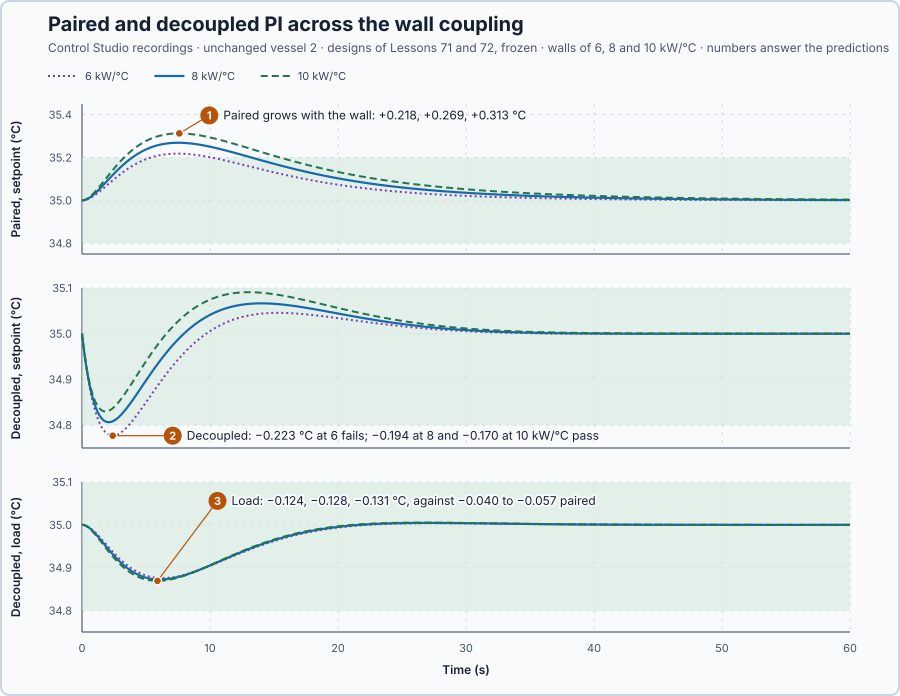

# 73. Multivariable design selection

In this lesson, you will compare Control Studio's paired PI and decoupled group on the same requirements across a range of wall couplings, with both designs frozen, and choose the simplest arrangement that passes every case.

## The problem

Lesson 72's decoupled group, designed by Control Studio, met every requirement: with one setpoint stepping alone, the unchanged vessel moved 0.194 °C, inside its 0.2 °C limit, where paired PI let it rise 0.269 °C. Its matrix $D$, though, was calculated for a wall of 8 kW per °C, and a real wall's coupling is known only roughly. If the wall passes more or less heat, the decoupler turns the other heater down too much or too little, and its margin was only 0.006 °C.

We will test both arrangements, unchanged, across the range of wall couplings, and choose the simplest that passes every case.

## What we need

We need to:

1. state the range of wall coupling the design must cover;
2. calculate what each coupling does to the steady commands and to the frozen decoupler; and
3. test both frozen arrangements at every coupling, in both directions, against Lesson 71's requirements.

## The new idea

**Design selection** compares the complete arrangements on the same requirements, including the cases where the coupling is weaker or stronger than modelled, and picks the simplest that passes them all. For the vessels the uncertain quantity is the wall's coupling $H_c$, taken here as 6 to 10 kW per °C around the modelled 8, a teaching choice.

**In words.** Every design so far was calculated for one model: a wall of 8 kW per °C. A real wall's coupling is known only roughly. A design that passes for the model can fail on the real plant, and the decoupler is the most exposed, because it cancels a cross effect of one particular size. Design selection therefore asks a different question from tuning: not "what is best for the model?" but "what passes for every plant we might really have?" It has four parts:

1. **State the uncertainty:** the range in which the real coupling may lie.
2. **Freeze the designs:** no retuning per case, because the real plant does not tell us which case it is.
3. **Test every arrangement in every case,** against the same requirements and in both directions.
4. **Choose the simplest arrangement that passes all cases,** or report that none does.

It is like qualifying one parameter set for a whole machine series: it must work on every machine built, not only on the prototype it was tuned on.

**The formula.** Lesson 69's steady balance with any wall is

$$
\begin{bmatrix}10 + H_c & -H_c\\ -H_c & 10 + H_c\end{bmatrix} x = 2v ,
$$

and what Lesson 72's frozen decoupler leaves of the cross effect is

$$
(KD)_{12} = \frac{81}{65}\cdot\frac{2H_c - 2c\,(10 + H_c)}{100 + 20H_c} .
$$

Let:

- $x$ be the temperature deviations from 35 °C, in °C, and $v$ the heater deviations from 75 %, in points;
- $H_c$ be the wall's coupling, in kW per °C, and 10 each vessel's loss to the surroundings, in kW per °C;
- $K$ be the gain matrix for that wall: the balance solved for $x$, $x = Kv$, in °C per point;
- $D = \frac{81}{65}\begin{bmatrix}1 & -c\\ -c & 1\end{bmatrix}$ be Lesson 72's decoupler, with $c = 4/9$, calculated for 8 kW per °C; and
- $(KD)_{12}$ be the cross gain left over: how far vessel 1 moves per point of request 2, in °C per point.

**Example: the coupled vessels from 6 to 10 kW per °C.** Follow the numbers:

1. Vessel 1 at 37 °C with vessel 2 at 35 °C, $x = [2, 0]^T$, needs $v_1 = 10 + H_c$ and $v_2 = -H_c$: heaters at 91 % and 69 % for 6 kW per °C, 93 % and 67 % for 8, and 95 % and 65 % for 10. A 10 kW load needs 80 % and 75 % at every coupling. All lie inside the heaters' 0–100 %.
2. At 8 kW per °C the decoupler leaves $2 \times 8 - 2 \cdot \frac{4}{9} \cdot 18 = 0$: no cross gain, as designed.
3. At 6 kW per °C it leaves $\frac{81}{65}\cdot\frac{12 - 14.22}{220} = -0.0126$ °C per point: heater 2 is cut more than the wall delivers.
4. At 10 kW per °C it leaves $\frac{81}{65}\cdot\frac{20 - 17.78}{300} = +0.0092$ °C per point: heater 2 is cut too little.
5. Without a map, $c = 0$ and a scale of 1, the cross gain is $2H_c/(100 + 20H_c)$: 0.0545, 0.0615 and 0.0667 °C per point. The frozen decoupler leaves far less at every tested wall, but not zero.

Both PIs still remove every steady error through their integrals; the leftover cross gain shows during the change. The test:

1. Freeze Control Studio's designs for 8 kW per °C: paired PI, $K_p = 6.75$ %/°C and $K_i = 1.73$ %/(°C·s); the decoupled group, $K_p = 5.42$, $K_i = 1.74$ and $D$.
2. Test each on both setpoint steps and both loads at 6, 8 and 10 kW per °C: 24 cases.
3. Apply Lesson 71's requirements to every case.
4. Choose the simplest design that passes every case.

**The limitation.** A pass holds at the tested couplings only; values between and beyond them are not proven. Outside the range the leftover grows quickly: at 4 kW per °C the frozen decoupler would leave $\frac{81}{65}\cdot\frac{8 - 12.44}{180} = -0.0308$ °C per point, 2.4 times its value at 6.

## Prediction

Before running, answer these questions:

1. How does paired PI's unchanged-vessel excursion change between 6 and 10 kW per °C, and why?
2. How does the frozen decoupler's dip change between 6 and 10 kW per °C, and why?
3. What does the decoupler cost under the load, and does either arrangement pass every case?

| Quantity, at 6 / 8 / 10 kW per °C | Predicted |
| --- | ---: |
| Heaters holding 37 °C and 35 °C | 91/69 %, 93/67 %, 95/65 % |
| Cross gain left by the frozen $D$ | −0.0126, 0, +0.0092 °C per point |
| Cross gain without a map | 0.0545, 0.0615, 0.0667 °C per point |

## Implementation

Open [`src/Main.st`](src/Main.st). The project holds three sets of the coupled vessels, with walls of 6, 8 and 10 kW per °C, and eight vessel pairs per set: both arrangements on both setpoint steps and both loads. Control Studio's declared experiment setting **Coupling Case** selects the set a run exercises; the other sets rest at 35 °C and 75 %. Both arrangements run in one block, `TwoVesselPi`, with $D = s\begin{bmatrix}1 & -c\\ -c & 1\end{bmatrix}$: $c = 0$, $s = 1$ and Lesson 71's gains for paired PI; $c = 4/9$, $s = 81/65$ and Lesson 72's gains for the decoupled group. It applies $D$ to deviations from 75 % with integrals starting at zero, so nothing starts at $D^{-1}u$; the plant is linear, so Lesson 72's design acts as at 30 °C. The active set is copied to names without the coupling, so every run shows the same signals.

```st
HoldingCommand1Pct := LREAL#75.0 + ((LREAL#10.0 + CouplingKwPerC) * X1C - CouplingKwPerC * X2C + D1Kw) / LREAL#2.0;
MappedCrossGainCPerPct := Scale * (LREAL#2.0 * CouplingKwPerC - LREAL#2.0 * CrossGain * (LREAL#10.0 + CouplingKwPerC))
    / (LREAL#100.0 + LREAL#20.0 * CouplingKwPerC);
PhysicalRequest2Pct := LREAL#75.0 + Scale * (V2Pct - CrossGain * V1Pct);
```

**Exercise.** By hand, the holding commands are 91 % and 69 % at 6 kW per °C and 95 % and 65 % at 10; `MappedCrossGainCPerPct` gives −0.0126 and +0.0092 °C per point with Lesson 72's $D$, and 0.0545 and 0.0667 with no map; the first update of a vessel-1 step gives 88.846 % and 75 % paired, 88.942 % and 68.804 % decoupled. Open [`src/tests.st`](src/tests.st) and run its tests from the **Testing** view.

## Experiment in Control Studio

1. Open this lesson's project and start **Simulator**. In the **truST** side bar, select **Control Studio**.
2. On **Identify**, choose **Project experiment** from **Method** and open **Declared experiment settings**. Select **Inspect experiment parameters**, set **Coupling Case** to 6, then select **Review parameter values** and **Apply reviewed values**.
3. **Signals** already shows `P1.TargetC · Setpoint (°C)`, `P1.DcT1Vessel1C · Process value (°C)` and `P1.DcT1Heater1Pct · Applied output (%)`, the decoupler's vessel-1 setpoint test; add `P1.DcT1Vessel2C · state (°C)`, `P1.PiT1Vessel1C · state (°C)` and `P1.PiT1Vessel2C · state (°C)`.
4. Answer the predictions before starting.
5. Select **Review project test** and check the declared **62.1 s** duration.
6. Select **Confirm and start**.
7. After the run, hover each vessel 2's largest deviation. Then show the decoupler's load test, `P1.LoadKw · disturbance (kW)`, `P1.DcL1Vessel1C · state (°C)` and `P1.DcL1Vessel2C · state (°C)`, and hover their lowest points. Control Studio shows **Project test completed. Outputs restored.**
8. Repeat with **Coupling Case** 8 and 10: restart **Simulator**, apply the new value and start the test again.

Select **Abort test** to stop early.

## Evidence and decision



The numbered marks answer the predictions with the same numbers. From Control Studio's recordings, one run per coupling; every vessel-2 case repeated its vessel-1 mirror:

| Arrangement, coupling | Setpoint: changed peak / largest error 30–60 s / unchanged vessel | Load: loaded lowest / largest error 30–60 s / other vessel | Cases passed |
| --- | ---: | ---: | ---: |
| Paired, 6 kW per °C | 36.999 °C / 0.020 °C / **+0.218 °C** | 34.736 °C / 0.006 °C / −0.040 °C | 2 of 4 |
| Paired, 8 kW per °C | 36.998 °C / 0.034 °C / **+0.269 °C** | 34.745 °C / 0.008 °C / −0.049 °C | 2 of 4 |
| Paired, 10 kW per °C | 36.996 °C / 0.051 °C / **+0.313 °C** | 34.753 °C / 0.010 °C / −0.057 °C | 2 of 4 |
| Decoupled, 6 kW per °C | 37.013 °C / 0.003 °C / **−0.223 °C** | 34.724 °C / 0.002 °C / −0.124 °C | 2 of 4 |
| Decoupled, 8 kW per °C | 37.004 °C / 0.001 °C / −0.194 °C | 34.730 °C / 0.002 °C / −0.128 °C | 4 of 4 |
| Decoupled, 10 kW per °C | 37.000 °C / 0.003 °C / −0.170 °C | 34.736 °C / 0.001 °C / −0.131 °C | 4 of 4 |

The heaters ended at the balance's 91/69, 93/67 and 95/65 %.

1. Paired PI's excursion grew with the wall, +0.218, +0.269 and +0.313 °C: more of heater 1's heat crossed before PI 2 acted. It failed the unchanged-vessel limit at every coupling.
2. The decoupled group's dip shrank from 0.223 to 0.170 °C as the wall grew: at 6 kW per °C it cut heater 2 more than the wall delivered and failed the limit by 0.023 °C; at 8 it passed by 0.006 °C, at 10 by 0.030 °C.
3. Under the load it cost 0.124–0.131 °C on the other vessel, against 0.040–0.057 °C with paired PI; every load case passed.

Neither arrangement passes all 12 of its cases: paired PI fails its 6 setpoint cases, the decoupled group its 2 setpoint cases at 6 kW per °C. So no frozen design is chosen for walls of 6 to 10 kW per °C; the decoupled group is chosen for 8 to 10 kW per °C. To cover 6 kW per °C, the design or the limit must change and all 24 cases be tested again. These are simulation results.

## Conclusion

Design selection compares complete, frozen arrangements across the stated uncertainty and both directions of every event, and picks the simplest that passes all cases. A design that cancels only the modelled coupling has to be shown to survive the others.

For the coupled vessels, paired PI failed the unchanged-vessel limit at every wall; Control Studio's decoupled group, frozen, passed from 8 to 10 kW per °C but failed it by 0.023 °C at 6, so neither design covers the whole range.

## Check yourself

1. **Which heater commands hold vessel 1 at 37 °C and vessel 2 at 35 °C with a 12 kW per °C wall?**
   $v_1 = 10 + 12 = 22$ and $v_2 = -12$ points: 97 % and 63 %.
2. **Why does the frozen decoupler's dip shrink as the wall grows?**
   Its heater-2 cut was calculated for 8 kW per °C; through a stronger wall more of heater 1's heat reaches vessel 2
   and fills in for the cut, and at 10 kW per °C the cut is even too small.
3. **Why do the 24 cases not prove the choice for a 12 kW per °C wall?**
   Only the tested walls were checked; at 12 kW per °C the leftover cross gain grows to +0.0163 °C per point, outside
   the tested range.

## Reason for the next lesson

The gain matrices of these lessons describe settled interaction only. They say nothing about the water or heat stored inside a process, or about what a process with fewer sensors than stores can reveal.

[State-space models](../../02-derivative-action-and-dynamic-response/20-state-equations-from-stores/README.md) describes two tanks in cascade by their stored water, and asks what one pump can control and what one downstream sensor can reveal.
