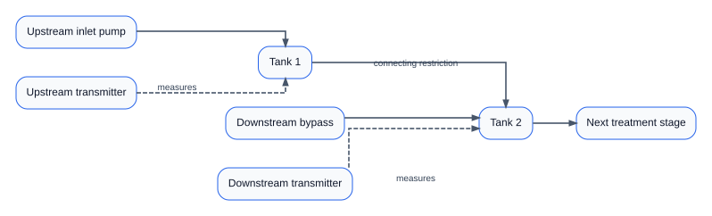
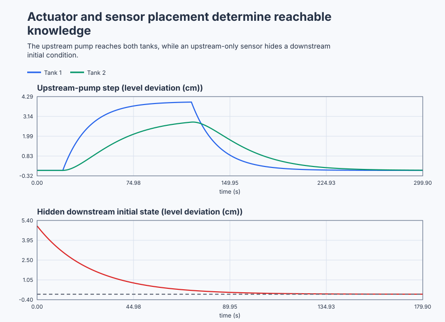

# Check two-tank actuator and sensor feasibility

Course position: Lesson 64 of 84. Prerequisite:
`control-distillation-robustness`. Next lesson:
`control-magnetic-bearing-state-feedback`.

**Equipment:** Interconnected water-treatment buffer tanks.

**Lesson objective:** Calculate and execute the reachable and visible state directions for normal and deliberately deficient pump/sensor layouts, then accept or reject each hardware layout before design.

## The problem

The equipment in this lesson is Interconnected water-treatment buffer tanks.

The equipment is a pilot water-treatment buffer with two interconnected vented tanks. Tank 1 receives normal inlet-pump flow and drains through a restriction into Tank 2. Tank 2 drains to the next treatment stage. Level deviations from the qualified operating point are measured in centimetres. Pump-flow changes are measured in litres per minute.

The normal actuator is an inlet pump into Tank 1. A maintenance bypass can inject flow directly into Tank 2, but cannot move water backward into Tank 1. The normal level transmitter measures Tank 2. A deliberately deficient alternative measures only Tank 1.

The local model loses 0.05 of Tank-1 deviation per second, transfers Tank-1 deviation into Tank 2 at 0.03 per second, and loses 0.04 of Tank-2 deviation per second. One litre per minute through either pump path changes the directly supplied tank's level rate by 0.20 centimetres per second. Flow is limited to -2 through +2 litres per minute, level deviation to -10 through +10 centimetres, and sampling is 0.1 seconds.

The simulator displays both true tank states so you can check the lesson's claims. These Simulation-only truth channels are not installed controller inputs. The selected sensor signal remains separate. A physical controller cannot use a truth channel unless that sensor actually exists.


The arrows explain the asymmetry: upstream liquid affects downstream level, but a downstream actuator or state cannot propagate backward through this model.

Lesson 63 showed that coupled directions and constraints can invalidate conclusions drawn from separate loops. State space makes internal directions explicit, but writing a model does not prove that installed actuators can move every direction or that installed sensors contain enough information to reconstruct every state.

If we design a controller or observer first, tuning mathematics can hide a hardware placement defect. This lesson checks feasibility before design.

## What we need

We need to know whether the installed pumps can move every important stored-water direction and whether the transmitters can reveal every state needed for control. Normal and deliberately deficient layouts must be accepted or rejected before controller design.

## The new idea

### State equations in physical words

A state is a minimum internal quantity needed to predict future plant behavior when future inputs are known. The state vector ($x$) contains the Tank 1 and Tank 2 level deviations, in centimetres. The input vector ($u$) contains the selected pump-flow change, in litres per minute. The measured-output vector ($y$) contains the selected level-transmitter reading, in centimetres.

The state matrix ($A$) describes the natural tank losses and the one-way transfer between tanks. The input matrix ($B$) describes how an installed actuator changes the state rates. The output matrix ($C$) describes how installed sensors form measurements from the states.

Only after those quantities are defined do we write:

$\dot{\mathbf{x}}=\mathbf{A}\mathbf{x}+\mathbf{B}u$

$\mathbf{y}=\mathbf{C}\mathbf{x}$

The first equation says that the present state and pump input determine how quickly both levels change. The second says which combination of true levels the installed transmitter reports.

### Controllability

The immediate pump-driven state direction is the first column, $B$. Natural tank dynamics transform that direction into a second column, `A*B`. The controllability matrix ($\mathcal{C}$) places both columns side by side:

$\mathcal{C}=\begin{bmatrix}\mathbf{B}&\mathbf{A}\mathbf{B}\end{bmatrix}$

Matrix rank is the number of independent directions contained in a matrix. A two-state plant is fully controllable when the controllability matrix has rank two. That means a suitable local input history can move both state components, subject to physical limits.

For the normal inlet pump, the upstream input matrix ($\mathbf{B}_{\mathrm{upstream}}$) and its controllability matrix are:

$\mathbf{B}_{\mathrm{upstream}}=\begin{bmatrix}0.20\\0\end{bmatrix}$

$\mathcal{C}_{\mathrm{upstream}} =\begin{bmatrix}0.20&-0.010\\0&0.006\end{bmatrix}$

Its determinant is 0.0012 and its rank is two. The pump moves Tank 1 immediately; hydraulic transfer later creates an independent Tank-2 direction.

For direct downstream injection, the bypass input matrix ($\mathbf{B}_{\mathrm{bypass}}$) gives:

$\mathbf{B}_{\mathrm{bypass}}=\begin{bmatrix}0\\0.20\end{bmatrix}$

$\mathcal{C}_{\mathrm{bypass}} =\begin{bmatrix}0&0\\0.20&-0.008\end{bmatrix}$

Its rank is one. The bypass moves Tank 2 but cannot move Tank 1.

### Observability

The immediate sensor information is the row $C$. Natural dynamics expose additional information in the measurement rate, represented by `C*A`. The observability matrix ($\mathcal{O}$) stacks those rows:

$\mathcal{O}=\begin{bmatrix}\mathbf{C}\\\mathbf{C}\mathbf{A}\end{bmatrix}$

A two-state plant is fully observable when this matrix has rank two. Known input and measurement history can then distinguish the two local initial states.

For the downstream transmitter, the downstream output matrix ($\mathbf{C}_{\mathrm{downstream}}$) and observability matrix are:

$\mathbf{C}_{\mathrm{downstream}}=\begin{bmatrix}0&1\end{bmatrix}$

$\mathcal{O}_{\mathrm{downstream}} =\begin{bmatrix}0&1\\0.03&-0.04\end{bmatrix}$

Its determinant is -0.03 and rank is two. An upstream deviation eventually changes the downstream measurement, so history contains information about both tanks.

For the upstream-only transmitter, the upstream output matrix ($\mathbf{C}_{\mathrm{upstream}}$) gives:

$\mathbf{C}_{\mathrm{upstream}}=\begin{bmatrix}1&0\end{bmatrix}$

$\mathcal{O}_{\mathrm{upstream}} =\begin{bmatrix}1&0\\-0.05&0\end{bmatrix}$

Its rank is one. A downstream-only deviation does not affect the upstream measurement in this one-way model.

### Modes and weaker feasibility properties

A mode is one independent natural pattern of state motion. An eigenvalue ($\lambda$) is that mode's exponential rate. A negative real eigenvalue decays; a positive real eigenvalue grows. The two tank eigenvalues are -0.05 and -0.04 per second, so both natural modes decay.

Stabilisability permits an uncontrollable mode only when that mode is already stable. Detectability permits an unobservable mode only when that mode is already stable. The deficient layouts are therefore stabilisable or detectable in this local model, but they are not fully controllable or observable. A stable missing direction remains a missing hardware capability.

## Prediction

Calculate all four matrices, determinants, ranks, condition numbers, and both eigenvalues before running the simulator.

For a +1-litre-per-minute upstream-pump step, predict Tank 1 initially rises at about 0.20 centimetres per second while Tank 2 has no immediate rate change. Tank 2 should respond later through the restriction. Route the same request to the downstream bypass and predict Tank 1 remains at zero while Tank 2 moves immediately.

Start with +5 centimetres in Tank 1 and measure downstream. Predict the downstream signal rises and later decays, revealing the upstream state through history. Start separately with +5 centimetres in Tank 2 and select the upstream sensor. Predict a zero measurement while the hidden Tank-2 truth state decays.

## Implementation

There is no feedback controller or observer in this lesson. The actual Structured Text only limits and routes a manual request, then selects the installed measurement:

```st
FlowApplied := LIMIT(LREAL#-2.0, FlowRequested, LREAL#2.0);
IF ActuatorLayout = 1 THEN
    BypassPumpApplied := FlowApplied;
ELSE
    UpstreamPumpApplied := FlowApplied;
END_IF;

IF SensorLayout = 1 THEN
    SelectedMeasurement := Tank1Truth;
ELSE
    SelectedMeasurement := Tank2Truth;
END_IF;
```

The program contains no PID instance, observer, matrix rank, eigenvalue, or accepted-layout answer. Control Studio calculates feasibility from the declared matrices and compares it with the executed plant.

## Experiment in Control Studio

This procedure tests one declared lesson change under controlled conditions. Qualify the upstream inlet pump and downstream level transmitter before design. The declared event lasts 300 seconds. It restores Requested pump-flow change to 0 L/min afterward. The deterministic Simulation seed is 20260829.

### Control Studio actions

1. **Monitor** — Start the **Simulator**, then open **truST sidebar → Control Studio → Monitor → Response**.
   - **Baseline check:** Wait until the header shows **Simulation**, **Running**, and current data. Confirm Selected level measurement (PV, cm); Requested pump-flow change (MV, L/min) and Applied selected flow (MV, L/min), including units, limits, mode, and quality. The initial operating point is Requested pump-flow change = 0 L/min, Applied upstream-pump flow = 0 L/min, Applied bypass-pump flow = 0 L/min, Selected level measurement = 0 cm, Simulation truth Tank-1 level deviation = 0 cm, Simulation truth Tank-2 level deviation = 0 cm. The unresolved baseline problem is: A downstream bypass cannot move Tank 1 and an upstream-only transmitter cannot reveal a downstream-only initial deviation. Control Studio Monitor must show Simulation mode, Manual authority, both actuator paths, and both sensor paths before feasibility is judged.
   - **Decision before action:** Read **Prediction** above, then state what should move first and in which direction. Use this decision rule: Accept full-state controller/observer design only for a layout whose independent matrices and executed movement/measurement evidence agree.
   - **Successful evidence:** The Response plot advances, the displayed values are finite and current, and **Start recording** is enabled. Select **Start recording** only after those conditions are visible.
   - **Recovery:** If recording is disabled or the plot reports unavailable or stale samples, stop the Simulator, correct the displayed runtime or binding problem, restart it, and repeat the baseline check.
   - **Record:** Write down the initial SP, PV, requested/applied MV where available, controller mode, and your predicted response before opening Test.

2. **Test** — Open **truST sidebar → Control Studio → Test**.
   - **Baseline check:** Set **Experiment** = **Manual output step**, **Amplitude** = **1 L/min**, and **Maximum duration (s)** = **300**. The affected signal is **Requested pump-flow change**; it starts at 0 L/min and must restore to 0 L/min.
   - **Decision before action:** Before selecting **Review test**, predict the response direction and confirm the requested change remains inside Requested pump-flow change -2 L/min to 2 L/min; Applied upstream-pump flow -2 L/min to 2 L/min; Applied bypass-pump flow -2 L/min to 2 L/min; Simulation truth Tank-1 level deviation -10 cm to 10 cm; Simulation truth Tank-2 level deviation -10 cm to 10 cm.
   - **Successful evidence:** Select **Review test**, verify the signal, requested bound, duration, restoration, and stop conditions, then select **Confirm and start**. The state changes to **Running**, **Abort test** remains available, and the terminal state confirms completion and restoration while Response shows the measured SP/PV/MV sequence.
   - **Recovery:** For a rejected, stale, unsafe, unavailable, failed, or aborted state, read the displayed reason, restore Requested pump-flow change to 0 L/min, wait for current data, and review a new test.
   - **Record:** Compare the response with your prediction and retain the terminal state, restoration result, and deterministic seed **20260829**.

3. **Identify** — After **Stop recording**, open **truST sidebar → Control Studio → Identify**.
   - **Baseline check:** Use **Qualify recording** to inspect sample count, duration, timing, excitation, and clipping. **Model selection**, **Fit estimation run**, and **Accept model for design** are the shared low-order model workflow; they do not replace the project-owned **Controllability, observability, stabilisability, and detectability** model and must not be accepted as this lesson's design authority.
   - **Decision before action:** Decide whether the recording contains the input/output change needed for **Controllability, observability, stabilisability, and detectability** before fitting anything.
   - **Successful evidence:** A qualified recording has current, finite, sufficiently excited data. Use the project-owned model described under **Implementation** and **Evidence and decision**, and record its assumptions, units, validity range, and rejection rule.
   - **Recovery:** If qualification reports stale, clipped, poorly excited, or insufficient data, return to Test and repeat the bounded experiment; never force or relabel a rejected fit.
   - **Record:** State which model is retained or rejected and why, explicitly identifying the runnable project as the model authority.

4. **Validate** — Open **truST sidebar → Control Studio → Validate**.
   - **Baseline check:** **Run required validation** is disabled because no shared Control.PID candidate exists. **Requirement details** and **Save result** cannot be used to claim a shared result; project-owned validation is executed by the runnable project's declared oracle.
   - **Decision before action:** Use the predeclared comparisons: upstream_layout_controllability_rank == 2 (dimensionless) (tolerance 0 (dimensionless)); downstream_sensor_observability_rank == 2 (dimensionless) (tolerance 0 (dimensionless)); upstream_pump_first_second_slope >= 0.18 cm/s (tolerance 0.001 cm/s); bypass_upstream_peak <= 0.001 cm (tolerance 0.0001 cm).
   - **Successful evidence:** Correlate the unrounded project-owned results with the named live signals and events in Monitor. Each applicable requirement must have a value, unit, limit, tolerance, evidence class, and Pass, Conditional pass, Fail, or Inconclusive disposition.
   - **Recovery:** If the project run aborts, becomes stale, fails, or violates restoration, discard that run and repeat the declared Test. Never present a disabled button or retained README table as newly executed evidence.
   - **Record:** State the validation disposition and name every failed or inconclusive requirement before continuing.

## Evidence and decision

### Measures and comparison

The first one-second state-rate slope is a least-squares level slope immediately after the pump event, in centimetres per second. The sample time after the event ($t_{i}$) is measured in seconds, and the sampled tank-level deviation ($h_{i}$) is measured in centimetres. The average sample time ($t_{\mathrm{mean}}$) and average sampled level ($h_{\mathrm{mean}}$) are calculated over the first second. The slope is then calculated as:

$\mathrm{slope} =\frac{\sum_i(t_i-\bar{t})(h_i-\bar{h})} {\sum_i(t_i-\bar{t})^2}$

Peak level deviation is the largest absolute sampled level during the pump event. First detectable response is the time after the pump event when a level first moves by at least 0.001 centimetres. Restoration error is the mean of $\left|Tank1Truth\right| + \left|Tank2Truth\right|$ over the final 10 seconds. Measurement-to-truth residual is the absolute difference between the selected sensor and its corresponding truth channel at the same sample time.

Retain each matrix, determinant, rank, condition number, eigenvalue, physical response, limit state, and validity result with its exact actuator and sensor layout. A rank calculation and a trace must agree before a hardware conclusion is accepted.

### Validation

The upstream-pump and downstream-sensor matrices must each have rank two and condition number no greater than 50. The upstream step must produce a first-second Tank-1 slope within 0.02 centimetres per second of 0.20, followed by a Tank-2 response. The bypass must keep Tank-1 peak below 0.001 centimetres while Tank 2 moves by at least 1 centimetre.

The downstream transmitter must respond by at least 0.10 centimetres to the Tank-1 initial state. The upstream transmitter must remain within 0.001 centimetres of zero during the Tank-2-only record while the hidden truth state starts above 4.9 centimetres. Every selected measurement must agree with its selected truth channel within 0.001 centimetres.

The shipped executable lesson produced this Simulation evidence:

| Record | Matrix result | Executed physical result | Final restoration error |
|---|---|---|---:|
| Upstream pump, downstream sensor | Controllability rank 2, condition 33.417; observability rank 2, condition 33.387 | Tank-1 slope 0.1951 cm/s; Tank 1 moved after 0.1 s and Tank 2 after 0.6 s; peaks 3.973 cm and 2.805 cm | 0.0123 cm |
| Downstream bypass | Controllability rank 1 | Tank-1 peak 0.000 cm; Tank-2 peak 4.908 cm | 0.0045 cm |
| Tank-1 initial state, downstream sensor | Observability rank 2 | Downstream sensor response 1.229 cm | Not applicable: zero-input decay record |
| Tank-2 initial state, upstream sensor | Observability rank 1 | Hidden Tank-2 initial state 5.000 cm; selected measurement peak 0.000 cm | Not applicable: zero-input decay record |

The maximum selected-measurement residual was 0.000 centimetres at the reported precision. Every applicable requirement passed. The table reports only simulation results; it does not establish physical pump or transmitter performance.

### Retained evidence



The figure connects the matrix ranks to physical behavior. The [trace CSV](figures/two-tank-feasibility-evidence-trace.csv) keeps every tank level, selected measurement, and applied pump flow. The [summary CSV](figures/two-tank-feasibility-evidence-summary.csv) retains the ranks, conditioning, response times, peaks, and restoration results used in the feasibility decision.

## Conclusion

The upstream pump creates one immediate Tank-1 direction. The restriction transforms it into a later Tank-2 direction, giving two independent columns in the controllability matrix. The downstream sensor sees Tank 2 immediately and Tank 1 through the downstream rate, giving two independent observability rows.

The bypass never moves Tank 1 because this model has no reverse hydraulic path. The upstream sensor never sees a downstream-only deviation for the same reason. Stable hidden or unreachable modes justify the words stabilisable or detectable; they do not justify a claim of complete authority or information.

## Reason for the next lesson

Check controllability and observability using the actual actuator and sensor placement before tuning feedback or an observer. Full rank is necessary but not sufficient: poor conditioning, uncertainty, noise, delay, saturation, or an incorrect hydraulic model can still make a layout impractical.

All results are Simulation evidence. A physical-tank experiment requires independently reviewed topology, calibrated pumps and level instruments, overflow and dry-run limits, isolation and restoration procedures, and explicit approval immediately before physical action.

Lesson 65 next uses a qualified actuator layout to place feedback poles and a qualified sensor/model layout to estimate an unmeasured motor state.
