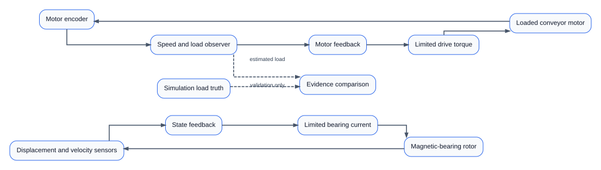
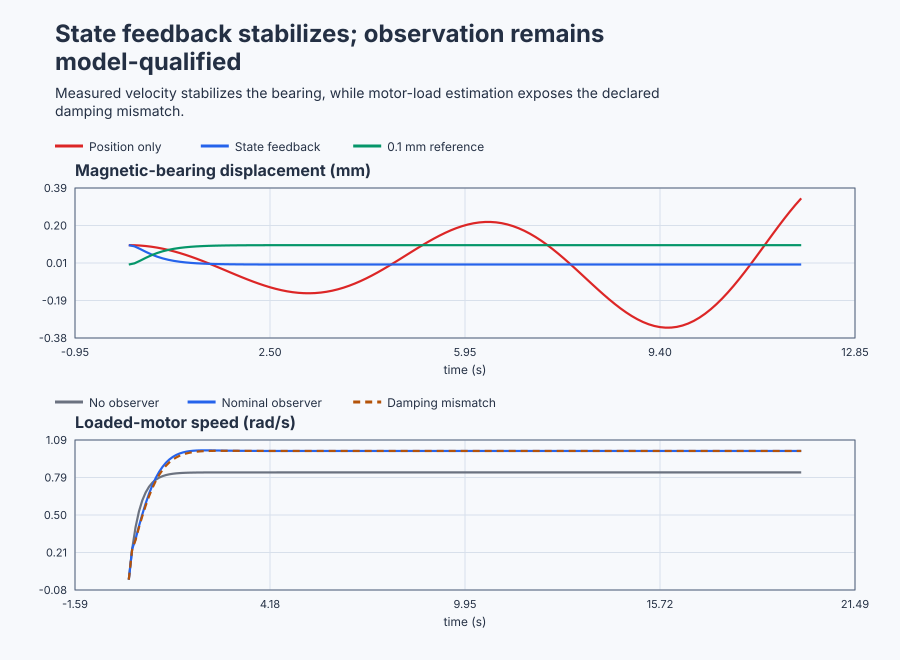

# Place bearing modes and observe motor load

Course position: Lesson 65 of 84. Previous lesson: [Check two-tank actuator and sensor feasibility](../64-two-tank-observability/README.md). Next lesson: [Qualify a weigh-feeder Kalman estimate](../66-weigh-feeder-kalman/README.md).

**Equipment:** Active magnetic-bearing training rig and loaded conveyor motor.

**Lesson objective:** Calculate and execute bearing feedback and motor observer gains, validate their modes and limits, and expose observer bias under declared plant-model mismatch.

**Evidence class:** Simulation evidence. The magnetic-bearing and motor benches are configured teaching models; this lesson does not qualify a physical bearing or motor.

## The problem

The equipment is the active magnetic-bearing training rig and loaded conveyor motor: two linked real-world benches. The active magnetic-bearing rig measures rotor displacement in millimetres and rotor velocity in millimetres per second. Its bidirectional actuator is coil-current deviation in amperes. The local model is valid only within -0.5 to +0.5 millimetres and -2 to +2 millimetres per second. Applied current is limited to -2 to +2 amperes.

The loaded conveyor motor measures shaft speed with an encoder in radians per second. Drive torque is measured in newton metres and limited to -3 to +3 newton metres. Physical load torque is not instrumented. The simulator exposes it as a **Simulation-only truth channel** so you can check the observer; the controller never reads that channel.

Both models run every 0.1 seconds. They omit coil electrical dynamics, nonlinear magnetic force, drive delay, shaft flexibility, nonlinear friction, and encoder quantisation. Zero coil current is the safe output but cannot levitate a physical rotor, so real equipment also needs independent touchdown bearings.


The first loop uses two measured states. The second uses one measured output and a model to reconstruct an unmeasured state.

Lesson 64 proved that installed actuators and sensors can move and reveal the required model directions. That does not choose the closed-loop dynamics.

Position-only feedback can change the magnetic bearing's stiffness, but it cannot independently choose displacement and velocity behavior. Measured velocity is therefore added to place both modes. The motor then creates the next limitation: its load state can be inferred from speed history but is not measured. Assuming zero load leaves a speed error, which creates the reason for an observer.

## What we need

We need feedback from the bearing's dynamic state and a separate estimate of conveyor speed and load where direct measurement is unavailable. Measured state, estimated state, limits, and model-mismatch bias must remain visibly distinct.

## The new idea

### Bearing state feedback

The rotor-displacement deviation ($x_b$) is measured in millimetres, rotor
velocity ($v_b$) in millimetres per second, and applied coil-current deviation
($u_b$) in amperes. Newton's law starts with rotor mass times acceleration equal
to the net magnetic force. Near the chosen centre point, a first-order Taylor
approximation separates that force into a displacement term and a coil-current
term. Dividing by rotor mass gives

$\dot x_b=v_b,$

$\dot v_b=a_bx_b+b_bu_b.$

The local magnetic acceleration coefficient ($a_b$) is measured in inverse
seconds squared. It is positive because a small displacement increases the
unbalanced force away from centre. The current-to-acceleration coefficient
($b_b$) is measured in millimetres per second squared per ampere. This scaled
training model configures $a_b=4\,\mathrm{s^{-2}}$ and
$b_b=1\,\mathrm{mm/(s^2 A)}$.

These are configured Simulation values, not measurements of a bearing. A real
design obtains initial values from rotor mass, pole geometry, air gap, bias
current, and electromagnetic force data; a guarded small-current test then
estimates the local slopes, and unused records validate them throughout the
declared gap and speed range. Coil dynamics, force curvature, eddy currents,
sensor dynamics, and structural modes omitted here would require additional
states or a narrower validity claim.

The bearing state vector ($\mathbf{x}_{\mathrm{b}}$) contains $x_b$ followed by
$v_b$. The bearing state matrix ($\mathbf{A}_{\mathrm{b}}$) collects the two
unforced coefficients, and the bearing input matrix
($\mathbf{B}_{\mathrm{b}}$) collects the current coefficient. Writing the two
derived equations in state order gives

$\mathbf{A}_b=\begin{bmatrix}0&1\\4&0\end{bmatrix}$

$\mathbf{B}_b=\begin{bmatrix}0\\1\end{bmatrix}.$

The first row says velocity changes displacement. The second says displacement
drives unstable acceleration and one ampere adds one millimetre per second
squared. This row-by-row interpretation is why the matrices have those entries.

The feedback-gain row ($\mathbf{K}_{\mathrm{b}}$) contains the displacement and
velocity weights used to oppose motion. Its displacement entry is measured in
amperes per millimetre and its velocity entry in ampere seconds per millimetre.
The reference gain ($N_b$), measured in amperes per millimetre, scales a
constant requested displacement so the model reaches that displacement at
equilibrium. The bearing reference ($r_b$) is the requested displacement in
millimetres. Only after defining these quantities do we write:

$u_{b,\mathrm{requested}}=N_b r_b-\mathbf{K}_b\mathbf{x}_b$

Applied bearing current is the requested value limited to -2 through +2 amperes.

The complex frequency variable ($s$) has unit inverse seconds, and the identity
matrix ($\mathbf I$) leaves a vector unchanged. The displacement-feedback gain
($k_x$) and velocity-feedback gain ($k_v$) are the two entries of
$\mathbf K_b$. To see how the gains are obtained, write

$\mathbf A_b-\mathbf B_b\mathbf K_b=\begin{bmatrix}0&1\\4-k_x&-k_v\end{bmatrix}$.

Its characteristic polynomial is the determinant of $s\mathbf I-(\mathbf A_b-\mathbf B_b\mathbf K_b)$:

$s^2+k_v s+(k_x-4)$.

This polynomial matters because its roots are the closed-loop modes. The
imaginary unit ($j$) satisfies $j^2=-1$. With position-only gain $k_x=5$ and
$k_v=0$, the polynomial becomes $s^{2}+1=0$. Its roots are $+j$ and $-j$:
neither has a negative real part, so the ideal response oscillates without
decaying. Desired poles at -3 and -4 per second instead require

$(s+3)(s+4)=s^2+7s+12$.

Matching like powers of $s$ gives $k_v=7$ and $k_x-4=12$, hence:

$\mathbf{K}_b=\begin{bmatrix}16&7\end{bmatrix}$

$N_b=12$

The reference gain follows from equilibrium rather than from pole placement. At a constant reference, velocity and acceleration are zero and we want $x=r_b$. Substituting $u=N_b r_b-16x$ into the acceleration equation $0=4x+u$ gives $0=(N_b-12)r_b$, so $N_b=12$.

From an initial +0.1-millimetre displacement at zero reference, the first requested current is $-16 \cdot 0.1 = -1.6 A$. From centred conditions with a +0.1-millimetre reference, it is $12 \cdot 0.1 = +1.2 A$. Both predictions are inside the current limit.

### Motor state observation

The shaft speed ($\omega_m$) is measured in radians per second. Applied drive
torque ($u_m$) and opposing load torque ($d_m$) are measured in newton metres.
Rotational inertia ($J_m$) is measured in kilogram square metres and viscous
damping ($c_m$) in newton metre seconds per radian. Newton's rotational balance
says inertia times angular acceleration equals drive torque minus damping torque
minus load torque:

$J_m\dot\omega_m=u_m-c_m\omega_m-d_m.$

The nominal record treats load torque as constant, so $\dot d_m=0$. Dividing
the balance by $J_m$ produces the speed row. The scaled training values make
$c_m/J_m=1\,\mathrm{s^{-1}}$ and convert both torque terms to speed rate with
unit numerical coefficients. On physical equipment, inertia begins with rotor
and load geometry, the drive torque scale comes from calibrated current-to-
torque data, damping is estimated from a coast-down or torque-step record, and
load constancy is checked over the intended observation window. Independent
records must then validate the model at the declared speeds and loads.

The motor state vector ($\mathbf{x}_{m}$) contains shaft speed followed by
opposing load torque. The measured motor output ($\mathbf{y}_{m}$) is encoder
speed. The motor state matrix ($\mathbf{A}_{m}$), input matrix
($\mathbf{B}_{m}$), and output matrix ($\mathbf{C}_{m}$) are therefore

$\mathbf{A}_m=\begin{bmatrix}-1&-1\\0&0\end{bmatrix}$

$\mathbf{B}_m=\begin{bmatrix}1\\0\end{bmatrix}$

$\mathbf{C}_m=\begin{bmatrix}1&0\end{bmatrix}$

The first matrix row is the divided torque balance: speed naturally decays,
positive load reduces acceleration, and drive torque increases acceleration.
The second row retains constant load, while the output row selects encoder
speed. The model omits changing load dynamics, nonlinear friction, shaft
flexibility, drive delay, and encoder quantisation; an observer cannot recover
effects absent from that model as uniquely identified physical truth.

The estimated state ($\hat{\mathbf{x}}$) is the observer's speed and load
prediction. Innovation ($\nu$) is measured encoder speed minus estimated speed.
Observer gain ($\mathbf L$) states how strongly that innovation corrects the
two state predictions. Its first entry has unit inverse seconds; its second has
the unit that converts speed innovation into load-torque change per second,
newton metres per radian. Applied motor torque ($u_{m,\mathrm{applied}}$) is the
torque that actually entered the plant. The observer is:

$\dot{\hat{\mathbf{x}}} =\mathbf{A}_m\hat{\mathbf{x}}+\mathbf{B}_m u_{m,\mathrm{applied}} +\mathbf{L}\nu$

$\nu=y_m-\mathbf{C}_m\hat{\mathbf{x}}$

The estimation-error vector ($\mathbf e$) is actual motor state minus estimated
motor state. Subtracting the observer equation from the plant equation cancels
the shared applied input. Because innovation equals measured-state error through
$\mathbf C_m$, the remaining error dynamics are
$\dot{\mathbf e}=(\mathbf A_m-\mathbf L\mathbf C_m)\mathbf e$. If the first and
second observer-gain entries are $l_1$ and $l_2$, so
$\mathbf L=[l_1,l_2]^T$, its characteristic polynomial is

$s^2+(1+l_1)s-l_2$.

The desired poles give $(s+4)(s+5)=s^2+9s+20$. Coefficient matching therefore gives $1+l_1=9$ and $-l_2=20$, or
$\mathbf{L}=\begin{bmatrix}8&-20\end{bmatrix}^{T}$. The load correction is negative because a positive physical load reduces speed; when measured speed falls below predicted speed, the observer must raise its positive load estimate. A continuous pole ($\lambda$), measured in inverse seconds, becomes a sampled pole ($z$), which is dimensionless. Forward Euler with the 0.1-second interval maps them by $z=1+0.1\lambda$, so -4 and -5 become 0.6 and 0.5. Their magnitudes are below one, which means the sampled estimation errors decay in the ideal model.

The motor reference ($r_m$) is desired speed, estimated speed
($\hat{\omega}$) is the observer's speed state, and estimated load ($\hat d$)
is its load state. The motor speed-feedback gain ($K_m$) and motor reference
gain ($N_m$) place the compensated motor loop the same way $\mathbf K_b$ and
$N_b$ placed the bearing: choose a desired closed-loop pole and match it. Only
after choosing that pole do we write the requested-torque law:

$u_{m,\mathrm{requested}} =N_m r_m-K_m\hat{\omega}+\hat{d}$

With a converged observer ($\hat\omega=\omega_m$, $\hat d=d_m$) and
unsaturated torque, substituting this law into $\dot\omega_m=u_m-\omega_m-d_m$
cancels the load terms and leaves $\dot\omega_m=-(K_m+1)\omega_m+N_m r_m$: a
single first-order pole at $s=-(K_m+1)$. Reusing the same $-3\,\mathrm{s^{-1}}$
pole already chosen for the bearing gives $K_m+1=3$, hence the motor
speed-feedback gain is 2 newton metres per unit of radians per second,
written $K_m=2\,\mathrm{N\,m/(rad/s)}$. At equilibrium the requested speed
must equal the reference ($\omega_m=r_m$), so $0=-(K_m+1)r_m+N_m r_m$ gives
the motor reference gain $N_m=K_m+1=3\,\mathrm{N\,m/(rad/s)}$.

At equilibrium the motor equation is $0=-\omega-d+u$. With $r_m=1$, real load $d=0.5$, and a controller that assumes $\hat d=0$, substitution of $u=3-2\omega$ gives $0=2.5-3\omega$, hence $\omega=0.8333$ radians per second. With a converged nominal observer, $\hat d=d=0.5$; the load terms cancel and $0=3-3\omega$, hence $\omega=1.0000$ radians per second. If real damping is 1.2 while the observer models 1.0, the missing damping at $\omega\approx1$ looks like another $0.2$ newton metres of opposing load. The observer can therefore estimate about 0.7 while the physical load remains 0.5.

The separation principle says feedback and observer-error poles can be selected separately for an exact linear model without active limits. It does not prove robustness, state truth, noise performance, or saturated behavior.

## Prediction

Before running, calculate the position-only poles, $\mathbf K_{\mathrm{b}}$,
$N_{\mathrm{b}}$, $\mathbf L$, $K_m$, $N_m$, both continuous and discrete
observer-error poles, and both motor equilibria.

Predict that position-only bearing feedback is **Not settled**, while state feedback restores the initial displacement and tracks the reference. Predict that nominal load estimation removes the motor bias. For a motor whose real damping is 1.2 while the observer retains 1.0, predict good speed regulation but a load estimate about 0.2 newton metres above physical load near 1 radian per second.

## Implementation

The shipped Structured Text calculates both designs directly:

```st
BearingCurrentRequested := LREAL#12.0 * BearingSetpoint
    - LREAL#16.0 * BearingDisplacement
    - LREAL#7.0 * BearingVelocity;
BearingCurrentApplied := LIMIT(LREAL#-2.0, BearingCurrentRequested, LREAL#2.0);

MotorInnovation := MotorSpeed - EstimatedMotorSpeed;
EstimatedMotorSpeed := EstimatedMotorSpeed + LREAL#0.1 * (
    -EstimatedMotorSpeed - EstimatedLoadTorque + PreviousMotorTorque
    + LREAL#8.0 * MotorInnovation
);
EstimatedLoadTorque := EstimatedLoadTorque
    + LREAL#0.1 * (LREAL#-20.0 * MotorInnovation);
MotorTorqueRequested := LREAL#3.0 * MotorSetpoint
    - LREAL#2.0 * EstimatedMotorSpeed + EstimatedLoadTorque;
MotorTorqueApplied := LIMIT(LREAL#-3.0, MotorTorqueRequested, LREAL#3.0);
```

The observer uses torque applied during the preceding scan because that input produced the newly measured motor state. The program contains no pole calculator, settling verdict, accepted-design label, PID instance, or use of `MotorLoadTruth` in its calculations.

## Experiment in Control Studio

This procedure observes the nominal design without asking Control Studio to synthesize the state changes. The project owns the complete sequence: it regulates the initial +0.1-millimetre bearing displacement, tracks a +0.1-millimetre reference, returns that reference to zero, and regulates the loaded motor with the nominal observer. Removing authority disables both actuators, requests zero current and torque, and clears the observer state. The deterministic Simulation seed is 20260829. The position-only, zero-load-assumption, and damping-mismatch comparisons are separate native test records; they are not hidden Control Studio stages.

### Control Studio actions

1. **Monitor** — Select target **Simulator**, choose **Run**, then open **Control Studio → Monitor → Response**.
   - **Baseline check:** Wait until the header shows **Simulation**, **Running**, and current data. Confirm Bearing displacement reference (SP, mm) and Motor speed reference (SP, rad/s); Bearing displacement (PV, mm) and Measured motor speed (PV, rad/s); requested and applied bearing current; requested and applied motor torque; estimated speed and load; innovation; and the separately labelled Simulation-truth load. Confirm their units, limits, mode, and quality. Before authority is granted, both controllers are disabled and both applied outputs are zero.
   - **Decision before action:** Read **Prediction** above, then state what should move first and in which direction. Use this decision rule: Accept the nominal gains only after executed mode, estimation, limit, and mismatch evidence agrees with the reviewed model, because a smooth trace alone cannot distinguish a correctly placed pole from a coincidentally similar-looking but wrong one.
   - **Successful evidence:** The Response plot advances, the displayed values are finite and current, and **Start recording** is enabled. Select **Start recording** only after those conditions are visible.
   - **Recovery:** If recording is disabled or the plot reports unavailable or stale samples, stop the Simulator, correct the displayed runtime or binding problem, restart it, and repeat the baseline check.
   - **Record:** Write down the initial measured and estimated states, the Simulation-truth label, both requested/applied outputs, controller mode, and your predicted response before opening Test.

2. **Test** — Open **truST sidebar → Control Studio → Test**.
   - **Baseline check:** Confirm **Experiment** = **Observe without excitation**, **Amplitude** = **0** (disabled), and **Maximum duration (s)** = **200.1**. The reviewed authority is **Experiment authority** (`P1.ExperimentEnabled`). The project, not the generic experiment generator, owns every reference change.
   - **Decision before action:** Before selecting **Review test**, predict four visible intervals: bearing regulation at zero reference, +0.1-millimetre reference tracking after 80 seconds, return to zero after 160 seconds, and motor regulation at 1 radian per second throughout. Confirm all predicted values remain inside the reviewed displacement, velocity, current, speed, and torque limits, because a prediction that already violates a declared limit signals a modelling or gain error before any current reaches the rig.
   - **Successful evidence:** Select **Review test**, verify the signal, requested bound, duration, restoration, and stop conditions, then select **Confirm and start**. The state changes to **Running**, **Abort test** remains available, and the terminal state confirms completion and restoration while Response shows the measured bearing displacement and velocity, motor speed, estimated motor state, and requested/applied current and torque sequence.
   - **Recovery:** For a rejected, stale, unsafe, unavailable, failed, or aborted state, read the displayed reason, remove experiment authority, verify zero applied current and torque and zero references, wait for current data, and review a new test.
   - **Record:** Stop recording only after Test reports restoration. Compare each interval with the derivations
     above, distinguish estimate from truth, and retain the terminal state, restoration result, and
     deterministic seed **20260829**. Use the native test evidence below for the alternative
     architectures and mismatch case; do not claim that this one visible run executed them. The
     inherited limitation under test is: Position-only bearing feedback does not settle, and a motor controller that assumes zero load retains speed error. The decision this run supports is:
     Accept the nominal gains only after executed mode, estimation, limit, and mismatch evidence agrees with the reviewed model.
## Evidence and decision

Bearing settling time is the first time after which absolute displacement error is at most 0.002 millimetres and absolute velocity is at most 0.005 millimetres per second for two continuous seconds. A response that never meets both conditions is **Not settled**. Final bearing error is the mean absolute displacement error over the final two seconds and is reported only for a settled record.

Motor final speed error is the final five-second mean absolute difference between reference and encoder speed. Nominal load-estimation error is the final five-second mean absolute difference between estimated load and Simulation truth. Estimation settling time requires speed-estimation error at most 0.01 radians per second and load-estimation error at most 0.02 newton metres for two continuous seconds.

For each record also retain peak displacement or speed, peak innovation, peak requested and applied output, time at the applied limit, and cumulative applied-output movement calculated as the sum of absolute changes between consecutive samples.

The position-only bearing record must be **Not settled**. State-feedback regulation and reference tracking must settle within 4 seconds, finish within 0.002 millimetres, and avoid sustained current limiting.

The zero-load motor baseline must retain at least 0.10 radians per second final speed error. The nominal observer must settle its estimates within 3 seconds, finish within 0.02 radians per second speed error and 0.02 newton metres load error, and avoid sustained torque limiting. The damping-mismatch record must remain bounded while retaining at least 0.10 newton metres load-estimation error.

The shipped executable lesson produced this Simulation evidence:

| Record | Eligibility and response | Final error | Applied-output evidence |
|---|---|---:|---:|
| Bearing, position only | Not settled | Not valid for a steady-state metric | Bounded inside the declared local range |
| Bearing, state regulation | Settled in 1.70 s; peak displacement 0.1000 mm | 0.00000 mm | Peak 1.6000 A; cumulative movement 1.7298 A |
| Bearing, +0.1 mm reference | Settled in 1.70 s | 0.00000 mm | No sustained limiting |
| Motor, zero-load assumption | Valid bounded baseline | 0.1667 rad/s speed error | Inside -3..+3 N m |
| Motor, nominal observer | Estimates settled in 2.00 s | 0.0000 rad/s speed error; 0.0000 N m load error | Peak 3.0000 N m; cumulative movement 2.2239 N m |
| Motor, damping mismatch | Bounded output regulation | 0.0000 rad/s speed error; 0.2000 N m physical-load error | Same reviewed torque limit |

The nominal innovation peak was 0.2379 radians per second. The mismatch row is intentionally not accepted as physical load measurement: its good speed result and wrong load estimate are the lesson's required warning.

The comparison table is populated only from the shipped executable records. Simulation evidence must never be presented as physical-bearing, motor, encoder, or load-torque evidence.

### Retained evidence



The figure shows the two decisions made in this lesson: full-state feedback stabilizes the bearing, and the observer improves load rejection only inside its model qualification. The [trace CSV](figures/magnetic-bearing-state-feedback-evidence-trace.csv) retains measured states, estimates, innovation, and requested/applied commands. The [summary CSV](figures/magnetic-bearing-state-feedback-evidence-summary.csv) records settling, error, effort, and mismatch results.

## Conclusion

Velocity feedback changes the damping term of the bearing polynomial, which is why position gain alone cannot place both modes. The motor innovation corrects both estimated speed and estimated load; its negative load-gain sign follows the physical convention that positive load reduces speed.

With the nominal model, the observer error follows the selected -4 and -5 modes. With extra real damping, the encoder cannot distinguish that missing damping from extra opposing load inside the observer's simpler model. Speed can still regulate while the reported load is wrong. The observer reconstructs model states, not truth, and its output is not a sensor.

## Reason for the next lesson

Use state feedback only after actuator and state feasibility are qualified. Use an observer only after observability, model validity, discretisation, limits, noise, and mismatch have been checked. A successful output trace does not prove an estimated physical quantity is accurate.

All results here are Simulation evidence. A physical magnetic-bearing or motor experiment needs independently reviewed topology, calibrated scaling, mechanical containment, current and overspeed protection, explicit approval immediately before action, and verified abort and restoration.

Lesson 66 introduces the Kalman filter because a deterministic observer does not express how process uncertainty and sensor uncertainty should be balanced.
