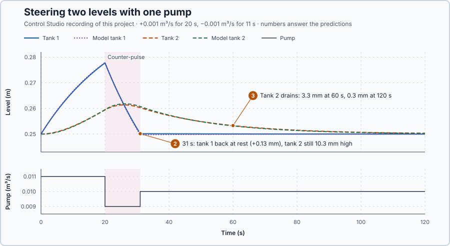

# 75. Controllability

In this lesson, you will test whether one pump can move both tank levels to a chosen state, steer the tanks there with two pump pulses, and see why they cannot stay there.

## The problem

Lesson 74's model followed both tank levels within 0.57 mm. It also showed that the one pump reaches tank 2 only through tank 1: after 20 s of raised flow, tank 2 kept rising for 17 s after the pump returned. Can that one pump still set both levels as we choose, for example bring tank 1 back to rest while tank 2 stays raised?

We will test the model for that ability and then steer the tanks with two pump pulses.

## What we need

We need to:

1. tell from the model whether one input can move both levels;
2. find a pump sequence that does it; and
3. tell reaching a state apart from holding it.

## The new idea

A system is **controllable** when its inputs can move every store to any value over time. One pump can steer both tanks, because the first tank feeds the second.

**In words.** Controllable does not mean that an input reaches every store directly. The pump puts water only into tank 1, yet it acts in two ways:

1. **Directly.** Raising the pump fills tank 1; tank 2 does not change at that moment.
2. **Through the process.** The extra water in tank 1 then flows on into tank 2: tank 1 loses what tank 2 gains.

The two effects move the levels in different directions: the first raises tank 1 alone, the second shifts water from tank 1 to tank 2. Mixing them over time, raising the pump at some moments and lowering it at others, moves the two levels to any nearby pair, even one that no constant pump flow gives, such as tank 1 at rest with tank 2 raised. It is like parking a car: the car cannot move sideways, yet forward and backward moves with the wheels turned bring it sideways into the space. If both effects moved the levels the same way, for example if tank 1 drained to the floor instead of into tank 2, no pump sequence could ever change tank 2.

Controllability is about moving the states, not holding them: a pair of levels the pump can reach for a moment need not be one the tanks can stay at.

**The formula.** For a model $\dot x = Ax + Bu$ with $n$ states, put the input's direct effect and the effects the process passes on side by side:

$$
\mathcal C = [B,\ AB,\ \ldots,\ A^{n-1}B].
$$

The model is controllable when $\mathcal C$ has rank $n$.

- $n$ is the number of states;
- $B$ is the input's direct effect: the rate each state gets from one unit of input;
- $AB$ is the effect passed on: the rates the process itself produces once the input has pushed the states along $B$; $A^2B$ passes it on once more, and so on up to $A^{n-1}B$;
- $\mathcal C$ is the **controllability matrix**, with these $n$ columns for each input;
- the **rank** of a matrix is the number of its columns that are **independent**: not obtainable by multiplying the other columns by numbers and adding them. For a square matrix, rank $n$ is the same as a determinant that is not zero (lesson 70).

**Example: the two tanks.** Lesson 74's model has $n = 2$, $A = \begin{bmatrix}-0.04&0\\0.04&-0.04\end{bmatrix}$ and $B = \begin{bmatrix}2\\0\end{bmatrix}$; $x_1$ and $x_2$ are the levels' deviations from 0.25 m, in metres, and $v$ is the pump's deviation from 0.010 m³/s, in cubic metres per second.

Follow the test:

1. Direct effect: $B = [2, 0]^T$. Raising the pump by 0.001 m³/s gives the rates $0.001\,B = [0.002, 0]^T$ m/s: tank 1 rises 2 mm per second, tank 2 not at all.
2. Passed on: $AB = \begin{bmatrix}-0.04&0\\0.04&-0.04\end{bmatrix}\begin{bmatrix}2\\0\end{bmatrix} = \begin{bmatrix}-0.08\\0.08\end{bmatrix}$. After one second of that raised flow tank 1 holds 2 mm extra, $x = [0.002, 0]^T$, and the process produces the rates $Ax = [-0.00008, +0.00008]^T$ m/s: tank 1 loses 0.08 mm per second and tank 2 gains it. Water moves from tank 1 to tank 2.
3. Side by side: $\mathcal C = [B,\ AB] = \begin{bmatrix}2&-0.08\\0&0.08\end{bmatrix}$. Neither column is a multiple of the other, and the determinant is $2 \cdot 0.08 - (-0.08) \cdot 0 = 0.16$, not zero: the rank is 2, the number of states. The model is controllable.

The rank says that some pump sequence exists; the model also finds one. To bring tank 1 back to rest with tank 2 raised, raise the pump by $a$ for a time $t_1$, then lower it by $a$ for a time $t_2$ that empties tank 1 again. Let:

- $a$ be the pulse size, in cubic metres per second; and
- $t_1$ and $t_2$ be the times of raised and lowered flow, in seconds.

Each pump setting drives tank 1 towards its own steady level, $2a/0.04 = 50a$ above or below rest, with the time constant $1/0.04 = 25$ s. Follow a short plan:

4. Raised flow: $x_1 = 50a\,(1 - e^{-0.04t})$. With $a = 0.001$ m³/s and $t_1 = 10$ s, $x_1 = 0.05\,(1 - e^{-0.4}) = 0.05 \cdot 0.330 = 0.0165$ m: tank 1 stands 16.5 mm high.
5. Lowered flow: tank 1 now heads for $-50a = -0.05$ m, starting from 0.0165 m, so, with $t$ counted from the start of the lowered flow, $x_1 = -0.05 + (0.0165 + 0.05)\,e^{-0.04t}$. It reaches zero when $e^{-0.04t_2} = 0.05/0.0665$, that is $t_2 = 25 \ln(0.0665/0.05) = 25 \cdot 0.285 = 7.1$ s.
6. Meanwhile tank 2 received the water that tank 1 passed on: the model puts it 4.2 mm above rest at that moment (calculated). Tank 1 is at rest and tank 2 is raised: one pump has moved the two levels apart.

**The limitation.** The pair is reached, not held. Tank 2 is steady only when $\dot x_2 = 0.04\,(x_1 - x_2) = 0$, that is when $x_1 = x_2$, whatever the pump does: every constant pump flow settles both tanks at the same level. Once the pump returns to 0.010 m³/s, tank 1 stays at rest and tank 2 drains, $\dot x_2 = -0.04\,x_2$. The rank also concerns only the local model: it does not lift the pump's 0–0.020 m³/s range, and a faster move needs larger flows. The ±0.001 m³/s pulses are a teaching choice that keeps the levels near 0.25 m, where the model holds.

## Prediction

Before running, answer these questions:

1. The experiment raises the pump by 0.001 m³/s for 20 s. How high is tank 1 when the lowered flow starts?
2. How long must the lowered flow last to bring tank 1 back to rest, and where is tank 2 then: above, at or below rest?
3. What does tank 2 do after the pump returns to 0.010 m³/s, and how high is it 60 s and 120 s after the step?

| From the model | Value |
| --- | ---: |
| Tank 1 after 20 s of raised flow | 27.5 mm above rest |
| Lowered flow | 10.97 s, so 11 updates |
| Tank 2 at 31 s | 10.3 mm above rest |
| Tank 2 at 60 s and 120 s | 3.2 mm and 0.3 mm |

## Implementation

Open [`src/Main.st`](src/Main.st). The rig has Lesson 74's cascade with `CascadeModel` beside it. In the experiment the pump runs 0.011 m³/s for 20 s and 0.009 m³/s for 11 s, then 0.010 m³/s. `SteeringFlowDeviationM3PerS` holds this pulse pair. A wrong clock interval or a level outside 0.05–0.45 m latches zero flow.

**Exercise.** Find `CounterPulseSeconds` and check its result by hand: $t_2 = 25\ln\frac{0.02753 + 0.05}{0.05} = 25 \cdot 0.4387 = 10.97$ s. Then run [`src/tests.st`](src/tests.st) from the **Testing** view; it checks the counter-pulse, the pulse pair and the model's state after it.

## Experiment in Control Studio

1. Open this lesson's project and start **Simulator**. Both tanks rest at 0.25 m with 0.010 m³/s. In the **truST** side bar, select **Control Studio**.
2. On **Identify**, choose **Supplied plant model** from **Method** and open `provided-model.json`.
3. On **Tune**, choose **Controllability and observability** and press **Calculate state structure**. Read the rank line, then open **Calculation details**: each matrix lists its rows in the declared order, tank 1 first.
4. On **Identify**, choose **Project experiment**. **Signals** shows `P1.Tank2M · Process value (m)` and `P1.PumpM3PerS · Applied output (m3/s)`; add `P1.Tank1M · state (m)`, `P1.Model1M · state (m)` and `P1.Model2M · state (m)`.
5. Answer the predictions, select **Review project test** and check the declared **123 s**.
6. Select **Confirm and start**. The pump steps at the program's next one-second update, about 2 s later; times below count from that step.
7. After the run, hover 20 s, 31 s, 60 s and 120 s after the step.
8. At completion Control Studio shows **Project test completed. Outputs restored.**

Select **Abort test** to stop early; to repeat, restart **Simulator** so both tanks start at rest.

## Evidence and decision

The numbered marks answer predictions 2 and 3; the table answers prediction 1. **Controllability and observability** confirms the rank test of The new idea: **Controllability rank 2 of 2**, with **Controllability [B, AB, …]** = [2, −0.08]; [0, 0.08]. The tool also reports the observability rank, which the next lesson explains.

From Control Studio's recording, times after the pump step:

| After the step | Pump | Tank 1 | Tank 2 | Model tank 1 / tank 2 |
| --- | ---: | ---: | ---: | ---: |
| 20 s | 0.011 → 0.009 m³/s | 0.2777 m | 0.2594 m | 0.2779 / 0.2595 m |
| 31 s | 0.009 → 0.010 m³/s | 0.2501 m | 0.2603 m | 0.2497 / 0.2608 m |
| 60 s | 0.010 m³/s | 0.2500 m | 0.2533 m | 0.2499 / 0.2532 m |
| 120 s | 0.010 m³/s | 0.2500 m | 0.2503 m | 0.2500 / 0.2503 m |

1. At 20 s tank 1 stood 27.7 mm above rest: 27.5 mm by the formula, 27.9 mm in the program's one-second model.
2. The 11 s counter-pulse brought tank 1 back within 0.13 mm of rest while tank 2 stood 10.3 mm above it: one pump moved the two levels apart. Tank 2 peaked at 0.2614 m at 26 s, when tank 1 had fallen to its level.
3. From 31 s tank 2 drained, 3.3 mm at 60 s and 0.3 mm at 120 s, while tank 1 stayed at rest: the state was reached, not held. `CascadeModel` followed both levels within 0.47 mm.

The rank cost one small calculation and told in advance that the steering could work; the model then timed it. The steering had a price: the counter-pulse was timed from tank 1's level, so it needed the whole state. Controllability is accepted for transient steering of this cascade around 0.25 m within the pump's range; it says nothing about holding unequal levels. These are simulation results.

## Conclusion

One input can move every state when its direct effect $B$ and the effects the dynamics pass on, $AB$ and beyond, point in independent directions: the controllability matrix has full rank.

Here one pump reached unequal levels that no constant flow can hold: controllability concerns moving the state, not holding it.

## Check yourself

1. **If the tanks were not connected, $A = \begin{bmatrix}-0.04&0\\0&-0.04\end{bmatrix}$ with the same $B$, what would $[B, AB]$ and its rank be?**
   $AB = [-0.08, 0]^T$, so $[B, AB] = \begin{bmatrix}2&-0.08\\0&0\end{bmatrix}$ with rank 1: the pump could never move
   tank 2.
2. **Why can no constant pump flow hold tank 1 at rest and tank 2 raised?**
   Tank 2 is steady only when its inflow equals its outflow, which needs equal levels; any constant flow settles both
   levels at the same height.
3. **With a pulse of $a = 0.002$ m³/s for 20 s, how far does tank 1 rise?**
   $x_1 = 50 \cdot 0.002(1 - e^{-0.8}) = 0.1 \cdot 0.551 = 0.055$ m.

## Reason for the next lesson

The counter-pulse was timed from tank 1's level, which this rig measures; the real installation measures only tank 2. Being able to steer the states does not mean the sensor tells us what they are.

[Observability](../67-observability/README.md) asks whether tank 2's readings reveal tank 1's level.
