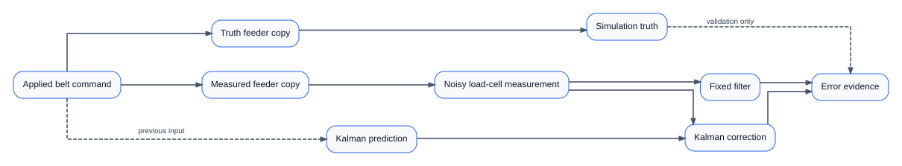
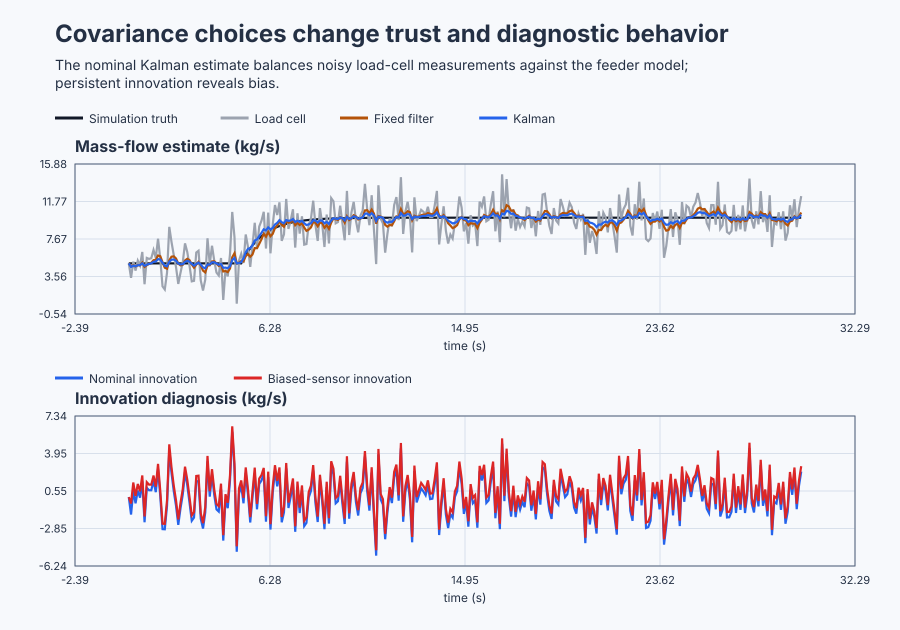

# Qualify a weigh-feeder Kalman estimate

Course position: Lesson 66 of 84. Prerequisite:
`control-magnetic-bearing-state-feedback`. Next lesson: `control-suspension-lqr`.

**Equipment:** Dry-material weigh-belt feeder with noisy load cell.

**Lesson objective:** Compare fixed, nominal Kalman, sensor-overtrust, sensor-distrust, biased-sensor, and invalid-covariance cases against synchronized Simulation truth.

## The problem

The equipment in this lesson is Dry-material weigh-belt feeder with noisy load cell.

The equipment is a dry-material weigh-belt feeder. Belt-speed command is measured in percent, and mass flow is measured in kilograms per second. The local feeder gain is one kilogram per second for each percent of belt command, and its time constant is one second. Command and mass-flow truth are limited to 0 through 20 in their respective units.

Two equivalent simulated feeders receive the same applied belt command. One publishes noise-free mass flow as **Simulation-only truth**. The second represents the load-cell measurement and adds deterministic approximate-white noise with zero mean and standard deviation 1.73205 kilograms per second. A separate fault case adds a 1.0-kilogram-per-second sensor bias. Both estimators read the same noisy measurement; neither reads truth.


The models omit transport delay, load-cell dynamics, impacts, slip, changing material density, colored noise, and outliers. The approximate-white generator is a repeatable teaching source, not proof that physical noise is Gaussian.

Lesson 65 used a deterministic observer. Its gain did not say how much uncertainty belongs to model prediction and how much belongs to the sensor. On a weigh belt, accepting every load-cell fluctuation makes the estimate move unnecessarily, while excessive model trust delays recognition of a real material-flow change.

Kalman covariance gives those assumptions numerical meaning. Innovation lets us check whether the measurement surprises are consistent with them.

## What we need

We need an estimate that combines the feeder model with noisy load-cell data according to declared uncertainty instead of choosing whichever trace looks smoothest. Innovation and truth-error evidence must reveal overtrust, distrust, sensor bias, and invalid covariance.

## The new idea

A random variable is a quantity whose next value is not known exactly before observation. Mean is the expected centre of repeated values. Variance is the expected squared departure from that mean. Covariance is joint uncertainty between states; this lesson has one state, so its covariance is one nonnegative variance. Standard deviation is the square root of variance, so $1.73205^{2}$ is approximately `3`.

The previous corrected mass-flow estimate ($x_{\mathrm{post\,previous}}$) is the last estimate after measurement correction. Its corrected covariance ($P_{\mathrm{post\,previous}}$) is the declared squared uncertainty. The previous applied belt command ($u_{\mathrm{previous}}$) is the input that produced the newly measured state.

The discrete feeder coefficient ($a$) is $\exp\left(-0.1/1\right) = 0.9048374180$. The command coefficient ($b$) is $1-a = 0.0951625820$. Process-noise variance ($Q$) represents unmodelled process uncertainty added per sample. Prediction means moving the prior state and its uncertainty through the feeder model:

$\hat{x}_{k\mid k-1}=a\hat{x}_{k-1\mid k-1}+b u_{k-1}$

$P_{k\mid k-1}=a^{2}P_{k-1\mid k-1}+Q$

The load-cell measurement ($z$) is noisy observed mass flow. Measurement-noise variance ($R$) is the assumed variance of measurement error. Innovation ($\nu$) is measurement minus predicted estimate. Innovation variance ($S$) describes the expected uncertainty of that difference. Kalman gain ($K$) is the fraction of innovation accepted during correction:

$\nu_k=z_k-\hat{x}_{k\mid k-1}$

$S_k=P_{k\mid k-1}+R$

$K_k=\frac{P_{k\mid k-1}}{S_k}$

$\hat{x}_{k\mid k}=\hat{x}_{k\mid k-1}+K_k\nu_k$

$P_{k\mid k}=(1-K_k)P_{k\mid k-1}$

Normalized innovation squared ($NIS$) is $\nu^{2}/S$. For an exact scalar model with independent zero-mean Gaussian uncertainty, its long-record mean is expected near one. Persistent innovation mean, excessive normalized innovation, or correlated successive innovations warns that the model or noise assumptions are inconsistent. This short deterministic lesson uses engineering bands; it is not a universal statistical proof.

The fixed-filter coefficient ($\alpha$) is 0.2. Its update has no model input or covariance:

$\hat{x}_{\mathrm{simple},k}=\hat{x}_{\mathrm{simple},k-1} +\alpha\left(z_k-\hat{x}_{\mathrm{simple},k-1}\right)$

With previous covariance 1.9, process-noise variance 0.1, and measurement-noise variance 3, the first calculation is $P_{\mathrm{prior}}=1.65559$, $K=0.35561$, and $P_{\mathrm{post}}=1.06684$. For a 5-kilogram-per-second innovation, the Kalman correction is 1.77807 kilograms per second. The fixed-filter correction is 1.00000 kilogram per second.

## Prediction

Reducing measurement-noise variance to $R=0.25$ creates sensor-overtrust: gain and estimate movement should increase. Increasing it to $R=12$ creates sensor-distrust: gain should fall and response should be no faster. Increasing Q increases gain because model prediction is declared less certain.

With a 1-kilogram-per-second bias missing from the model, predict persistent innovation inconsistency and an estimate biased away from truth. A Kalman filter that has no bias state cannot invent a bias state.

## Implementation

The shipped Structured Text performs prediction, checks covariance validity before division, then corrects:

```st
PredictedEstimate := LREAL#0.9048374180359595 * Estimate
    + LREAL#0.0951625819640405 * PreviousBeltCommand;
PredictedCovariance := LREAL#0.818730753077982 * Covariance
    + ProcessNoiseVariance;
Innovation := MassFlowMeasurement - PredictedEstimate;
InnovationVariance := PredictedCovariance + MeasurementNoiseVariance;
KalmanGain := PredictedCovariance / InnovationVariance;
Estimate := PredictedEstimate + KalmanGain * Innovation;
Covariance := (LREAL#1.0 - KalmanGain) * PredictedCovariance;
NormalizedInnovationSquared := Innovation * Innovation / InnovationVariance;
```

Requested and applied belt command are separate. The applied command is limited to 0 through 20 percent. Mass-flow truth is labelled **Simulation-only** and appears only as the diagnostic binding `MassFlowTruth`, never in an estimator calculation. If Q is negative, R is nonpositive, covariance is invalid, or innovation variance is nonpositive, `EstimatorValid` becomes false before division and the selected estimate falls back to the finite fixed filter.

## Experiment in Control Studio

This procedure tests one declared lesson change under controlled conditions. Apply the exact discrete feeder prediction and nominal Q=0.1, R=3 Kalman correction to the same samples. The declared event lasts 30 seconds. It restores Requested belt-speed command to 0 % afterward. The deterministic Simulation seed is 20260829.

### Control Studio actions

1. **Monitor** — Start the **Simulator**, then open **truST sidebar → Control Studio → Monitor → Response**.
   - **Baseline check:** Wait until the header shows **Simulation**, **Running**, and current data. Confirm Load-cell mass-flow measurement (PV, kg/s); Requested belt-speed command (MV, %) and Applied belt-speed command (MV, %), including units, limits, mode, and quality. The initial operating point is Requested belt-speed command = 5 %, Applied belt-speed command = 5 %, Simulation truth mass flow = 5 kg/s, Selected mass-flow estimate = 5 kg/s. The unresolved baseline problem is: A fixed smoothing coefficient cannot express separate model and sensor uncertainty or produce model-consistency diagnostics. Use Control Studio Monitor to establish the innovation record, then use Identify before Test so uncertainty choices precede the comparison.
   - **Decision before action:** Read **Prediction** above, then state what should move first and in which direction. Use this decision rule: Accept covariance settings only when truth-error, response, movement, innovation and fault evidence agree with the declared model and noise assumptions.
   - **Successful evidence:** The Response plot advances, the displayed values are finite and current, and **Start recording** is enabled. Select **Start recording** only after those conditions are visible.
   - **Recovery:** If recording is disabled or the plot reports unavailable or stale samples, stop the Simulator, correct the displayed runtime or binding problem, restart it, and repeat the baseline check.
   - **Record:** Write down the initial SP, PV, requested/applied MV where available, controller mode, and your predicted response before opening Test.

2. **Test** — Open **truST sidebar → Control Studio → Test**.
   - **Baseline check:** Set **Experiment** = **Manual output step**, **Amplitude** = **5 %**, and **Maximum duration (s)** = **30**. The affected signal is **Requested belt-speed command**; it starts at 5 % and must restore to 0 %.
   - **Decision before action:** Before selecting **Review test**, predict the response direction and confirm the requested change remains inside Applied belt-speed command 0 % to 20 %; Simulation truth mass flow 0 kg/s to 20 kg/s; Load-cell mass-flow measurement -10 kg/s to 30 kg/s.
   - **Successful evidence:** Select **Review test**, verify the signal, requested bound, duration, restoration, and stop conditions, then select **Confirm and start**. The state changes to **Running**, **Abort test** remains available, and the terminal state confirms completion and restoration while Response shows the measured SP/PV/MV sequence.
   - **Recovery:** For a rejected, stale, unsafe, unavailable, failed, or aborted state, read the displayed reason, restore Requested belt-speed command to 0 %, wait for current data, and review a new test.
   - **Record:** Compare the response with your prediction and retain the terminal state, restoration result, and deterministic seed **20260829**.

3. **Identify** — After **Stop recording**, open **truST sidebar → Control Studio → Identify**.
   - **Baseline check:** Use **Qualify recording** to inspect sample count, duration, timing, excitation, and clipping. **Model selection**, **Fit estimation run**, and **Accept model for design** are the shared low-order model workflow; they do not replace the project-owned **Scalar discrete Kalman filtering and innovation diagnosis** model and must not be accepted as this lesson's design authority.
   - **Decision before action:** Decide whether the recording contains the input/output change needed for **Scalar discrete Kalman filtering and innovation diagnosis** before fitting anything.
   - **Successful evidence:** A qualified recording has current, finite, sufficiently excited data. Use the project-owned model described under **Implementation** and **Evidence and decision**, and record its assumptions, units, validity range, and rejection rule.
   - **Recovery:** If qualification reports stale, clipped, poorly excited, or insufficient data, return to Test and repeat the bounded experiment; never force or relabel a rejected fit.
   - **Record:** State which model is retained or rejected and why, explicitly identifying the runnable project as the model authority.

4. **Tune / Design** — Open **truST sidebar → Control Studio → Tune**.
   - **Baseline check:** **Design method** and **Generate candidate** are disabled because **Scalar discrete Kalman filtering and innovation diagnosis** is designed by the runnable project; shared Control.PID tuning is unavailable. Do not select an unrelated PID method.
   - **Decision before action:** Apply the equations and choices under **Implementation**, then compare the declared alternatives under **Evidence and decision** before accepting **Scalar discrete Kalman filtering and innovation diagnosis**.
   - **Successful evidence:** Use **Monitor → Signals** to correlate the implemented project-owned design with its named live states and outputs. A disabled shared designer is only a visible ownership boundary, not successful design evidence.
   - **Recovery:** If the project-owned prerequisites or qualification flags are false, return to Test or Identify as directed by the lesson and do not bypass them with a generic PID candidate.
   - **Record:** State why the project-owned design is eligible, conditional, or rejected, including the decisive trade-off.

5. **Validate** — Open **truST sidebar → Control Studio → Validate**.
   - **Baseline check:** **Run required validation** is disabled because no shared Control.PID candidate exists. **Requirement details** and **Save result** cannot be used to claim a shared result; project-owned validation is executed by the runnable project's declared oracle.
   - **Decision before action:** Use the predeclared comparisons: nominal_kalman_rms_truth_error < 1 kg/s (tolerance 0.001 kg/s); nominal_innovation_mean_magnitude <= 0.25 kg/s (tolerance 0.001 kg/s); nominal_mean_normalized_innovation_squared >= 0.4 (dimensionless) (tolerance 0.001 (dimensionless)); bias_fault_final_estimation_error >= 0.5 kg/s (tolerance 0.001 kg/s).
   - **Successful evidence:** Correlate the unrounded project-owned results with the named live signals and events in Monitor. Each applicable requirement must have a value, unit, limit, tolerance, evidence class, and Pass, Conditional pass, Fail, or Inconclusive disposition.
   - **Recovery:** If the project run aborts, becomes stale, fails, or violates restoration, discard that run and repeat the declared Test. Never present a disabled button or retained README table as newly executed evidence.
   - **Record:** State the validation disposition and name every failed or inconclusive requirement before continuing.

## Evidence and decision

### Measures and comparison

Root-mean-square estimation error is the square root of mean squared estimate-minus-truth error from 5 through 30 seconds, in kilograms per second. Persistent measurement noise makes a rule requiring every sample to stay inside a narrow settling band misleading: a correctly centred estimate can cross that band repeatedly. Instead, two-second mean 90-percent response time is the first 20-sample window after the 5-to-10-percent command step whose arithmetic-mean estimate reaches at least 9.5 kilograms per second. It is valid only when requested and applied command steps agree and every sample in the window is finite; otherwise report **Not reached**.

Estimate movement is total variation: the sum of absolute changes between consecutive estimate samples, in kilograms per second. Innovation diagnostics are innovation mean, innovation root-mean-square value, mean NIS, and lag-one correlation over the same 5-through-30-second window. Retain the sample count, window, Q, R, seed, validity, and Simulation evidence class with every result.

### Validation

The first nominal calculation must reproduce 1.65559 predicted covariance, 0.35561 gain, 1.06684 corrected covariance, and 1.77807 correction. Every valid covariance must remain finite and nonnegative, and every valid innovation variance must remain positive.

The nominal Kalman estimate must have lower truth-error RMS than the fixed filter and reach the two-second mean 90-percent response no later than it. Sensor-overtrust must have higher average gain and at least 20 percent more estimate movement than nominal. Sensor-distrust must have lower gain and reach the same response no earlier than nominal.

Nominal innovation mean must remain within 0.25 kilograms per second, mean NIS within 0.4 through 1.6, and absolute lag-one innovation correlation at most 0.30. The bias case must show either absolute innovation mean at least 0.20 kilograms per second or mean NIS above 1.6, plus final truth error at least 0.50 kilograms per second. Invalid Q or R must select the fixed fallback while every retained output remains finite.

The shipped native execution produced these results from the same 250 samples between 5 and 30 seconds. Response time is measured from the command step at 5 seconds. A dash means that the measure does not apply to the fixed filter.

| Estimator case | Q | R | Truth-error RMS (kg/s) | Two-second mean 90% response (s) | Average gain | Estimate movement (kg/s) |
|---|---:|---:|---:|---:|---:|---:|
| Fixed filter | — | — | 0.5960 | 3.1 | — | 78.129 |
| Nominal Kalman | 0.10 | 3.00 | 0.3303 | 1.4 | 0.1095 | 44.340 |
| Sensor-overtrust | 0.10 | 0.25 | 0.8884 | 2.8 | 0.4290 | 182.623 |
| Sensor-distrust | 0.10 | 12.00 | 0.1327 | 1.5 | 0.0378 | 17.533 |

The nominal innovation mean was 0.0072 kilograms per second, its root-mean-square value was 1.8200 kilograms per second, mean NIS was 0.9832, and lag-one correlation was -0.1490. The paired bias run changed only measurement-noise mean. Its innovation mean was 0.4970 kilograms per second, mean NIS was 1.0565, mean absolute final truth error was 0.6483 kilograms per second, and its final estimate shifted by 0.5638 kilograms per second relative to the same-seed nominal run. The nonzero mean diagnoses the fault even though NIS alone remains inside its nominal band.

All valid records remained finite with nonnegative covariance, positive innovation variance, matching requested and applied commands, and bounded truth. Negative Q produced the explicit invalid state and selected the finite fixed-filter fallback. These are **Simulation** results; they do not qualify a physical load cell or feeder.

### Retained evidence



The figure makes the estimator tradeoff visible without hiding the noisy measurement. The [trace CSV](figures/weigh-feeder-kalman-evidence-trace.csv) retains truth, measurement, all estimates, covariance, gain, innovation diagnostics, and requested/applied belt commands. The [summary CSV](figures/weigh-feeder-kalman-evidence-summary.csv) records the reproducible accuracy, response, movement, and bias decisions.

## Conclusion

The previous command predicts where mass flow should move. Innovation measures how surprising the load-cell sample is. Innovation variance combines model and sensor uncertainty, and gain converts that uncertainty ratio into a correction.

Smaller R accepts more noise; larger R produces more lag. Q and R are engineering assumptions that need independent residual and stationary-sensor data. The biased record shows why finite covariance is insufficient: without a bias state, the filter cannot distinguish sensor bias from plant/model error.

## Reason for the next lesson

A Kalman filter is a model-based uncertainty-weighted observer, not a generic smoothing control and not a truth generator. Physical deployment needs qualified model residuals and stationary sensor data, innovation checks, calibrated units, reviewed fallback, guarded mechanics, and explicit approval immediately before affecting equipment.

All evidence here is Simulation evidence. Lesson 67 introduces LQR/LQG because the next problem is balancing several state errors and actuator effort, then combining that design with a qualified estimator.
