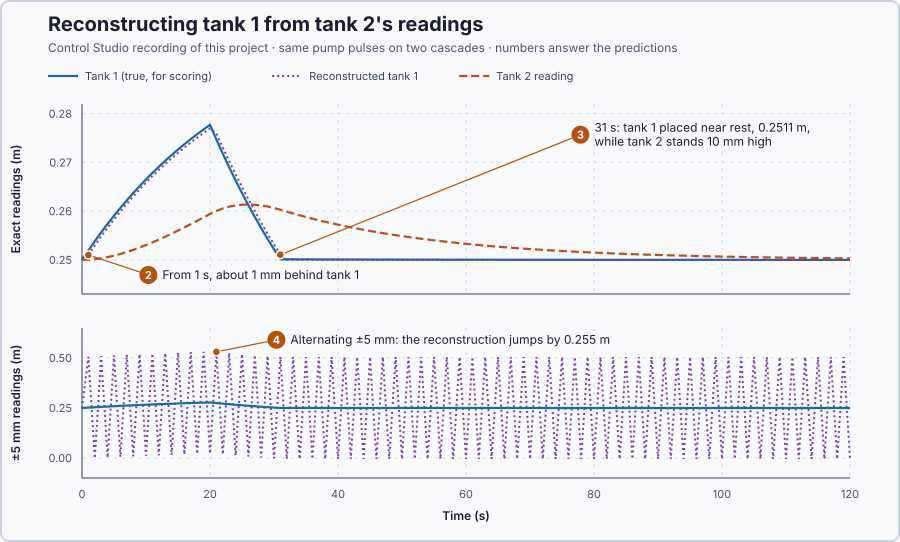

# 76. Observability

In this lesson, you will test whether tank 2's readings reveal tank 1's level, reconstruct tank 1 from them, and see what 5 mm of reading noise does to that reconstruction.

## The problem

Lesson 75 steered the two tanks with an 11 s counter-pulse that brought tank 1 back within 0.13 mm of rest while tank 2 stood 10.3 mm high. The counter-pulse was timed from tank 1's level, but the real installation measures only tank 2. Can tank 2's readings tell us tank 1's level?

We will test the model for that and reconstruct tank 1 from tank 2's readings, first exact, then with 5 mm of reading noise.

## What we need

We need to:

1. tell from the model whether the measured level determines both levels;
2. calculate tank 1's level from tank 2's readings alone; and
3. measure how accurate that is with exact and with noisy readings.

## The new idea

A system is **observable** when its states can be worked out from what the sensors show over time. The downstream level, and how fast it changes, reveal the upstream level.

**In words.** The sensor shows only tank 2, but tank 2 does not move at random: it rises when tank 1 feeds it more than its own outlet lets out, and falls when tank 1 feeds it less. So the readings carry two pieces of information:

1. **The reading itself:** tank 2's level.
2. **How fast the reading changes:** tank 2's inflow minus its outflow. The outflow follows from tank 2's own level, so the inflow, and with it tank 1's level, can be calculated.

Two states and two independent pieces of information: both levels are known, even while the pump runs. In PLC terms it is like taking a conveyor's speed from an encoder: the counter shows only position, yet the change in the count from one scan to the next gives the speed. Observability would fail if the sensor sat on tank 1 instead: tank 2 never acts back on tank 1, so tank 1's readings would be the same whatever tank 2 did.

Observability says the information is in the readings. It does not say how accurately it can be taken out.

**The formula.** For a model $\dot x = Ax + Bu$, $y = Cx$ with $n$ states, the reading and its rates of change give the rows

$$
\mathcal O = \begin{bmatrix}C\\ CA\\ \vdots\\ CA^{n-1}\end{bmatrix},
$$

and the model is observable when $\mathcal O$ has rank $n$.

- $C$ says which states the sensor shows: the reading is $y = Cx$;
- $CA$ says how the reading's rate depends on the states: $\dot y = C\dot x = CAx + CBu$, where the input's part $CBu$ is known because we command $u$; here $CB = 0$, because the pump does not act on tank 2 directly. $CA^2$ belongs to the next rate, and so on;
- $\mathcal O$ is the **observability matrix**, one row for the reading and one for each rate;
- its rank, as in lesson 75, must be $n$: then the rows are $n$ independent equations for the $n$ states.

For the two tanks the second row is tank 2's own balance, which can be solved for tank 1:

$$
\dot y = 0.04\,x_1 - 0.04\,y \quad\Longrightarrow\quad x_1 = y + 25\,\dot y .
$$

- $y = x_2$ is tank 2's measured deviation from 0.25 m, in metres;
- $\dot y$ is how fast that reading changes, in metres per second;
- $x_1$ is tank 1's deviation, in metres; and
- 25 s is $1/0.04$, the tanks' time constant.

The program reads tank 2 once per second, so it uses the change over the last second for $\dot y$:

$$
\hat x_1 = y_k + 25\,(y_k - y_{k-1}),
$$

where $y_k$ is the latest reading, $y_{k-1}$ the one a second before, and $\hat x_1$ (read "x-one hat") is the **reconstruction**: tank 1's level calculated from the readings.

**Example: the two tanks.** With lesson 74's $A = \begin{bmatrix}-0.04&0\\0.04&-0.04\end{bmatrix}$:

1. $C = [0, 1]$: the sensor shows tank 2 only.
2. $CA = [0, 1]\begin{bmatrix}-0.04&0\\0.04&-0.04\end{bmatrix} = [0.04, -0.04]$: the reading's rate depends on tank 1 as well as on tank 2.
3. $\mathcal O = \begin{bmatrix}0&1\\0.04&-0.04\end{bmatrix}$, with the determinant $0 \cdot (-0.04) - 1 \cdot 0.04 = -0.04$, not zero: rank 2. The model is observable.
4. Tank 2 reads rest, $y = 0$, but rises at 0.0008 m/s: $x_1 = 0 + 25 \cdot 0.0008 = 0.02$ m. Tank 1 must be 2 cm high, exactly lesson 74's starting state, where tank 2 read rest yet rose.
5. Two readings a second apart, 0.2550 m and 0.2560 m: $y_k = 0.006$ m and $y_k - y_{k-1} = 0.001$ m, so $\hat x_1 = 0.006 + 25 \cdot 0.001 = 0.031$ m. Tank 1 is about 31 mm above rest.
6. The change over the last second is the average rate over that second, so it describes the middle of the second, half a second ago. While the levels move, the reconstruction trails tank 1 by about half a second of tank 1's movement.
7. A reading error $n_k$ enters as $n_k + 25\,(n_k - n_{k-1})$: the error plus 25 times its change. One reading 1 mm too high makes that reconstruction $0.001 + 25 \cdot 0.001 = 0.026$ m too high and the next one $0 + 25 \cdot (0 - 0.001) = -0.025$ m off: a 1 mm slip becomes a 26 mm jump up and a 25 mm jump down.

**The limitation.** Observability says the information is there, not that it can be taken out accurately: differencing multiplies every change in the reading error by 25 s. To score the reconstruction we compare it with the true tank 1 level, which the simulation provides only for that purpose: over $N$ readings the root-mean-square error is $\sqrt{(e_1^2 + \cdots + e_N^2)/N}$, and the peak error is the largest $|e_k|$. The alternating ±5 mm reading noise below is a teaching choice that shows the worst case plainly.

## Prediction

Before running, answer these questions:

1. Tank 2 peaks 26 s after the step, as in lesson 75. Where does the reconstruction put tank 1 at that moment?
2. When is the first reconstruction available, and about how far does it lag tank 1?
3. At 31 s, after the pulses, tank 2 stands 10 mm high. Where does the reconstruction put tank 1?
4. What does alternating ±5 mm reading noise do to the reconstruction?

| From the model | Value |
| --- | ---: |
| Reconstruction when tank 2 peaks | tank 2's own level, about 0.261 m |
| First reconstruction | one reading after the step |
| Lag while moving | about 1 mm |
| Reconstruction at 31 s | near rest |
| ±5 mm alternating noise | jumps of 0.255 m |

## Implementation

Open [`src/Main.st`](src/Main.st). The rig has two copies of the cascade, both receiving the pulse pair: +0.001 m³/s for 20 s, then −0.001 m³/s for 11 s. `UpstreamReconstruction` rebuilds tank 1 from tank 2's readings with `UpstreamFromDownstream`: exact readings on the first copy, and on the second readings 5 mm low and 5 mm high on alternate seconds (`ReadingNoiseM`). `ErrorStatistics` scores each reconstruction against the true tank 1, which is read for that and nothing else.

**Exercise.** Tank 2 reads 0.25000 m and one second later 0.25080 m. By hand, $\hat x_1 = 0.0008 + 25 \cdot 0.0008 = 0.0208$ m above rest. Then run [`src/tests.st`](src/tests.st) from the **Testing** view; it checks the example, the priming reading and the 0.255 m from ±5 mm of noise.

## Experiment in Control Studio

1. Open this lesson's project and start **Simulator**. Both cascades rest at 0.25 m with 0.010 m³/s. In the **truST** side bar, select **Control Studio**.
2. On **Identify**, choose **Supplied plant model** from **Method** and open `provided-model.json`.
3. On **Tune**, choose **Controllability and observability**, press **Calculate state structure** and open **Calculation details**.
4. On **Identify**, choose **Project experiment**. **Signals** shows `P1.CleanTank2M · Process value (m)` and `P1.CleanPumpM3PerS · Applied output (m3/s)`; add `P1.CleanTank1M · state (m)` and `P1.CleanReconstructionM · state (m)`.
5. Answer the predictions, select **Review project test** and check the declared **123 s**.
6. Select **Confirm and start**. The pumps step at the program's next one-second update, about 2 s later; times below count from that step.
7. After the run, hover 1 s, 20 s, 26 s, 31 s and 60 s after the step. Then show `P1.NoisyReadingM · state (m)`, `P1.NoisyTank1M · state (m)` and `P1.NoisyReconstructionM · state (m)`, and hover 20 s and 21 s. Finally show `P1.CleanRmsM`, `P1.CleanPeakM`, `P1.NoisyRmsM` and `P1.NoisyPeakM`, and hover the end.
8. At completion Control Studio shows **Project test completed. Outputs restored.**

Select **Abort test** to stop early; to repeat, restart **Simulator** so both cascades start at rest.

## Evidence and decision

The numbered marks answer predictions 2–4; the table answers prediction 1. **Controllability and observability** confirms the observability test of The new idea: **observability rank 2 of 2**, with **Observability [C; CA; …]** = [0, 1]; [0.04, −0.04].

From Control Studio's recording of the cascade with exact readings, times after the step:

| After the step | Tank 2 | Tank 1 | Reconstructed tank 1 |
| --- | ---: | ---: | ---: |
| 1 s | 0.2500 m | 0.2520 m | 0.2510 m |
| 20 s | 0.2594 m | 0.2777 m | 0.2770 m |
| 26 s | 0.2614 m | 0.2612 m | 0.2624 m |
| 31 s | 0.2603 m | 0.2501 m | 0.2511 m |
| 60 s | 0.2533 m | 0.2500 m | 0.2500 m |

1. At 26 s tank 2 peaked at 0.2614 m and the reconstruction put tank 1 at 0.2624 m, close to tank 2's level, as $x_1 = y + 25\dot y$ gives when $\dot y = 0$. Tank 1 itself was at 0.2612 m and falling; the half-second lag kept the reconstruction 1.2 mm high.
2. The first reconstruction came one reading after the step and followed tank 1 about 1 mm behind: 0.95 mm low at 1 s while tank 1 rose, 1.25 mm high at 21 s once it fell. Over the run the RMS error was 0.47 mm and the peak 1.3 mm.
3. At 31 s it placed tank 1 at 0.2511 m, near rest, although tank 2 stood 10 mm high: tank 2's falling slope carried that information.
4. The second cascade, with readings 5 mm off in alternate directions, gave reconstructions of 0.022 m at 20 s and 0.531 m at 21 s, while tank 1 was 0.2777 and 0.2747 m. Its RMS error was 0.255 m and its peak 0.256 m.

The benefit: tank 2's readings determine tank 1, and exact readings reconstruct it within 1.3 mm. The cost: the reconstruction differentiates the readings, and with 5 mm of noise it is useless. Observability is confirmed for this cascade; differentiation is rejected as a way to obtain tank 1 from noisy readings. These are simulation results; the true tank 1 level was used only for scoring.

## Conclusion

A state that is not measured can be worked out when the measurement and its changes give independent equations for all states: the observability matrix has full rank.

Working it out by differentiation multiplies reading noise by the model's time scale, 25 s here: observability is information, not accuracy.

## Check yourself

1. **Tank 2 reads 2 mm above rest and falls at 0.0002 m/s. Where is tank 1?**
   $x_1 = 0.002 + 25 \cdot (-0.0002) = -0.003$ m: 3 mm below rest.
2. **Why does the pump flow not appear in $x_1 = y + 25\dot y$?**
   The pump fills only tank 1; tank 2's balance contains tank 1's level and its own, but not the pump.
3. **The model is observable. Why is the reconstruction from ±5 mm readings still useless?**
   It multiplies the change between readings by 25 s, so a 10 mm change from noise becomes 0.25 m.

## Reason for the next lesson

Tank 2's readings can reveal tank 1's level. But knowing the states can be found does not choose how the controller should use them.

[State feedback](../68-state-feedback/README.md) makes the pump act on both levels and chooses how fast each deviation dies away.
