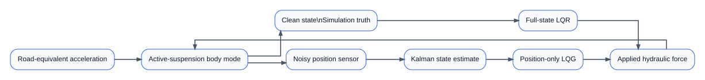
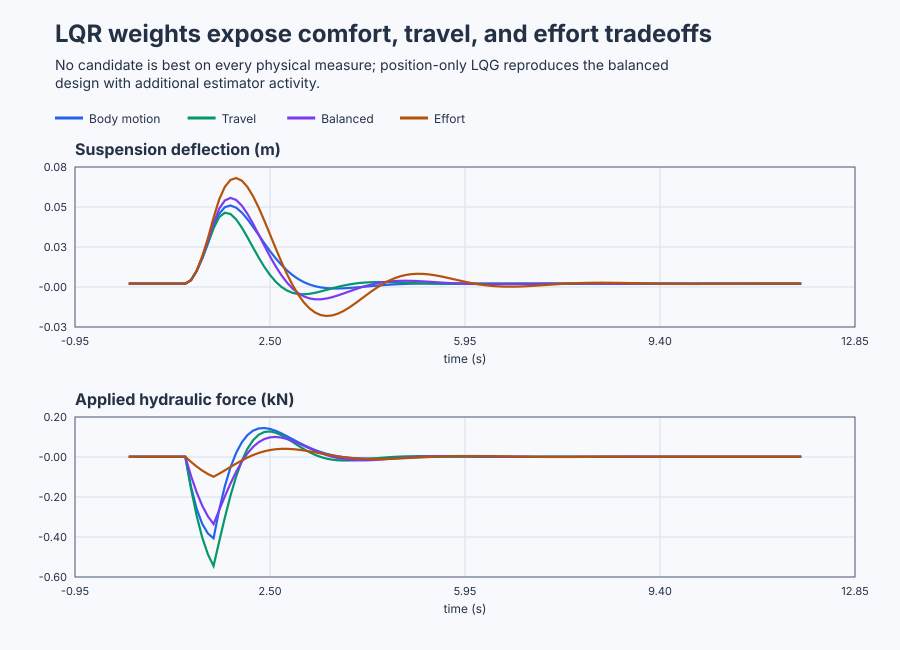

# Design and qualify active-suspension LQR/LQG

Course position: Lesson 67 of 84. Previous lesson: [Qualify a weigh-feeder Kalman estimate](../66-weigh-feeder-kalman/README.md). Next lesson: [Execute constrained two-zone building MPC](../68-building-hvac-mpc/README.md).

**Equipment:** Reduced body-bounce mode of an active road-vehicle suspension.

**Lesson objective:** Derive and compare pole-placement and four LQR designs on common physical measures, then qualify balanced position-only LQG under nominal noise and declared faults.

**Evidence class:** Simulation evidence, not physical-plant qualification evidence.

## The problem

The equipment is the reduced body-bounce mode of an active road-vehicle suspension: the locally linear model of one corner. Suspension deflection ($z$) says how far the body moves relative to its local rest position, in metres. Body vertical velocity ($v$) says how quickly that deflection changes, in metres per second. Hydraulic force ($u$) is the bidirectional actuator command, in kilonewtons. Road-equivalent vertical acceleration disturbance ($d$) represents the bump force reaching the body mode, in metres per squared second.

Velocity changes deflection. Spring and damper action oppose body motion, while hydraulic force and the road disturbance change vertical velocity. In equations:

$\dot{z}=v$

$\dot{v}=-4z-1.2v+0.5u+d$

The state vector ($x$) contains deflection and velocity: $x=[z,v]^T$. State matrix ($A$) describes the unforced spring and damper. Actuator matrix ($B$) describes hydraulic-force influence. Disturbance matrix ($E$) describes road influence:

$\mathbf{A}=\begin{bmatrix}0&1\\-4&-1.2\end{bmatrix},\qquad \mathbf{B}=\begin{bmatrix}0\\0.5\end{bmatrix},\qquad \mathbf{E}=\begin{bmatrix}0\\1\end{bmatrix}$

These coefficients are a configured teaching approximation of one corner's
body-bounce mode, not measurements of a specific vehicle. A real design would
begin with that corner's sprung mass, spring rate, and damper rate from the
vehicle's data sheets or a corner test rig, or would fit them from a
controlled bump or chirp test on an instrumented corner, then validate the
fitted model against an independent road event before using it for design.

Requested and applied force are separate. Applied hydraulic force is limited to -5 through +5 kilonewtons. The local model is valid only while absolute deflection is at most 0.08 metres, absolute velocity at most 0.50 metres per second, and absolute road acceleration at most 2 metres per squared second. The controller runs every 0.1 seconds.


Two equivalent simulated copies receive the same applied force and road event. One supplies clean validation state. The other supplies a position measurement with deterministic 0.002-metre standard-deviation noise. Its velocity is retained as **Simulation truth** for validation, but position-only LQG does not use it.

This is a reduced educational body-mode model. It omits tyre and wheel motion, hydraulic dynamics, delay, pitch, roll, structural modes, nonlinear geometry, friction, leakage, sensor dynamics, and real road spectra.

Lesson 65 showed that pole placement can assign a stabilizing pole set, but the chosen poles did not state how the engineer valued several state errors relative to actuator effort. Lesson 66 showed how a model and covariance can reconstruct an unmeasured state without pretending that the estimate is truth.

Active suspension needs both decisions. Many gains stabilize this local model. We need a reproducible reason for preferring one tradeoff, and we need a way to use that gain when only noisy displacement—not velocity—is measured.

## What we need

We need to turn explicit priorities for body motion, suspension travel, and hydraulic effort into comparable feedback designs. A position-only estimate must then preserve the balanced design under declared sensor noise and faults without being called universally optimal.

## The new idea

A state penalty assigns cost to unwanted deflection or velocity. An input penalty assigns cost to hydraulic force. State-weight matrix ($Q$) contains the state penalties. Input-weight matrix ($R$) contains the force penalty.

Quadratic performance cost ($J$) accumulates both kinds of penalty over time:

$J=\int_{0}^{\infty} \left(\mathbf{x}^{T}\mathbf{Q}\mathbf{x} +\mathbf{u}^{T}\mathbf{R}\mathbf{u}\right)dt$

Larger state weight asks the design to suppress that state more strongly. Larger input weight asks it to spend less actuator effort. A weight is not a physical limit, and a low cost is not permission to violate a limit.

### Units and normalization

Raw numerical weights depend on engineering units. A value written in millimetres is numerically one thousand times the same displacement written in metres, so reusing an unchanged weight would change the design.

Normalize deflection by 0.05 metres, velocity by 0.25 metres per second, and force by 5 kilonewtons before expressing a preference. If the normalized penalties are $q_z(z/0.05)^2$, $q_v(v/0.25)^2$, and $r_u(u/5)^2$, expansion shows that the dimensional weights are $Q_{zz}=q_z/0.05^2$, $Q_{vv}=q_v/0.25^2$, and $R=r_u/5^2$. This division by the squared engineering scale is why changing metres to millimetres without transforming the weight changes the controller.

These normalization scales are chosen as representative fractions of the
declared local-model range and the actuator's full rating: 0.05 metres and
0.25 metres per second are well inside the declared 0.08-metre and
0.50-metre-per-second local bounds, so a normalized penalty of one
corresponds to a deflection or velocity a rider would already notice, while 5
kilonewtons is the actuator's full rated force, so a normalized penalty of one
corresponds to spending the entire available force.

### From cost to feedback

Riccati matrix (P) relates the present state to future optimal cost—the least cost achievable by the declared unconstrained linear problem. First confirm that actuator force can stabilize every unstable state: stacking the actuator matrix with its one-step reach, $[\mathbf B\;\mathbf A\mathbf B]=\begin{bmatrix}0&0.5\\0.5&-0.6\end{bmatrix}$, gives determinant $-0.25\neq0$, so Lesson 64's rank test confirms this pair is controllable and every state can be moved by hydraulic force alone. The continuous algebraic Riccati equation then finds P:

$\mathbf{A}^{T}\mathbf{P}+\mathbf{P}\mathbf{A} -\mathbf{P}\mathbf{B}\mathbf{R}^{-1}\mathbf{B}^{T}\mathbf{P} +\mathbf{Q}=0$

Linear-quadratic regulator gain ($K$) converts state into requested force:

$\mathbf{K}=\mathbf{R}^{-1}\mathbf{B}^{T}\mathbf{P}$

$u_{\mathrm{requested}}=-\mathbf{K}\mathbf{x}$

The Riccati equation is solved for the symmetric matrix $P$ with a standard iterative numerical Riccati solver—successive algebraic iteration to convergence, the same class of method any linear-quadratic-regulator toolbox uses; it is not a guessed gain. Because $B=[0,0.5]^T$, the gain relation becomes $K=[0.5P_{12}/R,\;0.5P_{22}/R]$. For the balanced case, the numerical Riccati solution has $P_{12}=4.39607806$ and $P_{22}=3.81444278$, so with $R=1$ it gives $K=[2.19803903,1.90722139]$. Substitution into the Riccati equation and a stability check of $A-BK$ are the independent checks that those numbers solve the declared problem.

This solution is optimal for the declared linear model, quadratic cost, complete state, and unconstrained calculation. Saturation breaks the unconstrained optimum. Two candidates designed with different Q and R also have different private cost definitions, so their private J values cannot rank one another. Compare them using the same physical measures.

The independent Riccati calculation gives:

| Design | Q diagonal | R | Gain K | Intended emphasis |
|---|---:|---:|---:|---|
| Body-motion | $[20,20]$ | 1 | $[1.16515139,3.11548779]$ | vertical velocity |
| Suspension-travel | $[120,2]$ | 1 | $[5.56465997,3.07892689]$ | deflection |
| Balanced | $[40,4]$ | 1 | $[2.19803903,1.90722139]$ | both states |
| Effort-saving | $[40,4]$ | 5 | $[0.48528137,0.51566896]$ | hydraulic effort |

Pole-placement baseline gain $[13,6]$ is stable but does not expose a cost preference. It is not an LQR candidate.

### From full state to position-only LQG

The controller samples every 0.1 seconds. Sampled state-transition matrix ($\mathbf{A}_{\mathrm{d}}$) advances state without a new input. Sampled actuator matrix ($\mathbf{B}_{\mathrm{d}}$) advances state due to the previous applied force. Sampled disturbance matrix ($\mathbf{E}_{\mathrm{d}}$) advances state due to the previous road disturbance:

$\mathbf{A}_d=\begin{bmatrix}0.98084004&0.09360616\\-0.37442462&0.86851265\end{bmatrix}$

$\mathbf{B}_d=\begin{bmatrix}0.00239499\\0.04680308\end{bmatrix}$

$\mathbf{E}_d=\begin{bmatrix}0.00478999\\0.09360616\end{bmatrix}$

These matrices come from exact zero-order-hold sampling: $A_d=e^{A\Delta t}$, $B_d=\int_0^{\Delta t}e^{A\tau}B\,d\tau$, and $E_d=\int_0^{\Delta t}e^{A\tau}E\,d\tau$. The exponential carries the unforced state through 0.1 seconds; each integral accumulates the effect of an input held constant over that interval.

Measured position ($y$) is the noisy sensor sample. Predicted state estimate ($x_{\mathrm{prior}}$) is the state expected from the previous corrected estimate and applied inputs. Innovation ($\nu$) is measured position minus predicted position. Estimator gain ($L$) says how much of that surprise corrects deflection and velocity.

Process-noise covariance ($W$) declares model uncertainty. Measurement-noise covariance ($V$) declares position-sensor uncertainty. For $W=diag(1e-7,1e-4)$ and $V=4e-6$, the independent discrete Riccati calculation gives $L=[0.58488259,2.24682847]^T$.

$V=4\times10^{-6}\,\mathrm{m^2}$ is exactly the declared 0.002-metre
position-sensor standard deviation squared ($0.002^2=0.000004$), obtained
directly from the same stationary noise record already declared for this
sensor, not a separately invented number. $W$ is a configured teaching
covariance representing small trusted-model uncertainty; a real design would
instead estimate it from residual state-prediction error on an independent
road event, validated against a held-out record, the same route Lesson 66
used for its process-noise variance.

$\hat{\mathbf{x}}_{k\mid k-1} =\mathbf{A}_d\hat{\mathbf{x}}_{k-1\mid k-1} +\mathbf{B}_d u_{k-1}+\mathbf{E}_d d_{k-1}$

$\nu_k=y_k-\begin{bmatrix}1&0\end{bmatrix}\hat{\mathbf{x}}_{k\mid k-1}$

$\hat{\mathbf{x}}_{k\mid k} =\hat{\mathbf{x}}_{k\mid k-1}+\mathbf{L}\nu_k$

The balanced LQR gain then uses corrected estimated state instead of measured full state. That combination is linear-quadratic-Gaussian control, or LQG.

The separation principle says regulator and estimator poles can be designed separately for the exact nominal linear assumptions. It does not guarantee robustness to wrong dynamics, wrong covariance, delay, saturation, outliers, or an unsafe actuator.

## Prediction

Before running, use the common worked state of 0.03 metres deflection and zero velocity. Requested force is minus the first gain multiplied by 0.03:

| Design | Predicted requested force (kN) |
|---|---:|
| Pole placement | -0.39000 |
| Body-motion LQR | -0.03495 |
| Suspension-travel LQR | -0.16694 |
| Balanced LQR | -0.06594 |
| Effort-saving LQR | -0.01456 |

Predict that suspension-travel emphasis reduces deflection relative to effort-saving control, while effort-saving control consumes less force energy. Predict that the body-motion design reduces velocity relative to effort-saving control. Finally, predict that nominal LQG approaches balanced full-state behavior only while the estimator's model and noise assumptions remain credible.

## Implementation

The shipped Structured Text selects the declared gains, distinguishes requested from applied force, and bounds both hydraulic and road inputs. In position-only mode, force is calculated from estimated state:

```st
Innovation := PositionOnlyMeasurement - PredictedDeflection;
EstimatedDeflection := PredictedDeflection
    + LREAL#0.58488259 * Innovation;
EstimatedVelocity := PredictedVelocity
    + LREAL#2.24682847 * Innovation;

ForceRequested := -GainDeflection * FeedbackDeflection
    - GainVelocity * FeedbackVelocity;
ForceApplied := LIMIT(LREAL#-5.0, ForceRequested, LREAL#5.0);
```

Design modes are 0 pole placement, 1 body motion, 2 suspension travel, 3 balanced, 4 effort saving, and 5 balanced position-only LQG. An invalid selector or invalid local-range input sets `ControllerValid` false and applies zero force. Disabled mode also applies zero hydraulic force.

## Experiment in Control Studio

This procedure observes the balanced position-only LQG design under the nominal road pulse. The project owns the complete event: zero road acceleration for one second, +0.5 metres per squared second for half a second, then zero. Removing authority or detecting invalid inputs or a safety abort disables hydraulic force and restores the road request to zero. The pole-placement, four full-state LQR, doubled-noise, and mismatch comparisons remain separate native test records. The deterministic Simulation seed is 20260829.

### Control Studio actions

1. **Monitor** — Select target **Simulator**, choose **Run**, then open **Control Studio → Monitor → Response**.
   - **Baseline check:** Wait until the header shows **Simulation**, **Running**, and current data. Confirm clean validation state, noisy position, estimated state, innovation, requested/applied force, requested/applied road acceleration, design selector, saturation, units, limits, mode, and quality. Confirm Simulation-truth velocity is labelled as validation data and is not an estimator input. Before authority is granted, applied force and road acceleration are zero.
   - **Decision before action:** Read **Prediction** above, then state what should move first and in which direction. Use this decision rule: Select a regulator only from common physical tradeoff measures, then accept position-only LQG only when estimator and abnormal-case evidence remain inside declared bounds, because a private quadratic cost can rank two designs oppositely from how they perform on the shared physical measures a rider would feel.
   - **Successful evidence:** The Response plot advances, the displayed values are finite and current, and **Start recording** is enabled. Select **Start recording** only after those conditions are visible.
   - **Recovery:** If recording is disabled or the plot reports unavailable or stale samples, stop the Simulator, correct the displayed runtime or binding problem, restart it, and repeat the baseline check.
   - **Record:** Write down the initial noisy position, estimated deflection and velocity, innovation, requested/applied hydraulic force, and your predicted response before opening Test.

2. **Test** — Open **truST sidebar → Control Studio → Test**.
   - **Baseline check:** Confirm **Experiment** = **Observe without excitation**, **Amplitude** = **0** (disabled), and **Maximum duration (s)** = **12.1**. The reviewed authority is **Experiment authority** (`P1.ExperimentEnabled`). The project owns the road pulse and balanced-LQG selection.
   - **Decision before action:** Before selecting **Review test**, predict that positive road acceleration first drives positive body velocity and deflection, while the feedback requests opposing force. Confirm the scheduled pulse and expected response remain inside the force, road, deflection, and velocity limits, because a predicted excursion outside those bounds would mean the balanced design is already operating outside the model it was derived from.
   - **Successful evidence:** Select **Review test**, verify the signal, requested bound, duration, restoration, and stop conditions, then select **Confirm and start**. The state changes to **Running**, **Abort test** remains available, and the terminal state confirms completion and restoration while Response shows the measured suspension-deflection and applied-force sequence.
   - **Recovery:** For a rejected, stale, unsafe, unavailable, failed, or aborted state, read the displayed reason, remove experiment authority, verify zero applied force and road acceleration, wait for current data, and review a new test.
   - **Record:** Stop recording only after restoration. Compare the nominal LQG response and estimate with your
     prediction, then retain the terminal state, restoration result, and deterministic seed
     **20260829**. Use the native evidence below for the other designs and abnormal cases; do not
     claim this visible run executed them. The inherited limitation under test is: Pole placement stabilizes the local mode but does not encode a reproducible preference among suspension travel, body motion and hydraulic effort. The decision this run supports is: Select a regulator only from common physical tradeoff measures, then accept position-only LQG only when estimator and abnormal-case evidence remain inside declared bounds.
## Evidence and decision

Suspension-deflection root-mean-square value is the square root of mean squared deflection from 1 through 12 seconds, in metres. Body-velocity root-mean-square value uses the same calculation and window, in metres per second. Body-acceleration root-mean-square value is calculated from the declared state equation, in metres per squared second.

Hydraulic-force energy is $\sum\left(u_{\mathrm{applied}}^{2} \cdot 0.1\right)$ over 1 through 12 seconds, in squared-kilonewton seconds. Force movement is total variation, the sum of absolute applied-force changes, in kilonewtons. Also retain peak absolute force and saturation duration.

Return time begins after the road pulse. It is the first point for which the next continuous second remains within 0.002 metres deflection and 0.01 metres per second velocity. Report **Not returned** if that prerequisite is never met.

For LQG, position- and velocity-estimation root-mean-square errors compare estimated state with synchronized Simulation truth from 1 through 12 seconds. Innovation mean over the same window checks persistent position prediction bias. Retain source signals, units, window, sample count, mode, model, seed, and evidence class with every value.

The native executable test must independently solve all four continuous Riccati designs and the discrete estimator Riccati equation before comparing gains. Every regulator pole and estimator pole must lie inside its applicable stability boundary. Every run must remain finite and inside force and local-model limits.

The suspension-travel candidate must reduce deflection RMS relative to effort-saving control. The body-motion candidate must reduce velocity RMS relative to effort-saving control. Effort-saving control must use less force energy than body-motion and suspension-travel control. Balanced control is eligible only when it avoids saturation and occupies a defensible common-measure tradeoff.

Nominal position-only LQG must keep position-estimation RMS within 0.01 metres, velocity-estimation RMS within 0.10 metres per second, and absolute innovation mean within 0.002 metres. Its deflection RMS may be no more than 1.5 times balanced full-state control, and its force energy no more than twice the balanced value. Force movement remains a separate actuator-wear measure. Doubled noise must not appear better than nominal in position-estimation error, and model mismatch must not appear better in velocity-estimation error.

The shipped native execution produced the following common-measure results. Every row used the same 0.5-metre-per-squared-second road pulse, initial state, interval, duration, force limit, and seed. All rows remained finite, unsaturated, and inside the local model range.

| Design | Deflection RMS ($m$) | Velocity RMS (m/s) | Acceleration RMS (m/s^{2}) | Force energy (kN^{2}·s) | Force movement (kN) | Peak force (kN) | Return time (s) |
|---|---:|---:|---:|---:|---:|---:|---:|
| Pole placement | 0.0077 | 0.0197 | 0.0963 | 0.2638 | 1.991 | 0.825 | 1.6 |
| Body-motion LQR | 0.0145 | 0.0261 | 0.1005 | 0.0759 | 1.117 | 0.406 | 2.8 |
| Suspension-travel LQR | 0.0120 | 0.0264 | 0.1071 | 0.1218 | 1.383 | 0.544 | 2.3 |
| Balanced LQR | 0.0156 | 0.0305 | 0.1109 | 0.0503 | 0.911 | 0.335 | 3.5 |
| Effort-saving LQR | 0.0207 | 0.0383 | 0.1213 | 0.0054 | 0.312 | 0.099 | 5.5 |
| Balanced position-only LQG | 0.0156 | 0.0304 | 0.1104 | 0.0520 | 1.952 | 0.330 | 3.5 |

Pole placement suppresses this one nominal pulse most strongly, but spends more than five times the balanced force energy. Suspension-travel weighting reduces deflection relative to effort-saving control; body-motion weighting reduces velocity; effort-saving control minimizes force energy but returns most slowly. Balanced LQR is not “best” in every column. It is a measured compromise on the common tradeoff.

Nominal LQG position- and velocity-estimation RMS were 0.00127 metres and 0.00511 metres per second. Innovation mean was 0.000058 metres. Its motion and force energy closely reproduce balanced full-state control, but force movement rises from 0.911 to 1.952 kilonewtons because noisy position enters the estimate. That actuator-wear cost remains visible rather than being hidden by the LQG label.

Doubling position-noise standard deviation increased position- and velocity-estimation RMS to 0.00254 metres and 0.01021 metres per second. The spring/damping mismatch produced 0.00132 metres and 0.00590 metres per second, with innovation mean 0.000191 metres. Both are separately labelled abnormal **Simulation** evidence; neither changes the nominal qualification automatically. A Riccati solver success flag, a smooth plot, or a low private cost is not sufficient evidence.

### Retained evidence



The figure compares the same road event under four unit-scaled costs. The [trace CSV](figures/suspension-lqr-evidence-trace.csv) also retains the pole-placement baseline, balanced LQG estimates, innovation, requested/applied force, saturation, doubled-noise case, and model mismatch. The [summary CSV](figures/suspension-lqr-evidence-summary.csv) records the comfort, travel, effort, peak, and return-time measures used in the design decision.

## Conclusion

The four LQR gains differ because their Q and R values express different preferences. The Riccati equation does not discover whether comfort, travel, or energy matters most; it solves the preference the engineer supplied. This is why unit scaling and common physical comparison measures are essential.

Hydraulic saturation matters because the Riccati result assumed unlimited force. Once requested and applied force differ, the unconstrained optimum no longer describes the executed system.

Position-only LQG predicts hidden velocity from the model, previous applied force, previous road disturbance, and noisy position. Estimation error therefore enters requested force. A smooth position estimate does not prove velocity is correct. Clean synchronized velocity exists here only for Simulation validation.

## Reason for the next lesson

LQR makes a multi-state-versus-effort preference explicit and reproducible, but optimal means optimal only for the declared model, cost, complete-state assumption, and unconstrained calculation. LQG combines that regulator with a covariance-qualified estimator; it does not remove model, noise, delay, or constraint risk.

Physical use requires an identified full-order vehicle and hydraulic model, calibrated sensing, structural and force limits, independent topology and functional-safety review, explicit approval immediately before physical testing, and rollback. This lesson operates no physical vehicle.

Lesson 68 introduces building-HVAC model-predictive-control because several future constraints and disturbances cannot be represented by one unconstrained instantaneous state-feedback calculation.
