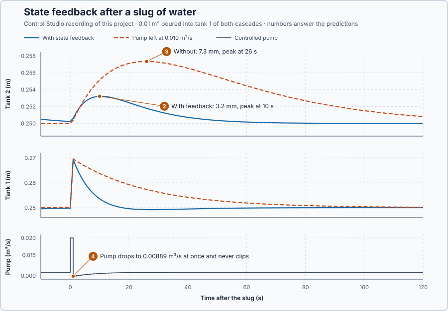

# 77. State feedback

In this lesson, you will make the pump act on both tank levels, choose how fast deviations should die away, and let Control Studio calculate the gains. You will then compare the controlled tanks with uncontrolled ones after a slug of water.

## The problem

Lesson 76 showed that tank 2's readings determine tank 1's level: exact readings reconstructed it within 1.3 mm. Knowing the levels is not yet using them. After an upset, such as a slug of water poured into tank 1, no pump plan made in advance fits; the pump must react to where the water is now, in both tanks. How strongly should it react to each level?

We will make the pump act on both levels and choose how fast their deviations die away.

## What we need

We need to:

1. set the pump from both levels, so it reacts to water in tank 1 before it reaches tank 2;
2. choose the gains from a required speed of recovery; and
3. keep the pump within its 0–0.020 m³/s range.

## The new idea

**State feedback** sets the pump from every state, not just from one error, and so can choose how quickly each natural motion dies away. For the tanks, the pump can turn down as soon as tank 1 holds extra water, before tank 2 has moved.

**In words.** A PI controller on tank 2 sees only tank 2's error: after a slug into tank 1 it does nothing until the water has reached tank 2. State feedback looks at every store. Each state's deviation gets its own gain, and the pump correction adds the results; in ST it is one assignment per scan, a weighted sum of the measured deviations. The parts:

1. **The gain on tank 1** reacts to water that is still on its way: it turns the pump down while tank 2 has not moved yet.
2. **The gain on tank 2** reacts to the level we finally care about.
3. **Together** the gains set how the controlled tanks return to rest. Left alone, the tanks have two natural motions (lesson 49), both dying away with a 25 s time constant. Each gain changes both motions, and with one gain per state we can choose both speeds, because the tanks are controllable (lesson 75). Choosing the gains from the speeds we want is **pole placement**.

For this plant it means: decide how fast deviations should die away, calculate the two gains that give exactly those speeds, and the pump reacts to a slug the moment it lands in tank 1.

**The formula.** The law, and the controlled tanks it gives, are

$$
v = -Kx = -k_1x_1 - k_2x_2, \qquad \dot x = (A - BK)\,x ,
$$

and the closed-loop poles are the roots of the characteristic equation (lesson 50)

$$
\det(sI - A + BK) = 0 .
$$

- $v$ is the pump correction, in cubic metres per second; the pump delivers $q = 0.010 + v$;
- $x_1$ and $x_2$ are the level deviations, in metres;
- $K = [k_1, k_2]$ holds the gains, in m³/s per metre of level, that is m²/s;
- $A - BK$ is the controlled tanks' matrix: the process's own $A$ plus what the feedback adds, $-BK$;
- the roots $s$ of the characteristic equation are the poles: each natural motion of the controlled tanks varies as $e^{st}$ and, when $s$ is negative, dies away with the time constant $-1/s$;
- $I$ is the identity matrix (lesson 72), and $\det$ the determinant (lesson 70).

For the two tanks, with $A$ and $B$ from lesson 74,

$$
A - BK = \begin{bmatrix}-0.04-2k_1&-2k_2\\0.04&-0.04\end{bmatrix},
$$

$$
\det(sI - A + BK) = (s + 0.04 + 2k_1)(s + 0.04) + 0.08k_2 = s^2 + (0.08 + 2k_1)\,s + (0.0016 + 0.08k_1 + 0.08k_2).
$$

To place the poles at chosen values $p_1$ and $p_2$, make this polynomial equal to $(s - p_1)(s - p_2)$ and match its terms.

**Example: poles at −0.06 and −0.10 per second.**

1. Without feedback, $k_1 = k_2 = 0$: the polynomial is $s^2 + 0.08s + 0.0016 = (s + 0.04)^2$, both poles at −0.04 per second, the 25 s time constant of lesson 74.
2. Choose poles at −0.06 and −0.10 per second, time constants of 16.7 s and 10 s: $(s + 0.06)(s + 0.10) = s^2 + 0.16s + 0.006$.
3. Match the $s$ terms: $0.08 + 2k_1 = 0.16$, so $k_1 = 0.04$ m²/s.
4. Match the constants: $0.0016 + 0.08 \cdot 0.04 + 0.08k_2 = 0.006$, so $0.08k_2 = 0.0012$ and $k_2 = 0.015$ m²/s.
5. A slug leaves tank 1 2 cm high, $x = [0.02, 0]^T$: $v = -0.04 \cdot 0.02 - 0.015 \cdot 0 = -0.0008$ m³/s. The pump drops at once to 0.0092 m³/s, although tank 2 has not moved.

**In the program.** The program updates the pump once per second and holds it in between. Over one second a motion $e^{st}$ shrinks by the factor $z = e^{s \cdot 1\,\text{s}}$ (lesson 60), so the example's poles become $z = e^{-0.06} = 0.9418$ and $z = e^{-0.10} = 0.9048$. Control Studio places such factors for the held pump, and its gains come out slightly smaller than the continuous ones. To hold tank 2 at a setpoint $r$ instead of 0.25 m, the law gets a **reference gain** $N$: $v = N(r - 0.25) - Kx$. With both levels at $r$, each outlet lets out $0.020\,(r - 0.25)$ m³/s more (lesson 74's tangent slope), and the pump must supply that extra flow: $(N - k_1 - k_2)(r - 0.25) = 0.020\,(r - 0.25)$, which gives $N = 0.020 + k_1 + k_2$, here $0.020 + 0.04 + 0.015 = 0.075$ m²/s.

**The limitation.** The poles hold only while the pump follows $-Kx$. The pump can move only 0.010 m³/s either way from 0.010 m³/s; a clipped flow at 0 or 0.020 m³/s no longer follows the law, and the design is also local to 0.25 m. Faster poles need larger gains: both poles at −0.2 per second would need $k_1 = 0.16$ and $k_2 = 0.32$ m²/s, and then a 31 mm deviation in tank 2 alone, $0.010/0.32$ m, would use the pump's whole range (calculated). The pole speeds used below are a teaching choice, fast enough to see and slow enough to keep the pump within range.

## Prediction

Before running, answer these questions:

1. What are $k_1$ and $k_2$ for poles at −0.08 and −0.12 per second, and the pump flow at $x = [0.02, 0]^T$?
2. After a slug raises tank 1 by 2 cm, how high does tank 2 rise with feedback?
3. How high does it rise with the pump left at 0.010 m³/s?
4. Does the pump flow clip?

| From the design | Value |
| --- | ---: |
| $k_1$, $k_2$ (continuous) | 0.06 and 0.04 m²/s |
| Pump at $x = [0.02, 0]^T$ | 0.0088 m³/s |
| Time constants | 12.5 s and 8.3 s, against 25 s |
| Sampled poles | $z$ = 0.9231 and 0.8869 |

## Implementation

Open [`src/Main.st`](src/Main.st). The rig has two copies of the cascade. `FeedbackFlowM3PerS` calculates $q = 0.010 + N(r - 0.25) - K_1x_1 - K_2x_2$ from both measured levels, `LimitedFlowM3PerS` limits it to 0–0.020 m³/s, and `Clipped` reports a limited request. In Manual the pump delivers `ManualFlowM3PerS`, 0.010 m³/s. In the experiment the program returns tank 2's setpoint to 0.25 m and holds it for 60 s; then both pumps run one second at 0.020 m³/s, a slug of 0.01 m³ into each tank 1. After it, the first cascade runs under the feedback and the second stays at 0.010 m³/s.

**Exercise.** One second after the slug the controlled levels are 0.26940 m and 0.25060 m. With Control Studio's gains, $q = 0.010 - 0.0562 \cdot 0.01940 - 0.0369 \cdot 0.00060 = 0.008888$ m³/s: check it against the recording. Then run [`src/tests.st`](src/tests.st) from the **Testing** view; it checks the flow law, the limits and the reference term.

## Experiment in Control Studio

1. Open this lesson's project and start **Simulator**. Both cascades rest at 0.25 m with 0.010 m³/s. In the **truST** side bar, select **Control Studio**.
2. On **Identify**, choose **Supplied plant model** from **Method** and open `provided-model.json`: the cascade's matrices with both levels measured.
3. On **Tune**, open **Requirements…** and enter **Setpoint change (m)** 0.01, **Maximum steady-state error (m)** 0.002, **Maximum settling time (s)** 60, **Settling band (±m)** 0.001 and **Validation duration (s)** 120; select **Done**.
4. Keep **Controller** **P1 · State feedback — recommended**, choose **State-space design** in **Tuning method**, enter **Desired poles** `[0.9231163463866358, 0.8869204367171575]` and press **Tune controller**.
5. On **Validate**, press **Validate controller**: Studio runs your program on a 1 cm setpoint step and a recovery from disturbed levels.
6. Press **Apply**. Studio writes the gains, switches to Auto, moves tank 2's setpoint to 0.26 m as a live check and shows **Applied**.
7. On **Identify**, choose **Project experiment**. **Signals** shows `P1.Tank2SetpointM · Setpoint (m)`, `P1.ControlledTank2M · Process value (m)` and `P1.ControlledPumpM3PerS · Applied output (m3/s)`; add `P1.ControlledTank1M · state (m)`, `P1.UncorrectedTank1M · state (m)` and `P1.UncorrectedTank2M · state (m)`.
8. Answer the predictions, select **Review project test** and check the declared **182 s**; select **Confirm and start**. The slug comes about 63 s later; times below count from it.
9. After the run, hover 1 s, 10 s, 26 s and 50 s after the slug.
10. At completion Control Studio shows **Project test completed. Outputs restored.**

Select **Abort test** to stop early; to repeat, restart **Simulator** and apply again.

## Evidence and decision

The numbered marks answer predictions 2–4. **Tune controller** answers prediction 1: **Gain K1 on tank 1's level deviation** 0.0562 m3/s/m, **Gain K2** 0.0369 and **Reference gain N** 0.1131, slightly below the continuous 0.06, 0.04 and 0.12, with phase margin 95°. **Validate controller** passed every row: settling time 33 s and state recovery 25 s, both within 60 s, steady-state error 0.25 mm within 2 mm, and 20 range checks.

From Control Studio's recording, times after the slug:

| After the slug | Controlled tank 1 / tank 2 | Uncontrolled tank 1 / tank 2 | Controlled pump |
| --- | ---: | ---: | ---: |
| 1 s | 0.2694 / 0.2506 m | 0.2696 / 0.2504 m | 0.008888 m³/s |
| 10 s | 0.2536 / 0.2532 m | 0.2638 / 0.2551 m | 0.0097 m³/s |
| 26 s | 0.2492 / 0.2518 m | 0.2573 / 0.2573 m | 0.0100 m³/s |
| 50 s | 0.2497 / 0.2504 m | 0.2528 / 0.2555 m | 0.0100 m³/s |

2. The slug raised both tank 1 levels by 19.6 mm. With feedback, tank 2 peaked at 0.2532 m after 10 s: a rise of 3.2 mm.
3. Uncontrolled, tank 2 peaked at 0.2573 m after 26 s: 7.3 mm.
4. The pump dropped to 0.00889 m³/s at once, reacting to tank 1's water before tank 2 had moved, and never clipped, so the placed poles held.

The benefit: from 50 s after the slug both controlled levels stayed within 0.35 mm of rest, while uncontrolled tank 2 was still 5.5 mm high. The cost: controlled tank 1 dipped 0.8 mm below rest at 28 s, because the feedback moves the water on faster than the tanks do alone. The design is accepted for this cascade around 0.25 m and small upsets. These are simulation results.

## Conclusion

State feedback uses every state, so it reacts to stored water before it shows up downstream, and pole placement turns a required speed of recovery into gains.

For the tanks, the pump turned down at once and tank 2 rose 3.2 mm instead of 7.3 mm; the law needed both levels.

## Check yourself

1. **What gains place the poles at −0.10 and −0.10 per second?**
   $(s + 0.1)^2 = s^2 + 0.2s + 0.01$, so $k_1 = 0.06$ m²/s and $0.0016 + 0.0048 + 0.08k_2 = 0.01$ gives $k_2 = 0.045$ m²/s.
2. **Why did the controlled pump drop before tank 2 had risen?**
   It acts on tank 1's level as well; the slug raised tank 1 at once, and $k_1$ turned that into less flow.
3. **Why would clipping at 0 m³/s spoil the placed poles?**
   A clipped pump no longer delivers $-Kx$, so the controlled equations, and with them the poles, no longer apply.

## Reason for the next lesson

The law needs both levels, but the real installation measures only tank 2.

[State observers](../70-state-observer/README.md) estimate tank 1 from tank 2's readings and the model, without differentiating noisy readings.
