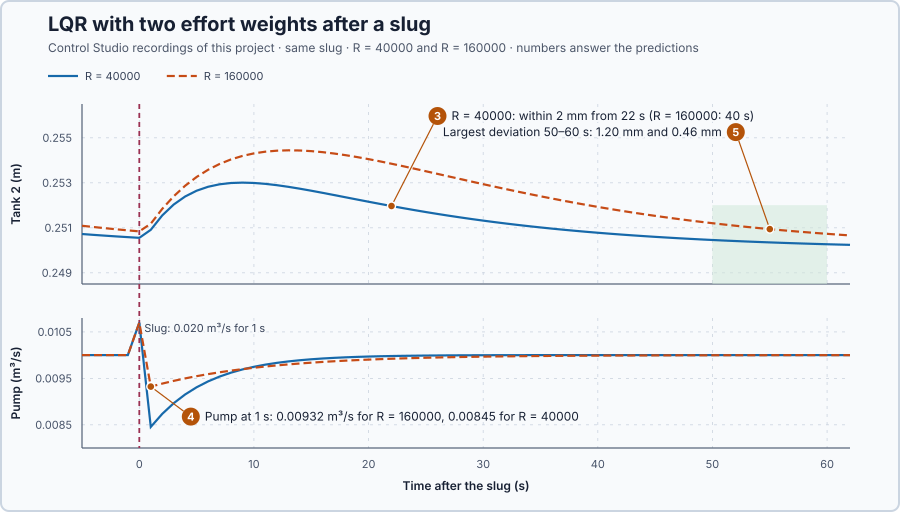

# 80. LQR control

This lesson is an introduction to LQR control. You will choose the state-feedback gains by stating what level deviations and pump effort cost, let Control Studio calculate the best gains, and compare two effort weights after a slug of water.

## The problem

Lesson 79's Kalman filter estimated tank 1 within 2 mm from 25 s, by weighing the model against the reading from their uncertainties. Estimation tells the controller where the water is; it does not decide how hard the pump should work to put it right. Placing poles by choice says how fast the levels recover, but not how much pump movement that speed is worth.

We will state that trade as a cost, let Control Studio find the gains that minimise it, and compare two effort weights after the same slug.

## What we need

We need to:

1. state, in comparable numbers, what a level deviation and a pump correction cost;
2. find the gains that make the total cost smallest for the tanks' model; and
3. compare two weightings on recovery and pump movement.

## The new idea

**LQR**, the linear-quadratic regulator, chooses the feedback gains that best balance two costs we state: how much the levels may deviate and how much the pump may work. For the tanks, a large weight on pump effort gives a gentle pump and a slower recovery; a small one gives the opposite.

**In words.** In lesson 77 we chose how fast the levels should recover and calculated the gains for it; nothing said whether that speed was worth the pump movement it took. LQR starts from the other end: it asks what a level deviation costs and what pump movement costs, and finds the gains that make the total smallest. It is the trade-off every commissioning engineer makes by feel, a fast but busy loop against a calm but slow one, written down as numbers so that the model can do the balancing. The parts:

1. **The level cost.** Every second, each level's deviation is squared and weighted, so one large deviation costs more than several small ones.
2. **The effort cost.** Every second, the pump correction is squared and weighted the same way.
3. **The total over the coming seconds.** The controller looks ahead, adds both costs up over the coming seconds, and the LQR gains make that total as small as possible.

The result is still state feedback, $v = -Kx$, as in lesson 77; only the way the gains are chosen is new. For the tanks, the weights say how much a millimetre of level is worth against pump movement, and the model works out the gains.

> **Math you need: quadratic cost.** A quadratic cost adds weighted squares: $qx^2$ is 0 at $x = 0$ and grows faster the further $x$ is from 0, so one large deviation costs more than several small ones. For two levels, $x^TQx = q_1x_1^2 + q_2x_2^2$ with $Q = \mathrm{diag}(q_1, q_2)$. A quadratic $av^2 + bv$ is smallest where its derivative $2av + b$ is zero, at $v = -b/2a$.

**The formula.** Over $N$ updates the cost is

$$
J = \sum_{k=0}^{N-1}\left(x_k^TQx_k + R\,v_k^2\right) + x_N^TQx_N .
$$

- $k$ counts the one-second updates, from now, $k = 0$, to the end of the look-ahead, $N$;
- $x_k$ are the level deviations at update $k$, in metres, and $v_k$ is the pump correction, in m³/s;
- $Q$ weighs the level deviations, per square metre, and $R$ weighs the pump correction, in s²/m⁶;
- $x_N^TQx_N$ charges the deviation left at the end; and
- $J$ is the total cost, a pure number.

With the one-second model $x_{k+1} = A_dx_k + B_dv_k$, the cost of the last step, $Rv^2 + x_{k+1}^TQx_{k+1}$, is a quadratic in $v$, and it is smallest at $v = -Kx$ with

$$
K = (R + B_d^TQB_d)^{-1}B_d^TQA_d .
$$

Further back, today's correction has more seconds of consequences, and $Q$ is replaced by $P$, the weight of the cost still to come: $x^TPx$ is the least cost from state $x$ to the end. Working backward from the end, starting with $P = Q$, each step calculates

$$
K = (R + B_d^TPB_d)^{-1}B_d^TPA_d, \qquad P \leftarrow Q + A_d^TPA_d - K^T(R + B_d^TPB_d)K .
$$

This backward repetition is the **Riccati recursion**. The gain it gives for the first step is the one used, every second.

- $A_d = \begin{bmatrix}0.96&0\\0.04&0.96\end{bmatrix}$ and $B_d = [2, 0]^T$ are lesson 74's one-second model;
- $P$ is a 2 × 2 matrix of weights, per square metre, like $Q$; and
- $K = [k_1, k_2]$ holds the gains, in m²/s, as in lesson 77.

**Choosing the weights.** To make the terms comparable, let a level deviation of 0.05 m cost as much as a pump correction of 0.005 m³/s. Dividing by these scales and squaring gives $Q = \mathrm{diag}(1/0.05^2, 1/0.05^2) = \mathrm{diag}(400, 400)$ per square metre and $R = 1/0.005^2 = 40000$ s²/m⁶. These weights are design choices, not uncertainties.

**Example: effort weighted four times as much.** Take $Q = \mathrm{diag}(400, 400)$ and $R = 4 \cdot 40000 = 160000$ s²/m⁶, the second design below.

1. One step: $B_d^TQB_d = 2 \cdot 400 \cdot 2 = 1600$ and $B_d^TQA_d = [2 \cdot 400 \cdot 0.96,\ 0] = [768, 0]$, so $K = [768, 0]/(160000 + 1600) = [0.00475, 0]$ m²/s. A slug that leaves tank 1 2 cm high, $x = [0.02, 0]^T$, would turn the pump down by only $0.00475 \cdot 0.02 = 0.000095$ m³/s.
2. Tank 2 gets no gain: within one second the pump changes only tank 1, so in a one-second look-ahead nothing the pump does can lower tank 2's cost.
3. One step further back, the cost still to come is $P = Q + A_d^TQA_d - K^T(R + 1600)K$. With $A_d^TQA_d = \begin{bmatrix}369.3&15.36\\15.36&368.6\end{bmatrix}$ and $K^T(R + 1600)K = 0.00475^2 \cdot 161600 = 3.65$ in the top-left corner, $P = \begin{bmatrix}765.6&15.36\\15.36&768.6\end{bmatrix}$. Its off-diagonal 15.36 links the levels, because water in tank 1 will reach tank 2. Then $B_d^TPB_d = 4 \cdot 765.6 = 3062.5$ and $B_d^TPA_d = 2\,[765.6 \cdot 0.96 + 15.36 \cdot 0.04,\ 15.36 \cdot 0.96] = [1471.2, 29.5]$, so the gain becomes $K = [1471.2, 29.5]/(160000 + 3062.5) = [0.00902, 0.00018]$: looking two seconds ahead, the pump turns down harder for tank 1's water and starts to act on tank 2's level too.
4. Twenty steps back, calculated with the same two lines, $K = [0.0346, 0.0095]$ m²/s. The program applies this first gain every second, as if planning 20 s ahead each time.

For $R = 40000$ the same twenty steps give $K = [0.0787, 0.0239]$ m²/s (calculated): a smaller effort weight gives larger gains, a busier pump and a faster recovery.

**The limitation.** A gain is best only for its own weights: other weights make another gain best, so the weights are the decision. It is also best only while the pump delivers $-Kx$; a clipped pump follows a different law. With $R = 160000$'s gains and tank 2 at rest, the pump would clip at 0 m³/s only with tank 1 $0.010/0.0346 = 0.29$ m high (calculated), far beyond this lesson's slug. The two effort weights are a teaching choice that shows the trade.

## Prediction

Before running, answer these questions:

1. What is the one-step gain for $R = 40000$, and the pump correction at $x = [0.02, 0]^T$?
2. With the 20-step gains, how far does each design turn the pump down when a slug leaves tank 1 2 cm high?
3. After the slug, which design brings the levels within 2 mm sooner?
4. Which moves the pump less?
5. Do both keep the levels within 2 mm from 50 to 60 s after the slug?

| From the design | $R = 40000$ | $R = 160000$ |
| --- | ---: | ---: |
| One-step gain | $[0.01846, 0]$ | $[0.00475, 0]$ |
| 20-step gain, calculated | $[0.0787, 0.0239]$ | $[0.0346, 0.0095]$ |
| Pump correction at $[0.02, 0]^T$ | −0.00157 m³/s | −0.00069 m³/s |

## Implementation

Open [`src/Main.st`](src/Main.st). The program applies $q = 0.010 + N(r - 0.25) - K_1x_1 - K_2x_2$, limited to 0–0.020 m³/s, with `Clipped` reporting a limited request; Control Studio's **Apply** writes $K_1$, $K_2$ and $N$. In the experiment the program returns tank 2's setpoint to 0.25 m for 60 s, then pours the slug: one second at 0.020 m³/s. After it, the program adds up each update's level cost $400(x_1^2 + x_2^2)$ and effort cost $40000(q - 0.010)^2$, with the same scales for both designs, and records the largest level deviation 50–60 s after the slug.

**Exercise.** Check the one-step gain by hand: $B_d^TQB_d = 2 \cdot 400 \cdot 2 = 1600$ and $B_d^TQA_d = [2 \cdot 400 \cdot 0.96, 0] = [768, 0]$, so $K_1 = 768/41600 = 0.01846$. Then run [`src/tests.st`](src/tests.st) from the **Testing** view; it checks the flow law, both costs and the limits.

## Experiment in Control Studio

1. Open this lesson's project and start **Simulator**. The tanks rest at 0.25 m with 0.010 m³/s. In the **truST** side bar, select **Control Studio**.
2. On **Identify**, choose **Supplied plant model** from **Method** and open `provided-model.json`.
3. On **Tune**, open **Requirements…** and enter **Setpoint change (m)** 0.01, **Maximum steady-state error (m)** 0.002, **Maximum settling time (s)** 90, **Settling band (±m)** 0.001 and **Validation duration (s)** 120; select **Done**.
4. Choose **Controller** **P1 · LQR** and **Tuning method** **State-space design**. Set **Solver policy** to **Finite-horizon (fixed policy)**, **State weights (Q)** `[[400, 0], [0, 400]]`, **Input weights (R)** `[[40000]]`, **Finite horizon steps** 20 and **Terminal weights** `[[400, 0], [0, 400]]`, and press **Tune controller**. Open **Riccati stages**.
5. On **Validate**, press **Validate controller**, then **Apply**.
6. On **Identify**, choose **Project experiment**. **Signals** shows `P1.Tank2SetpointM · Setpoint (m)`, `P1.Tank2M · Process value (m)` and `P1.PumpM3PerS · Applied output (m3/s)`; add `P1.Tank1M · state (m)`. Select **Review project test**, check the declared **124 s** and select **Confirm and start**. The slug comes about 62 s later.
7. After the run, hover 1 s, 22 s and 55 s after the slug. Show `P1.LevelCostSum`, `P1.EffortCostSum` and `P1.LatePeakM`, and hover the end.
8. Restart **Simulator** and repeat steps 4–7 with **Input weights (R)** `[[160000]]`. Each run ends with **Project test completed. Outputs restored.**

Select **Abort test** to stop early.

## Evidence and decision

The numbered marks answer predictions 3–5. **Tune controller** gave **Gain K1** 0.0784 and **Gain K2** 0.0245 m3/s/m with **Reference gain N** 0.1229 for $R = 40000$, and 0.0344, 0.0098 and 0.0642 for $R = 160000$, close to the calculated values. **Riccati stages** shows stage 19, the one-step design, with $K = [0.0182, 0.0004]$, and the gains growing towards stage 0; Studio's model lets part of each second's water reach tank 2, which gives tank 2 its small gain at stage 19. **Validate controller** passed both designs: settling in 38 s and 45 s.

1. The one-step gain is $[0.01846, 0]$: the pump would drop only 0.00037 m³/s.

From Control Studio's two recordings:

| Design | Pump 1 s after the slug | Tank 2 peak | Within 2 mm from | Largest deviation 50–60 s | Level cost | Effort cost |
| --- | ---: | ---: | ---: | ---: | ---: | ---: |
| $R = 40000$ | 0.00845 m³/s | +3.0 mm at 9 s | 22 s | 0.46 mm | 0.489 | 0.288 |
| $R = 160000$ | 0.00932 m³/s | +4.4 mm at 13 s | 40 s | 1.20 mm | 0.913 | 0.100 |

2. One second after the slug, with tank 1 about 19.4 mm above rest, the pump ran at 0.00845 m³/s for $R = 40000$ and 0.00932 m³/s for $R = 160000$: drops of 0.00155 and 0.00068 m³/s, as the 20-step gains predicted for 2 cm, 0.00157 and 0.00069 m³/s.
3. $R = 40000$ was within 2 mm 22 s after the slug; $R = 160000$ only after 40 s.
4. $R = 160000$ moved the pump less: its effort cost was a third.
5. Both stayed within 2 mm 50–60 s after the slug, and neither clipped.

Four times the effort weight cut the effort cost to a third and nearly doubled the level cost: each design is cheapest by its own weights, so the weights are the decision. Both designs are accepted for these tanks around 0.25 m. The effort cost counts pump correction, not energy or wear. These are simulation results.

## Conclusion

LQR turns "how much faster recovery is worth how much more pump movement" into weights, and the model turns the weights into gains.

For the tanks, the larger effort weight spared the pump and left more level deviation; both met the requirement, so the choice between them is the choice of weights.

## Check yourself

1. **With $R = 10000$ instead of 40000, what is the one-step gain?**
   $K_1 = 768/(10000 + 1600) = 0.0662$ m²/s, and still no gain on tank 2.
2. **Why is the effort cost of $R = 160000$'s run smaller although its gain is the "best"?**
   Its weights charge pump effort four times as much, so its best gains use less effort and accept more level
   deviation.
3. **Why does a clipped pump spoil the LQR design?**
   The gains are best only while the pump delivers $-Kx$; a clipped flow is a different law, with a different cost.

## Reason for the next lesson

The design assumes that both levels are measured, but the installation measures only tank 2, and tank 1 comes from a noisy estimator.

[LQG control](../72-lqg/README.md) feeds the LQR gains with the Kalman filter's estimates.
