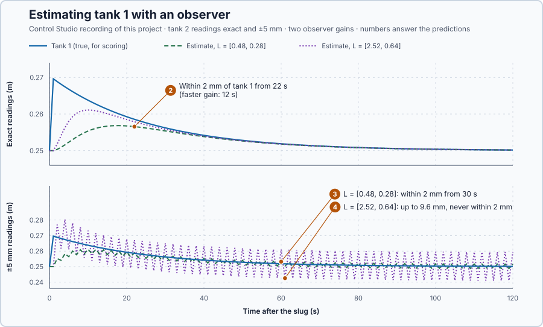

# 78. State observers

In this lesson, you will estimate tank 1's level from tank 2's readings with a model that the readings keep correcting, choose how strongly they correct it, and see how reading noise limits that choice.

## The problem

Lesson 77's state feedback turned the pump down at once after a slug of water, so tank 2 rose only 3.2 mm instead of 7.3 mm. But its law needed both levels, and the real installation measures only tank 2. Working tank 1 out by differentiating tank 2's readings multiplies their noise by 25 s, which makes 5 mm of noise useless.

We will run the tanks' model alongside the tanks, let tank 2's readings correct it, and score its estimate of tank 1 with exact and with noisy readings.

## What we need

We need to:

1. estimate tank 1 from tank 2's readings and the known pump flow, without differentiating the readings;
2. choose how quickly a wrong estimate is corrected; and
3. see how much reading noise reaches the estimate.

## The new idea

An **observer** runs the model alongside the process and corrects the model's states with the difference between what the sensor shows and what the model expected. For the tanks, the model predicts both levels from the pump flow; tank 2's reading shows how far that prediction is off, and the difference pulls both estimates back.

**In words.** The program keeps its own copy of the two tanks and moves it on every update with the model and the pump flow it commanded. The copy has tank 1 too, so it gives an estimate of the level nobody measures. It works like product tracking on a conveyor: the program counts where a product should be from the belt speed, and corrects the count whenever a photo-eye sees the product. The parts:

1. **The prediction.** The copy advances both levels from the known pump flow, as lesson 74's model did.
2. **The comparison.** Tank 2's reading minus the copy's tank 2. If the copy were right, this difference would be zero.
3. **The correction.** Each estimated level moves by its own gain times that difference, tank 1's as well: if tank 2 rises more than the copy expected, tank 1 must hold more water than the copy thinks.

Nothing is differentiated: the model carries the estimate from one reading to the next, and each reading only nudges it. How hard each reading nudges is the design choice: hard nudges correct a wrong estimate quickly but also pass each reading's noise on.

**The formula.**

$$
\dot{\hat x} = A\hat x + Bv + L\,(y - C\hat x) .
$$

- $\hat x$ is the estimated state, the copy's two levels, in metres;
- $A$, $B$ and $C$ are lesson 74's model, and $v$ is the pump correction actually commanded, in cubic metres per second;
- $y$ is tank 2's reading and $C\hat x$ the copy's tank 2; their difference $y - C\hat x$, in metres, is the **innovation**;
- $L = [l_1, l_2]^T$ is the **observer gain**, per second: how fast each estimate moves per metre of innovation.

Subtracting the observer from the tanks, $\dot x = Ax + Bv$ with $y = Cx$, gives the estimation error $e = x - \hat x$:

$$
\dot e = (A - LC)\,e, \qquad A - LC = \begin{bmatrix}-0.04&-l_1\\0.04&-0.04-l_2\end{bmatrix}.
$$

The pump flow cancels, because the copy receives the same flow as the tanks. With an exact model the error therefore dies away on its own, and its poles are the roots of

$$
\det(sI - A + LC) = s^2 + (0.08 + l_2)\,s + 0.0016 + 0.04\,(l_1 + l_2) = 0,
$$

so $L$ places the error's poles as $K$ placed the tanks' poles in lesson 77.

**Example: an observer as fast as lesson 77's feedback.** Place the error poles at −0.08 and −0.12 per second.

1. The polynomial must be $(s + 0.08)(s + 0.12) = s^2 + 0.20s + 0.0096$.
2. Match the $s$ terms: $0.08 + l_2 = 0.20$, so $l_2 = 0.12$ per second.
3. Match the constants: $0.0016 + 0.04\,(l_1 + 0.12) = 0.0096$, so $l_1 + 0.12 = 0.20$ and $l_1 = 0.08$ per second.
4. A slug has put 2 cm into tank 1 that the copy does not know about: $e = [0.02, 0]^T$. At first both tank 2s agree, the innovation is zero and nothing is corrected. After one second tank 2 has risen about $0.04 \cdot 0.02 = 0.0008$ m while the copy's has not: an innovation of 0.8 mm, which raises tank 1's estimate by $0.08 \cdot 0.0008 = 0.000064$ m per second. The observer learns about tank 1 only through tank 2.
5. The error of tank 1's estimate is a mix of the two motions, $e_1(t) = a\,e^{-0.08t} + b\,e^{-0.12t}$. At the start $a + b = 0.02$ m, and its rate is the first row of $(A - LC)e$, $-0.04 \cdot 0.02 = -0.0008$ m/s, so $-0.08a - 0.12b = -0.0008$. Solving the two equations: $a = 0.04$ and $b = -0.02$ m. After 10, 20 and 30 s the error is 11.9, 6.3 and 3.1 mm, and it is within 2 mm after about 36 s (calculated): the slow motion starts twice as large as the error itself, so the error falls slowly at first, while the innovation builds up.
6. A reading 5 mm off moves tank 1's estimate by $0.08 \cdot 0.005 = 0.0004$ m in one second, 0.4 mm; the model carries the estimate on instead of following the reading. Differentiation turned the same 5 mm into 255 mm (lesson 76).

An estimate as slow as the feedback is still wrong while the feedback acts on it, so the observer below is chosen faster than the feedback, to settle first. The program advances the estimate once per second from the old estimate, so with poles $p$ the error shrinks by about $1 + p$ per second, 0.92 and 0.88 in this example.

**The limitation.** Speed and noise pull against each other: a larger $L$ forgets a wrong start faster but moves the estimate further with every noisy reading. The estimate is also only as good as the model, so its error grows far from 0.25 m. The two pole pairs used below, −0.16 and −0.20, and twice that, are a teaching choice that makes the trade-off visible.

## Prediction

Before running, answer these questions:

1. Which $L$ places the error poles at −0.16 and −0.20 per second?
2. Tank 1 holds 2 cm of water the observer does not know about. How long until its estimate is within 2 mm?
3. With ±5 mm reading noise, does the estimate with $L = [0.48, 0.28]^T$ stay within 2 mm?
4. With the same noise, does the estimate with $L = [2.52, 0.64]^T$?

| From the model | Value |
| --- | ---: |
| $L$ for −0.16 / −0.20 | $[0.48, 0.28]^T$ |
| $L$ for −0.32 / −0.40 | $[2.52, 0.64]^T$ |
| Error from 2 cm after 10 s / 20 s / 30 s | 8.0 / 2.2 / 0.5 mm |
| Noise moved per update, slower gain | about 2.4 mm |

## Implementation

Open [`src/Main.st`](src/Main.st). In the experiment the pump runs one second at 0.020 m³/s, 0.01 m³ into tank 1; one second later four `TankObserver`s start: both gains, each once with exact readings of tank 2 and once with readings 5 mm off in alternate directions (`ReadingNoiseM`). Each starts with tank 2 from its reading and tank 1 guessed at rest, so tank 1's estimate starts 2 cm too low. The observers read only tank 2 and the pump flow; `ErrorStatistics` scores tank 1's estimates against the true level from 31 s on.

**Exercise.** Find `ObserverGain1` and `ObserverGain2` and check them by hand for poles −0.16 and −0.20: $l_2 = 0.36 - 0.08 = 0.28$ and $l_1 = (0.032 - 0.0016)/0.04 - 0.28 = 0.48$. Then run [`src/tests.st`](src/tests.st) from the **Testing** view; it checks both gain pairs and two observer steps.

## Experiment in Control Studio

1. Open this lesson's project and start **Simulator**. The tanks rest at 0.25 m with 0.010 m³/s. In the **truST** side bar, select **Control Studio**.
2. On **Identify**, choose **Supplied plant model** from **Method** and open `observer-error-model.json`: the error equations $\dot e = (A - LC)e$ for $L = [0.48, 0.28]^T$.
3. On **Tune**, choose **Poles and zeros** and calculate. Then choose **Initial-state response**, enter **Step (s)** 1, **Duration (s)** 60, **Initial state** `0.02,0` and **Held input** `0`, and press **Calculate initial-state response**.
4. On **Identify**, choose **Project experiment**. **Signals** shows `P1.Tank2M · Process value (m)` and `P1.PumpM3PerS · Applied output (m3/s)`; add `P1.Tank1M · state (m)`, `P1.CleanEstimate1M · state (m)` and `P1.CleanFastEstimate1M · state (m)`.
5. Answer the predictions, select **Review project test** and check the declared **123 s**; select **Confirm and start**. The slug comes at the program's next one-second update, about 2 s later; times below count from it.
6. After the run, hover 11 s, 21 s and 22 s after the slug. Then show `P1.NoisyReadingM`, `P1.NoisyEstimate1M` and `P1.NoisyFastEstimate1M`, and finally the four RMS errors `P1.CleanRmsM`, `P1.CleanFastRmsM`, `P1.NoisyRmsM` and `P1.NoisyFastRmsM`, and hover the end.
7. At completion Control Studio shows **Project test completed. Outputs restored.**

Select **Abort test** to stop early; to repeat, restart **Simulator** so the tanks start at rest.

## Evidence and decision

The numbered marks answer predictions 2–4. **Poles and zeros** answers prediction 1: the error poles are at −0.2 and −0.16, so $L = [0.48, 0.28]^T$ places them. **Initial-state response** predicts the error from 0.02 m: 8.0 mm after 10 s, 2.2 mm after 20 s and 0.5 mm after 30 s.

The slug put tank 1 19.6 mm above rest, and every observer started 19.6 mm low. From Control Studio's recording:

| Readings, gain | Within 2 mm from | RMS error from 31 s | Peak error from 31 s |
| --- | ---: | ---: | ---: |
| Exact, $L = [0.48, 0.28]^T$ | 22 s | 0.21 mm | 0.77 mm |
| Exact, $L = [2.52, 0.64]^T$ | 12 s | 0.12 mm | 0.38 mm |
| ±5 mm, $L = [0.48, 0.28]^T$ | 30 s | 1.43 mm | 1.96 mm |
| ±5 mm, $L = [2.52, 0.64]^T$ | never | 9.19 mm | 9.57 mm |

2. With exact readings the slower observer closed the gap to 7.5 mm after 10 s and 2.2 mm after 20 s, as the model predicted, and stayed within 2 mm from 22 s; the faster one from 12 s.
3. With noisy readings the slower observer stayed within 2 mm from 30 s, with an RMS error of 1.43 mm. Differentiating the same readings would have given errors of 255 mm.
4. The faster observer never settled within 2 mm: its estimate swung up to 9.6 mm, further than the reading noise itself.

The observer with $L = [0.48, 0.28]^T$ is accepted for these tanks with 5 mm of reading noise: it costs 10 s more to settle than the faster gain, and gains a sixfold smaller error. The faster gain is rejected. The estimate relies on the model, so its error grows far from 0.25 m. These are simulation results; the true tank 1 level was used only to score the estimates.

## Conclusion

An observer carries the estimate forward with the model and corrects it with the innovation; its gain sets how fast a wrong start dies away, as the feedback gain sets how fast the tanks recover.

The same gain decides how much reading noise reaches the estimate: for these tanks the slower observer estimated tank 1 within 2 mm from noisy readings, and the faster one could not.

## Check yourself

1. **For error poles at −0.12 and −0.16 per second, what is $L$?**
   $(s + 0.12)(s + 0.16) = s^2 + 0.28s + 0.0192$, so $l_2 = 0.20$ and $l_1 = (0.0192 - 0.0016)/0.04 - 0.20 = 0.24$ per second.
2. **Why does the pump flow not affect the estimation error?**
   The observer feeds the same pump flow into its model as the tanks receive, so the flow cancels in $e = x - \hat x$.
3. **Why did the faster observer do worse with noisy readings?**
   Its larger gain moves the estimate further with every noisy reading, so it follows the noise instead of averaging
   it out.

## Reason for the next lesson

We chose $L$ from how fast errors should die away, and only the noisy run showed whether that was wise. A faster correction does not say how to weigh an uncertain model against a noisy sensor.

[Kalman filtering](../71-kalman-filter/README.md) calculates the gain from how uncertain the model and the readings are.
