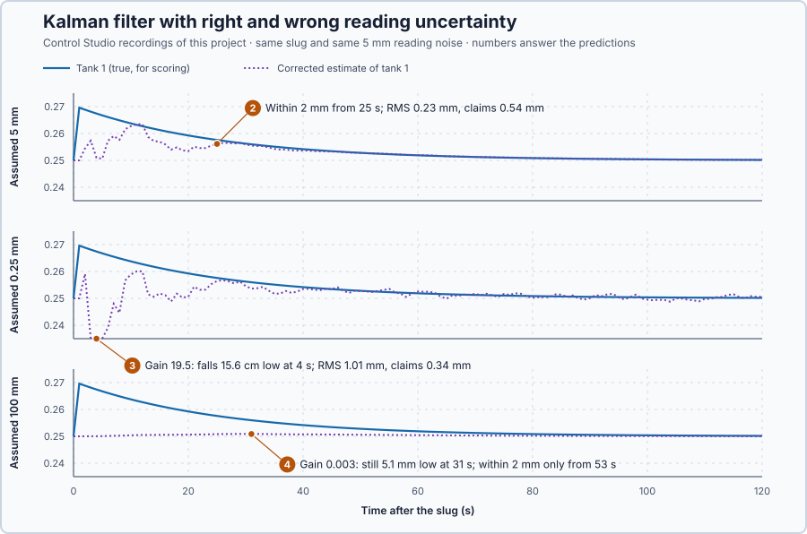

# 79. Kalman filtering

This lesson is an introduction to Kalman filtering. You will let the uncertainty of the model and of the reading set the observer's correction, and see what a wrong assumption about the reading does to the estimate and to the filter's own claim of accuracy.

## The problem

Lesson 78's observer with $L = [0.48, 0.28]^T$ estimated tank 1 within 2 mm from 30 s with noisy readings, while the faster gain never settled within 2 mm. The gain was chosen for a speed, and only the noisy run showed which choice was better: nothing in the choice weighed the model against the sensor. Yet the size of each error is roughly known: the model drifts a little each second, and tank 2's reading is off by about 5 mm.

We will let those two uncertainties set the correction every second, and test what happens when the assumed reading uncertainty is right and when it is wrong.

## What we need

We need to:

1. weigh the model's prediction against the reading by how uncertain each is;
2. recalculate that weighting every second as the estimate improves; and
3. check the estimate, and the accuracy the filter claims, against the true level.

## The new idea

A **Kalman filter** blends the model's prediction with the measurement, trusting each in proportion to how certain it is: the noisier the sensor, the less the estimate follows it. For the tanks it is an observer whose gain is calculated, every second, from how uncertain the model and tank 2's reading are.

**In words.** Lesson 78's observer nudged its copy of the tanks with a fixed gain that we chose for speed. A Kalman filter calculates the nudge at every update from two uncertainties: how far the copy's prediction is probably off, and how far the reading is probably off. It is like combining two redundant transmitters on one level: you give the more reliable one more weight. Here the two sources are the model's prediction and the sensor. The parts:

1. **Predict.** The copy moves on with the model, as in lesson 78. Its uncertainty grows a little every second, because the model is not perfect.
2. **Weigh.** The weight of the reading follows from the two uncertainties: a certain prediction and a noisy reading give a small weight; an uncertain prediction and a good reading give a large one.
3. **Correct.** The estimate moves by the weight times the disagreement, and its uncertainty shrinks: the blend is more certain than either source alone.

The filter also keeps track of how the errors of the two levels go together. Tank 2 is fed by tank 1, so when the copy's tank 1 is too low, its tank 2 soon comes out too low as well; that link lets a reading of tank 2 correct tank 1. For the tanks this means: tell the filter how much the model drifts each second and how noisy tank 2's reading is, and it calculates the best correction every second, together with how sure it is of its estimate.

> **Math you need: variance and covariance.** The **variance** of an error is the mean of its square: errors of +2, −2, +2 and −2 mm have variance 4 mm², and its square root, 2 mm, is the **standard deviation**. The **covariance** of two errors is the mean of their product: positive when they tend to have the same sign. For a vector of errors the variances and covariances form a matrix.

**The formula.** For one measured quantity, let:

- $\hat x^-$ be the prediction before the reading, with error variance $P^-$;
- $z$ be the reading, with error variance $R$;
- $K$ be the weight given to the disagreement $z - \hat x^-$; and
- $\hat x^+$ be the corrected estimate.

The corrected estimate and the best weight are

$$
\hat x^+ = \hat x^- + K(z - \hat x^-), \qquad K = \frac{P^-}{P^- + R}.
$$

Why this $K$: the corrected error is $(1 - K)$ times the prediction error plus $K$ times the reading error, so for independent errors its variance is $(1 - K)^2P^- + K^2R$. Setting its derivative $-2(1 - K)P^- + 2KR$ to zero gives that $K$, and the corrected variance is then $P^+ = (1 - K)P^-$. Worked number: the model predicts a level of 10 cm with a standard deviation of 2 cm, $P^- = 4$ cm², and the sensor reads 12 cm with a standard deviation of 1 cm, $R = 1$ cm². Then $K = 4/5 = 0.8$ and $\hat x^+ = 10 + 0.8 \cdot 2 = 11.6$ cm: the estimate moves most of the way towards the better source. Its variance is $0.2^2 \cdot 4 + 0.8^2 \cdot 1 = 0.8$ cm², smaller than either source's.

For the two tanks the same idea runs once per second, with matrices:

1. **Predict:** $\hat x^- = A_d\hat x^+ + B_dv$ and $P^- = A_dP^+A_d^T + Q$.
2. **Correct:** $K = P^-C^T(CP^-C^T + R)^{-1}$, $\hat x^+ = \hat x^- + K(y - C\hat x^-)$ and $P^+ = (I - KC)P^-$.

- $A_d = \begin{bmatrix}0.96&0\\0.04&0.96\end{bmatrix}$ and $B_d = [2, 0]^T$ are lesson 74's one-second model;
- $P$ is the error covariance matrix, in m²: the two levels' error variances on the diagonal and their covariance off it;
- $Q$ is the model's own new error per second, in m²;
- $C = [0, 1]$, $y$ is tank 2's reading, and $R = \sigma^2$ is its error variance for an assumed standard deviation $\sigma$, in m²;
- $K = [K_1, K_2]^T$ holds the weights for tank 1 and tank 2, in metres of correction per metre of disagreement at tank 2;
- $I$ is the identity matrix.

With $C = [0, 1]$, $CP^-C^T$ is just $P^-_{22}$, so $K_2 = P^-_{22}/(P^-_{22} + R)$ is the one-quantity weight, and $K_1 = P^-_{12}/(P^-_{22} + R)$ uses the covariance.

**Example: the filter's first second.** The program uses $Q = \mathrm{diag}(10^{-8}, 10^{-8})$ m², about 0.1 mm of model error per second, and starts with tank 1 unknown within about 2 cm: $P = \mathrm{diag}((20\ \text{mm})^2, (5\ \text{mm})^2)$, that is 400 and 25 mm². With the true reading noise, $R = (5\ \text{mm})^2 = 25$ mm². In mm²:

1. Predict: $P^-_{11} = 0.96^2 \cdot 400 + 0.01 = 368.7$, $P^-_{12} = 0.96 \cdot 0.04 \cdot 400 = 15.4$ and $P^-_{22} = 0.04^2 \cdot 400 + 0.96^2 \cdot 25 + 0.01 = 23.7$. Tank 1 is uncertain by $\sqrt{368.7} = 19.2$ mm and tank 2 by 4.9 mm; the covariance is positive because tank 1's error has started to flow into tank 2.
2. Weigh: $K_2 = 23.7/(23.7 + 25) = 0.487$ and $K_1 = 15.4/48.7 = 0.316$.
3. Correct: if tank 2 reads 1 mm above its prediction, tank 2's estimate moves up 0.49 mm and tank 1's 0.32 mm, although tank 1 is not measured.
4. Uncertainty after: $P^+_{22} = (1 - 0.487) \cdot 23.7 = 12.2$ mm², so tank 2 is now uncertain by 3.5 mm; $P^+_{11} = 368.7 - 0.316 \cdot 15.4 = 363.8$ mm², so tank 1 only by 19.1 instead of 19.2 mm. One reading of tank 2 says little about tank 1 yet; as tank 1's water shows up at tank 2 over the next seconds, the covariance, and with it tank 1's weight, grows.

**The limitation.** $P$ is what the filter believes about its error, calculated from $A_d$, $Q$ and $R$ without a single reading: after the first second it claims tank 1 within 19.1 mm whatever the readings said. If $R$ is wrong, the weights and the claimed accuracy are both wrong. The three values of $\sigma$ below, the true 5 mm, 0.25 mm and 100 mm, are a teaching choice that shows both mistakes.

## Prediction

Before running, answer these questions:

1. Which assumed $\sigma$ gives tank 1's estimate the largest weight in the first seconds, and which the smallest?
2. With the true $\sigma = 5$ mm, from when is the estimate within 2 mm of tank 1?
3. Assuming $\sigma = 0.25$ mm, trusting the reading too much, what happens to the estimate and to the claimed accuracy?
4. Assuming $\sigma = 100$ mm, trusting the model too much, what happens?

| Assumed $\sigma$ | $R$ against the truth | Weight on tank 1 | Expected behaviour |
| --- | ---: | --- | --- |
| 5 mm | right | between the others | settles near 25 s, honest claim |
| 0.25 mm | 400 times too small | largest | follows the noise, claims too much |
| 100 mm | 400 times too large | smallest | smooth but late |

## Implementation

Open [`src/Main.st`](src/Main.st). The rig has Lesson 78's tanks and slug. Tank 2's reading carries noise with a 5 mm standard deviation from `ReadingNoise`, a fixed sequence that restarts with each experiment, so every run reads the same noise. `TankKalmanFilter` predicts and corrects once per second; it reads only tank 2 and the pump flow, and starts one update after the slug with tank 1 guessed at rest. `AssumedReadingSdM` is a Control Studio experiment setting, and $R$ is its square. `ErrorStatistics` scores the corrected estimate against the true level from 31 s, and also the RMS error the filter claims from its own variance.

**Exercise.** Work the worked example by hand: $K = 4/(4 + 1) = 0.8$, $\hat x^+ = 11.6$ cm, variance 0.8 cm². Then run [`src/tests.st`](src/tests.st) from the **Testing** view; it checks this example, the minimum variance at that $K$ and the filter's first prediction and correction.

## Experiment in Control Studio

1. Open this lesson's project and start **Simulator**. The tanks rest at 0.25 m with 0.010 m³/s. In the **truST** side bar, select **Control Studio**.
2. On **Identify**, choose **Project experiment** from **Method**. Under **Declared experiment settings**, **Assumed Reading Sd M** shows 0.005 (m, 0.0001–0.2). Press **Inspect experiment parameters**, keep 0.005, press **Review parameter values** and then **Apply reviewed values**; Studio confirms the applied values.
3. **Signals** shows `P1.Tank2M · Process value (m)` and `P1.PumpM3PerS · Applied output (m3/s)`; add `P1.Tank1M · state (m)`, `P1.CorrectedTank1M · state (m)` and `P1.PredictedTank1M · state (m)`.
4. Answer the predictions, select **Review project test** and check the declared **123 s**; select **Confirm and start**. The slug comes at the program's next one-second update, about 2 s later; times below count from it.
5. After the run, hover 11 s, 25 s and 31 s after the slug. Show `P1.GainTank1 · state (1)` and hover 3 s after the slug. Show `P1.RmsM`, `P1.ClaimedRmsM` and `P1.PeakM`, and hover the end.
6. Restart **Simulator** and repeat with **Assumed Reading Sd M** 0.00025 and then 0.1: edit the value, review and apply it before each run.
7. At the end of each run Control Studio shows **Project test completed. Outputs restored.**

Select **Abort test** to stop early.

## Evidence and decision

The numbered marks answer predictions 2–4, and the table's gain column answers prediction 1: the smaller the assumed reading uncertainty, the larger the weight on tank 1, from 0.0028 to 19.5. The slug put tank 1 19.6 mm above rest, and every filter started 19.6 mm low. From Control Studio's three recordings:

| Assumed $\sigma$ | Gain on tank 1 at 3 s | Error at 11 s | Within 2 mm from | RMS error from 31 s | Claimed RMS error |
| --- | ---: | ---: | ---: | ---: | ---: |
| 5 mm, true | 0.57 | +0.2 mm | 25 s | 0.23 mm | 0.54 mm |
| 0.25 mm | 19.5 | −3.2 mm | 39 s | 1.01 mm | 0.34 mm |
| 100 mm | 0.0028 | −12.8 mm | 53 s | 1.87 mm | 2.08 mm |

2. With the true $\sigma$ the estimate was within 2 mm from 25 s, against 30 s for Lesson 78's observer with noisy readings, and its RMS error of 0.23 mm stayed within the 0.54 mm it claimed.
3. Assuming 0.25 mm made $R$ 400 times too small. The gain on tank 1 reached 19.5, so each millimetre of disagreement at tank 2 moved tank 1's estimate by 19.5 mm, and the noise threw it 15.6 cm low at 4 s. It settled only from 39 s, with an RMS error of 1.01 mm while it claimed 0.34 mm: three times worse than it believed.
4. Assuming 100 mm, the filter hardly used the readings; its estimate approached the true level only as tank 1 drained by itself, still 5.1 mm low at 31 s. It was the smoothest and the least accurate, and it claimed 2.08 mm: knowing it was uncertain did not make it better.

The benefit of the filter is a gain that follows from the uncertainties instead of a guess; its cost is that it needs those uncertainties right. The filter with the reading's true standard deviation is accepted; both wrong assumptions are rejected. The model is local and the noise uniform, not Gaussian; these are simulation results, and the true level was used only for scoring.

## Conclusion

A Kalman filter sets the observer gain from the uncertainty of the model and of the measurement, and recalculates it every second.

It is only as good as those uncertainties: too small a reading uncertainty makes the estimate follow the noise while the filter claims an accuracy it does not have; too large makes it smooth, late and poor.

## Check yourself

1. **Prediction 20 cm with $P^- = 1$ cm², reading 22 cm with $R = 3$ cm². What are $K$ and $\hat x^+$?**
   $K = 1/(1 + 3) = 0.25$ and $\hat x^+ = 20 + 0.25 \cdot 2 = 20.5$ cm.
2. **Why did the filter that assumed 0.25 mm claim a better accuracy than it had?**
   Its claimed accuracy comes from $P$, which it calculates from the assumed $R$, not from the readings; a too-small
   $R$ makes $P$ too small.
3. **How can a filter correct tank 1, which it never measures?**
   Through the covariance between the two errors: the gain on tank 1 is $P^-_{12}/(P^-_{22} + R)$, nonzero because the
   model links tank 2's error to tank 1's.

## Reason for the next lesson

The filter weighed the model against the reading. But estimation does not decide how much pump effort is worth spending to correct the levels.

[LQR control](../69-lqr/README.md) chooses the feedback gains by weighing level deviations against pump effort.
